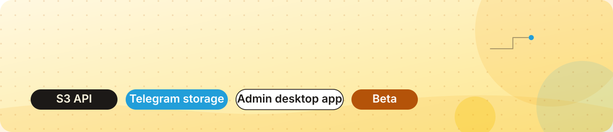
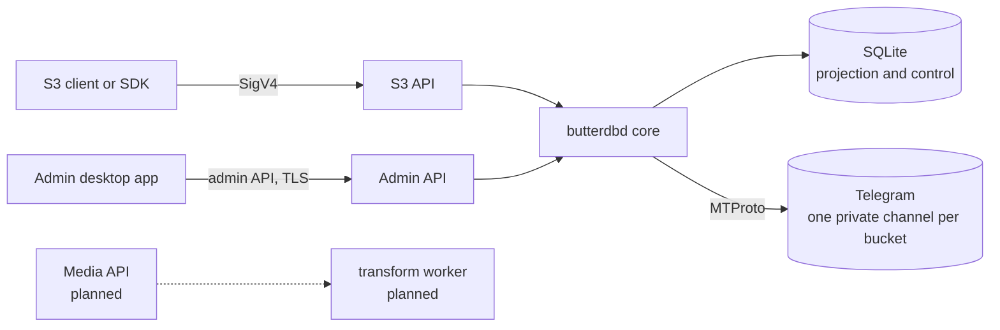

<p align="center">
  
</p>

<h1 align="center">butterDB</h1>

<p align="center">
  <b>S3-compatible object storage that keeps its bytes in your own Telegram account.</b>
</p>

<p align="center">
  
  
  
</p>

<p align="center">
  
</p>

---

## What is butterDB?

butterDB is a self-hosted object store. Any tool that speaks the S3 protocol
(the AWS SDKs, `aws s3`, rclone and similar) can read and write objects through
it. The bytes are not kept on your disk or in a cloud bucket. They are stored
as messages in private Telegram channels that belong to the account you deploy
with.

There is no hosted service, no shared credential and no third party in the
path. You run the server, you own the Telegram account, and you hold the keys.

## How it works



- **Buckets are Telegram channels.** Each bucket is a private channel. A
  registry channel holds the bucket configuration.
- **An object is two messages.** A hidden body document holds the bytes, and a
  small `t=put` control message commits it. The put message is the commit point.
- **A successful PUT is durable.** butterDB replies only after Telegram accepts
  the object and the local projection has applied it.
- **Local state is rebuildable.** The SQLite projection is derived from the
  Telegram history, so it can be rebuilt if the local database is lost.
- **Encryption is optional.** Objects can be encrypted per bucket or per
  request with the TDE1 format. Keys are wrapped by a server key file.
- **Deletes are hard.** A delete removes the object immediately.

The server is a headless Go binary, `butterdbd`. The admin app is a remote
client of the admin API and never holds a Telegram session.

## Beta status

| Area | Status |
|---|---|
| Foundation: config, logging, lifecycle, errors, limits | Done |
| Storage engine: projector, rebuild, TDE1 streams, keyring | Done |
| Telegram transport: sends, ranged reads, identity, `setup` and `tgprobe` | Done |
| Buckets and sync: registry, channels, history scan, live sync | Done |
| Write path: spool, put, delete, admission, job sweeper, multipart | Done |
| Read path: range reader, block cache, decryption, conditional requests | Done |
| S3 API: access keys, SigV4 (header, presigned, chunked), bucket policy, object and list operations | Done |
| Admin API: setup token, device pairing, admin handlers, `api/adminv1` client | Done |
| Admin desktop app (Fyne): connect, buckets, keys, objects, dashboard, settings | In progress, awaiting owner review |
| Operations and first release (`v0.1.0`): health, metrics, snapshot and restore, deploy files | Planned |
| Replica account (`v0.2.0`): second account mirror, backfill, read fallback | Planned |
| Media transforms (`v0.3.0`): resize and convert on request, derivative cache | Planned |

Beta means the storage and S3 layers are feature-complete and tested, but
butterDB has not yet had its first tagged release. Do not rely on it for data
you cannot afford to lose.

## Quick start

### Prerequisites

- Go 1.26 or newer
- A Telegram account, plus Telegram API credentials (`api_id` and `api_hash`)
- Linux, macOS or Windows. For the admin app you also need cgo and OpenGL.

### 1. Clone and build

```bash
git clone https://github.com/PRIEYAN/ButterDB.git
cd ButterDB
CGO_ENABLED=0 go build -trimpath -mod=readonly -o bin/butterdbd ./cmd/butterdbd
```

Or, with [Task](https://taskfile.dev), run `task build`.

### 2. Configure

butterDB reads its settings from environment variables, or from a TOML file
passed with `--config <path>` (or `BUTTERDB_CONFIG`). At minimum, set:

```bash
export BUTTERDB_DATA_DIR="$PWD/data"
export BUTTERDB_SERVER_KEY_FILE="$PWD/secrets/server.key"
```

The server key file must exist before the server starts. Keep it secret and
back it up. Without it, encrypted objects cannot be read. See
[`docs/spec/security.md`](docs/spec/security.md) for how it is used.

Check the configuration:

```bash
bin/butterdbd check-config
```

### 3. Link Telegram and start the server

```bash
bin/butterdbd setup     # links your Telegram account
bin/butterdbd serve     # starts the S3 and admin listeners
```

Run `bin/butterdbd help` for the full list of subcommands, including `tgprobe`,
`admin-token`, `rebuild`, `snapshot` and `restore`.

### 4. Point a client at it

Create an access key through the admin API or the admin app, then use it like
any S3 endpoint:

```bash
aws --endpoint-url http://127.0.0.1:<s3-port> s3 mb s3://photos
aws --endpoint-url http://127.0.0.1:<s3-port> s3 cp ./cat.jpg s3://photos/
```

Replace `<s3-port>` with the S3 listener address from your configuration.

### 5. Admin desktop app (optional)

```bash
task gui                       # or: go -C apps/admin build -o ../../bin/butterdb-admin .
```

Packaging for Windows, Linux and macOS is described in
[`docs/guide/admin-app-build.md`](docs/guide/admin-app-build.md).

## Development

| Command | What it does |
|---|---|
| `task test` | Runs the unit and acceptance tests |
| `task race` | Runs the tests with the race detector |
| `task layering` | Checks the import rules between layers |
| `task nocomments` | Checks the comment policy |
| `task verify` | Runs the full verification script |

Contributor rules live in [`CLAUDE.md`](CLAUDE.md) and
[`docs/claude.md`](docs/claude.md).

## Documentation

- [`docs/plan.md`](docs/plan.md): the phased build plan and release cut lines
- [`docs/decisions.md`](docs/decisions.md): every product and engineering decision, by ID
- [`docs/spec/`](docs/spec): the specifications (storage model, S3 API, admin API, security, operations)
- [`docs/guide/`](docs/guide): operator guides

## License

Licensed under the Apache License, Version 2.0. See [`LICENSE`](LICENSE).
