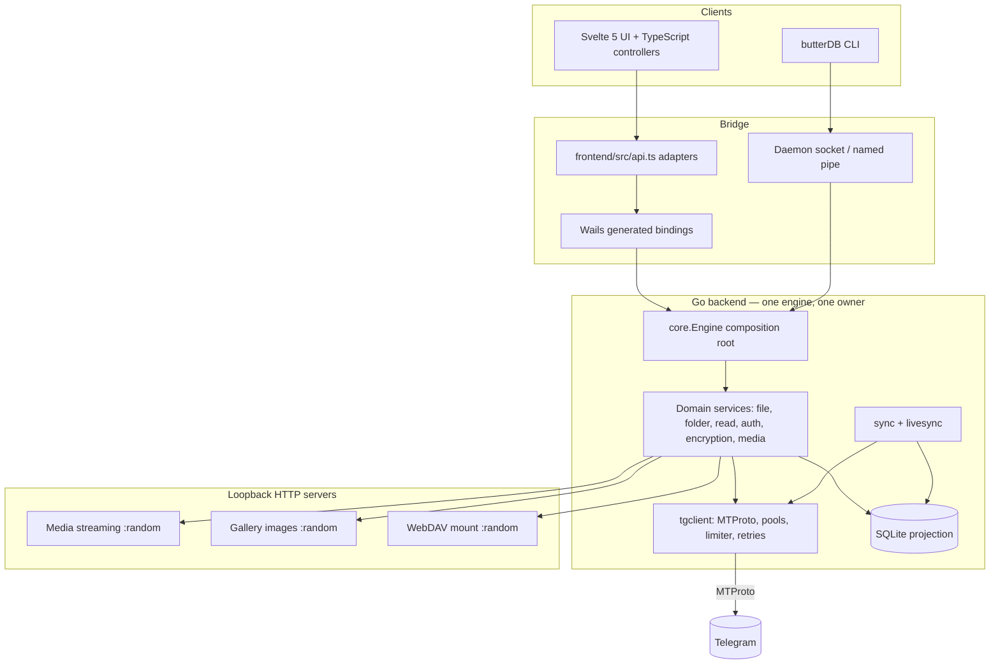
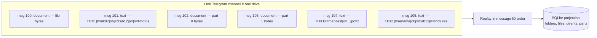
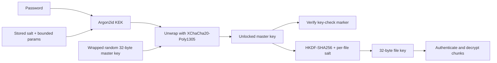
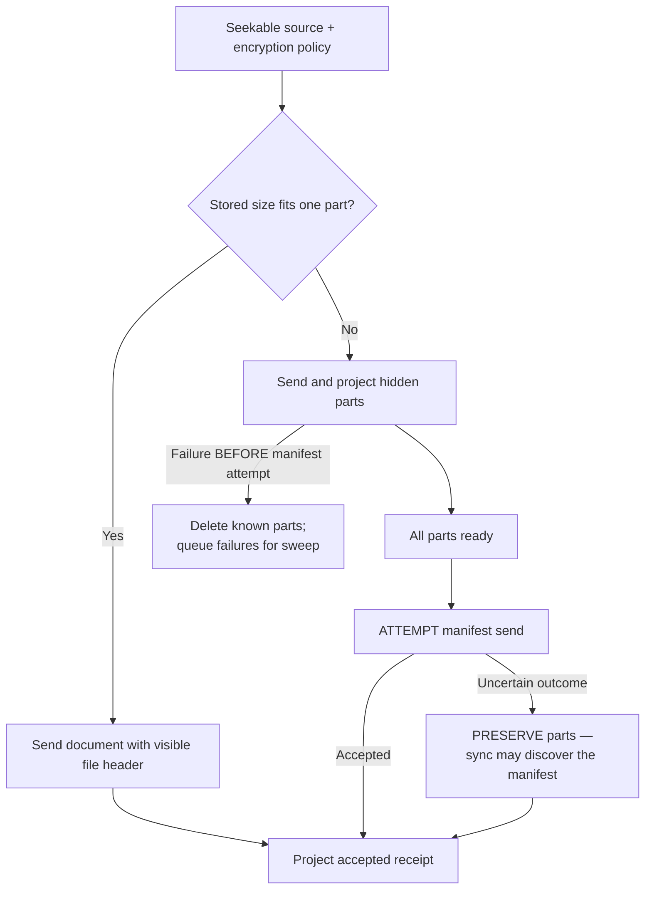
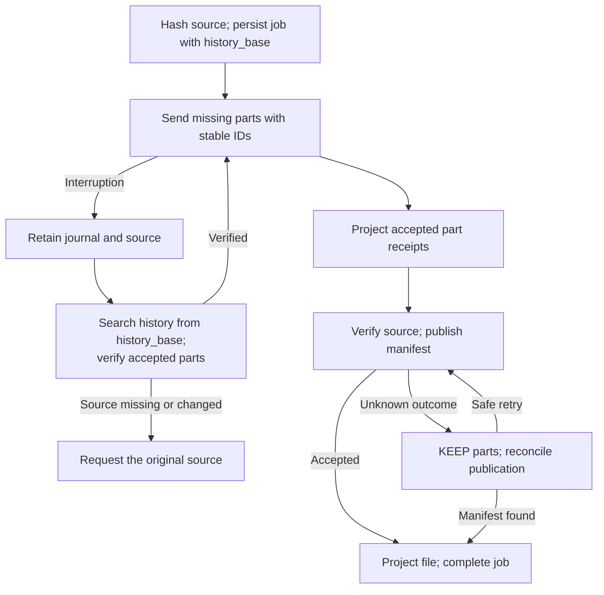
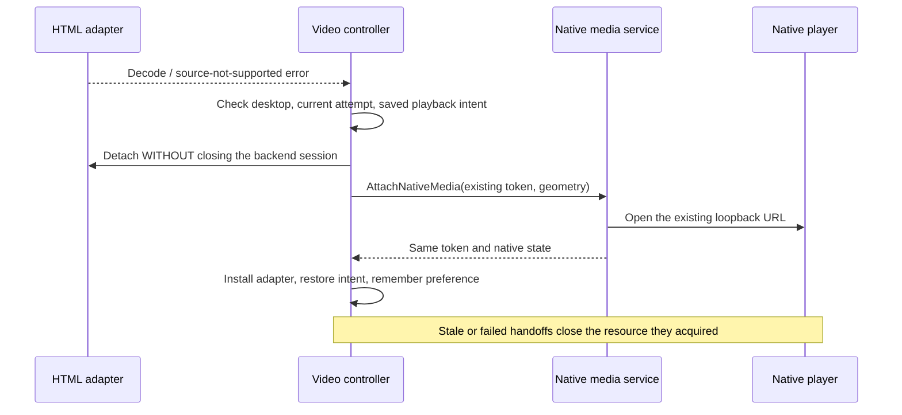
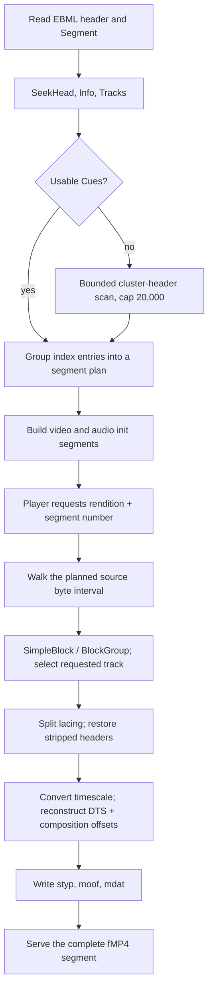
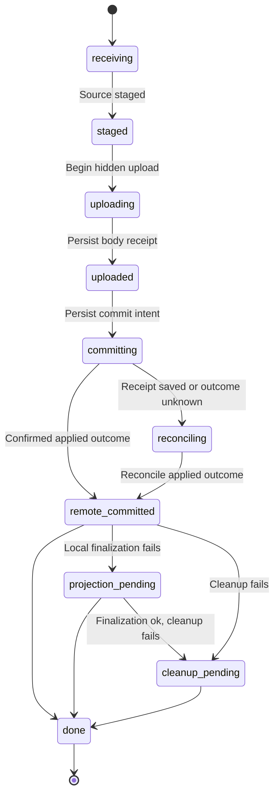
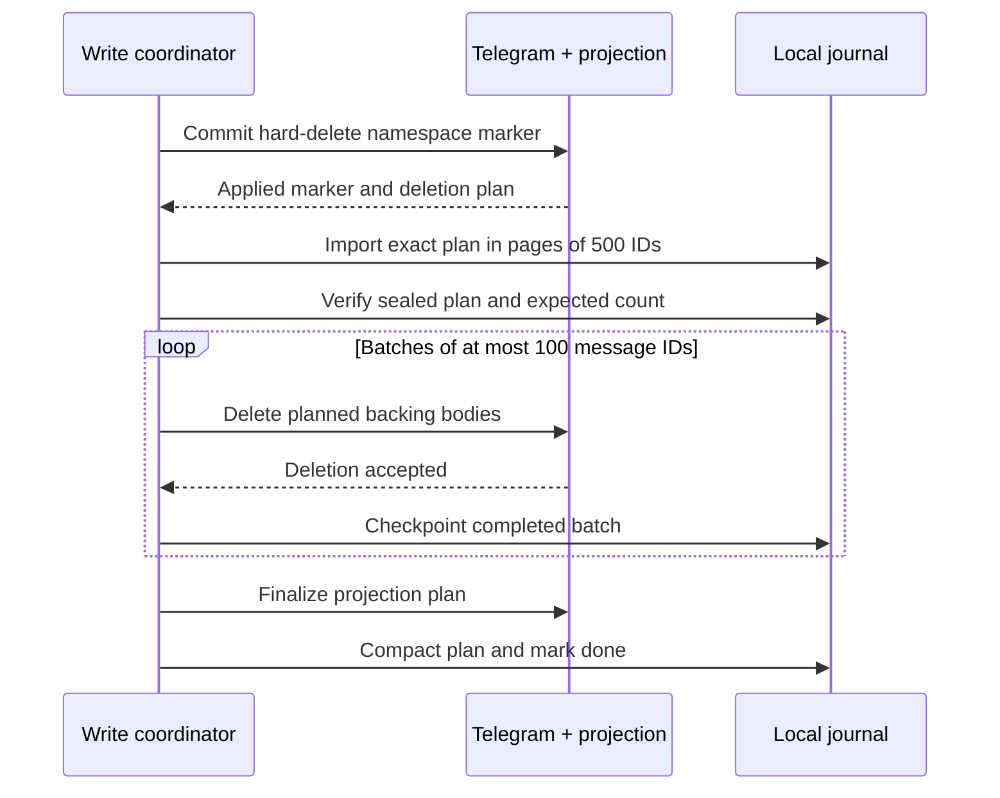

# butterDB — Complete Build Specification

**Everything needed to build butterDB from scratch, in one file.**

butterDB turns a Telegram account into a personal cloud drive: a desktop and mobile
file manager with media streaming, client-side encryption, shared drives, an OS
mount, and a scriptable CLI. This document specifies it completely — the formats
byte-for-byte, the database schema as runnable DDL, the algorithms as pseudocode,
the exact Telegram RPCs, the toolchain, and a staged implementation plan.

---

## 0. How to use this document

### What this file is

A **specification**, not a code dump. The real implementation is roughly 89,000
lines of Go across 399 files plus a Svelte frontend; no single Markdown file can
contain that, and a copy of it would be worth less than this is. What you get
instead is the part that is genuinely hard to recover from source:

- **Every wire format and on-disk format specified exactly** — TDX1 operations,
  the TDE1 encryption container, the HLS output, the daemon protocol. These are
  compatibility surfaces. Get a byte wrong and you corrupt user drives.
- **The complete database schema as runnable DDL**, with the invariants each
  index enforces.
- **Every algorithm that carries a correctness requirement** as pseudocode —
  upload commit boundaries, resumable download checkpointing, range reading,
  authenticated random access, sync coverage.
- **Every tuning constant**, with the reasoning behind it.
- **The exact toolchain, configuration files and build commands.**
- **A 12-milestone implementation roadmap** with acceptance criteria.

What you write yourself is the ordinary connective tissue: UI components, SQL
query helpers, error plumbing, platform glue. That is the easy, mechanical part —
and the part where your judgement should differ from the original's.

### Reading order

| If you are | Read |
| --- | --- |
| Deciding whether to build this | Part I |
| Setting up to write code | Part II, then §24 (roadmap) |
| Implementing a subsystem | Its spec in Part III — they are self-contained |
| Debugging something subtle | §26 (invariants), §27 (constants) |
| Looking up a word | §28 (glossary) |

### Contents

**Part I — Orientation** · §1 What you are building · §2 Architecture · §3 The storage model

**Part II — Environment** · §4 Toolchain · §5 Project scaffolding · §6 First build

**Part III — Specifications** · §7 Telegram integration · §8 TDX1 wire format ·
§9 SQLite projection · §10 The projector · §11 Sync engine · §12 TDE1 encryption ·
§13 Vault · §14 Upload · §15 Download · §16 Range transport · §17 Media streaming ·
§18 HLS remux · §19 WebDAV mount · §20 Daemon protocol

**Part IV — Clients** · §21 Wails service surface · §22 Frontend

**Part V — Ship** · §23 Build & package · §24 Tests

**Part VI — Execution** · §25 Implementation roadmap · §26 Walkthroughs ·
§27 Invariants & failure modes · §28 Constants · §29 Glossary

---

# PART I — ORIENTATION

## 1. What you are building

### The product

A file manager whose backing store is the user's own Telegram account.

- **My Drive** — a private Telegram broadcast channel, owned by the user.
- **Shared drives** — Telegram megagroups whose members collaborate.
- Nested folders, rename, move, drag-and-drop, search, trash.
- Files larger than 2 GB, split across messages, presented as one file.
- Streaming playback of video and audio directly from Telegram, including
  encrypted media, with byte-range seeking.
- Optional client-side XChaCha20-Poly1305 encryption of personal-drive contents.
- Mount as a drive in Finder / Explorer / a Linux file manager over local WebDAV.
- A CLI with a JSON mode for scripting.
- Desktop (macOS, Windows, Linux), Android, iOS.

### Five decisions that define the architecture

Make these differently and you are building a different program.

**1. It is a local-first app, not a web service.**
No server, no Docker deployment, no reverse proxy, no `.env`. A Go backend
compiled into a Wails v3 shell with a Svelte 5 UI embedded in the binary. A CLI
drives the same backend through a local daemon.

**2. It speaks MTProto as a logged-in user, not the Bot API.**
Transport is `github.com/gotd/td`. The user supplies their own `api_id` and
`api_hash` from my.telegram.org. There is no bot token and no shared project
credential. This is what makes per-account storage and 2 GB documents possible.

**3. The filesystem is an event log living in chat history.**
File *bytes* are Telegram document messages. Folders, renames, moves, deletes and
vault configuration are tiny text messages whose first line is a `TDX1|...`
header. There is no server-side database; the namespace is replayed from messages.

**4. SQLite is a projection, not the source of truth.**
It is derived state, rebuildable from the replay log without any network access.
This is what makes "install on a second device and see your drive" work.

**5. Publication and projection are separate events.**
Telegram accepting a message and SQLite committing its effect are two facts. The
system is designed around the gap between them. This single decision is why
uploads have idempotency keys, why mounted writes have a journal, and why "an
error does not prove a send failed" is repeated throughout this document.

### What "unlimited" actually means

Telegram caps a single document at ~2 GiB. butterDB splits larger files, but
applies its own ceilings:

| Limit | Value | Why |
| --- | --- | --- |
| Stored bytes per Telegram message | 1900 MiB | Under 2 GiB so encryption overhead cannot push a part over |
| Stored size per logical file | 40 GiB | Beyond this the part count is unwieldy |
| Parts per file | 32 | Defence in depth alongside the size cap |
| Resumable-journal threshold | 2,000,000,000 bytes | Separate from the split boundary |

A file over 40 GiB is refused, not truncated. An empty file is refused —
Telegram rejects an empty document with `FILE_PART_LENGTH_INVALID`.

### What butterDB deliberately does not have

| Absent | What exists instead |
| --- | --- |
| butterDB accounts, JWTs, password hashing, roles | Identity **is** the Telegram account; authorization is channel membership |
| Content deduplication | `content_hash` verifies downloads and keys rendition caches; it never skips an upload |
| Full-text search | `LIKE ? COLLATE NOCASE` over names |
| A public HTTP API | The Wails bridge, a daemon socket, and three loopback-only HTTP servers |
| Transcoding | Remux only — compressed frames are repackaged, never re-encoded |
| Background sync daemons on mobile | Explicit, bounded foreground work with honest limits |

---

## 2. Architecture

### Component map



### The single-owner rule

`core.Engine` is the headless composition root. The GUI and the CLI daemon are
**alternative owners** of exactly one engine — never two at once.

Enforced by an OS exclusive lock on a persistent `backend.lock.guard` file:

- The GUI quits if acquisition fails.
- Daemon startup returns an error.
- Process death releases the lock without trusting a recorded PID.
- A separate `backend.lock` holds versioned role/PID diagnostics.
- Neither file is deleted on release, so contenders keep one guard inode.

Build this early. Every "why is the database locked" bug downstream traces back
to two engines running.

### Engine construction order

```
1. Clean cache temp directories            → FATAL on failure
2. Build the Telegram adapter              (default path installs live updates)
3. Connect to Telegram                     → WARNING only; engine stays usable offline
4. InitDB + EnsureSchema                   → FATAL on failure
5. Construct domain services               → FATAL on failure
6. Load saved personal channel from config → distinguishes unconfigured vs invalid
```

Two subtleties worth encoding from day one:

- **A failed Telegram connection is not fatal.** Users must be able to browse
  their projection offline. Only local-state failures block construction.
- **Injecting a custom client or connect function silently skips live-update
  installation.** Tests and alternate hosts must not assume live sync started.

### GUI startup and shutdown

Startup:

```
mobile storage path overrides   (Android HOME is /sdcard; must precede engine)
  → acquire process lock         (quit on failure)
  → logging + updater init
  → core.New                     (on failure: close logging, release lock, quit)
  → photo-backup ledger          (warn only)
  → mount controller             (warn only, retryable)
  → trash sweep start
  → update cleanup               (receives the mount result: a broken mount
                                  preserves the rollback copy)
  → release WaitForBackendReady waiters
```

Shutdown, in strict reverse-dependency order:

```
1. Shut down the mount controller with a bounded context
2. Stop trash sweeping; close native media and gallery image sessions
3. Stop and close photo backup (worker then ledger)
4. Close the engine → stops live sync, cancels and joins backfill,
   closes the media service, closes Telegram transport
5. Close logging, release the process lock
```

Login-success events can arrive while the engine is still being constructed, so
authenticated background work resumes only after publication — without blocking
the event callback.

---

## 3. The storage model

This is the heart of the design. Read it twice.

### Two planes



- **Byte plane** — Telegram document messages hold file content. Immutable.
- **Operation plane** — Telegram text messages hold namespace changes. Append-only.

Both live in the same channel history, interleaved. A client with no local state
reads the channel from message 1 and reconstructs the entire filesystem.

### Identity

**A file's identity is the message ID of its header-carrying message.**

| Upload shape | Identity |
| --- | --- |
| Single document | The document message itself (which carries the `t=f` header in its caption) |
| Multipart | The `t=manifest` **text** message |

Part messages carry `t=part` and never enter the `files` table, so they can never
be mistaken for orphans or appear as user-visible files.

Object IDs are prefixed by kind:

- `d:` — folders (`FolderIDPrefix`). A folder's ID is generated client-side.
- `f:` — files (`FileIDPrefix`). The suffix is the file's message ID.
- `""` — the root parent.

### Three trust layers

| Layer | Authority | If destroyed |
| --- | --- | --- |
| Telegram documents and control messages | **Authoritative.** A locally failed write may already exist here | Data loss |
| `replay_log` | First operation observed per message, with raw header and hash | Loses tamper evidence; the original caption of a since-edited message is unrecoverable |
| Derived tables (files, folders, dirents, revisions, gallery) | Rebuildable from the replay log with no network access | Rebuild |
| Journals (mount, resumable upload/download) | Local evidence of in-flight remote work | Orphaned remote bodies; uncertain commits unresolvable |

So SQLite is a projection, but it is **not disposable**. Deleting it loses
first-seen evidence and recovery state even though the namespace can be rebuilt.

### Why event sourcing rather than a metadata file

A single JSON metadata message that each client edits would be simpler. It is
rejected because:

1. **Concurrent editors clobber.** Two devices editing one message race; an
   append-only log merges by construction.
2. **Telegram message edits are destructive.** There is no revision history to
   fall back on; the log keeps every step.
3. **Replay gives free recovery.** Any client can rebuild from history.
4. **Partial reads are useful.** A client can project the first 10,000 messages
   and show a working drive while the rest streams in.

The cost is that the log only grows, and that ordering matters — which is why
§11 spends so much effort on coverage and ordering repair.

---

# PART II — ENVIRONMENT

## 4. Toolchain

### Required

| Tool | Version | Notes |
| --- | --- | --- |
| Go | **1.26.11** or the version you pin in `go.mod` | CGO required on desktop |
| Node.js | **22** with npm | Frontend build |
| Wails CLI | **v3.0.0-beta.22** | `go install github.com/wailsapp/wails/v3/cmd/wails3@v3.0.0-beta.22` |
| go-task | Bundled via `wails3 task` | Build orchestration |

Pin the Wails beta exactly. v3 betas change the binding generator's output and
method IDs between releases.

### Platform native dependencies

| Platform | Needs |
| --- | --- |
| **Linux** | GTK3, WebKit2GTK-4.1, X11 headers, `libmpv` (native player). Every Go build/test/vet needs `-tags=gtk3` |
| **macOS** | Xcode command line tools; `libmpv`. Code signing and notarization for distribution |
| **Windows** | WebView2 runtime; `libmpv` DLL; NSIS for the installer; MSIX tooling for Store packaging |
| **Android** | JDK 21, Android SDK, NDK. `ANDROID_HOME`, `ANDROID_NDK_HOME` |
| **iOS** | Xcode, iOS 16.0+ target, a provisioning profile for device builds |

### Go dependencies

```
require (
    github.com/Eyevinn/mp4ff v0.56.0          // fMP4 muxing
    github.com/Microsoft/go-winio v0.6.2      // Windows named pipes
    github.com/google/uuid v1.6.0
    github.com/gotd/td v0.145.1               // MTProto
    github.com/wailsapp/wails/v3 v3.0.0-beta.22
    golang.org/x/crypto v0.57.0               // Argon2id, XChaCha20-Poly1305, HKDF
    golang.org/x/image v0.45.0                // thumbnail decode
    golang.org/x/net v0.60.0                  // WebDAV
    golang.org/x/sync v0.23.0                 // semaphore, errgroup, singleflight
    golang.org/x/sys v0.48.0
    golang.org/x/term v0.46.0
    golang.org/x/text v0.42.0
    modernc.org/sqlite v1.45.0                // pure-Go SQLite, no cgo
)
```

`modernc.org/sqlite` rather than `mattn/go-sqlite3` is deliberate: it keeps
SQLite out of the cgo cross-compilation story, which matters a lot for Android
and iOS.

### Frontend dependencies

```json
{
  "dependencies": {
    "@lucide/svelte": "^1.34.0",
    "@wailsio/runtime": "3.0.0-beta.22",
    "dompurify": "^3.4.11",
    "highlight.js": "^11.11.1",
    "hls.js": "^1.6.14",
    "libphonenumber-js": "1.13.14",
    "markdown-it": "^14.3.0",
    "pdfjs-dist": "^6.1.200"
  },
  "devDependencies": {
    "@eslint/js": "^9.13.0",
    "@playwright/test": "^1.63.0",
    "@sveltejs/vite-plugin-svelte": "^7.1.2",
    "@vitest/coverage-v8": "^4.1.11",
    "eslint": "^9.13.0",
    "eslint-plugin-svelte": "^3.19.0",
    "globals": "^15.11.0",
    "happy-dom": "^20.10.6",
    "svelte": "^5.56.4",
    "svelte-check": "^4.7.0",
    "typescript": "^5.6.0",
    "typescript-eslint": "^8.11.0",
    "vite": "^8.1.0",
    "vitest": "^4.1.11"
  }
}
```

`@wailsio/runtime` must match the Wails CLI version exactly.

---

## 5. Project scaffolding

### Directory layout

```
butterDB/
├── main.go                     Embeds frontend/dist, calls app.Run
├── go.mod go.sum
├── Taskfile.yml                Root build dispatcher
│
├── backend/                    The engine — no GUI imports allowed here
│   ├── core/                   Engine: composition root, control writes, path resolution
│   ├── auth/                   Telegram identity + private on-disk secrets
│   ├── tgclient/               MTProto transport, pools, limiter, retries, idempotency
│   ├── projection/             TDX1 wire format, schema, apply, replay, rebuild, gallery
│   ├── sync/                   History scans and channel differences
│   ├── livesync/               Debounced live-update coordinator
│   ├── backfill/               One-time personal-drive backfill
│   ├── crypto/                 TDE1 stream, vault, random-access decryptor
│   ├── services/
│   │   ├── file/               Upload, download, renditions, resumable journals
│   │   ├── auth/ encryption/ folder/ read/ channel/ personaldrive/ users/
│   │   └── servicecontext/
│   ├── media/                  Sessions, range reader, HTTP server, HLS, thumbnails
│   │   └── remux/              Matroska demux → fMP4 (codecs, plan, dts, fmp4, hls)
│   ├── mountdav/ mountwrite/ mountadapter/ mountcontroller/ mountfs/
│   ├── mountcontent/ mountcache/ mountlocal/ mountos/ mountpath/
│   ├── mountpolicy/ mountsafe/ mountscratch/ mountlifecycle/
│   ├── galleryimage/           Loopback server for thumbnail bytes
│   ├── photobackup/            Durable photo/video backup ledger + worker
│   ├── channelsource/          Read-only browsing of connected chats
│   ├── biometric/ thumbnail/ nativeplayer/ updater/
│   ├── processlock/ datadir/ applog/
│   ├── daemon/                 CLI daemon + JSON protocol
│   ├── storage_sqlite.go       DB open + pragmas
│   └── fstructs.go
│
├── internal/app/               Wails service layer — the bound API surface
├── cmd/butterDB/                 CLI
├── cmd/butterDBd/                Daemon binary
│
├── frontend/
│   ├── index.html pdf-viewer.html
│   ├── package.json tsconfig.json vite.config.ts eslint.config.mjs
│   ├── playwright.config.ts playwright.gallery-webkit.config.ts
│   ├── bindings/               GENERATED — never hand-edit
│   ├── e2e/                    Playwright specs + wails-mock harness
│   └── src/
│       ├── main.ts api.ts state.ts types.ts utils.ts style.css
│       ├── api/                Typed domain adapters over bindings
│       ├── modules/            Imperative controllers
│       ├── ui/                 Svelte components + per-feature stores
│       └── styles/             Tokens and theme palettes
│
├── build/
│   ├── config.yml              Product metadata
│   ├── Taskfile.yml            Shared tasks
│   ├── {windows,darwin,linux,ios,android}/
│   └── appicon.png
└── scripts/                    Packaging + script tests
```

**Dependency rule:** `backend/` may never import `internal/app/`. The GUI and the
daemon both import `backend/`; neither imports the other. Violate this once and
the CLI starts pulling in a windowing toolkit.

### `main.go`

```go
package main

import (
    "embed"
    "log"

    "butterDB/internal/app"
)

//go:embed all:frontend/dist
var assets embed.FS

// appVersion is stamped by release builds with -X main.appVersion.
var appVersion = "dev"

func main() {
    if err := app.Run(assets, appVersion); err != nil {
        log.Fatal(err)
    }
}
```

`all:` matters — without it `embed` skips files beginning with `_` or `.`, which
Vite emits.

**Chicken-and-egg:** root-package Go commands embed `frontend/dist`, so on a
fresh checkout you must build the frontend before any `go build` of the root.

### `Taskfile.yml` (root)

```yaml
version: '3'

vars:
  APP_NAME: "butterDB"
  BIN_DIR: "build/bin"
  PACKAGE_MANAGER: '{{.PACKAGE_MANAGER | default "npm"}}'
  VITE_PORT: '{{.WAILS_VITE_PORT | default 9245}}'
  VERSION: '{{.VERSION | default ""}}'
  GOOS: '{{.GOOS | default OS}}'

includes:
  common: ./build/Taskfile.yml
  windows: ./build/windows/Taskfile.yml
  darwin: ./build/darwin/Taskfile.yml
  linux: ./build/linux/Taskfile.yml
  ios:
    taskfile: ./build/ios/Taskfile.yml
    vars: { MIN_IOS_VERSION: "16.0" }
  android:
    taskfile: ./build/android/Taskfile.yml
    vars: { APP_ID: com.jeetraj.butterDB }

tasks:
  build:   { cmds: [ { task: "{{.GOOS}}:build" } ] }
  package: { cmds: [ { task: "{{.GOOS}}:package" } ] }
  run:     { cmds: [ { task: "{{.GOOS}}:run" } ] }
  dev:
    cmds:
      - wails3 dev -config ./build/config.yml -port {{.VITE_PORT}}
```

### `build/config.yml`

```yaml
version: '3'

info:
  companyName: "YourName"
  productName: "butterDB"
  productIdentifier: "com.example.butterDB"
  description: "Use a private Telegram channel as cloud storage"
  copyright: "© 2026"
  version: "1.0.0"

ios:
  bundleID: "com.example.butterDB"
  displayName: "butterDB"
  minIOSVersion: "16.0"

dev_mode:
  root_path: .
  log_level: warn
  debounce: 1000
  ignore:
    dir:   [.git, node_modules, frontend, build]
    file:  [.DS_Store, .gitignore, .gitkeep, "*_test.go"]
    watched_extension: ["*.go", "*.js", "*.ts"]
    git_ignore: true
  executes:
    - { cmd: wails3 build DEV=true,            type: blocking }
    - { cmd: wails3 task common:dev:frontend,  type: background }
    - { cmd: wails3 task run,                  type: primary }

fileAssociations: []
```

Changing the `info` block requires `wails3 task common:update:build-assets`,
which **overwrites** `build/darwin/Info*.plist`, `build/windows/info.json` and
`wails.exe.manifest`. Linux's `.desktop` file is maintained by hand.

### `frontend/vite.config.ts`

```ts
/// <reference types="vitest/config" />
import { resolve } from 'node:path';
import { svelte } from '@sveltejs/vite-plugin-svelte';
import { defineConfig } from 'vite';
import wails from '@wailsio/runtime/plugins/vite';

export default defineConfig({
    plugins: [svelte(), wails('./bindings')],
    // wails3 dev proxies to 127.0.0.1; without this Vite 8 binds only ::1.
    server: {
        host: '127.0.0.1',
        port: Number(process.env.WAILS_VITE_PORT) || 9245,
        strictPort: true,
    },
    build: {
        rollupOptions: {
            input: {
                main:      resolve(__dirname, 'index.html'),
                pdfViewer: resolve(__dirname, 'pdf-viewer.html'),
            },
        },
    },
    test: {
        coverage: {
            provider: 'v8',
            include: [ /* curated list — see §24 */ ],
            thresholds: { branches: 80, functions: 80, lines: 80, statements: 80 },
        },
        projects: [
            { extends: true,
              test: { name: 'ssr', include: ['src/**/*.test.{js,ts}'],
                      exclude: ['src/**/*.dom.test.ts'] } },
            { extends: true,
              resolve: { conditions: ['browser'] },
              test: { name: 'dom', environment: 'happy-dom',
                      include: ['src/**/*.dom.test.ts'] } },
        ],
    },
});
```

The `browser` resolve condition on the DOM project is required — without it
Svelte's server build is picked and `mount`/`flushSync`/effects do not work.

### `frontend/tsconfig.json`

```json
{
  "compilerOptions": {
    "target": "ES2020",
    "module": "ESNext",
    "moduleResolution": "bundler",
    "lib": ["ES2020", "DOM", "DOM.Iterable"],
    "strict": true,
    "noEmit": true,
    "allowJs": false,
    "skipLibCheck": true,
    "esModuleInterop": true,
    "resolveJsonModule": true,
    "isolatedModules": true,
    "forceConsistentCasingInFileNames": true
  },
  "include": ["src/**/*.ts", "src/**/*.svelte", "e2e/**/*.ts",
              "playwright.config.ts", "vite.config.ts", "bindings"]
}
```

### `frontend/index.html` — the anti-FOUC preflight

The theme must be stamped on `<html>` **before CSS parses**, or every launch
flashes the wrong background:

```html
<!doctype html>
<html lang="en">
<head>
  <meta charset="utf-8" />
  <meta name="viewport" content="width=device-width, initial-scale=1,
        viewport-fit=cover, user-scalable=no" />
  <title>butterDB</title>
  <script>
    // Runs before stylesheets. Keep it tiny and dependency-free.
    try {
      var raw = localStorage.getItem('butterDB.appearance.v1');
      var pref = raw ? JSON.parse(raw) : null;
      var mode = pref && pref.mode ? pref.mode : 'system';
      var dark = mode === 'dark' || (mode === 'system' &&
          window.matchMedia('(prefers-color-scheme: dark)').matches);
      document.documentElement.dataset.theme = dark ? 'dark' : 'light';
      if (pref && pref.palette) document.documentElement.dataset.palette = pref.palette;
    } catch (_) { /* hardened webviews can refuse storage */ }
  </script>
  <link rel="stylesheet" href="/src/style.css" />
</head>
<body><div id="app"></div><script type="module" src="/src/main.ts"></script></body>
</html>
```

### On-disk runtime state

Everything lives under the data directory (mode `0700`), resolved from
`os.UserConfigDir()` or a mobile override. **There are no runtime environment
variables for configuration.**

| File | Contents | Mode |
| --- | --- | --- |
| `imp_config.json` | `{"API_ID": int, "API_HASH": string}` | 0600 |
| `session.json` | gotd MTProto session blob | 0600 |
| `config.json` | `{"channel_id": int64}` — the personal drive | 0600 |
| `butterDB.db` | The projection | 0600 |
| `photo-backup.db` | Backup ledger | 0600 |
| `backend.lock` | Role/PID diagnostics | 0600 |
| `backend.lock.guard` | The OS exclusive lock | 0600 |

Build-time and diagnostic variables are separate: `BUILD_FLAGS=-tags=gtk3`,
`WAILS_VITE_PORT`, `butterDB_MPV_BIN`, `butterDB_NATIVE_VIDEO_FALLBACK`,
`ANDROID_HOME`, `ANDROID_NDK_HOME`.

### The one primitive for writing secrets

Every secret file goes through this. Implement it once, in `backend/auth`:

```
writePrivateFile(path, data):
    dir := filepath.Dir(path)
    tmp := CreateTemp(dir, ".tmp-*")        # SAME directory — rename must be atomic
    defer remove tmp on any failure
    Chmod(tmp, 0600)                        # BEFORE any secret byte is written
    Write(tmp, data)
    Sync(tmp)
    Close(tmp)
    Rename(tmp, path)                       # atomic replace; failure leaves old file intact
    fsyncDirectory(dir)                     # make the rename itself durable
```

Two rules that follow:

- The session file is chmodded when it exists but is **never created empty** — an
  empty session file reads as a corrupt one.
- Loading config distinguishes **three** states and callers must too: a missing
  file means *unconfigured*, a parse failure is an explicit *error*, and nothing
  may create or overwrite a drive on that error.

---

## 6. First build

Get a window on screen before writing any Telegram code.

```bash
# 0. Tools
go install github.com/wailsapp/wails/v3/cmd/wails3@v3.0.0-beta.22

# 1. Frontend deps and a first dist (required before any root-package go build)
npm --prefix frontend ci
npm --prefix frontend run build

# 2. Generate bindings (none yet, but it creates frontend/bindings/)
wails3 task common:generate:bindings            # Linux: BUILD_FLAGS=-tags=gtk3

# 3. Run in dev mode — hot reload for the frontend, rebuild on .go change
wails3 dev

# 4. Build a binary into build/bin
wails3 task build

# 5. Platform package (.app / NSIS installer / AppImage)
wails3 task package

# CLI
go build -o build/bin/butterDB ./cmd/butterDB
```

On Linux every direct Go command needs the build tag:

```bash
go test  -tags=gtk3 . ./internal/... ./cmd/... ./backend/...
go vet   -tags=gtk3 . ./internal/... ./cmd/... ./backend/...
```

Frontend checks, from `frontend/`:

```bash
npm run typecheck     # tsc --noEmit && svelte-check
npm run lint          # eslint --max-warnings 0
npm run test          # vitest (ssr + dom projects)
npm run test:coverage
npm run build
npm run test:e2e      # playwright
```

### Minimal `internal/app/run.go`

```go
func Run(assets fs.FS, version string) error {
    app := NewApp(version)

    wailsApp := application.New(application.Options{
        Name:        "butterDB",
        Description: "Version " + version + "\nTelegram-backed desktop drive.",
        Services:    app.services(),
        Assets:      application.AssetOptions{
            Handler: application.AssetFileServerFS(assets),
        },
        Mac: application.MacOptions{
            ApplicationShouldTerminateAfterLastWindowClosed: true,
        },
        IOS: application.IOSOptions{
            EnableInlineMediaPlayback: true,
            DisableBounce:             true,
            BackgroundColour:          application.NewRGB(14, 23, 28),
        },
        Android: application.AndroidOptions{
            DisableOverscroll: true,
            BackgroundColour:  application.NewRGB(14, 23, 28),
        },
    })
    app.wails = wailsApp

    wailsApp.Window.NewWithOptions(application.WebviewWindowOptions{
        Title:  "butterDB",
        Width:  1024, Height: 768,
        MinWidth: 800, MinHeight: 600,
        BackgroundColour: application.NewRGB(14, 23, 28),
        EnableFileDrop:   true,   // dropped folders arrive as absolute paths
        URL:              "/",
    })
    return wailsApp.Run()
}
```

Set the native window background to your dark canvas colour. Otherwise every
launch shows a white flash before the WebView paints.

### Service registration order

```go
func (a *App) services() []application.Service {
    return []application.Service{
        application.NewService(a),            // App — root, MUST be first
        application.NewService(a.device),     // DeviceService
        application.NewService(a.encryption), // EncryptionService
        application.NewService(a.drives),     // DriveService
        application.NewService(a.media),      // MediaService
        application.NewService(a.updates),    // UpdateService
    }
}
```

**Service package paths determine generated binding locations and method IDs.**
Moving a bound type to another package changes the generated API. Regenerate
`frontend/bindings/`, update the typed adapters, and never hand-edit IDs.

Bound methods can be called before construction finishes, so every one needs an
unavailable-backend check. `NewApp` creates a startup-completion signal before
Wails can dispatch, and `WaitForBackendReady` waits on it.

---

# PART III — SPECIFICATIONS

Each section here is self-contained and implementable on its own.

## 7. Telegram integration

### Credentials and session

The user supplies their own `api_id` and `api_hash` from
[my.telegram.org/apps](https://my.telegram.org/apps). Never ship a shared
credential — it would be rate-limited across every user and can be revoked.

```
SaveSetup(apiID int, apiHash string) → writePrivateFile(imp_config.json)
Connect() → telegram.NewClient(apiID, apiHash, telegram.Options{
    SessionStorage: privateSessionStorage{path: session.json},
    UpdateHandler:  liveActivity,     // omit this and live sync never starts
})
```

### The login state machine

Do **not** use gotd's one-shot `auth.Flow`. Hold the phone code hash across
attempts so a mistyped code is retryable in place instead of restarting from the
phone number.

```
login(phone):
    sent := client.Auth().SendCode(phone, SendCodeOptions{})
    codeHash := sent.PhoneCodeHash
    loop:
        code := waitForCodeFromUI()
        err  := client.Auth().SignIn(phone, code, codeHash)
        switch:
            err == nil                        → authorized, done
            err is ErrPasswordAuthNeeded      → signInWithPassword()
            err is PHONE_CODE_INVALID
              or  PHONE_CODE_EMPTY            → notifyUI("bad code"); continue loop
            default                           → terminal
                                                (expired, unregistered, flood)

signInWithPassword():
    hint := client.API().AccountGetPassword().Hint   # best effort — a failed
                                                      # lookup must not block
    sendHintToUI(hint)
    password := waitForPasswordFromUI()
    client.Auth().Password(password)
```

### Drive creation

| Drive kind | RPC | Result |
| --- | --- | --- |
| Personal | `channels.createChannel` (broadcast) | Title "butterDB", about "butterDB personal storage" |
| Shared | `channels.createChannel` (megagroup) | Returns channel ID + access hash |

Store `channel_id` and `access_hash` in the `channels` table. A channel can
never be addressed with a zero access hash; refresh stale hashes from primary
and archived dialogs.

### RPC catalogue

Everything butterDB calls, by purpose.

**Auth and identity**

| RPC | Purpose |
| --- | --- |
| `auth.sendCode`, `auth.signIn`, `auth.checkPassword` | Login |
| `account.getPassword` | 2FA hint |
| `users.getUsers(InputUserSelf)` | Own user ID — cached as the actor ID |

**Channels and membership**

| RPC | Purpose |
| --- | --- |
| `channels.createChannel` | Create a drive |
| `messages.exportChatInvite` | Invite link; `request_needed` for approval links |
| `messages.checkChatInvite` | Inspect a link before joining |
| `messages.importChatInvite` | Instant join |
| `messages.hideChatJoinRequest` | Approve or reject |
| `channels.leaveChannel` | Leave |
| `messages.getDialogs` | Refresh access hashes (primary + archived) |
| `contacts.resolveUsername` | Resolve a public `@name` or `t.me` link |

**Reading history**

| RPC | Purpose |
| --- | --- |
| `messages.getHistory` | Full scan and backwards page discovery |
| `updates.getChannelDifference` | Incremental sync with a usable `pts` |
| `channels.getMessages` | Resolve specific message IDs (batched) |
| `messages.search` | Connected-source text search (**not** a filename index) |
| `messages.getForumTopics`, `messages.getReplies` | Forum topic browsing |

**Writing**

| RPC | Purpose |
| --- | --- |
| `messages.sendMessage` | Control operations (TDX1 text) |
| `messages.sendMedia` with `InputMediaUploadedDocument` | File bodies |
| `messages.deleteMessages` | Body deletion, batched at 100 IDs |

**File transfer**

| RPC | Purpose |
| --- | --- |
| `upload.saveBigFilePart` / `saveFilePart` (via gotd's uploader) | Upload |
| `upload.getFile` | Ranged read |
| `upload.getCdnFile`, `upload.reuploadCdnFile`, `upload.getCdnFileHashes` | CDN path |

### Connection architecture

One long-lived `client.Run` scope — not a connection per call. Dispatch every
call onto it.

```
Gotd {
    conn        liveConn          // the single run scope, started lazily
    writes      writeCoordinator  // §16: flood-wait cooldown + message serialization
    cdn         map[dcID]CloseInvoker
    pools       map[dcID]CloseInvoker
    poolRetryAt map[dcID]time.Time   // 30s backoff on dial failure
    poolFlights singleflight.Group   // concurrent first reads share one dial
}
```

| Constant | Value | Rationale |
| --- | --- | --- |
| `MediaPoolSize` | 4 | Telegram meters file transfer **per connection**. One connection after a `FILE_MIGRATE` hop tops out near 1 MB/s |
| `UploadThreads` | `2 × MediaPoolSize` = 8 | Parts in flight per upload, across the pool |

Route each range read to the pool for the document's own DC, falling back to the
primary connection plus a `FILE_MIGRATE` redirect.

### Document references

```go
type DocumentRef struct {
    Peer          InputPeer
    MsgID         int64
    Size          int64
    Name          string
    DocumentID    int64
    AccessHash    int64
    FileReference []byte   // EXPIRES — re-resolve and retry on rejection
    DCID          int      // which data center holds the bytes
    PhotoSizeType string   // largest JPEG variant, for Telegram photos
    InlineBytes   []byte   // tiny inline payloads
}
```

`FileReference` expiry is normal, not an error. On rejection, re-resolve the
document and keep the fresh reference for the rest of the session. Deduplicate
concurrent refreshes — otherwise every in-flight block issues its own.

### Idempotency

The whole retry story rests on this:

```
StableRandomID(uploadUUID string, step string) int64:
    h := sha256(uploadUUID + "\x00" + step)
    return int64(binary.LittleEndian.Uint64(h[:8])) | 1   // non-zero
```

Steps are `"body"`, `"part:0"`, `"part:1"`, …, and the manifest step. Reusing the
same `random_id` lets Telegram deduplicate a resend whose receipt was lost.

Two consequences to encode in types:

- `ErrSendOutcomeUnknown` — a distinct error meaning *the message may exist*.
  Never collapse it into a generic failure.
- Multipart upload **refuses to start** without an idempotent sender. Failing is
  better than publishing a duplicate nobody can tell apart.

---

## 8. TDX1 operation wire format

This is a compatibility surface. Specify it, test it, and version it before
changing it.

### Grammar

```
message.text (or document caption) :=
    <header-line> [ "\n" <human-readable remainder> ]

header-line := "TDX1" ( "|" key "=" value )+
```

Rules:

| Rule | Detail |
| --- | --- |
| Version prefix | Literal `TDX1`. Anything else → `ErrWireBadVersion` |
| Header extent | **First line only** — cut at the first `\n` before parsing |
| Separator | `\|`. A pair with no `=`, or `=` at index 0 → `ErrWireMalformed` |
| Required key | `t` (operation type). Missing → `ErrWireMalformed` |
| Text encoding | `url.QueryEscape` / `QueryUnescape` |
| Binary encoding | `base64.RawURLEncoding` (no padding) |
| Unknown keys | **Ignored.** Parsing branches only on `t`, so new keys are additive |
| Timestamps | Unix seconds, `0 ≤ ts ≤ 253402300799` (SQLite's bound) |

Because unknown keys are ignored, an older client reading a newer drive degrades
gracefully rather than failing. Preserve that property.

### Object identifiers

| Form | Meaning |
| --- | --- |
| `""` | The root parent |
| `d:<uuid>` | A folder. Client-generated UUIDv4 at mkdir time |
| `f:<msgid>` | A file. The suffix is the header message's ID |

A parent must be `""` or `d:…`, or the operation is rejected.

### Operation catalogue

**Group 1 — legacy namespace operations** (no operation ID, no revision CAS)

| `t=` | Fields | Meaning |
| --- | --- | --- |
| `f` | `p`, `n`, +file attrs | Single-document upload. This message carries the bytes |
| `meta` | `obj`(f:), `p`, `n`, +file attrs | Metadata for an existing file |
| `mkdir` | `obj`(d:), `p`, `n` | Create a folder |
| `rename` | `obj`(f: or d:), `n` | Rename |
| `move` | `obj`(f: or d:), `p` | Reparent |
| `rmdir` | `obj`(d:) | Tombstone a folder |
| `tomb` | `obj`(f:) | Tombstone a file |

**Group 2 — multipart**

| `t=` | Fields | Meaning |
| --- | --- | --- |
| `part` | `u`, `pix`, `sz`, optional `rend` | One hidden body slice. Never enters `files` |
| `manifest` | `u`, `p`, `n`, `pc`, +file attrs | Commits the multipart file. **This message's ID is the file ID** |

**Group 3 — vault**

| `t=` | Fields |
| --- | --- |
| `encfg` | `salt` (b64), `kdf` (JSON, escaped), `wrap` (b64), `check` (b64), optional `hint`, optional `cv` (default 1) |

**Group 4 — writable operations** (operation ID + revision compare-and-swap)

All carry the envelope `v=<protocolVersion>|oid=<opID escaped>`.

| `t=` | Extra fields | Meaning |
| --- | --- | --- |
| `fcommit` | `p`, `n`, content ref | Create a file from an already-uploaded hidden body |
| `freplace` | `obj`(f:), `rev`, content ref, `retain` | Replace content, creating a new revision |
| `dcommit` | `obj`(d:), `p`, `n` | Create a folder |
| `relocate` | `obj`, `p`, `n`, `rev`, `ow`, `dst`, `drev`, `del`, `purge` | Atomic move/rename, optionally replacing one exact destination |
| `trash` | `obj`, `rev`, `del`, `purge` | Move a subtree to trash |
| `harddel` | `obj`, `rev` | Permanent deletion; also a resurrection barrier |
| `untrash` | `obj`, `p`, `n`, `rev` | Restore from trash |

### Shared field vocabulary

| Key | Type | Meaning |
| --- | --- | --- |
| `t` | string | Operation type |
| `obj` | string | Target object ID |
| `p` | string | Parent folder ID (`""` = root) |
| `n` | escaped string | Display name |
| `sz` | int64 ≥ 0 | **Stored** size in bytes (ciphertext when encrypted) |
| `ts` | int64 | Upload time, Unix seconds |
| `enc` | `1` | Encrypted. Implies `ev=1` unless overridden |
| `ev` | int | Encryption format version |
| `psz` | int64 ≥ 0 | Plaintext size (only meaningful with `enc=1`) |
| `h` | string | Content hash (SHA-256 hex) |
| `u` | string | Upload UUID grouping parts + manifest |
| `pix` | int ≥ 0 | 0-based part index |
| `pc` | int > 0 | Part count (on the manifest) |
| `v` | int | Writable payload protocol version |
| `oid` | escaped string | Durable idempotency key |
| `rev` | int64 > 0 | Expected revision (compare-and-swap) |
| `drev` | int64 > 0 | Expected destination revision |
| `dst` | string | Destination object for an overwriting relocate |
| `ow` | `1` | Overwrite allowed |
| `del` | int64 | Deletion timestamp — **supplied on the wire** |
| `purge` | int64 | Purge-after timestamp |
| `retain` | int64 | Retention deadline for a superseded revision |
| `rend` | encoded | Rendition descriptor; valid **only** on `t=part` |

> **The projector never reads the local clock for domain state.** `del` and
> `purge` travel on the wire so replay is deterministic across devices and
> across time. Any field that affects the projection must come from the message.

### File attribute serialization

Emitted by `f`, `meta` and `manifest`:

```
appendFileAttrs(op):
    if op.FileSize       > 0: "|sz="  + int64
    if op.FileUploadTime > 0: "|ts="  + int64
    if op.Encrypted:
        "|enc=1"
        v := op.EncryptionVersion; if v == 0 { v = 1 }
        if v != 1:            "|ev="  + int
        if op.PlaintextSize > 0: "|psz=" + int64
```

Note `ev` is omitted for version 1 — the common case stays compact, and `enc=1`
alone implies it.

### Worked examples

A folder:

```text
TDX1|t=mkdir|obj=d:3f8a1c22-9e04-4d1b-a7c5-0b2e6f91d433|p=|n=Holiday+2026
```

A small single-document upload (this is the document message's caption):

```text
TDX1|t=f|p=d:3f8a1c22-9e04-4d1b-a7c5-0b2e6f91d433|n=beach.jpg|sz=2412887|ts=1763000000
butterDB: beach.jpg
```

An encrypted upload — note `sz` is the **ciphertext** size and `psz` the plaintext:

```text
TDX1|t=f|p=|n=notes.txt|sz=1114|ts=1763000100|enc=1|psz=1024
```

A 4 GB multipart file (4 messages):

```text
msg 101  TDX1|t=part|u=7f3e2a10-...|pix=0|sz=1992294400
msg 102  TDX1|t=part|u=7f3e2a10-...|pix=1|sz=1992294400
msg 103  TDX1|t=part|u=7f3e2a10-...|pix=2|sz=310378496
msg 104  TDX1|t=manifest|u=7f3e2a10-...|p=d:3f8a1c22-...|n=holiday+video.mkv|pc=3|sz=4294967296|ts=1763000200
```

Message 104's ID is the file identity. The `.part0`/`.part1` suffixes on the
Telegram *attachment names* are cosmetic; the authoritative index is `pix`.

A mounted write:

```text
TDX1|t=fcommit|v=1|oid=a91f3c2e55b04d7e|p=d:3f8a1c22-...|n=report.pdf|cmsg=307|sz=884422|h=9f2c...
```

### Parser skeleton

```
Parse(raw string) (Op, error):
    header := TrimSpace(CutBefore(raw, "\n"))
    if header == ""                    → ErrWireMissingHeader
    parts := Split(header, "|")
    if len(parts) < 2                  → ErrWireMalformed
    if parts[0] != "TDX1"              → ErrWireBadVersion

    kv := {}
    for each p in parts[1:]:
        eq := IndexByte(p, '=')
        if eq <= 0                     → ErrWireMalformed
        kv[p[:eq]] = p[eq+1:]

    t, ok := kv["t"]; if !ok           → ErrWireMalformed
    op := Op{Type: OpType(t)}

    switch op.Type:
        ... per-type required-field extraction (table above) ...
        default                        → ErrWireBadOpType

    # Shared trailing attributes, applied to EVERY type
    if sz  present: parse int64 ≥ 0 else ErrWireMalformed
    if ts  present: parse int64 in [0, maxWireUnixTimestamp]
    if enc == "1":  Encrypted = true; EncryptionVersion = 1
    if ev  present: EncryptionVersion = int
    if psz present: parse int64 ≥ 0
    if rend present:
        if op.Type != OpFilePart       → ErrWireMalformed
        op.Rendition = parseRendition(...)
    return op
```

Field setters, each with its own validation:

| Setter | Rule |
| --- | --- |
| `setParent` | `""` → root; else must start with `d:`, or `ErrWireBadParent` |
| `setName` | Empty → `ErrWireMalformed`; `QueryUnescape` must succeed |
| `setObj` | Must carry the expected prefix (`d:` or `f:`) |
| `setObjAny` | Must carry either prefix |
| `setUUID` | Non-empty |
| `setPartIndex` | Integer ≥ 0 |
| `setPartCount` | Integer > 0 |
| `setPositiveInt64` | Integer > 0 |
| `setB64` | Valid `base64.RawURLEncoding` |

### Round-trip test obligation

Every operation type must satisfy `Parse(Format(op)) == op`, and `Parse` must
reject each malformed case above with its specific error. Write this table test
first — it is the cheapest bug prevention in the project.

---

## 9. SQLite projection — schema

Pure-Go SQLite (`modernc.org/sqlite`) at `<datadir>/butterDB.db`, chmod `0600`.

### Connection setup — and the rule that follows

```go
db.SetMaxOpenConns(1)
db.SetMaxIdleConns(1)
db.SetConnMaxLifetime(0)
```

```sql
PRAGMA journal_mode = WAL;
PRAGMA synchronous  = NORMAL;
PRAGMA busy_timeout = 5000;
PRAGMA foreign_keys = ON;
PRAGMA temp_store   = MEMORY;
PRAGMA cache_size   = -32768;      -- 32 MiB
PRAGMA mmap_size    = 134217728;   -- 128 MiB, best effort
```

**Exactly one pooled connection, process-wide.** Every statement is serialized at
the driver level. This eliminates `SQLITE_BUSY` races between overlapping
uploads, and it imposes a hard rule:

> **No code path may hold a transaction across network I/O.** Doing so stalls
> every other query in the process. Spool to the database in short transactions
> *between* network calls, never during them.

If you ever raise the pool size, the connection-specific pragmas must move into
connection initialization or they will apply to only one connection.

### Full DDL

Runnable as-is. Schema version 14.

```sql
CREATE TABLE IF NOT EXISTS schema_version (version INTEGER PRIMARY KEY);

-- ---------------------------------------------------------------- drives
CREATE TABLE IF NOT EXISTS channels (
    channel_id               INTEGER PRIMARY KEY,
    access_hash              INTEGER NOT NULL DEFAULT 0,
    title                    TEXT    NOT NULL,
    kind                     TEXT    NOT NULL,          -- 'personal' | 'shared'
    invite_link              TEXT,
    joined_at                INTEGER NOT NULL,
    last_synced_msg          INTEGER NOT NULL DEFAULT 0, -- contiguous watermark
    last_viewed_msg          INTEGER NOT NULL DEFAULT 0,
    has_unseen_content       INTEGER NOT NULL DEFAULT 0,
    initial_sync_done        INTEGER NOT NULL DEFAULT 0, -- full-history authority
    personal_backfill_done   INTEGER NOT NULL DEFAULT 0,
    needs_projection_rebuild INTEGER NOT NULL DEFAULT 0,
    pts                      INTEGER NOT NULL DEFAULT 0  -- difference cursor
);

-- ------------------------------------------------- replay log (rebuild source)
CREATE TABLE IF NOT EXISTS replay_log (
    channel_id      INTEGER NOT NULL,
    msg_id          INTEGER NOT NULL,
    op_type         TEXT    NOT NULL,
    op_payload_json TEXT    NOT NULL,
    raw_header      TEXT    NOT NULL,
    first_seen_hash TEXT    NOT NULL,   -- sha256 hex of raw_header
    actor_user_id   INTEGER NOT NULL DEFAULT 0,
    seen_at         INTEGER NOT NULL,
    PRIMARY KEY (channel_id, msg_id)
);
CREATE INDEX IF NOT EXISTS idx_replay_log_channel_msg
    ON replay_log(channel_id, msg_id);

CREATE TABLE IF NOT EXISTS replay_log_tamper (
    channel_id  INTEGER NOT NULL,
    msg_id      INTEGER NOT NULL,
    old_hash    TEXT    NOT NULL,
    new_hash    TEXT    NOT NULL,
    detected_at INTEGER NOT NULL,
    PRIMARY KEY (channel_id, msg_id)
);

CREATE TABLE IF NOT EXISTS replay_log_rejects (
    channel_id  INTEGER NOT NULL,
    msg_id      INTEGER NOT NULL,
    error       TEXT    NOT NULL,
    detected_at INTEGER NOT NULL,
    PRIMARY KEY (channel_id, msg_id)
);

-- --------------------------------------------------------------- namespace
CREATE TABLE IF NOT EXISTS dirents (
    channel_id   INTEGER NOT NULL,
    object_id    TEXT    NOT NULL,
    object_kind  TEXT    NOT NULL CHECK (object_kind IN ('file','folder')),
    parent_id    TEXT    NOT NULL DEFAULT '',
    display_name TEXT    NOT NULL,
    name_key     TEXT    NOT NULL,        -- normalized for uniqueness
    revision     INTEGER NOT NULL DEFAULT 1,
    tombstoned   INTEGER NOT NULL DEFAULT 0,
    PRIMARY KEY (channel_id, object_id)
);

-- Enforces sibling-name uniqueness IN THE DATABASE. A conflicting remote op is
-- rejected rather than producing two live entries with one name.
CREATE UNIQUE INDEX IF NOT EXISTS idx_dirents_live_sibling_name
    ON dirents(channel_id, parent_id, name_key) WHERE tombstoned = 0;

CREATE INDEX IF NOT EXISTS idx_dirents_live_parent
    ON dirents(channel_id, parent_id, display_name, object_id) WHERE tombstoned = 0;

-- ------------------------------------------------------------- file content
CREATE TABLE IF NOT EXISTS file_revisions (
    channel_id         INTEGER NOT NULL,
    file_msg_id        INTEGER NOT NULL,
    revision           INTEGER NOT NULL,
    content_msg_id     INTEGER NOT NULL DEFAULT 0,   -- single-document body
    upload_uuid        TEXT    NOT NULL DEFAULT '',  -- multipart group
    part_count         INTEGER NOT NULL DEFAULT 0,
    size               INTEGER NOT NULL DEFAULT 0,   -- STORED bytes
    plaintext_size     INTEGER NOT NULL DEFAULT 0,
    content_hash       TEXT    NOT NULL DEFAULT '',
    encrypted          INTEGER NOT NULL DEFAULT 0,
    encryption_version INTEGER NOT NULL DEFAULT 0,
    committed_msg_id   INTEGER NOT NULL,
    actor_user_id      INTEGER NOT NULL DEFAULT 0,
    op_id              TEXT    NOT NULL DEFAULT '',
    retained_until     INTEGER NOT NULL DEFAULT 0,
    PRIMARY KEY (channel_id, file_msg_id, revision)
);
CREATE INDEX IF NOT EXISTS idx_file_revisions_content_msg
    ON file_revisions(channel_id, content_msg_id) WHERE content_msg_id > 0;
CREATE INDEX IF NOT EXISTS idx_file_revisions_upload_uuid
    ON file_revisions(channel_id, upload_uuid) WHERE upload_uuid != '';
CREATE INDEX IF NOT EXISTS idx_file_revisions_retention
    ON file_revisions(retained_until, channel_id, file_msg_id, revision)
    WHERE retained_until > 0;

CREATE TABLE IF NOT EXISTS file_parts (
    channel_id  INTEGER NOT NULL,
    upload_uuid TEXT    NOT NULL,
    part_index  INTEGER NOT NULL,
    msg_id      INTEGER NOT NULL,
    size        INTEGER NOT NULL DEFAULT 0,
    PRIMARY KEY (channel_id, upload_uuid, part_index)
);
CREATE INDEX IF NOT EXISTS idx_file_parts_msg ON file_parts(channel_id, msg_id);

CREATE TABLE IF NOT EXISTS pending_part_cleanup (
    channel_id INTEGER NOT NULL,
    msg_id     INTEGER NOT NULL,
    PRIMARY KEY (channel_id, msg_id)
);

-- ------------------------------------------------------- operation outcomes
-- "Telegram accepted it" and "the namespace applied it" are different facts.
CREATE TABLE IF NOT EXISTS projection_operations (
    channel_id INTEGER NOT NULL,
    op_id      TEXT    NOT NULL,
    msg_id     INTEGER NOT NULL,
    op_type    TEXT    NOT NULL,
    outcome    TEXT    NOT NULL CHECK (outcome IN ('applied','rejected')),
    error      TEXT    NOT NULL DEFAULT '',
    PRIMARY KEY (channel_id, op_id)
);

-- ------------------------------------------------------------------- vault
CREATE TABLE IF NOT EXISTS encryption (
    channel_id         INTEGER PRIMARY KEY,
    enabled            INTEGER NOT NULL DEFAULT 0,
    kdf_salt           BLOB    NOT NULL,
    kdf_params_json    TEXT    NOT NULL,
    wrapped_master_key BLOB    NOT NULL,
    key_check          BLOB    NOT NULL,
    hint               TEXT    NOT NULL DEFAULT '',
    created_at         INTEGER NOT NULL,
    version            INTEGER NOT NULL DEFAULT 1
);

-- ------------------------------------------------------- trash & hard delete
CREATE TABLE IF NOT EXISTS trash_entries (
    channel_id         INTEGER NOT NULL,
    object_id          TEXT    NOT NULL,
    object_kind        TEXT    NOT NULL CHECK (object_kind IN ('file','folder')),
    original_parent_id TEXT    NOT NULL,
    original_name      TEXT    NOT NULL,
    original_revision  INTEGER NOT NULL,
    deleted_at         INTEGER NOT NULL,
    purge_after        INTEGER NOT NULL,
    op_id              TEXT    NOT NULL,
    PRIMARY KEY (channel_id, object_id)
);

CREATE TABLE IF NOT EXISTS hard_delete_jobs (
    channel_id     INTEGER NOT NULL,
    op_id          TEXT    NOT NULL,
    root_object_id TEXT    NOT NULL,
    marker_msg_id  INTEGER NOT NULL,
    total_messages INTEGER NOT NULL DEFAULT 0,
    completed      INTEGER NOT NULL DEFAULT 0 CHECK (completed IN (0,1)),
    PRIMARY KEY (channel_id, op_id)
);

CREATE TABLE IF NOT EXISTS hard_delete_intents (
    channel_id        INTEGER NOT NULL,
    op_id             TEXT    NOT NULL,
    root_object_id    TEXT    NOT NULL,
    expected_revision INTEGER NOT NULL CHECK (expected_revision > 0),
    PRIMARY KEY (channel_id, op_id)
);

CREATE TABLE IF NOT EXISTS hard_delete_plan_items (
    channel_id INTEGER NOT NULL,
    op_id      TEXT    NOT NULL,
    msg_id     INTEGER NOT NULL,
    PRIMARY KEY (channel_id, op_id, msg_id)
);
CREATE INDEX IF NOT EXISTS idx_hard_delete_plan_items_msg
    ON hard_delete_plan_items(channel_id, msg_id);

-- ---------------------------------------------------------------- progress
CREATE TABLE IF NOT EXISTS backfill_progress (
    channel_id    INTEGER PRIMARY KEY,
    cursor_obj_id TEXT    NOT NULL,
    cursor_kind   TEXT    NOT NULL,
    started_at    INTEGER NOT NULL,
    updated_at    INTEGER NOT NULL
);

CREATE TABLE IF NOT EXISTS pending_joins (
    invite_hash     TEXT PRIMARY KEY,
    invite_link     TEXT    NOT NULL,
    title           TEXT    NOT NULL DEFAULT '',
    requested_at    INTEGER NOT NULL,
    last_checked_at INTEGER NOT NULL DEFAULT 0,
    status          TEXT    NOT NULL,
    last_error      TEXT    NOT NULL DEFAULT ''
);
```

### Migration-created tables

`files` and `folders` are **not** created by `EnsureSchema`. They come from
`MigratePersonalChannel`, once the personal channel ID is known:

```sql
CREATE TABLE files (
    channel_id         INTEGER NOT NULL,
    msg_id             INTEGER NOT NULL,
    name               TEXT    NOT NULL,
    size               INTEGER NOT NULL,
    parent_id          TEXT    NOT NULL DEFAULT '',
    upload_time        INTEGER NOT NULL,
    uploader_user_id   INTEGER NOT NULL DEFAULT 0,
    tombstoned         INTEGER NOT NULL DEFAULT 0,
    encrypted          INTEGER NOT NULL DEFAULT 0,
    plaintext_size     INTEGER NOT NULL DEFAULT 0,
    encryption_version INTEGER NOT NULL DEFAULT 0,
    upload_uuid        TEXT    NOT NULL DEFAULT '',
    part_count         INTEGER NOT NULL DEFAULT 0,
    content_msg_id     INTEGER NOT NULL DEFAULT 0,
    content_hash       TEXT    NOT NULL DEFAULT '',
    revision           INTEGER NOT NULL DEFAULT 1,
    PRIMARY KEY (channel_id, msg_id)
);

CREATE TABLE folders (
    channel_id INTEGER NOT NULL,
    id         TEXT    NOT NULL,
    name       TEXT    NOT NULL,
    parent_id  TEXT    NOT NULL DEFAULT '',
    tombstoned INTEGER NOT NULL DEFAULT 0,
    revision   INTEGER NOT NULL DEFAULT 1,
    PRIMARY KEY (channel_id, id)
);

-- All listing indexes are partial on live rows.
CREATE INDEX idx_files_content_msg
    ON files(channel_id, content_msg_id) WHERE content_msg_id > 0;
CREATE INDEX idx_files_channel_parent_latest
    ON files(channel_id, parent_id, upload_time, msg_id) WHERE tombstoned = 0;
CREATE INDEX idx_files_uploader_latest
    ON files(channel_id, uploader_user_id, upload_time) WHERE tombstoned = 0;
CREATE INDEX idx_files_channel_upload_time
    ON files(channel_id, upload_time) WHERE tombstoned = 0;
CREATE INDEX idx_files_channel_name_nocase
    ON files(channel_id, name COLLATE NOCASE) WHERE tombstoned = 0;
CREATE INDEX idx_folders_channel_name_nocase
    ON folders(channel_id, name COLLATE NOCASE) WHERE tombstoned = 0;
```

### Gallery tables

```sql
CREATE TABLE IF NOT EXISTS gallery_epoch (
    id INTEGER PRIMARY KEY CHECK(id = 1),
    epoch TEXT NOT NULL
);
INSERT OR IGNORE INTO gallery_epoch(id, epoch)
    VALUES (1, lower(hex(randomblob(16))));

CREATE TABLE IF NOT EXISTS gallery_generations (
    channel_id INTEGER PRIMARY KEY,
    revision   INTEGER NOT NULL DEFAULT 0
);

CREATE TABLE IF NOT EXISTS gallery_schema_meta (
    id INTEGER PRIMARY KEY CHECK(id = 1),
    version INTEGER NOT NULL
);

CREATE TABLE IF NOT EXISTS gallery_items (
    channel_id   INTEGER NOT NULL,
    msg_id       INTEGER NOT NULL,
    upload_time  INTEGER NOT NULL,
    month_key    TEXT    NOT NULL,     -- 'YYYY-MM'
    display_name TEXT    NOT NULL,
    PRIMARY KEY (channel_id, msg_id)
);
CREATE INDEX IF NOT EXISTS idx_gallery_items_channel_order
    ON gallery_items(channel_id, upload_time DESC, msg_id DESC);
CREATE INDEX IF NOT EXISTS idx_gallery_items_channel_month_order
    ON gallery_items(channel_id, month_key, upload_time DESC);

CREATE TABLE IF NOT EXISTS gallery_months (
    channel_id         INTEGER NOT NULL,
    month_key          TEXT    NOT NULL,
    item_count         INTEGER NOT NULL,
    latest_upload_time INTEGER NOT NULL,
    PRIMARY KEY (channel_id, month_key)
);
```

`gallery_epoch` is a stable namespace created **before** the file service is
constructed — even when personal-drive migration has not created `files` yet.
The download journal uses it, so a first-session download can checkpoint without
an app restart.

The `(channel_id, upload_time DESC, msg_id DESC)` index is what makes keyset
pagination possible: `WHERE (upload_time, msg_id) < (?, ?) ORDER BY ... LIMIT n`
stays constant-cost at any scroll depth.

### Rendition tables

```sql
CREATE TABLE IF NOT EXISTS file_renditions (
    channel_id     INTEGER NOT NULL,
    msg_id         INTEGER NOT NULL,
    file_msg_id    INTEGER NOT NULL,
    content_msg_id INTEGER NOT NULL DEFAULT 0,
    upload_uuid    TEXT    NOT NULL DEFAULT '',
    kind           TEXT    NOT NULL,         -- 'thumbnail' | 'preview' | 'original'
    version        INTEGER NOT NULL,
    size           INTEGER NOT NULL,
    plaintext_size INTEGER NOT NULL,
    width          INTEGER NOT NULL,
    height         INTEGER NOT NULL,
    encrypted      INTEGER NOT NULL,
    actor_user_id  INTEGER NOT NULL DEFAULT 0,
    PRIMARY KEY (channel_id, msg_id)
);
CREATE INDEX IF NOT EXISTS idx_renditions_content ON file_renditions
    (channel_id, file_msg_id, content_msg_id, upload_uuid, kind, version, msg_id);

CREATE TABLE IF NOT EXISTS unavailable_renditions (
    channel_id INTEGER NOT NULL,
    msg_id     INTEGER NOT NULL,
    PRIMARY KEY (channel_id, msg_id)
);

-- Idempotent outbox: retains the exact payload AND random_id so a retry after
-- process death cannot duplicate a rendition.
CREATE TABLE IF NOT EXISTS pending_rendition_uploads (
    channel_id INTEGER NOT NULL,
    job_id     TEXT    NOT NULL,
    random_id  INTEGER NOT NULL,
    header     TEXT    NOT NULL,
    payload    BLOB    NOT NULL,
    created_at INTEGER NOT NULL,
    PRIMARY KEY (channel_id, job_id)
);
```

### Journal tables

```sql
CREATE TABLE IF NOT EXISTS resumable_uploads (
    job_id            TEXT PRIMARY KEY,
    channel_id        INTEGER NOT NULL,
    account_namespace TEXT    NOT NULL,
    source_path       TEXT    NOT NULL,
    name              TEXT    NOT NULL,
    parent_id         TEXT    NOT NULL,
    source_size       INTEGER NOT NULL,
    source_sha256     TEXT    NOT NULL,
    part_hashes_json  TEXT    NOT NULL,
    source_mtime_ns   INTEGER NOT NULL,
    part_size         INTEGER NOT NULL,
    part_count        INTEGER NOT NULL,
    history_base      INTEGER NOT NULL,   -- channel head BEFORE upload
    upload_time       INTEGER NOT NULL,
    actor_id          INTEGER NOT NULL,
    status            TEXT    NOT NULL,
    error             TEXT    NOT NULL DEFAULT '',
    manifest_msg_id   INTEGER NOT NULL DEFAULT 0
);

CREATE TABLE IF NOT EXISTS resumable_downloads (
    job_id            TEXT PRIMARY KEY,
    account_namespace TEXT    NOT NULL,
    channel_id        INTEGER NOT NULL,
    file_json         TEXT    NOT NULL,   -- pinned revision + body message IDs
    destination       TEXT    NOT NULL,
    stage_path        TEXT    NOT NULL,
    status            TEXT    NOT NULL,
    detail            TEXT    NOT NULL DEFAULT '',
    dest_exists       INTEGER NOT NULL DEFAULT 0,
    dest_size         INTEGER NOT NULL DEFAULT 0,
    dest_mtime_ns     INTEGER NOT NULL DEFAULT 0,
    output_sha256     TEXT    NOT NULL DEFAULT ''
);

CREATE TABLE IF NOT EXISTS resumable_download_blocks (
    job_id     TEXT    NOT NULL,
    part_index INTEGER NOT NULL,
    block_index INTEGER NOT NULL,
    byte_count INTEGER NOT NULL,
    sha256     TEXT    NOT NULL,
    PRIMARY KEY (job_id, part_index, block_index),
    FOREIGN KEY (job_id) REFERENCES resumable_downloads(job_id) ON DELETE CASCADE
);

CREATE TABLE IF NOT EXISTS mount_write_journal (
    operation_id  TEXT PRIMARY KEY,
    kind          TEXT    NOT NULL,
    state         TEXT    NOT NULL,
    drive_id      INTEGER NOT NULL,
    mutation_json TEXT    NOT NULL,
    staged_json   TEXT    NOT NULL DEFAULT '',
    body_json     TEXT    NOT NULL DEFAULT '',
    result_json   TEXT    NOT NULL DEFAULT '',
    error_code    TEXT    NOT NULL DEFAULT '',
    created_at_ns INTEGER NOT NULL,
    updated_at_ns INTEGER NOT NULL
);
```

Plus `mount_write_hard_delete_plans` / `_messages`, `connected_media_sources`,
`media_source_migrations`, `photo_backup_settings` / `_sources` / `_jobs` /
`_counts`, and `initial_scan_spool`.

---

## 10. The projector

### One ingestion door

Every remote operation — local action receipts and sync alike — enters through
exactly one of:

- `ProjectFromOp(db, channelID, msgID, op, actorID, rawHeader)` — owns its
  transaction.
- `ProjectFromOpTx(tx, …)` — participates in a caller's page or batch
  transaction, so a sync page's operations, watermark and `pts` commit together.

There is no other legal way to mutate the log or the projection. Direct
namespace writes bypass idempotency and validation; do not add any.

### The algorithm

```
ProjectFromOpTx(tx, channelID, msgID, op, actorID, rawHeader) → (alreadySeen, error):

    if msgID <= 0: error

    hash := sha256_hex(rawHeader)

    existing, found := SELECT first_seen_hash FROM replay_log
                       WHERE channel_id = ? AND msg_id = ?
    if found:
        if existing != hash:
            # The caption was edited after we first saw it, via a regular
            # Telegram client. Record it, but KEEP THE ORIGINAL CANONICAL so
            # already-synced clients converge.
            log warning
            INSERT OR REPLACE INTO replay_log_tamper
                (channel_id, msg_id, old_hash, new_hash, detected_at)
        return alreadySeen = true          # projection unchanged

    INSERT INTO replay_log
        (channel_id, msg_id, op_type, op_payload_json, raw_header,
         first_seen_hash, actor_user_id, seen_at)

    err := ApplyOp(tx, channelID, msgID, op, actorID)
    if err != nil:
        if isSkippableApplyError(err):
            # Namespace rules rejected a structurally valid op. Record it and
            # let later history proceed — this must NOT fail the transaction.
            INSERT INTO replay_log_rejects (channel_id, msg_id, error, detected_at)
            if op has an OpID:
                INSERT INTO projection_operations (..., outcome='rejected', error)
            return alreadySeen = false
        return err                          # database/unexpected → fail the tx

    if op has an OpID:
        INSERT INTO projection_operations (..., outcome='applied')
    return alreadySeen = false
```

Three properties to preserve exactly:

| Property | Why |
| --- | --- |
| Identity is `(channel_id, msg_id)` | Re-observing a message is a no-op, so sync is safe to re-run at any point |
| First operation stays canonical | Detects an edit **relative to this client's evidence**; it neither signs the message nor guarantees every client first saw the same caption |
| Rejections are recorded, not fatal | One bad op must not halt replay of 50,000 messages |

### Skippable vs fatal errors

| Skippable (record and continue) | Fatal (fail the transaction) |
| --- | --- |
| `ErrBadOp` — structurally valid, semantically wrong | SQL errors |
| `ErrCycleRejected` — a move would create a loop | Constraint violations that indicate a bug |
| Sibling-name conflict | Marshalling failures |
| Missing referenced object | Anything unexpected |
| Revision CAS mismatch | |
| Incomplete multipart content | |

### Apply rules per operation

**`mkdir`** — first-mkdir-wins:

```sql
INSERT INTO folders (channel_id, id, name, parent_id, tombstoned)
VALUES (?, ?, ?, ?, 0)
ON CONFLICT(channel_id, id) DO NOTHING;
```

Validation: `obj` must be `d:`; parent must be root or `d:`; name must be
non-blank. A duplicate mkdir is a no-op — renames and moves go through their own
operations so identity state cannot be silently rewritten.

**`f` / `meta`** — validate parent and non-blank name; for `meta`, `obj` must be
`f:` and parse to a message ID. Writes the file row and revision 1.

**`part`** — insert into `file_parts`. **Never touches `files`.** This is what
guarantees a part can never be mistaken for an orphaned file.

**`manifest`** — verify every `pix` in `0 … pc-1` exists in `file_parts` for this
`upload_uuid`. Missing parts → reject as incomplete content, because a file
nobody can read must not appear in the namespace.

**`rename`**:

```sql
UPDATE folders SET name = ?, revision = revision + 1
WHERE id = ? AND channel_id = ? AND tombstoned = 0;
```

**`move`** — the cycle check is mandatory:

```
applyMove(op):
    parent must be root or d:
    if folder:
        if op.Parent != root:
            if op.Parent == op.Obj:                         → ErrCycleRejected
            if wouldCreateCycle(tx, channel, op.Obj, op.Parent) → ErrCycleRejected
        UPDATE folders SET parent_id = ?, revision = revision + 1
        WHERE id = ? AND channel_id = ? AND tombstoned = 0

wouldCreateCycle(obj, newParent):
    walk newParent upward through parent_id;
    cycle if obj is reached, or if the walk exceeds a depth bound
```

Bound the walk. A corrupt projection with an existing cycle must not hang the
projector.

**`rmdir` / `tomb`** — set `tombstoned = 1`, bump revision.

**`encfg`** — upsert the `encryption` row for the channel.

**Writable ops (`fcommit`…`untrash`)** — additionally:

1. Check `projection_operations` for `op_id`. Already present → return the
   recorded outcome without reapplying.
2. Compare-and-swap `rev` against the object's current revision. Mismatch →
   reject.
3. Apply, bump revision, record the outcome.

### Rebuild

```
RebuildProjection(db, channelID):
    BEGIN                                   # one atomic transaction
    clear derived tables for the channel:
        files, folders, dirents, file_revisions, file_parts,
        gallery_items, gallery_months, trash_entries, projection_operations
    PRESERVE: replay_log, replay_log_tamper, replay_log_rejects
    recreate incomplete hard-delete plans; retain completed cleanup receipts

    cursor := 0
    loop:                                   # keyset batches of 256
        rows := SELECT msg_id, op_payload_json FROM replay_log
                WHERE channel_id = ? AND msg_id > cursor
                ORDER BY msg_id ASC LIMIT 256
        if empty: break
        for each row: ApplyOp(tx, channel, msg_id, unmarshal(payload), actor)
        cursor = last msg_id
    clear needs_projection_rebuild
    COMMIT
```

No network round trips. It cannot discover operations absent from the log.
Bounded memory does **not** mean bounded runtime or disk — a large rebuild holds
the single connection and grows the WAL.

---

## 11. Sync engine

### Per-channel gate

Initial, incremental and authoritative work serialize behind one gate per
channel. Queued callers can cancel without waiting for another scan's network
calls or `FLOOD_WAIT`; cancellation affects **only the caller's admission** — the
active scan keeps its own context and gate until it finishes.

Deletion reconciliation and hard-delete preparation use the same gate.

### Four fields, four distinct meanings

| Field | Means | Does **not** mean |
| --- | --- | --- |
| `last_synced_msg` | Contiguous scanned boundary, including messages that yield no butterDB op | The highest message projected |
| `pts` | Telegram difference cursor | Anything about coverage |
| `initial_sync_done` | A completed full-history observation committed | That the drive is up to date |
| `needs_projection_rebuild` | Ordering/coverage repair still required | A corrupt database |

A local operation can already be projected at message 150 while the watermark is
100. Reading 101–150 fills the gap.

### The ordering-repair rule

If ingestion meets an **already-recorded** operation *above* the watermark, it
durably marks repair and rebuilds from the replay log **before** reporting
successful incremental sync. An earlier operation can change how a later one
applies, so out-of-order arrival requires ordered re-application. A pending
repair escalates the next pass to a full scan.

### Incremental with `pts`

```
difference(channel):
    loop:
        d := updates.getChannelDifference(channel, pts, limit)
        switch d:
            Empty:      commit pts; done
            TooLong:    fall back to history scan
            Difference:
                BEGIN
                  for msg in d.NewMessages (ascending):
                      parse TDX1; if ok: ProjectFromOpTx(...)
                  UPDATE channels SET pts = ?, last_synced_msg = ?
                COMMIT                       # ops + watermark + pts TOGETHER
                emit deletion tombstones for d.OtherUpdates deleted IDs
                                             # AFTER the page transaction;
                                             # individual failures are logged
            if !d.Final: continue
```

> The cursor transaction is **not** an atomic commit of all deletion
> reconciliation work. Tombstones are emitted after it.

### Full history scan

```
fullScan(channel):
    # Phase 1 — discover the extent, newest-first
    offsetID := 0
    pages := []
    loop:
        page := messages.getHistory(channel, offsetID, limit)
        if len(page) == 0: break              # ONLY an empty page proves exhaustion
        pages.prepend(page bounds)
        if no progress made: FAIL              # short pages are normal
        offsetID = page.oldest.ID
    fix an upper bound here so new arrivals do not extend this pass forever

    # Phase 2 — read oldest-first, spool in SHORT transactions
    clear stale initial_scan_spool rows
    for bounds in pages (oldest → newest):
        page := messages.getHistory(channel, bounds)
        BEGIN; INSERT page rows INTO initial_scan_spool; COMMIT
        # No transaction is held during network waits.

    # Phase 3 — apply atomically
    BEGIN
      for row in spool ordered by msg_id ASC:
          parse; ProjectFromOpTx(...)
      if repairRequested: RebuildProjection within this tx
      UPDATE channels SET initial_sync_done = 1, last_synced_msg = ?,
                          needs_projection_rebuild = 0
    COMMIT
    best-effort: delete spool rows      # failure here is logged, not reported
                                        # as a failed scan
```

Key properties:

- **Only an empty page proves exhaustion.** Short pages occur because Telegram
  omits deleted and withheld messages.
- **The spool is scratch, not a checkpoint.** The next full scan clears abandoned
  rows and rereads. Cancellation before the application commit grants no
  authority and leaves no partially applied scan.
- Without a usable `pts`, sample it *before* the scan so later differences cover
  arrivals during it. Failure to obtain it still leaves history scanning viable.

### Authority

`EnsureAuthoritative` runs an incremental refresh **only** when full-history
authority already exists *and* no repair is pending. Otherwise it scans from
message zero.

This matters for encryption: **absence of a vault policy is only meaningful
after complete history has been observed.** Treating "no `encfg` seen yet" as "no
encryption" on a partially synced drive would upload plaintext into an encrypted
drive.

`InitialSyncEmptyChannel` additionally refuses to run if a replay log or
namespace already exists.

### Retry budgets

History and difference reads use bounded flood-wait retries **plus** four
transport retries with capped exponential backoff and jitter. The budgets remain
independent across mixed failures.

A gotd engine shutdown can wrap its own context cancellation while the scan's
caller is still alive; that transport failure is retryable, whereas caller
cancellation stops retries. Distinguish them.

### Live signals

```
livesync.Coordinator:
    receives channel IDs as CHANGE SIGNALS — never applies update payloads directly
    debounce          750 ms
    periodic backstop 5 minutes
    timeout per pass  2 minutes
    flushes are SEQUENTIAL
    a failure waits for a later signal or the backstop — no immediate retry
```

The backstop covers lost signals *and* continuously arriving updates that keep
resetting the debounce.

### Deletion

Telegram-side deletion of any backing part makes the whole logical multipart file
unreadable. Differences map deleted IDs to live files and emit tombstones; the
history fallback can run `ReconcileDeletions` to check backing-message existence.
The successful difference path marks deletions current and skips the redundant
existence check.

---

## 12. TDE1 — the encryption stream format

A compatibility surface. Every byte below is normative.

### Design goals

1. **Random access.** Seeking in a 4 GB encrypted video must not decrypt from
   byte zero.
2. **Authenticated.** Modification and truncation must be detectable.
3. **Bounded memory.** ~64 KiB regardless of file size.
4. **Known ciphertext size before encrypting.** The upload planner needs it to
   decide single vs multipart.

Chunked AEAD with a counter-derived nonce satisfies all four.

### Header — exactly 50 bytes

| Offset | Bytes | Field | Value |
| ---: | ---: | --- | --- |
| 0 | 4 | magic | ASCII `TDE1` |
| 4 | 1 | flags | Reserved; **must be 0** |
| 5 | 1 | chunk_log2 | log2 of plaintext chunk size; **must be 16** |
| 6 | 16 | file_salt | Random, per file, HKDF salt |
| 22 | 20 | nonce_prefix | Random, per file |
| 42 | 8 | plaintext_size | Unsigned **little-endian** |
| 50 → | var | chunks | Each: ciphertext ‖ 16-byte tag |

```
streamHeaderLen   = 4 + 1 + 1 + 16 + 20 + 8 = 50
chunkSizeLog2     = 16
chunkSizePlain    = 1 << 16 = 65_536
streamFileSaltLen = 16
streamPrefixLen   = 20
streamTagLen      = 16                      (Poly1305)
finalChunkBit     = uint32(1) << 31
maxPlaintextSize  = int64(finalChunkBit) * chunkSizePlain - 1     ≈ 2^47 - 1
hkdfInfo          = "butterDB/file/v1"
```

### Key derivation

```
deriveSubkey(masterKey[32], fileSalt[16]) → fileKey[32]:
    r := hkdf.New(sha256.New, masterKey, fileSalt, []byte("butterDB/file/v1"))
    read exactly 32 bytes
```

The AEAD is **XChaCha20-Poly1305** (24-byte nonce, 16-byte tag).

### Nonce construction — the critical detail

```
buildNonce(prefix[20], counter uint32, final bool) → nonce[24]:
    nonce := zeroes(24)
    copy(nonce[0:20], prefix)
    c := counter
    if final { c |= (1 << 31) }
    BigEndian.PutUint32(nonce[20:24], c)
```

- Raw counters stay **below** bit 31, so setting it is an unambiguous
  domain-separated final-chunk marker — even for the largest representable file.
- **AEAD calls use no additional authenticated data.**
- The final marker is what makes truncation detectable: a stripped last chunk
  leaves the stream with no chunk carrying the marker.

### Size arithmetic

```
CiphertextSize(L):
    if L < 0:                return 0
    if L > maxPlaintextSize: return MaxInt64        (overflow sentinel)
    chunks := L / 65536 + 1                          -- note: ALWAYS +1
    base   := 50 + L
    if base < L:             return MaxInt64         (overflow)
    if chunks > (MaxInt64 - base) / 16: return MaxInt64
    return base + chunks * 16
```

For plaintext length `L`, `C = 65_536`:

```
chunk count     = floor(L / C) + 1
ciphertext size = 50 + L + 16 * chunk count
chunk i offset  = 50 + i * (65_536 + 16)       = 50 + i * 65_552
final index     = floor(L / C)
final length    = L mod C
```

> **The `+1` is not a rounding error.** A partial last chunk carries the final
> marker. Empty files and exact multiples of 64 KiB require an **empty final
> chunk with a tag**, so there is always a marked final chunk to authenticate.
>
> - A 0-byte file occupies **66 bytes** (50 header + 0 + 16 tag).
> - A 65,536-byte file occupies **65,618 bytes** (50 + 65,536 + 2 × 16).

Call `CiphertextSize` and `ValidatePlaintextSize` in code rather than reimplementing
this. Nonce layout and final-marker changes require a new format version.

### Encrypt

```
EncryptStream(dst, src, masterKey, plaintextSize):
    validate plaintextSize ≤ maxPlaintextSize
    fileSalt    := random(16)
    noncePrefix := random(20)
    fileKey     := deriveSubkey(masterKey, fileSalt);  defer clear(fileKey)
    aead        := XChaCha20Poly1305(fileKey)

    header := TDE1 | 0x00 | 0x10 | fileSalt | noncePrefix | LE64(plaintextSize)
    write(dst, header)

    buf       := make([]byte, 65536)
    counter   := uint32(0)
    remaining := plaintextSize
    for:
        want := min(65536, remaining)
        n    := ReadFull(src, buf[:want])
        remaining -= n
        isFinal := (remaining == 0 && n < 65536)
        nonce   := buildNonce(noncePrefix, counter, isFinal)
        write(dst, aead.Seal(nil, nonce, buf[:n], nil))
        clear(nonce)
        counter++
        if isFinal: return
        if remaining == 0:
            # exact multiple of 64 KiB (or empty): emit the EMPTY final chunk
            nonce := buildNonce(noncePrefix, counter, true)
            write(dst, aead.Seal(nil, nonce, nil, nil))
            return
```

Guard against a misbehaving reader with a `maxConsecutiveEmptyReads = 100` bound.

### Random-access decryptor

```
Open(source ReaderAt, storedSize int64, masterKey []byte) → *RandomAccessDecryptor:
    header := ReadAt(source, 0, 50)
    if len < 50:                           → ErrShortHeader
    if header[0:4] != "TDE1":              → ErrBadMagic
    if header[4] != 0 || header[5] != 16:  → ErrUnsupported
    fileSalt    := header[6:22]
    noncePrefix := header[22:42]
    L           := LE64(header[42:50])
    validate L; if CiphertextSize(L) != storedSize → ErrPlaintextSizeMismatch

    fileKey := deriveSubkey(masterKey, fileSalt)   # RETAINED, not the master key
    aead    := XChaCha20Poly1305(fileKey)

    # Authenticate the FINAL chunk now, so a wrong key or a truncated tail is
    # caught before a usable handle is published.
    finalIdx := L / 65536
    finalLen := L % 65536
    ct       := ReadAt(source, 50 + finalIdx*65552, finalLen + 16)
    aead.Open(nil, buildNonce(noncePrefix, finalIdx, true), ct, nil)
        → failure means ErrAuthFailed (wrong key, tampering, or truncation)
    return reader with authenticated length L

ReadAt(p []byte, plaintextOffset int64) → (n int, err error):
    first := plaintextOffset / 65536
    last  := (plaintextOffset + len(p) - 1) / 65536
    copied := 0
    for i := first; i <= last; i++:
        isFinal   := (i == L/65536)
        chunkLen  := isFinal ? (L % 65536) : 65536
        ct        := ReadAt(source, 50 + i*65552, chunkLen + 16)
        pt, err   := aead.Open(nil, buildNonce(noncePrefix, i, isFinal), ct, nil)
        if err != nil:
            return copied, ErrAuthFailed     # HONOUR BOTH the count and the error
        copied += copy(p[copied:], pt[offsetWithinChunk : ])
        clear(pt)
    return copied, nil
```

Behaviour contract:

| Property | Detail |
| --- | --- |
| Open authenticates header, length and final chunk | Not interior chunks |
| Each read authenticates **whole touched chunks** before copying | Never partial-chunk verification |
| A multi-chunk read may return authenticated bytes **plus** an error | Callers must honour both |
| Retains the derived **file** key, not the master key | Narrower blast radius |
| At most one chunk-sized ciphertext buffer per read | Bounded memory |
| `Close` | Cancels linked reads, waits for them, clears the key, rejects future reads |
| `Clone` | Copies authenticated metadata + file key for another source without re-reading header/tail. **Same stream only** |

`DecryptStream` (sequential) may have written authenticated earlier chunks before
discovering truncation or a final-length mismatch. Only successful completion
means the whole stream is acceptable.

### What TDE1 does not protect

| Not protected | Consequence |
| --- | --- |
| File and folder names | Visible in TDX1 headers |
| Sizes and timestamps | Visible |
| Telegram relationships and operational metadata | Visible |
| The namespace/control plane | TDX1 headers are **not** authenticated by TDE1 |
| Binding ciphertext to a filename | Substituting another valid ciphertext **within the same encrypted drive** is outside the threat model |
| Shared drives | Encryption is personal-drive only |

State these limits in your UI. Users will otherwise assume more.

---

## 13. The vault

### Key hierarchy



### Argon2id parameters

```go
type Params struct {
    Memory      uint32 `json:"memory"`      // KiB
    Time        uint32 `json:"time"`        // iterations
    Parallelism uint8  `json:"parallelism"` // lanes
    KeyLen      uint32 `json:"key_len"`     // bytes
    SaltLen     int    `json:"salt_len"`    // bytes
}

Defaults: Memory = 64 * 1024 (64 MiB), Time = 3, Parallelism = 4,
          KeyLen = 32, SaltLen = 16
```

Bounds, enforced **before** the expensive derivation:

| Parameter | Min | Max |
| --- | ---: | ---: |
| Memory | 16 MiB (`16 * 1024` KiB) | 256 MiB (`256 * 1024` KiB) |
| Time | 1 | 10 |
| Parallelism | 1 | 16 |
| Salt length | 16 | 64 |
| Key length | exactly 32 | exactly 32 |

Also: the KDF JSON is capped at **1,024 bytes**, unknown fields and trailing
values are rejected, and a legacy record with no KDF field selects Argon2id.

> Validate parameters before deriving. Otherwise a hostile or corrupt `encfg`
> message with `memory = 4 GiB` is a one-message denial of service against every
> client that syncs the drive.

### Operations

```
DeriveKEK(password, salt, params) → kek[32]:
    params := normalizeParams(params)          # applies defaults + bounds
    validateSalt(salt, params)                 # length within bounds
    return argon2.IDKey(password, salt, params.Time, params.Memory,
                        params.Parallelism, params.KeyLen)

WrapMasterKey(master[32], kek[32]) → wrapped[72]:
    aead  := XChaCha20Poly1305(kek)
    nonce := random(24)
    return nonce || aead.Seal(nil, nonce, master, nil)
    # 24 nonce + 32 ciphertext + 16 tag = 72 bytes

UnwrapMasterKey(wrapped, kek) → master[32]:
    if len(wrapped) != 72:          → ErrCorruptKeyData
    nonce := wrapped[:24]; ct := wrapped[24:]
    master, err := aead.Open(nil, nonce, ct, nil)
    if err != nil:                  → ErrWrongPassword
    if len(master) != 32:           → ErrCorruptKeyData

MakeKeyCheck(master[32]) → blob:
    aead  := XChaCha20Poly1305(master)
    nonce := random(24)
    return nonce || aead.Seal(nil, nonce, []byte("butterDB-key-check-v1"), nil)
    # 24 + 19 + 16 = 59 bytes

VerifyKeyCheck(master, blob):
    if len(blob) != 59:                       → ErrCorruptKeyData
    pt, err := aead.Open(nil, blob[:24], blob[24:], nil)
    if err != nil:                            → ErrWrongPassword
    if string(pt) != "butterDB-key-check-v1":   → ErrCorruptKeyData
```

> `ErrWrongPassword` deliberately does **not** distinguish a wrong password from
> tampered key material. Both are authentication failures; claiming to tell them
> apart would be a lie.

### Setup, unlock, change

```
Setup(password, hint):
    salt   := random(16)
    params := defaults
    kek    := DeriveKEK(password, salt, params);   defer clear(kek)
    master := random(32)
    op := Op{Type: OpEncConfig,
             KDFSalt: salt, KDFParamsJSON: json(params),
             WrappedMasterKey: WrapMasterKey(master, kek),
             KeyCheck: MakeKeyCheck(master),
             Hint: hint, ConfigVersion: 1}
    publish op to the channel; project the receipt
    load master into the session

Unlock(password):
    cfg := SELECT * FROM encryption WHERE channel_id = personalChannel
    kek := DeriveKEK(password, cfg.kdf_salt, parse(cfg.kdf_params_json))
    master := UnwrapMasterKey(cfg.wrapped_master_key, kek)   # ErrWrongPassword
    VerifyKeyCheck(master, cfg.key_check)
    load master into the session

ChangePassword(current, next, hint):
    master := Unlock(current)            # re-wraps THE SAME master key
    salt   := random(16)
    kek    := DeriveKEK(next, salt, defaults)
    publish a NEW encfg with the new salt and wrapping
```

> Changing the password **re-wraps the same master key**. It does not rewrite
> stored files or rotate the content key — and therefore cannot immediately
> revoke a device that stays offline with the old configuration. There is **no
> password reset**; the hint cannot decrypt anything.

### The publication gate

The subtlest concurrency problem in the system: slow, network-backed media setup
must not publish a session built from a key that has since been discarded.

```
Engine {
    encGate       sync.RWMutex
    encGeneration atomic.Uint64      // EVEN = stable, ODD = transition in flight
}

openEncryptedMedia():
    gen0 := encGeneration.Load()
    if gen0 is odd: retry or fail                    # transition in flight
    key := LoadedMasterKey()                         # an owned COPY
    session := slowNetworkBackedSetup(key)           # OUTSIDE the gate
    encGate.RLock(); defer RUnlock()
    if encGeneration.Load() != gen0 || gen0 is odd:
        session.Close(); return ErrStale             # reject stale publication
    publish(session)

ClearEncryptionSession():
    encGate.Lock(); defer Unlock()
    encGeneration.Add(1)            # → ODD
    closeEncryptedMediaSessions()
    clearServiceKey()
    encGeneration.Add(1)            # → EVEN
```

**Both checks are necessary.** Clearing the key alone cannot stop a request that
already copied the old key from publishing afterwards.

### Key ownership

| API | Ownership |
| --- | --- |
| `LoadedMasterKey()` | Returns an owned **copy** |
| `MasterKeyLease` | Owns an independent copy; must be closed |
| `lease.Key()` | Makes another defensive copy |

Consumers must clear copies and close leases. **Clearing the service alone does
not revoke already-issued copies.** Buffer clearing is best effort, not a promise
to erase every runtime or OS copy of plaintext.

`RequireMasterKeyForChannel` rejects encrypted **shared**-drive reads before
cache access — a cached rendition must not bypass that check.

### Lock ordering with the mount

GUI and daemon vault lifecycles hold the mount lifecycle gate through mount
closure and key clearing, so a concurrent mount start cannot acquire a lease in
between. GUI lock allows up to 55 seconds for the transition. After detachment,
teardown closes encrypted native media, revokes gallery images and stops photo
backup before clearing the engine session.

**If detachment fails, the lock fails and the key is retained** — breaking active
filesystem I/O is worse than keeping a key in memory a little longer.

### Biometric unlock (optional)

Enrollment requires fresh password verification **and** native authentication.
Both paths load the same master key; the file format and the synced vault
configuration are unchanged. The password stays mandatory for setup, recovery,
password changes, and enrollment on another device. The CLI uses password only.

Each enrollment is scoped to the Telegram account, its personal channel, and a
canonical digest of the vault configuration. The protected 64-byte payload is a
digest of the complete scope plus the 32-byte master key. The stable native item
identifier **excludes** that digest, so an outdated binding can still be removed.

| Platform | Mechanism |
| --- | --- |
| Android 6+ | AES-256-GCM with a non-exportable Keystore key requiring strong biometric auth per operation via `BiometricPrompt.CryptoObject`; ciphertext in `noBackupFilesDir` |
| macOS / iOS | Device-only, non-synchronizing data-protection Keychain items restricted with `biometryCurrentSet`. Changing enrolled biometrics invalidates access |
| Windows | A dedicated Windows Hello RSA-2048 credential signs a domain-separated random challenge; the deterministic signature is HKDF input for AES-256-GCM wrapping, then cleared. Only challenge, salt, nonce and ciphertext persist |
| Other | Password only; enrollment fails closed |

Two non-obvious requirements:

- **Android must prepare the cipher before showing the prompt**, and supply the
  account/configuration AAD only *after* successful authentication. Supplying AAD
  first can cache a Keystore failure that persists even after the fingerprint is
  accepted.
- **The Windows signature is exclusively for local key wrapping.** It must never
  be published as a login signature, logged, cached, or exposed to JavaScript —
  disclosure would disclose the derived wrapping key.

Passwords, keys and native signatures never enter the frontend bindings or
runtime events. Lock, logout, shutdown, password unlock/change, disable and
mobile backgrounding all cancel pending prompts; late callbacks cannot reopen a
locked vault.

---

## 14. Upload

The file service is the only place that turns a local file into Telegram
messages, and the only place that decides which messages constitute one logical
file.

### Four shapes, four commit boundaries

| Shape | Commits when | Failure consequence |
| --- | --- | --- |
| Single document | Telegram accepts the document carrying the file header | Local projection can fail **after** the remote file exists |
| Ordinary multipart | Telegram accepts the manifest referencing already-sent parts | Once manifest send is **attempted**, parts must be preserved even if the outcome is unknown |
| Resumable multipart | Same manifest boundary, plus a durable job and verified part receipts | Keep checkpoints; reconcile uncertain sends before continuing or discarding |
| Hidden (mounted) write | Never commits here — `UploadHidden` returns a body; `mountwrite` publishes it with `fcommit` | Reconcile the journaled operation before deciding bodies are disposable |

> **The central invariant: an error does not prove a send failed.** An upload can
> return a valid `msg_id` *and* an error. A non-zero message ID means the file
> exists and must not be resent.

### Limits

```go
MaxPartBytes            int64 = 1900 * 1024 * 1024          // ~1.855 GiB
MinResumableUploadBytes int64 = 2_000_000_000
LargeFileMaxBytes       int64 = 40 * 1024 * 1024 * 1024     // 40 GiB
MaxParts                      = 32

var ErrFileTooLarge = errors.New("file exceeds the maximum upload size")
var ErrEmptyFile    = errors.New("empty files can't be uploaded")
```

Keep these in **one** file. Do not duplicate thresholds or infer feature
eligibility from the multipart boundary.

### Planning uses stored size

```go
func uploadByteSize(plaintextSize int64, encrypt bool) int64 {
    if encrypt { return crypto.CiphertextSize(plaintextSize) }
    return plaintextSize
}

func planUpload(name string, plaintextSize int64, encrypt bool)
        (storedSize int64, multipart bool, err error) {
    storedSize = uploadByteSize(plaintextSize, encrypt)
    if storedSize > largeFileMaxBytes() {
        return 0, false, fmt.Errorf("%s (%s) exceeds the %s maximum: %w",
            name, human(plaintextSize), human(largeFileMaxBytes()), ErrFileTooLarge)
    }
    return storedSize, storedSize > maxPartBytes(), nil
}
```

Because TDE1 adds 50 bytes plus 16 per 64 KiB chunk, **a file just under
1900 MiB becomes multipart once encrypted.** Never plan from plaintext size.

Empty files: Telegram rejects an empty document, so imports *count and skip* them
the way they skip oversize files, and a direct upload reports a non-retryable
`empty_file` failure **before any send**. Encrypted empty files still upload —
the 50-byte header plus an empty final chunk gives them a body.

### Part plan

```go
func buildUploadPartPlan(storedSize int64) (uploadPartPlan, error) {
    partSize := maxPartBytes()
    if storedSize < 0 || partSize <= 0 { return ..., errInvalid }

    partCount := storedSize / partSize
    if storedSize % partSize != 0 { partCount++ }
    if partCount == 0 { partCount = 1 }
    if partCount > MaxParts {
        return ..., fmt.Errorf("would split into %d parts (max %d): %w",
            partCount, MaxParts, ErrFileTooLarge)
    }
    return uploadPartPlan{partSize: partSize, partCount: int(partCount)}, nil
}

func (plan uploadPartPlan) window(storedSize int64, partIndex int)
        (offset, length int64, err error) {
    if partIndex < 0 || partIndex >= plan.partCount { return ..., errInvalid }
    index := int64(partIndex)
    // Overflow guard: index * partSize must not wrap.
    if index > 0 && plan.partSize > storedSize/index { return ..., errInvalid }
    offset = index * plan.partSize
    return offset, min(plan.partSize, storedSize-offset), nil
}
```

### Shape dispatch

```
uploadVisibleSource(source ReadSeeker, sourcePath, filename, plaintextSize,
                    parentID, channelID, wantEncrypted, resumable):

    storedSize, multipart := planUpload(filename, plaintextSize, wantEncrypted)
    masterKey := masterKeyForUpload(channelID, wantEncrypted)
    defer clearOwnedKey(masterKey)             # EVERY return path, errors included

    if multipart:
        if resumable && !wantEncrypted && sourcePath != "" &&
           plaintextSize > minResumableUploadBytes():
            return startResumableUpload(...)   # durable journal
        return uploadMultipart(...)            # in-session
    return uploadSingle(...)
```

### Multipart algorithm



```
uploadMultipart(plainFile, filename, plaintextSize, parent, channelID,
                encrypt, masterKey, peer, storedSize):

    if !TG.supportsIdempotentSends():
        return error      # REFUSE to start. Without stable random IDs an
                          # unknown outcome becomes an undetectable duplicate.

    uuid := NewUploadUUID()                        # UUIDv4
    plan := buildUploadPartPlan(storedSize)

    if encrypt:
        pr, pw := io.Pipe()
        go EncryptStream(pw, plainFile, masterKey, plaintextSize)
        partReader = pr                            # streamed, never materialized whole
    else:
        partReader = plainFile

    partMsgIDs := []
    manifestAttempted := false

    defer:
        if failed && !manifestAttempted:
            ctx30 := NewContext(30s)               # FRESH context — the original
                                                   # may already be cancelled
            err := deleteMessagesChunked(ctx30, peer, partMsgIDs)   # batches of 100
            if err != nil:
                INSERT partMsgIDs INTO pending_part_cleanup   # sweep later
        # If manifestAttempted: DO NOTHING. Telegram may have accepted it.

    for i := 0; i < plan.partCount; i++:
        offset, length := plan.window(storedSize, i)

        if encrypt:
            stage := stageUploadPart(partReader, length)   # ONE part at a time
            defer remove(stage)                            # rewind-safe retries
            body := stage
        else:
            plainFile.Seek(offset, SeekStart)              # rewind, never resume
            body := io.LimitReader(plainFile, length)

        partOp  := Op{Type: OpFilePart, UploadUUID: uuid,
                      PartIndex: i, FileSize: length}
        caption := Format(partOp)
        randomID := StableRandomID(uuid, fmt.Sprintf("part:%d", i))

        result := SendFileIdempotent(ctx, TG, peer, body,
                      partAttachmentName(filename, i, plan.partCount),  # cosmetic
                      caption, length, onProgress, randomID)

        partMsgIDs.append(result.MsgID)       # BEFORE projecting, so a projection
                                              # failure still cleans the body
        ProjectFromOp(DB, channelID, result.MsgID, partOp, actorID, caption)

    manifestOp := Op{Type: OpFileManifest, UploadUUID: uuid, Parent: parent,
                     Name: filename, PartCount: plan.partCount,
                     FileSize: storedSize, FileUploadTime: now,
                     Encrypted: encrypt, PlaintextSize: plaintextSize}
    manifestCaption := Format(manifestOp)

    manifestAttempted = true                  # SET BEFORE THE SEND
    res := SendControlIdempotent(ctx, TG, peer, manifestCaption, silent,
                                 StableRandomID(uuid, "manifest"))

    ProjectFromOp(DB, channelID, res.MsgID, manifestOp, actorID, manifestCaption)
    return Metadata{MsgID: res.MsgID, ...}
```

The `manifestAttempted = true` placement is the whole safety property. Set it
*before* the call, not after — cancellation during the send can still have
delivered the message.

### Single document

Encrypted single files are written to a full ciphertext temp first
(`writeCiphertextTemp`), because the uploader needs a seekable body of known
length. A document **thumbnail** (320 px, ≤200 KiB) is generated locally for
images and for video posters, and attached — **unencrypted uploads only**, since
a thumbnail of encrypted content would leak it.

### Transport layer

```go
partClient := &retryingUploadClient{
    policy: DefaultUploadNetworkRetryPolicy(),
    run: func(ctx, action) error {
        return writes.Do(ctx, writeClassUploadPart, func() error {
            return runClient(ctx, func(ctx, client) error {
                return action(uploadAPI(ctx, client))
            })
        })
    },
}
u := uploader.NewUploader(partClient).
        WithPartSize(uploader.MaximumPartSize).   // 512 KiB
        WithThreads(UploadThreads)                // 8

media := &tg.InputMediaUploadedDocument{
    File: uploadResult, MimeType: "application/octet-stream", ForceFile: true,
    Attributes: []tg.DocumentAttributeClass{
        &tg.DocumentAttributeFilename{FileName: name},
    },
}
req := &tg.MessagesSendMediaRequest{
    Peer: toPeer(peer), Media: media, RandomID: sendRandomID, Message: caption,
}
```

### Two nested chunkings — never conflate them

| Layer | Size | Retry granularity |
| --- | --- | --- |
| **butterDB part** | ≤ 1900 MiB → one Telegram *message* | Resending re-uploads the whole part |
| **Telegram part** | `uploader.MaximumPartSize` = **512 KiB**, 8 in flight | A transport retry resends only the failed 512 KiB block |

Because `retryingUploadClient` reacquires *inside* the uploader, a dropped
connection mid-part does **not** restart the ~1.9 GiB segment. Getting this wrong
turns a flaky connection into an infinite upload.

`uploadPartSlots = semaphore(UploadThreads)` is a **process-wide** budget shared
by every upload, served FIFO so three large files take turns part by part rather
than starving a small one behind their queue.

### Retry and recovery

| Mechanism | Detail |
| --- | --- |
| Stable identity | `StableRandomID(uuid, step)` for `"body"`, `"part:N"`, manifest |
| Body rewind | Sources are `io.ReadSeeker`, rewound before a resend — never resumed mid-stream |
| Flood waits | Uploads honour **every** server-directed `FLOOD_WAIT` while the transfer context is live, including repeated cooldowns and waits > 30 s |
| Retained state on retry | A part keeps its buffered bytes, file ID and index; final publication keeps the uploaded file handle and random ID — **the body is not re-uploaded** |
| Transport retries | Exponential backoff capped at 30 s until connectivity returns or the transfer is cancelled |
| Outer bound | Whole-file service retries stay bounded so local source errors cannot cause endless rereads |
| Slot behaviour | Request slots are released between attempts; the owning transfer keeps its upload slot until it ends |

### Batch semantics

In a multi-file batch, a multipart file emits completion as soon as its manifest
is projected. **Single-document receipts are sorted by Telegram message ID and
projected after the batch finishes** — projecting them on arrival could apply
operations out of order.

`UploadWithFailures` exposes every failed input **keyed by its original request
index**, not by filename (filenames are not unique within a selection). The
returned failures must distinguish:

| Class | Retryable? |
| --- | --- |
| Preflight / app-level failure, temporary prepublication error, missing source | **Yes** — the observer's start event precedes every send, so an input without one never left the machine |
| Cancellation | No, and it is **not a batch failure**: the batch result, an import's completion and the failed-file review all leave it out |
| Uncertain acceptance | No — needs reconciliation |
| Pending local indexing (`upload_accepted`) | No — **it already exists**; show "saving", never resend |
| Existing resumable job | No — use its own recovery controls |

Consuming a retry invalidates its original report, so reviewing a stale report
cannot resend files that have since succeeded.

### Resumable uploads

Eligibility: **individual, unencrypted**, from a real path, `plaintextSize >
2,000,000,000`.

> This threshold is **unrelated** to the 1900 MiB split boundary. Files in the
> gap between them are multipart but **not** journaled.



```
startResumableUpload(path, name, parent, channelID):
    stat        := os.Stat(path)
    wholeHash   := sha256(file)
    partHashes  := [sha256 of each planned part window]
    historyBase := currentChannelHead(channelID)   # BEFORE any send — bounds the
                                                   # later uncertain-send search
    INSERT INTO resumable_uploads (job_id, …, history_base, status='uploading')
    runResumableUpload(job)

resume(job):
    if os.Stat(job.source_path) missing          → status='needs_source'
    if size or mtime changed:
        rehash; if wholeHash differs             → status='restart_required'
    accepted := searchHistory(channel, from: job.history_base)
                   for OpFilePart with job's uuid
    verify each accepted part's size against the plan
    send only the missing indices
    then publish the manifest as above

on service construction:
    UPDATE resumable_uploads SET status='paused'
    WHERE status='uploading' AND account_namespace = current
```

Resume verifies the source and the accepted remote parts before sending what is
missing. **It does not continue an unfinished Telegram document at a byte
offset.** Discard removes only parts verified to belong to the job.

Job statuses: `paused | uploading | waiting_network | needs_source | uncertain |
uncertain_manifest | restart_required | completed | canceling`.

On Android and iOS, eligible picker sources are retained in private app storage
for unfinished jobs; cleanup checks journal references before removing copies,
and startup sweeps unreferenced staging left before a job was saved. iOS excludes
these copies from device backup.

---

## 15. Download

### Resumable download journal

Applies at **every file size** and to both single-document and multipart files.
The job pins account, channel, projected file **revision**, body message IDs,
sizes and destination.

Block records describe **stored** bytes — ciphertext for encrypted files,
plaintext otherwise.

Statuses: `paused | downloading | waiting_network | waiting_unlock |
needs_destination | source_changed | verifying | saving | completed | error`.

### Block planning

```go
func planDownloadBlocks(file DownloadFile, blockBytes int64)
        ([]downloadBlock, []int64, error) {
    if blockBytes <= 0 ||
       blockBytes > tgclient.RangeReadMaxBytes ||            // ≤ 1 MiB
       blockBytes % tgclient.RangeReadAlignment != 0 ||      // 4 KiB aligned
       tgclient.RangeReadMaxBytes % blockBytes != 0 {        // evenly divides
        return nil, nil, errInvalidBlockSize
    }
    var blocks []downloadBlock
    var messages []int64
    base := int64(0)
    for i, part := range file.Parts {
        messages = append(messages, part.MsgID)
        for offset := int64(0); offset < part.Size; offset += blockBytes {
            length := int(min(blockBytes, part.Size-offset))
            blocks = append(blocks, downloadBlock{
                part:   i,
                index:  offset / blockBytes,
                remote: offset,          // offset WITHIN the part message
                local:  base + offset,   // flat offset in the output file
                length: length,
            })
        }
        base += part.Size
    }
    if base != file.StoredSize { return nil, nil, errSizeMismatch }
    return blocks, messages, nil
}
```

### Fetch loop — and the durability rule

```
run(job):
    stage := OpenOrCreate(job.stage_path)
    blocks := planDownloadBlocks(job.file, 1 MiB)
    done   := SELECT (part_index, block_index) FROM resumable_download_blocks

    # Recovery: validate saved bytes before trusting a checkpoint.
    for b in done:
        data := stage.ReadAt(b.local, b.byte_count)
        if sha256(data) != b.sha256:
            DELETE that block row            # fetch it again
    
    cursor := atomic counter
    errgroup with concurrency = 3:
        worker:
            loop:
                batch := cursor.Add(8)       # checkpointBlocks = 8
                for b in batch:
                    ref := resolveRef(job.messages[b.part])
                    if ref.Size != job.partSize[b.part]:
                        → errDownloadSourceChanged
                    data := readDocumentRange(ref, b.remote, b.length)
                    stage.WriteAt(data, b.local)
                    sum := sha256(data)
                stage.Sync()                 # ← BEFORE the rows are inserted
                INSERT the batch's block rows

    # Verify, then publish
    if job.file.Encrypted:
        DecryptStream(final, stage, masterKey)    # must complete successfully
    else:
        if job.file.ContentHash is trusted:
            verify sha256(stage) == ContentHash
        else:
            verify size only        # NOT a cryptographic integrity guarantee
    publishByRename(final, job.destination)
```

> **SQLite must never get ahead of the file.** A block is confirmed only after
> its bytes are synced to the staging file. Insert the rows after `Sync()`, never
> before — otherwise a crash leaves rows claiming bytes that were never durable,
> and recovery skips blocks that do not exist.

Telegram range reads stay bounded to 1 MiB, so an interrupted multi-gigabyte
document never restarts from its first byte.

### Publication

```
publishByRename(staged, destination):
    recheck destination conflict      # narrows the race; there is NO atomic
                                      # "rename only if absent" primitive
    try Rename(staged, destination)
    on failure:
        backup := destination + ".butterDB-backup"
        Rename(destination, backup)
        Rename(staged, destination)
        on failure: best-effort rollback from backup
        else: remove(backup)
```

The fallback is **not** a crash-atomic transaction. Say so in the code comment so
nobody later assumes it is.

### Legacy whole-file download (folder assembly)

```
switch:
    no parts, not encrypted  → downloadSinglePlain
    no parts, encrypted      → downloadSingleEncrypted
    parts,    not encrypted  → downloadMultipartPlain
    parts,    encrypted      → downloadMultipartEncrypted
```

| Shape | Transfer and verification |
| --- | --- |
| Single plaintext | Retry into a truncated temp using random-access writes; verify final size |
| Single encrypted | Download and size-check a ciphertext temp, then decrypt to final staging |
| Multipart plaintext | Download **two parts concurrently**; size-check each temp before copying to its final offset |
| Multipart encrypted | Download, verify and feed parts **in order** into one decrypting stream; stage one ciphertext part at a time |

Retries restart the affected target or part rather than blindly appending to a
partial byte stream. Aggregate progress must avoid counting retransmitted bytes
twice.

Folder downloads assemble a private sibling directory and publish it with a
rename after success. They do not retain a folder manifest across interruptions —
folder resume would need a parent job and separate publication recovery.

---

## 16. Range transport and rate limiting

### Constants

```go
// tgclient/range.go
RangeReadAlignment int64 = 4 * 1024          // Telegram's offset alignment
RangeReadMaxBytes        = 1024 * 1024       // max bytes per getFile

// tgclient/gotd_pool.go
MediaPoolSize = 4
UploadThreads = 2 * MediaPoolSize            // 8

// tgclient/getfile_limiter.go
MaxConcurrentGetFile           = 3 * MediaPoolSize   // 12
PlaybackGetFileReserve         = MediaPoolSize       // 4
MaxConcurrentBackgroundGetFile = 12 - 4              // 8
DefaultDownloadThreads         = MediaPoolSize       // 4
```

Three requests per pooled connection keep every socket busy without queueing
deep inside any one of them. One reserved slot per connection lets a seek land
on every socket at once.

### Preconditions — validate before the wire

```go
func ReadDocumentRange(ctx, ref DocumentRef, offset int64, dst []byte) (int, error) {
    if len(dst) == 0                           { return 0, nil }
    if offset < 0                              { return 0, errNegativeOffset }
    if offset % RangeReadAlignment != 0        { return 0, errMisaligned }
    if len(dst) > RangeReadMaxBytes            { return 0, errTooLarge }
    if crossesRangeBoundary(offset, len(dst))  { return 0, errCrossesBoundary }
    ...
}

// A request may not span a 1 MiB boundary.
func crossesRangeBoundary(offset int64, length int) bool {
    return offset/RangeReadMaxBytes != (offset+int64(length)-1)/RangeReadMaxBytes
}
```

### The background-acquire trick

```go
func AcquireGetFileSlots(ctx, n int) (release func(), err error) {
    w := clamp(n, MaxConcurrentGetFile)
    getFileSlots.Acquire(ctx, w)          // foreground: may queue
    return func() { getFileSlots.Release(w) }, nil
}

func AcquireBackgroundGetFileSlots(ctx, n int) (release func(), err error) {
    w := clamp(n, MaxConcurrentBackgroundGetFile)
    backgroundGetFileSlots.Acquire(ctx, w)                 // small pool first
    releaseGlobal, err := acquireGlobalGetFileSlotsNoQueue(ctx, w)  // TryAcquire!
    if err != nil {
        backgroundGetFileSlots.Release(w)
        return nil, err
    }
    return func() { releaseGlobal(); backgroundGetFileSlots.Release(w) }, nil
}
```

> The non-queueing `TryAcquire` on the second step is essential. A queued
> multi-slot background acquire must **never** sit at the head of the global
> semaphore and block a one-slot foreground playback read from using its reserved
> capacity. With a plain `Acquire` there, a seek stalls behind a thumbnail sweep.

### The write coordinator

```go
const (
    writeClassMessage    writeClass = iota + 1
    writeClassUploadPart
)

func (c *writeCoordinator) Do(ctx, class, action func() error) error {
    if class == writeClassMessage {
        c.messageSlot <- struct{}{}            // SERIALIZE message writes
        defer func() { <-c.messageSlot }()
    }
    if err := c.waitForCooldown(ctx); err != nil { return err }  // re-check AFTER
                                                                 // acquiring the slot
    err := action()
    c.observe(err)       // record server-directed FLOOD_WAIT for EVERY class
    return err
}
```

> It does not invent a client-side rate. **Telegram's longest observed
> `FLOOD_WAIT` is the source of truth.** The longest observed cooldown applies
> across both message sends and upload parts.

### Two independent retry budgets

```go
defaultWriteFloodWaitRetries = 2
defaultWriteFloodWaitMax     = 30 * time.Second   // single wait
defaultWriteFloodWaitTotal   = 60 * time.Second

defaultTransientRetries    = 4
defaultTransientBackoff    = 2 * time.Second
defaultTransientMaxBackoff = 30 * time.Second
defaultTransientJitter     = 750 * time.Millisecond
```

Policy flags that change the shape:

| Flag | Meaning |
| --- | --- |
| `WaitUntilCanceled` | Honour *every* flood wait for the transfer's life (uploads) |
| `RetryTransportUntilCanceled` | Only where request bytes **and** identity are retained |
| `MaxTransientRetries` | Bound for everything else |

Playback uses a tuned variant: 5 flood retries, 2 min max single wait, 5 min
total, 3 transient retries at 250 ms → 3 s.

Convert gotd flood waits into a typed `FloodWaitError` at the boundary so callers
branch on a type, never on message text.

### CDN reads

```
readDocumentRangeVia(api, ref, offset, dst):
    req := UploadGetFileRequest{
        Location: ref.AsInputFileLocation(),
        Offset:   offset,
        Limit:    roundedTelegramLimit(len(dst)),
    }
    req.SetCDNSupported(true)
    switch result := api.UploadGetFile(req):
        case *UploadFile:
            copy bytes
        case *UploadFileCDNRedirect:
            cdn := cdnClient(result.DCID)         # cached per DC
            loop (bounded):
                r := cdn.UploadGetCDNFile(FileToken, offset, limit)
                switch r:
                    case *UploadCDNFile:
                        plain := decryptCDNBytes(result, r.Bytes, offset)
                        verifyCDNRange(cdn, result, offset, plain)
                        return plain
                    case *UploadCDNFileReuploadNeeded:
                        mainAPI.UploadReuploadCDNFile(FileToken, RequestToken)
                        continue         # once; a second request is an error

decryptCDNBytes(redirect, src, offset):
    block := aes.NewCipher(redirect.EncryptionKey)
    iv    := copy(redirect.EncryptionIV)          # 16 bytes
    BigEndian.PutUint32(iv[12:16], uint32(offset / 16))   # CTR counter
    cipher.NewCTR(block, iv).XORKeyStream(dst, src)

verifyCDNRange(cdn, redirect, offset, data):
    hashes := cdn.UploadGetCDNFileHashes(FileToken, offset)
    for each h in hashes:
        chunk := data covering [h.Offset, h.Offset+h.Limit)
        if the chunk straddles the request, re-read the neighbouring range
        if sha256(chunk) != h.Hash: → integrity error
```

A CDN node is untrusted transport. **The hashes are the integrity boundary** —
skipping verification means accepting whatever the CDN returns.

---

## 17. Media streaming

### The loopback HTTP server

Binds `127.0.0.1:0` (ephemeral port), `ReadHeaderTimeout: 5s`.

| Route | Purpose |
| --- | --- |
| `GET/HEAD/OPTIONS /media/file/<token>` | Byte-range stream of the logical **plaintext** file |
| `GET/HEAD/OPTIONS /media/thumb-source/<token>` | Byte-range read for the thumbnail extractor |
| `GET/HEAD/OPTIONS /media/thumb/<token>?t=<secs>` | Generated seek-preview JPEG |
| `GET /media/hls/<token>/index.m3u8` | Master playlist |
| `GET /media/hls/<token>/{v,a0,a1,…}/index.m3u8` | VOD rendition playlist |
| `GET /media/hls/<token>/<rendition>/init.mp4` | fMP4 decoder configuration |
| `GET /media/hls/<token>/<rendition>/<n>.m4s` | fMP4 segment, muxed on request |

```go
const (
    mediaSessionIdleTTL  = 2 * time.Hour
    mediaSessionSweep    = 5 * time.Minute
    mediaStreamChunkSize = 256 * 1024
)
```

### Tokens are capabilities

```go
func newSessionToken() string {
    b := make([]byte, 32)
    rand.Read(b)                                  // crypto/rand
    return base64.RawURLEncoding.EncodeToString(b)
}
```

Access control is **loopback + token possession**. CORS is `*` by design — the
token, not the origin, is the boundary. Encrypted, external and image responses
set `Cache-Control: no-store`.

> **Closing and revoking sessions is part of access control, not just memory
> cleanup.** Vault lock closes encrypted sessions while leaving clear-media
> sessions alone. Logout, disconnect and viewer close all revoke.

The gallery image server uses the same pattern under `/gallery/` and
**additionally enforces a strict `Host` check** against its own address, which
closes DNS rebinding. Do the same on any new loopback server.

### Range handling

```
parseRangeHeader(h string, size int64) → (start, end int64, err error):
    accepts exactly one range: "bytes=a-b", "bytes=a-", "bytes=-n"
    MULTI-RANGE IS REJECTED with 416
    clamp to [0, size-1]; start > end → 416

serve:
    Accept-Ranges: bytes
    if no Range header:  200, Content-Length: size
    else:                206, Content-Range: bytes start-end/size
    stream with a sync.Pool of 256 KiB buffers
```

### One logical stream over many messages

Byte offsets presented to a player are **plaintext** offsets. The session maps
them down:

```
player plaintext offset
  → (if encrypted) TDE1 chunk mapping → ciphertext offset
  → segment lookup (binary search over sorted parts)
  → per-part stored offset
  → RangeReader block
  → upload.getFile
```

```
readStoredAt(p []byte, storedOffset int64) (int, error):
    done := 0
    for done < len(p):
        seg    := segmentFor(storedOffset + done)   # binary search
        segOff := storedOffset + done - seg.Start
        need   := min(len(p)-done, seg.Size-segOff)
        n := reader.ReadStoredAt(ctx, seg.ref, p[done:done+need], segOff)
        done += n
    return done, nil
```

A single read can cross several Telegram part messages. Loop until satisfied.

### RangeReader

```go
const (
    defaultRangeCacheBytes = 64 * 1024 * 1024   // per playback session
    imageRangeCacheBytes   =  8 * 1024 * 1024   // originals, no read-ahead
    playbackReadAhead      = 8                  // blocks
    openingChunkBytes      = 256 * 1024
)
```

Responsibilities:

| Behaviour | Detail |
| --- | --- |
| Block splitting | 1 MiB Telegram boundaries, 4 KiB alignment |
| LRU block cache | Bounded by the session's byte budget |
| **Request coalescing** | Concurrent callers for an in-flight block join its existing `flight` rather than issuing a second RPC |
| **Priority promotion** | If foreground playback catches up with queued speculation, promote the background fetch |
| **Seek cancels unclaimed read-ahead** | Otherwise the window stays stranded ahead of the new playhead, burning slots |
| Latency-sensitive open | Serve a 256 KiB prefix before filling the complete block |
| Reference refresh | Deduplicated re-resolve on expired `FileReference` |
| Retry | Bounded flood-wait and transient retries; cancellation terminates only the caller's wait |

```mermaid
sequenceDiagram
    participant P as Player
    participant H as Local HTTP handler
    participant S as Session
    participant R as RangeReader
    participant T as Telegram
    P->>H: Range at new playback position
    H->>S: ReadAt in logical plaintext space
    S->>S: Map encrypted chunks and multipart segments
    S->>R: Read stored bytes
    alt Block cached
        R-->>S: Cached bytes
    else Block in flight
        R->>R: Join fetch; promote priority if needed
    else New block
        R->>T: Aligned bounded request
        T-->>R: Bytes or retryable error
    end
    R-->>S: Stored bytes
    S->>S: Authenticate touched chunks when encrypted
    S-->>H: Plaintext
    H-->>P: 206 Partial Content
    R->>R: Re-arm read-ahead; cancel obsolete speculation
```

### Warm-up

Two best-effort accelerations — **correctness must never depend on them**:

1. `warmContainerIndex` speculatively prefetches the **last** block, because MP4
   and MKV indexes live at the end of the file. It overlaps with the head read.
2. The MP4 index warmer inspects a bounded number of top-level atoms and
   speculatively warms **up to 16 blocks after `mdat`**, mapping plaintext
   offsets through encryption and part boundaries.

> These are *transport* budgets. The WebView, mpv, remux output and image/video
> decoders have entirely separate allocations. Do not present 64 MiB as a total
> player memory limit.

### Format admission

Recognized video containers for streaming:

| Family | Extensions |
| --- | --- |
| ISO media / QuickTime | `.mp4`, `.m4v`, `.mov`, `.qt` |
| WebM / Matroska | `.webm`, `.mkv`, `.mk3d` |
| MPEG transport / program | `.ts`, `.m2ts`, `.mts`, `.mpeg`, `.mpg` |
| Other | `.avi`, `.flv`, `.wmv`, `.ogv` |

Plus MP3, M4A, AAC, WAV, FLAC, Ogg for audio, and PDF, text and selected image
formats through other viewers.

> **MIME classification is not a codec probe.** A recognized extension does not
> guarantee playback. The video opener requires video kind; `OpenStream` serves
> the broader set.

### Platform routing

| Platform | Initial choice | Fallback / limitation |
| --- | --- | --- |
| macOS | HTML for MP4/M4V/MOV/WebM/OGV unless native is remembered; mpv otherwise | HTML decode errors may promote to mpv |
| Windows | Same | Native uses a different embedded layout — HTML cannot reliably paint over its child window |
| Linux | Same | Native needs cgo and a supported display; X11 embeds, Wayland uses a standalone window |
| Android | HTML with the direct byte URL | For MKV/MK3D, hls.js when the master exposes ≥ 2 audio renditions; failed setup falls back to direct |
| iOS | HTML: direct MP4/M4V/MOV/QT, HLS for MKV/MK3D | Other containers refused before opening a session; no mpv fallback |

**Only decode and `source-not-supported` errors promote to native.** Network and
aborted errors must not — promoting on a network blip gives the user an mpv
window for a file the WebView could have played.

Promotion reuses the **same media token**, so the backend session is not torn
down and rebuilt:



---

## 18. HLS remux

### Why repackage at all

Repackaging helps when the player can decode the elementary streams but cannot
demux the container — which is exactly the MKV situation on iOS and Android.

HLS rather than progressive fMP4 because an on-demand progressive file would need
a byte-addressable output index whose fragment sizes are not known before muxing.
HLS instead advertises durations and named segments, so a seek selects a source
region without converting the whole file first.

> Remuxing keeps compressed frames and rewrites container and timing structures.
> **There is no audio or video re-encoding and no converted file on disk.**
> Unsupported codecs need another player or a download — never an automatic
> transcode.

Offered **only** for `.mkv` and `.mk3d`. The Matroska parser recognizes EBML
document types `matroska` and `webm`, but that does not make `.webm` an
HLS-routed extension.

### Pipeline



1. **Probe** follows SeekHead references to metadata and Cues. Missing or
   unusable Cues trigger a cluster scan **capped at 20,000 entries**; a final
   fallback may treat the first cluster as one long segment. Missing Cues degrade
   seeking and memory behaviour — they are not rejected outright.
2. **PlanSegments** groups indexed cluster regions around a **6-second target**.
   Real cue spacing determines durations, so 6 s is not a maximum. Published
   durations reflect the plan.
3. **Stream.Open** builds per-rendition init segments. AC-3 and E-AC-3 need
   first-segment **sample** reads to recover configuration, so opening is not
   always two small metadata reads.
4. **File.Samples** walks the chosen interval and selected track. It handles
   SimpleBlock and BlockGroup, signed relative timestamps, no/Xiph/fixed/EBML
   lacing, and header stripping. Other content-compression or encryption
   encodings are refused. Block payloads cap at **64 MiB**; string/binary
   metadata values cap at **1 MiB**.
5. **AssignDecodeTimes** reconstructs decode times from presentation timestamps
   while retaining decode order.

> **The DTS step matters.** With B-frames, PTS and DTS differ. Copying PTS into
> DTS causes stalls, judder and timing drift. Audio is anchored to its own first
> sample rather than the nominal video boundary, which avoids repeated gaps at
> segment joins.

### Codec carry table

| Matroska track | fMP4 entry | Preparation |
| --- | --- | --- |
| H.264 / AVC | `avc1` | Decoder configuration from CodecPrivate |
| H.265 / HEVC | `hvc1` | Preserve HEVC configuration |
| AAC | `mp4a` | AAC configuration |
| AC-3 | `ac-3` | Probe first syncframe to build `dac3` |
| E-AC-3 | `ec-3` | Probe first syncframe to build `dec3` |
| FLAC | `fLaC` | STREAMINFO configuration |
| ALAC | `alac` | ALAC configuration |
| MP3, DTS, TrueHD, Opus, Vorbis | — | Deliberately not carried |
| Other video codecs | — | No implemented copy path |
| Embedded subtitles | — | No subtitle-to-WebVTT conversion |

Track selection:

- The **first playable video** track.
- **All** playable audio tracks. The one with the most channels is the initial
  choice, file order breaking ties; the rest retain their order.
- A file with genuinely no audio plays video-only.
- A file with audio but **no supported** audio track returns `ErrNoPlayableTrack`
  rather than silently producing a silent video.

> Matroska's `default` flag routinely points at a format the platform cannot
> decode, which is why track selection ignores it and uses channel count plus
> file order instead.

### Playlist output — exact format

Media playlist:

```go
func Playlist(segments []Segment) string {
    out.WriteString("#EXTM3U\n")
    out.WriteString("#EXT-X-VERSION:7\n")                    // floor for fMP4
    fmt.Fprintf(&out, "#EXT-X-TARGETDURATION:%d\n", targetDuration(segments))
    out.WriteString("#EXT-X-MEDIA-SEQUENCE:0\n")
    out.WriteString("#EXT-X-PLAYLIST-TYPE:VOD\n")
    fmt.Fprintf(&out, "#EXT-X-MAP:URI=%q\n", InitName)       // mandatory for fMP4
    for _, s := range segments {
        fmt.Fprintf(&out, "#EXTINF:%.3f,\n", s.Duration.Seconds())
        out.WriteString(SegmentName(s.Index) + "\n")         // "<n>.m4s"
    }
    out.WriteString("#EXT-X-ENDLIST\n")   // without it the player treats the
    return out.String()                   // presentation as live and refuses
}                                         // to seek past what is loaded

func targetDuration(segments []Segment) int {
    longest := 0.0
    for _, s := range segments {
        if d := s.Duration.Seconds(); d > longest { longest = d }
    }
    if longest <= 0 { return 1 }
    return int(math.Ceil(longest))   // ROUND UP — a player that finds a segment
}                                    // longer than advertised may stall
```

Master playlist:

```go
func MasterPlaylist(video Track, audio []Track, bandwidth int) string {
    out.WriteString("#EXTM3U\n")
    out.WriteString("#EXT-X-VERSION:7\n")
    out.WriteString("#EXT-X-INDEPENDENT-SEGMENTS\n")   // every segment opens on
                                                       // a keyframe
    for i, t := range audio {
        fmt.Fprintf(&out, "#EXT-X-MEDIA:TYPE=AUDIO,GROUP-ID=%q,NAME=%q",
            audioGroup, audioName(t, i))
        if t.Language != "" && t.Language != "und" {
            fmt.Fprintf(&out, ",LANGUAGE=%q", t.Language)
        }
        fmt.Fprintf(&out, ",DEFAULT=%s,AUTOSELECT=YES,URI=%q\n",
            yesNo(i == 0), AudioRendition(i)+"/"+MediaName)
    }
    fmt.Fprintf(&out, "#EXT-X-STREAM-INF:BANDWIDTH=%d", bandwidth)
    if c := variantCodecs(video, audio); c != "" {
        fmt.Fprintf(&out, ",CODECS=%q", c)
    }
    if video.Width > 0 && video.Height > 0 {
        fmt.Fprintf(&out, ",RESOLUTION=%dx%d", video.Width, video.Height)
    }
    if len(audio) > 0 { fmt.Fprintf(&out, ",AUDIO=%q", audioGroup) }
    out.WriteString("\n" + VideoRendition + "/" + MediaName + "\n")
    return out.String()
}
```

Sample output:

```text
#EXTM3U
#EXT-X-VERSION:7
#EXT-X-INDEPENDENT-SEGMENTS
#EXT-X-MEDIA:TYPE=AUDIO,GROUP-ID="audio",NAME="Audio 1 (6ch)",LANGUAGE="eng",DEFAULT=YES,AUTOSELECT=YES,URI="a0/index.m3u8"
#EXT-X-MEDIA:TYPE=AUDIO,GROUP-ID="audio",NAME="Audio 2 (2ch)",LANGUAGE="jpn",DEFAULT=NO,AUTOSELECT=YES,URI="a1/index.m3u8"
#EXT-X-STREAM-INF:BANDWIDTH=8000000,CODECS="hvc1.1.6.L150.90,mp4a.40.2",RESOLUTION=1920x1080,AUDIO="audio"
v/index.m3u8
```

### Serving and errors

The session lazily prepares **one** remux instance under a lock. Successful setup
is reused; **failed setup is not permanently cached**. Named HLS resources are
served whole, including HEAD handling — they are not byte-range resources.

| Condition | Status |
| --- | --- |
| Unsupported remux feature, or no playable audio | **415** |
| Other remux failure | **500** |
| Bad token, rendition name or segment path | 404 / 400 |
| Cancellation | Stop work; no response needed |

> Preserve the 415/500 distinction in UI messages and retry behaviour. One is a
> permanent format limitation; the other is a temporary read failure.

> **One HLS segment ≠ one Telegram RPC.** A planned source interval can require
> many `ReadAt` calls and block requests, including across multipart boundaries.
> The remuxer retains track samples and the complete muxed output for the
> requested segment but **does not cache completed segments**. The byte cache may
> reuse source data across audio/video requests, but mux work can repeat. There
> is no global remux-memory cap — large or poorly indexed segments plus
> concurrent requests can exceed the 64 MiB byte cache.

---

## 19. WebDAV mount

### Server

Binds `tcp4` on `127.0.0.1:0`. Every request lives under a random capability path
prefix.

```go
ReadHeaderTimeout: 5 * time.Second
ReadTimeout:       15 * time.Second
IdleTimeout:       60 * time.Second
MaxHeaderBytes:    32 * 1024
shutdownTimeout:    5 * time.Second
```

Read-only by default; writes require `Writable` plus a write coordinator.
Standard verbs via `golang.org/x/net/webdav`: OPTIONS, PROPFIND, GET, HEAD, PUT,
DELETE, MKCOL, COPY, MOVE, LOCK, UNLOCK.

### Why mounted writes need a journal

An HTTP request may end before its remote outcome is known. So mounted writes add
durable operation identity, staging, namespace preconditions and recovery.



`mount_write_journal` retains mutation parameters, staged source references,
hidden-body receipts and remote commit references. **Transitions check the
expected prior state** so competing recovery cannot silently overwrite it.

### Commit

```
TelegramRemote.Commit(op):
    sendID := StableRandomID(op.OperationID, "commit")
    msgID  := publishControlMessage(Format(op), sendID)
    persistReceipt(msgID)
    ProjectFromOp(...)

    # Telegram acceptance is INSUFFICIENT.
    outcome := SELECT outcome FROM projection_operations
               WHERE channel_id = ? AND op_id = ?
    if outcome == 'rejected': return the rejection
    if outcome missing:       state = reconciling
```

Receipt-aware recovery fetches that exact message. Without a receipt,
reconciliation checks local outcomes and a **bounded history search** for the
operation ID.

> Finding nothing in that search does **not** prove publication never happened.
> Treat "not found" as unresolved, not as "safe to retry".

### Recovery table

| Durable state | Action | Must remain available |
| --- | --- | --- |
| `receiving`, `staged`, `uploading`, `uploaded` | Abort precommit work; clean hidden bodies. **Do not publish a resumed write** | Staging and exact receipts until cleanup ownership is established |
| `committing` | Re-enter the stable commit path | Original operation ID, mutation, body |
| `reconciling` | Resolve receipt or operation ID; stay pending if not found | Journal and referenced bodies |
| `remote_committed`, `projection_pending` | Finish local finalization and invalidation | Confirmed result and journal |
| `cleanup_pending` | Retry stage/body cleanup; finish as done or aborted | Ownership receipts and cleanup metadata |
| Hard-delete states | Continue the recorded plan | Sealed plan and batch checkpoints |

Temporary unavailability during hidden cleanup or an already-committed hard
delete is retained as pending without blocking the whole mount. Validation,
corruption and commit-state recovery failures remain fatal.

> **A request error must not cause blanket journal or staging deletion.** A
> remote mutation may already depend on that record for reconciliation.

Hidden upload uncertainty is equally significant: a body may have been accepted
before its receipt could be durably recorded. The coordinator retains staging
while hidden-receipt recovery reconstructs exact cleanup ownership. **Deleting
whatever messages happen to look like unused parts is not a valid recovery
strategy.**

### Lock lifetime

The adapter keeps each mutation's lock held while receiving its body **and** while
waiting for the coordinator. A client may refresh its own explicit lock during
that interval without releasing exclusive access; competing writes and UNLOCK
stay blocked until the mutation returns, including on failure or cancellation.

Held public tokens remain refreshable even when an upload outlasts the previous
deadline. On release the delegate receives the **latest** deadline, not a fresh
full timeout — so an expired, unrefreshed lease cannot be revived by completion.
Temporary locks for writes without a client token are held through completion
too.

### Content-Range PUT assembly

macOS clients send follow-up PUTs with `Content-Range: bytes start-end/total`.

```
PUT with Content-Range:
    entry := resumeStore[resourcePath]
    if entry missing and start == size(committed content):
        seed a new sequence from the committed content
    if start != entry.accumulatedOffset:            → 409
    if total changed, or the lock token changed:    discard and require reseed
    if malformed syntax:                            → 400
    if over caps:                                   → 413

    append to the private temp file
    if this is NOT the final chunk:                 → 204, never reaches the coordinator
    else: pass the assembled source through the ordinary Put path
          with a FRESH operation ID
```

Caps: **8 GiB per object**, **16 GiB aggregate** reservations, **2 minutes** idle
retention. Idle cleanup runs lazily on later access; server stop removes the
scratch root. The entry map is process-local — this is transient chunk assembly,
**not** durable upload continuation across restarts, and it is distinct from
mount-journal recovery (which aborts unfinished precommit uploads).

> **These buffers are plaintext.** Content-Range assembly and unknown-length PUT
> buffering happen *before* encrypted staging. Private scratch permissions do not
> encrypt those bytes.

### Hard deletion



The marker is a **namespace resurrection barrier** during ordered replay. A
remote deletion followed by a failed local checkpoint is safe to repeat, because
Telegram body deletion is idempotent.

### Deletion semantics by surface

| Surface | Behaviour |
| --- | --- |
| File-service delete | Publishes a **trash** operation and stops. **It never touches Telegram.** Bytes die only on explicit purge or the retention sweep |
| Mounted WebDAV delete | Hard-delete coordinator; reports success only after planned body deletion **and** finalization finish |

`DefaultTrashRetention = 30 * 24 * time.Hour`. The sweep's first pass runs
`trashSweepStartupDelay = 2 * time.Minute` after startup, then every
`trashSweepInterval = 6 * time.Hour`.

### Platform notes

- **macOS** — Finder's sidebar shows the server **hostname**, independently of
  the volume name given to `mount_webdav -v`, so the connector advertises one
  fixed hostname `butterDB.localhost`. The first mount requests administrator
  authorization to append exactly:

  ```text
  127.0.0.1 butterDB.localhost # butterDB Finder mount
  ```

  Setup checks `/private/etc/hosts` is a root-owned, non-symlink regular file
  without group/world write; serializes cooperating installers; rechecks safety
  and all existing aliases while privileged; preserves unrelated contents; and
  refuses conflicting addresses including IPv6. No user-controlled text,
  capability or temporary helper path enters the privileged script. Before the OS
  receives its capability URL, native `getaddrinfo` must return **only** IPv4
  `127.0.0.1`, and proxy selection must return only direct connections. Setup
  gets its own two-minute context so authorization does not consume the ordinary
  30-second attachment deadline. The entry persists across unmount and crashes,
  because native WebDAV mounts can outlive the app.

- **Windows** — defaults to drive `T:`. Windows WebDAV has a default
  50,000,000-byte file-size limit that must be changed in the OS for larger files.

- **Linux** — uses the active GIO/GVfs desktop session; requires the GVfs WebDAV
  backend. Treat as beta.

Personal-drive mounts support create, replace, rename, move and delete, including
encrypted content (staged as ciphertext before commit; encrypted uploads require
a known content length). **Shared-drive mounts are read-only.**

---

## 20. Daemon protocol

### Transport

| Platform | Transport | Permissions |
| --- | --- | --- |
| Unix | Socket | `0600` socket inside a UID-checked `0700` directory |
| Windows | Named pipe | ACL granting only the current user's SID |

Preserve these controls when changing transport.

### Frames

Newline-delimited JSON. `ProtocolVersion = 3` on **every** request frame; a
mismatch fails explicitly — including when an upgraded CLI finds an older daemon
running.

```go
type Request struct {
    ID      string
    Version int
    Command string
    Payload json.RawMessage
}

type Frame struct {
    ID        string
    Version   int
    Type      string          // "result" | "event" | "error"
    OK        bool
    Event     string
    Error     string
    ErrorCode string
    Payload   json.RawMessage
}
```

### Commands

| Group | Commands |
| --- | --- |
| Daemon | `daemon.ping`, `daemon.status`, `daemon.shutdown` |
| Auth | `auth.setup`, `auth.status`, `auth.login`, `auth.submit_code`, `auth.submit_password`, `auth.logout`, `auth.whoami` |
| Drives | `drive.list`, `drive.use`, `drive.create`, `drive.join`, `drive.leave` |
| Invites | `drive.pending.list` / `.check` / `.remove`, `drive.invite_link`, `drive.join_requests`, `drive.join_action` |
| Personal drive | `personal_drive.prepare` / `.select` / `.create` |
| Filesystem | `fs.pwd`, `fs.cd`, `fs.list`, `fs.find`, `fs.mkdir`, `fs.remove`, `fs.move` |
| Vault | `vault.status`, `vault.unlock`, `vault.lock` |
| Transfers | `transfer.upload`, `transfer.download` |
| Mount | `mount.start`, `mount.status`, `mount.stop` |
| Maintenance | `maintenance.sync`, `maintenance.rebuild` |

A CLI invocation is a **client** of the daemon — even `pwd` and `cd` round-trip
to daemon state.

### Streaming and locking

Login, upload and download **stream** until their connection ends. Events are
bounded and delivered with **non-blocking sends**: overflow drops progress
updates rather than stalling a transfer.

> **Streaming transfers are serialized**, because backend progress has no request
> ID for attributing concurrent streams. Fix the progress protocol before
> parallelizing this.

Separate locks protect remote writes, persisted shell state, and
mount/encryption transitions. One global lock would also block otherwise
concurrent reads.

Shutdown: close the listener, stop the mount, wait for handlers, close the
engine, release the process lock.

### CLI JSON contract

```bash
butterDB version --json          # offline, no daemon needed
butterDB commands --json         # authoritative list of JSON-supported commands
butterDB ls /Photos --drive-id 123456789 --json --non-interactive
```

Success writes **one** schema-versioned object to stdout with no progress text:

```json
{ "schema_version": 1, "ok": true, "command": "ls", "data": { } }
```

Errors write one object to stderr:

```json
{ "schema_version": 1, "ok": false,
  "error": { "code": "not_found", "message": "...",
             "retryable": false, "hint": "..." } }
```

**Branch on `error.code`, never on the message.**

| Exit code | Meaning |
| --- | --- |
| 0 | Success |
| 1 | Other operation failure |
| 2 | Invalid or unsupported command |
| 3 | Required input or authentication |
| 4 | Not found |
| 5 | Conflict or required confirmation |
| 6 | Timeout or unavailability |

Rules:

- `--non-interactive` never prompts; vault unlock then requires `--password-stdin`.
- JSON `rm` and `rebuild` require `--yes`. There is no dry-run.
- JSON `put` accepts one regular local file. JSON `get` requires an explicit
  local path and refuses to overwrite without `--yes` (best-effort, not atomic
  with other writers).
- Drive-scoped JSON commands require `--drive-id` and canonical absolute remote
  paths, and do **not** change the daemon's shared active drive or working
  directory — so concurrent scripts can target different drives safely.
- `--timeout 30s` bounds a daemon RPC *after* startup, not daemon startup itself.
- `cat` emits raw bytes and does not support JSON. It verifies downloads in a
  private temp directory before writing to stdout; a crash can leave plaintext
  there.

---

# PART IV — CLIENTS

## 21. Wails service surface

### Boundary rules

1. Bound methods may be called **before** construction completes — every one
   needs an unavailable-backend check.
2. Service **package paths** determine generated binding locations and method
   IDs. Moving a bound type changes the generated API.
3. Regenerate `frontend/bindings/` whenever exposed Go APIs change. Never
   hand-edit IDs or keep stale bindings as a shim.
4. Separate **stable operation error codes** from display messages. The frontend
   branches on codes, never on translated text.

```go
type Operation struct {
    OK      bool   `json:"ok"`
    Code    string `json:"code"`     // stable; branch on this
    Message string `json:"message"`  // display only; may be translated
}
```

Not every API uses this envelope — inspect the adapter before assuming.

### App (root service)

| Group | Methods |
| --- | --- |
| Lifecycle | `ServiceStartup`, `ServiceShutdown`, `WaitForBackendReady`, `FlushEvents(token)` |
| Drive context | `ActiveChannelID`, `SetActiveChannel(id)` |
| Identity | `MyUserID`, `Me`, `ResolveUsernames(ids)` |
| Auth | `CheckSystemStatus`, `SaveSetup(apiID, apiHash)`, `CheckLoginStatus`, `LoginPhoneNumber(p)`, `SubmitCode(c)`, `SubmitPassword(p)`, `SendHint(h)`, `Logout(mode)` |
| Pickers / drop | `SelectFiles`, `SelectFolder`, `ReleaseUploadSources(paths)`, `SetFileDropEnabled(b)`, `ShareFile(path)` |
| Upload | `UploadToDriveFS(paths, parentIDs, encrypt)`, `RetryUploadToDriveFS(..., expectedChannelID)`, `CancelUpload`, `CancelUploadByID(id)`, `PauseUploads`, `ResumeUploads` |
| Resumable upload | `ListResumableUploads`, `ResumeResumableUpload(jobID, src)`, `PauseResumableUpload(jobID)`, `CancelResumableUpload(jobID)` |
| Import | `PlanImport(paths, encrypt, extractArchives)`, `ImportPaths(...)`, `ImportPathsForDrive(..., expectedChannelID)` |
| Download | `DownloadFile(channelID, msgID, tgMsgID, requestID)`, `DownloadFolder(channelID, folderID, requestID)`, `CancelDownload` |
| Resumable download | `ListResumableDownloads(ch)`, `ResumeDownload(ch, jobID, reqID)`, `PauseResumableDownload(ch, jobID)`, `DiscardResumableDownload(ch, jobID)` |
| Listing | `GetFileList`, `GetFolderContents(parentID)`, `GetFolderSize(id)`, `GetFolderStats(parentID)`, `GetAllFsMsgIDs`, `GetStorageUsed`, `Search(query, limit)` |
| Preferences | `GetFileSortPreference`, `SetFileSortPreference(p)` |
| Mutations | `CreateFolder(name, parentID)`, `CreateFolderForDrive(..., expectedChannelID)`, `DeleteFolder`, `RenameFolder`, `MoveFolder`, `DeleteFile`, `RenameFile`, `MoveFile`, `MsgTobutterDBSystem(...)` |
| Trash | `ListTrash`, `RestoreFromTrash(ch, objID)`, `DeleteFromTrashPermanently(objID)`, `EmptyTrash` |
| Preview | `PreviewThumbnail(msgID)`, `PreviewFile(msgID)` |
| Gallery | `GetMediaTimeline`, `GetMediaTimelineSummary`, `GetMediaTimelineAnchors(gen)`, `ListMediaPage(cursor, limit)`, `ListMediaFolders`, `GetMediaFolderTimeline(id)`, `ListMediaFolderPage(id, cursor, limit)`, `LocateMedia(msgID, gen)`, `GetMediaNeighbors(msgID, before, after, gen)` |
| Gallery images | `OpenGalleryImages(channelID)`, `CloseGalleryImages(token)`, `GetGalleryStorage`, `ClearGalleryCache` |
| Mount | `MounbutterDB`, `MounbutterDBs(ids)`, `MountStatus`, `OpenMountedDrive`, `UnmounbutterDB` |
| Maintenance | `SyncChannel(id)`, `RebuildProjection(id)` |
| Photo backup | `GetPhotoBackupState`, `SavePhotoBackupSettings`, `AddPhotoBackupFolder`, `UpsertPhotoBackupSource`, `RemovePhotoBackupSource`, `EnqueuePhotoBackupAssets`, `CommitPhotoBackupScanPage`, `ResetPhotoBackupScan`, `RunPhotoBackup`, `PausePhotoBackup`, `ResumePhotoBackup`, `RetryPhotoBackup`, `SetPhotoBackupPolicy`, `SetPhotoBackupBackgroundLease`, `ResolvePhotoBackupResource` |

### DriveService

`ListChannels`, `CreateSharedDrive(title, requireApproval)`,
`JoinSharedDrive(inviteLink)`, `ListPendingJoins`, `CheckPendingJoin(hash)`,
`RemovePendingJoin(hash)`, `GetInviteLink(ch)`, `GetApprovalInviteLink(ch)`,
`ListJoinRequests(ch)`, `ApproveJoinRequest(ch, user)`,
`RejectJoinRequest(ch, user)`, `LeaveSharedDrive(ch)`, `PreparePersonalDrive`,
`DiscoverPersonalDrives`, `SelectPersonalDrive(id)`, `CreatePersonalDrive`,
plus the connected-source family (`ListChannelSourceCandidates`,
`ResolvePublicChannelSource`, `ConnectChannelSource`, `DisconnectChannelSource`,
`ListChannelMedia`, `ListChannelSourceTopics`, `ListChannelMediaByTopic`).

`PreparePersonalDrive` must enforce the backend-ready wait at the Go boundary —
not only in the frontend.

### MediaService

`ListMedia`, `Thumbnail(msgID)`, `OpenMedia(msgID)`, `OpenStream(msgID)`,
`OpenOriginalImage(msgID, revision)`,
`OpenChannelMedia(kind, peerID, msgID, acct, gen)`, `CloseMedia(token)`,
`UpdateMediaPlayback(update)`, `GetMediaStats(token)`,
`OpenNativeMedia(msgID, rect)`, `AttachNativeMedia(token, rect)`,
`ResizeNativeMedia(token, rect)`, `NativeMediaCommand(token, cmd[])`,
`CloseNativeMedia(token)`, `ShowNativeSeekThumbnail(token, b64, rect)`,
`MoveNativeSeekThumbnail(token, rect)`, `HideNativeSeekThumbnail(token)`.

```go
type OpenResult struct {
    ImagePreview  bool
    Token         string
    URL           string      // loopback byte URL
    ThumbnailURL  string
    HLSURL        string      // only for .mkv / .mk3d
    Name          string
    Kind          StreamKind
    MimeType      string
    SupportsRange bool
    Info          LogicalFile
}
```

### EncryptionService / DeviceService / UpdateService

```
EncryptionService: EncryptionStatus, CreateEncryptionPassword(pw, hint),
                   UseEncryptionPassword(pw), ChangeEncryptionPassword(cur, new, hint),
                   BiometricStatus, EnableBiometricUnlock(pw), UseBiometricUnlock,
                   CancelBiometricUnlock, DisableBiometricUnlock

DeviceService:     Haptic(kind), SetScreenProtect(b), SetKeyboardWatch(b),
                   SetImmersive(b), SafeAreaInsets

UpdateService:     AppVersion, GetUpdateState, CheckForUpdate, DownloadUpdate,
                   CancelUpdateDownload, InstallUpdateAndRestart, OpenUpdatePage
```

### Runtime events

~50 typed events over the Wails event bus:

```ts
upload_start:            [id: number, name: string, size: number, parentId: string];
upload_progress:         [id: number, percent: number];
upload_complete:         [id: number];
upload_accepted:         [id: number];     // EXISTS remotely; indexing pending
upload_error:            [id: number, message: string];
resumable_upload_changed:   [];
resumable_download_changed: [];
download_progress:       [percent: number, requestId: string];
download_resume_progress:[jobId: string, verified: number, total: number];
folder_download_progress:[...];
import_start / import_progress / import_uploading
  / import_upload_progress / import_complete;
native_media_state:      [...];
files_dropped:           [paths: string[]];
gallery_memory_pressure: [];
live_sync_started / live_sync_completed / live_sync_failed;
drive_scan_progress:     [...];
update_state:            [...];
events_flushed:          [token: string];
"android:NetworkChanged" | "ios:NetworkChanged" | "*:BatteryChanged";
"android:PhotoBackupMediaChanged" | "android:BackgroundTransferExpired";
"android:NotificationAction" | "android:OpenRoute";
"common:keyboard" | "common:filepicker";
```

### The event-ordering barrier

Wails delivers events in order **but apart from call results**, so an upload call
can resolve before its last events arrive.

```
async function withEventsDelivered<T>(call: Promise<T>): Promise<T> {
    const result = await call;
    await flushRuntimeEvents();   // FlushEvents(token) → events_flushed(token)
    return result;                // the reply travels BEHIND every earlier event
}
```

Act on the result only once the flush lands or a short timeout passes. Without
this, a batch's late events land on the batch queued behind it, which reuses the
same upload IDs.

---

## 22. Frontend

### Stack

| Concern | Choice |
| --- | --- |
| Framework | **Svelte 5** with runes (`$props`, `$derived`, `$effect`, `$state`) |
| Build | **Vite 8** + `@sveltejs/vite-plugin-svelte` + the Wails runtime plugin |
| Language | **TypeScript 5.6**, strict, isolatedModules, bundler resolution |
| State | Svelte stores (~40 `*-store.ts`) plus one mutable `state.ts` singleton |
| Styling | Plain CSS with design tokens. No Tailwind, no CSS-in-JS |
| Routing | **None.** A discriminated-union view store |
| Icons | `@lucide/svelte`, enforced by a contract test |

```ts
type AppView = 'startup' | 'loading' | 'auth' | 'dashboard' | 'fatal';
```

### Ownership boundaries

```
Svelte components → src/api.ts (barrel) → src/api/<domain>.ts → bindings/ → Go
```

- **Components never import `bindings/` directly.** Svelte owns rendering;
  TypeScript modules own backend orchestration, transport and media lifecycle.
- Components receive data and callbacks; controllers own playback and native
  geometry.
- Preserve DOM hooks still used by TypeScript controllers, and release resources
  on unmount.

### The gateway

```ts
export async function invokeBackend<T>(binding: (...a: never[]) => T | Promise<T>,
                                       ...args: never[]): Promise<T> {
    try {
        return await binding(...args);
    } catch (cause) {
        throw new BackendInvocationError(binding.name, cause);  // PRESERVE the cause
    }
}
// invokeRuntime preserves the receiver: binding.apply(target, args)
// RuntimeUnavailableError marks a native capability that was never injected
```

Every domain module **normalizes and bounds** the wire shape — `asRecord`,
`boundedText(value, maxLen)` (strips control characters), `finiteNumber`,
`nonNegativeNumber`. Treat backend JSON as untrusted input; a 10 MB filename
should not reach the DOM.

Modules for optional features use guarded namespace lookup so an older binary
fails loudly:

```ts
const binding = (name: string) => {
    const fn = (bindings as Record<string, unknown>)[name];
    if (typeof fn !== 'function') throw new Error(`${name} is unavailable in this build.`);
    return fn;
};
```

### Startup

```
main.ts
  → build an AppLifecycle with a disposer stack
  → mountApplication(lifecycle) → mountSvelte(AppRoot, #app)

AppRoot startup sequence:
  1. wait for the API gateway
  2. apply native platform / theme / text-scale state
  3. connect auth events
  4. activate backup on the dashboard
  5. initialize the session
```

Session initialization waits for **backend readiness** before reading credential
configuration or checking the saved login, so mobile storage paths are configured
first. Saved-drive preparation waits too, including on the login-success path.

`AppRoot` chooses the desktop or mobile shell when startup finishes — after the
bridge can identify the platform — and **keeps that choice for the session**.
`FeatureLayer` connects feature controllers while the dashboard is active and
releases their effects on teardown.

Heavy features (`transfers`, `file-viewer`, `video`) are **dynamically imported**
so they stay out of the startup bundle.

### Transfers and upload resume

| Module | Responsibility |
| --- | --- |
| `upload-queue.ts` | FIFO, `MAX_WAITING_UPLOADS = 10`, per-drive `canRun` gating |
| `transfer-batch.ts` | Aggregate progress at **constant cost per event** |
| `transfers.ts` | Orchestrator: download queue, upload rows, import rows, cancel/pause/resume |
| `resumable-uploads.ts` | Journal-backed retries |
| `transfer-persistence.ts` | Restores activity history across app kills |

Confirmation captures the drive, destination folder and encryption choice.
Selecting files is separate from executing a batch, so another selection can be
reviewed while an upload runs. Queue admission does **not** start another backend
upload or replace its cancellation context.

Order holds **per drive**: a batch for a closed drive shows as paused with a way
to open that drive, and does not hold back batches for the open one.

`TransferBatch` keeps retained state bounded by upload **concurrency**, not batch
size — `snapshot()` walks only in-flight files. A two-hundred-file selection must
not push two hundred rows.

Retry policy — only a **transport** failure is safe to retry without asking:

```ts
function canRetryInBackground(): boolean {
    return active && activeChannelId !== null
        && document.visibilityState !== 'hidden'
        && (nativeConnected ?? navigator.onLine !== false);
}

const delay = retryCount === 0 ? 0 : Math.min(5_000 * 2 ** (retryCount - 1), 60_000);
```

0 → 5 s → 10 s → 20 s → 40 s → 60 s, reset to 0 on a native "connected" network
event. Waiting jobs round-robin via `lastRetriedJobId` so one stuck file cannot
starve the rest.

List refreshes are **generation-guarded** so a response for an old drive can
never replace a newer drive's jobs; on a list error, keep the last confirmed view
rather than blanking the panel.

Pausing holds back files that have not started, **including one already waiting
for an upload slot**. Files already sending finish, because an ordinary upload
cannot stop part way and continue later — only journal-backed large uploads can.
A pause belongs to its batch and is lifted when the batch ends or the transfer
surfaces tear down.

A file is marked started **and** its cancel handle registered in one step, so a
cancel always finds a running batch's file either waiting (skip, no send) or
sending (stop it).

Failure classification in the frontend:

```ts
// Malformed or ambiguous indexes cannot authorize a fresh send.
function normalizeUploadResult(raw: unknown): UploadResult {
    // validate failure indexes: unique, in range, correctly typed
    // → if ANY check fails, drop the entire failure list
}
```

Two persistence rules worth copying verbatim into any similar system:

1. **Nothing measured per tick is written.** Progress, bytes and speed are
   excluded, so a 10-minute download serializes byte-identically and writes
   once, not 600 times.
2. **Nothing serializes where events arrive.** A 2 s timer plus an immediate
   flush on `visibilitychange` — the last moment iOS guarantees scheduling.

`SNAPSHOT_VERSION = 1`; a foreign version is dropped, not guessed at.
`MAX_TEXT_LENGTH = 300`.

### Gallery

| Mechanism | Detail |
| --- | --- |
| Metadata | 128-item **keyset** pages; LRU page map (6 mobile / 12 desktop); ≤ 2 concurrent bridge reads; pinned viewport pages; generation-checked cursors |
| Layout | Per-month bucket geometry; binary search to the month at an offset; visible rows ± 2 buffer rows |
| Scroll space | Browsers clamp element height, so above `MAX_PHYSICAL_GALLERY_HEIGHT = 16_000_000` the mapping is `logicalOffset = physicalOffset * L / P` |
| Image bytes | `RenditionBroker` — thumbnails only, `MAX_EDGE = 512`, `MAX_COMPRESSED = 1 MiB` |

Drive-wide startup has two phases: a **summary** (month counts, generation) then
**anchors**. Opening Media must not start a remote original-library download.

The broker is the most careful piece of client code — reproduce its properties:

- Key is `JSON.stringify([scope, channelId, fileId, revision, kind])`; the scope
  includes the **authenticated account**.
- Priority queue `viewer (0) < visible (1) < prefetch (2)`, linear scan rather
  than a second heap that could drift during cancellation.
- `Map` delete-and-reinsert gives **O(1) LRU touch**.
- **Lease model:** `acquire()` returns `{ promise, release() }`; the last release
  aborts in-flight work. Revision-0 entries are not retained after their final
  subscriber leaves.
- **Byte admission:** reserve worst-case `512 * 512 * 4` decoded plus 1 MiB
  compressed *before* starting; replace the reservation with validated actuals on
  completion. Cancelled-but-running work keeps its reservation until it settles.
- **Entry-count bound too** (`maxQueued * 2`), so millions of 1-pixel images
  cannot fit under a byte budget while consuming unbounded bookkeeping.
- It owns every `URL.createObjectURL` / `revokeObjectURL`. No other layer may.

Budgets:

| Signal | Concurrency | Decoded | Compressed | Max queued |
| --- | ---: | ---: | ---: | ---: |
| Mobile | 2 | 80 MiB | 8 MiB | 192 |
| Desktop | 4 | 192 MiB | 32 MiB | 448 |
| Memory pressure (mobile) | 1 | 48 MiB | 4 MiB | — |
| Memory pressure (desktop) | 1 | 96 MiB | 16 MiB | — |
| Backgrounded | 0 | — | — | — |

Memory pressure has a 60-second cooldown. Opening an original image reserves
128 MiB decoded + 8 MiB compressed from the thumbnail budget, floored at 16 MiB /
2 MiB.

Thumbnails are fetched over the **loopback HTTP session**, not base64 through the
bridge:

```ts
await fetch(`${session.baseUrl}/${request.fileId}/${request.kind}?revision=${request.revision}`,
            { signal, cache: 'no-store', credentials: 'omit' });
```

with `X-Rendition-Width/Height` header validation, a streaming reader that aborts
past `maxBytes`, and status mapping: **423** `encryption_password_required`,
**429** `rate_limited`, **410** `session_revoked`, **404** `missing_rendition`.
`Retry-After` is parsed as seconds *or* an HTTP date.

### Video

Two adapters behind one interface: `HtmlVideoAdapter` (webview `<video>`) and
`NativeMpvAdapter` (desktop mpv child window), plus `NativeMediaStateRouter` and
a shared `TrackSwitching` interface so audio and subtitle pills behave
identically.

`hls-source.ts` fetches the master playlist, counts `#EXT-X-MEDIA:TYPE=AUDIO`
renditions, and attaches **hls.js only when there are ≥ 2 audio tracks** —
Android Chromium exposes no `audioTracks` and cannot extract MKV subtitles. A
fatal hls.js error resolves `null` and falls back to the direct byte URL.

Transport details: seek 10 s, volume step 0.05, seek-preview thumbnails bucketed
at 10/20/30 s by duration, 140 ms debounce, 420 ms dwell prefetch, 650 ms retry,
15 s failure TTL. Windows paints previews through the backend, because HTML
cannot layer over the child mpv window.

`video-prefetch.ts` warms a 2 MiB head and 1 MiB tail of the next playlist item,
but only when ≤ 25 s remain **and** the current file is fully buffered — MP4 and
MKV indexes live at the tail.

Playback resume:

```ts
const STORAGE_KEY = 'butterDB.playback-position.v1';
const MAX_ENTRIES = 500;
const SAVE_INTERVAL_MS = 5000;

// drive:   JSON.stringify([accountId, 'drive', channelId, fileId, revision || 0])
// channel: JSON.stringify([accountId, sourceIdentity, fileId, revision || 0])
```

Records contain identifiers, seconds and duration — **never** filenames, media
URLs or credentials. Metadata must be ready before restoring a seek, and startup
zero-time events cannot overwrite a saved position (`protectStartupZero`).
Browser-rejected seeks are handled by `restoreFailed()`. Natural completion
clears the record; stopping near the end retains it. A shared `playbackProgress`
readable store lets thumbnails draw progress bars without each cell re-parsing
`localStorage`, and it listens to the cross-window `storage` event.

`native-memory.ts` remembers files the webview already failed to decode (max 200
entries, keyed `id:name:size`) so the next open goes straight to mpv.

`playback-lifecycle.ts` uses **generations** to reject late opens after
navigation or close. Native state events route by token and sequence, because
startup events can arrive before an adapter is installed.

### Mobile

- Shell: `MobileShell`, `TabBar` (Files / Media / Transfers / Account), `TopBar`,
  `Fab`, `DriveSwitcherSheet`, `AccountTab`, `TransfersTab`, `SyncRing`.
- Platform: safe-area insets, keyboard insets, system text scale (Dynamic Type),
  haptics, reduced motion, platform classes, back handling.
- Gestures: swipe **reveals**, never executes (`HORIZONTAL_BIAS = 1.5`,
  `EDGE_GUARD_PX = 24` to avoid stealing system back); long-press;
  pull-to-refresh; tap/double-tap/axis-locked drag/pinch in the viewer, which
  never captures pointers.
- Video: left-side vertical swipe changes brightness; Android right-side swipes
  change media volume; iOS opens a native `MPVolumeView` because WKWebView cannot
  set system volume. Closing or backgrounding restores brightness and
  orientation and invalidates the control session. Native callbacks and frontend
  updates reject stale sessions; rapid gesture writes are coalesced.
- Background transfers: start the Android foreground service with **no debounce**
  (Android 12+ refuses a background start) but stop with `STOP_GRACE_MS = 2500`;
  notification updates throttled to `UPDATE_INTERVAL_MS = 1500`.
- Android folder picker owns **one document tree at a time**; its selection lease
  stays held while that folder batch is waiting or running, so another pick
  cannot invalidate its URI grant. Teardown does not release an active tree lease
  until its outstanding native materialization has settled.

### Client storage

**No service worker, no PWA, no IndexedDB, no `sessionStorage`, no Cache API.**
The app ships inside a native webview. Every `localStorage` access is wrapped in
try/catch because hardened webviews can refuse it.

| Key | Owner |
| --- | --- |
| `butterDB.appearance.v1` | Theme controller + the `index.html` preflight |
| `butterDB.fileListSort` | File-sort store (also mirrored to the Go backend) |
| `butterDB.playback-position.v1` | Playback resume |
| `butterDB.playback-appearance.v1` | Picture mode + subtitle appearance |
| `butterDB.video.nativeOnly` | Native-player memory |
| `butterDB.video.auto-next.v1` | Playlist auto-advance |
| `butterDB.transfers.v1` | Transfer history snapshot |
| `butterDB.transfersSeenAt` | Notification bell read marker |
| `butterDB.updates.v1` | Update state |

**No auth token is stored in the frontend.** The MTProto session lives entirely
in Go. No cookies, no JWT, no `Authorization` headers. Loopback sessions use
backend-issued random tokens embedded in the URL, and are revocable.

### Content safety

- Text and markdown viewers run through **DOMPurify with an explicit tag
  allowlist** before rendering.
- The PDF viewer is a **separate HTML entry** (own Rollup input) running pdf.js
  in an iframe with `textLayerMode: 0` and `AnnotationMode.DISABLE` for view-only
  content.
- Protected viewers (Telegram `noforwards`) disable saving, copying, printing,
  dragging and context menus; PDFs render to canvases without selectable text;
  protected videos create no generated seek thumbnails or temp files; native
  players disable disk cache, recording, watch-later persistence, external
  scripts and screenshot shortcuts **before** media loads.

### Platform detection

```ts
function isGatewayReady(): boolean {
    return Boolean(
        window._wails?.environment ||
        (window as any).chrome?.webview?.postMessage ||
        (window as any).webkit?.messageHandlers?.external ||
        (window as any).wails?.invoke
    );
}
```

`hydrateEnvironment()` fills `_wails.environment` on iOS and Android where the
beta does not inject it. A `?mobile=1|ios|android` query parameter forces the
mobile shell in a plain browser for development and e2e.

---

# PART V — SHIP

## 23. Build and package

### Task graph

```
wails3 task build
  → {GOOS}:build
      → common:build:frontend
          → common:install:frontend:deps      (run: once)
          → common:generate:bindings          (run: once)
              → common:go:mod:tidy            (run: once)
          → npm run build
      → go build -ldflags "-X main.appVersion={{.VERSION}}" -o build/bin/butterDB
```

> `run: once` on those three tasks is **required**, not an optimization.
> Universal/multi-arch builds invoke them concurrently from parallel
> dependencies. Two `go mod tidy` processes racing can corrupt `go.mod`, and
> `generate:bindings` with `-clean=true` deletes `frontend/bindings` while the
> other architecture's bundler is reading it — failing intermittently with
> `Could not resolve "./bindings/<pkg>"`.

### Binding generation

```bash
wails3 generate bindings -f '-tags=gtk3' -clean=true -ts -i
```

Sources that trigger regeneration: all `.go` files, `go.mod`, `go.sum`, and
`frontend/bindings/**` (so switching between dev and production modes
regenerates). Output: `frontend/bindings/**`.

Inspect the generated diff and any module-file changes. CI must fail on drift.

### Platform packaging

| Platform | Output | Notes |
| --- | --- | --- |
| macOS | `.app`, zipped | Not notarized by default — document the Gatekeeper "Open Anyway" flow. mpv runtime bundled |
| Windows | NSIS `-setup.exe` + portable `.zip`; MSIX for Store | Installer runs **per user**, no admin rights. mpv DLL bundled |
| Linux | `.AppImage` | Requires glibc 2.35+. Bundles its own GTK/WebKit — verified by the smoke test below |
| Android | Signed `.apk` (arm64-v8a) | Manual updates; releases share one signing certificate |
| iOS | Simulator bundle + device archive | Source builds only without a distribution profile |

Native video playback needs **libmpv** on desktop. Acquire and stage it per OS
with a pinned version, and verify the hash.

### The AppImage smoke test

The only Dockerfile in the project is a **test harness, not a deployment
target**: Ubuntu 22.04 that *deliberately omits GTK and WebKit*, to prove the
AppImage bundles its own runtime. It runs headless under Xvfb as an
unprivileged user with `--network none`.

This is a pattern worth stealing. A bundle that only works on the build machine
is not a bundle.

### CI jobs

Global: `CGO_ENABLED=1`, `GOFLAGS=-tags=gtk3`.

| Job | Runner | Covers |
| --- | --- | --- |
| `test` | ubuntu-22.04 | Packaging-script syntax (`bash -n`) + script unit tests; frontend typecheck / lint / coverage / build; `go test` + `go vet` over `. ./internal/... ./cmd/... ./backend/...` |
| `browser-contracts` | ubuntu-22.04 | Playwright chromium + WebKit gallery contracts; uploads `test-results` on failure |
| `webkit-media-contracts` | macos-15 | WebKit media + biometric specs |
| `race` | ubuntu-22.04 | `-race` over a curated package list |
| `analysis` | ubuntu-22.04 | Static analysis / vulnerability checks |
| `bindings` | ubuntu-22.04 | Regenerate bindings; **fail on drift** |
| `wails-build` | ubuntu / windows / macos | Desktop builds + AppImage smoke in Docker + artifact upload |
| `windows-msix` | windows-latest | Store sideload package |
| `android-build` | ubuntu-22.04 | arm64-v8a APK |
| `ios-build` | macos-15 | Simulator bundle + device archive |

Release (`on: push tags v*`): validate ref → matrix build → Android signing check
→ publish. Produce SHA checksums **and a signed checksum manifest**. SHA-pin
every third-party action.

> The frontend lint warning allowance is a **ratchet**: lower it when warnings
> are removed, never raise it to hide new ones.

---

## 24. Tests

| Layer | Framework | Location |
| --- | --- | --- |
| Frontend unit (SSR) | Vitest project `ssr`, `svelte/server` render, no DOM | `src/**/*.test.ts` |
| Frontend DOM | Vitest project `dom`, happy-dom, `resolve.conditions: ['browser']` | `src/**/*.dom.test.ts` |
| Browser contracts | Playwright, `baseURL http://127.0.0.1:4173`, projects `chromium` + `webkit-media` | `frontend/e2e/*.spec.ts` |
| Go | stdlib `testing` | `*_test.go` beside sources |
| Android native | JUnit | `build/android/app/src/test/...` |
| Packaging scripts | `test-*.sh` / `test-*.ps1` | `scripts/` |

### Coverage gate

v8 provider at **80 %** branches/functions/lines/statements, over a **curated
`include` list**.

> Curating the include list is the point. Thin Wails forwarding is deliberately
> excluded, because testing mock echoes inflates coverage without defending a
> contract. A blanket 80 % over everything is a worse signal than 80 % over the
> modules whose missed branches are user-visible.

### The e2e harness

`window.__wailsMock` intercepts **every** binding with declarative plans:

| Plan | Use |
| --- | --- |
| `resolves(value)` / `rejects(error)` | The common case |
| `deferred(key)` | Hold a response until a competing user action is established — the only way to test races deterministically |
| `returnsSynchronously(value)` | Bindings the frontend calls synchronously |
| `echoesAsEvent(name)` | Verify the event path, not just the return value |
| `byFirstArg({...})` | Different answers per argument |
| `galleryPage(count, template)` | Generate a page **at the wire boundary**, so million-photo scale tests never inject a 100k-element array |

It records `calls[]` with state and asserts on `unexpectedCalls`.

### What each evidence class does and does not prove

| Evidence | Proves | Does **not** prove |
| --- | --- | --- |
| Go unit tests | Logic and failure paths | Real Telegram behaviour |
| Fake Telegram client | Protocol shape and retry logic | Flood-wait reality, DC routing |
| happy-dom tests | Component behaviour | Real WebView quirks |
| Playwright chromium | Browser contracts | WKWebView/WebKitGTK behaviour |
| Playwright webkit | The same engine as iOS/Linux shells | Physical device decoders |
| Compilation | It builds | It runs on a device |
| Simulators | UI flow | Biometrics, background limits, signed-package behaviour |

Say which checks you actually ran. "Compiles" is not "works".

### Minimum test set before shipping anything

1. **TDX1 round-trip table test** — `Parse(Format(op)) == op` for every type, plus
   every malformed input mapping to its specific error.
2. **TDE1 size arithmetic** — `CiphertextSize` for 0, 1, 65535, 65536, 65537, and
   a multi-GB value; verify the empty-final-chunk rule.
3. **TDE1 round trip + tamper** — encrypt/decrypt; flip one ciphertext byte and
   assert the touched chunk fails; truncate the tail and assert open fails.
4. **Random-access boundary reads** — reads spanning chunk boundaries, reads
   entirely inside one chunk, a read ending exactly at the final chunk.
5. **Projector idempotency** — apply the same `(channel, msg)` twice; assert the
   projection is unchanged and `alreadySeen` is true.
6. **Tamper evidence** — same message ID, different header; assert the original
   op stays canonical and a tamper row appears.
7. **Rebuild equivalence** — project N ops, snapshot derived tables, rebuild,
   assert byte-identical.
8. **Cycle rejection** — move a folder into its own descendant.
9. **Multipart abort boundary** — fail before the manifest attempt (parts
   deleted); fail after (parts preserved).
10. **Download checkpoint durability** — kill mid-batch, assert no block row
    claims unsynced bytes.

---

# PART VI — EXECUTION

## 25. Implementation roadmap

Twelve milestones. Each is independently demonstrable, and each has an
acceptance criterion you can actually check.

### M1 — Shell and process ownership

Build: `main.go`, `internal/app/run.go`, a Wails window, `backend/datadir`,
`backend/processlock`, `backend/applog`.

**Accept:** the app opens a window; a second instance refuses to start and says
why; killing the first frees the lock without a stale-PID file.

### M2 — Telegram identity

Build: `backend/auth` — the private-file primitive, credential storage, the
hand-rolled login state machine, 2FA, session persistence, soft/full logout.
Expose `SaveSetup`, `LoginPhoneNumber`, `SubmitCode`, `SubmitPassword`,
`CheckLoginStatus`, `Logout`.

**Accept:** sign in with a real account; restart and stay signed in; a mistyped
code is retryable without restarting from the phone number; `session.json` is
`0600`.

### M3 — Database and the wire format

Build: `backend/storage_sqlite.go` with the pragmas; `backend/projection` —
`wire.go` (Parse/Format), `types.go`, `schema.go` (full DDL), `apply.go`,
`log.go` (`ProjectFromOp`), `rebuild.go`.

**Accept:** the TDX1 round-trip table test passes for every op type; projecting
the same message twice is a no-op; a header edit produces a tamper row with the
original op still canonical; rebuild reproduces the derived tables exactly.

Do **not** move past this milestone with a shaky wire format. Everything else
depends on it.

### M4 — Drives and read-only sync

Build: personal drive creation/discovery; `backend/sync` — full scan with the
spool, `pts` differences, watermark vs authority, ordering repair;
`backend/livesync`; basic folder listing.

**Accept:** create a drive, add a few `mkdir` messages by hand in the Telegram
app, sync, and see the folders; delete the database, restart, and watch the
namespace rebuild from history.

### M5 — Single-file upload and download

Build: `backend/tgclient` — the gotd scope, `SendFileIdempotent`,
`StableRandomID`, `ReadDocumentRange` with its preconditions, the getFile
limiter, flood-wait retries; `backend/services/file` single-document upload;
whole-file download with staging and rename publication.

**Accept:** upload a 10 MB file; see it in the Telegram app with a `TDX1|t=f`
caption; download it and compare SHA-256.

### M6 — Multipart

Build: `limits.go`, `buildUploadPartPlan`, `uploadMultipart` with the abort
boundary, `deleteMessagesChunked`, `pending_part_cleanup`, the manifest
completeness check in the projector.

**Accept:** upload a 4 GB file; it appears as **one** file; the parts are not
listed as files; killing the process before the manifest leaves no orphans;
killing it after the manifest send still yields a usable file after sync.

### M7 — Encryption

Build: `backend/crypto` — `stream.go` (TDE1), `vault.go`,
`random_access.go`; `backend/services/encryption` with leases and the generation
gate; the `encfg` operation.

**Accept:** set a password; upload an encrypted file; verify the Telegram
document starts with `TDE1`; download and decrypt; a wrong password fails at
open; flipping a ciphertext byte fails the read that touches that chunk;
`CiphertextSize` matches the actual stored size exactly.

### M8 — Media streaming

Build: `backend/media` — resolver, session, `RangeReader` with cache,
read-ahead, coalescing and promotion; the loopback HTTP server with tokens and
range handling; encrypted range mapping.

**Accept:** stream a 2 GB MP4 and seek to the middle without downloading the
whole file; stream an encrypted multipart video and seek across a part boundary;
revoking the session makes the URL 404 immediately.

### M9 — Frontend

Build: the Svelte 5 shell, the API adapter layer and gateway, the typed event
map, `FlushEvents`, the file list with virtualization, the upload queue and
transfer batch, the gallery with keyset paging and the rendition broker, the
video controller with both adapters.

**Accept:** browse, upload with progress, play a video, scroll a 50,000-photo
gallery without memory growth, and have a batch's late events land on its own
rows.

### M10 — Resumable transfers

Build: `resumable_uploads` and `resumable_downloads` journals, the runners,
recovery and reconciliation, the frontend retry logic with backoff and
generation guards.

**Accept:** start a 5 GB upload, pull the network cable, restore it, and watch it
continue from confirmed parts — without re-sending them. Same for a download,
across an app restart.

### M11 — Mount, remux, CLI

Build: `backend/mountdav` + `mountwrite` with the journal and state machine;
`backend/media/remux` and the HLS server; `backend/daemon` and `cmd/butterDB`.

**Accept:** mount the drive in Finder/Explorer and copy a file in and out; play
an MKV on a device whose WebView cannot demux it; run `butterDB ls --json` and get
a schema-versioned object.

### M12 — Platforms and packaging

Build: Android and iOS hosts, biometric providers, photo backup, the updater,
packaging scripts and CI.

**Accept:** install the APK and sign into the same drive; the AppImage runs in a
container with no system GTK/WebKit; the update installs and rolls back cleanly
if the mount is unhealthy.

### Ordering advice

- **M3 is the gate.** A wire-format or projector bug found at M9 is expensive;
  found at M3 it is a test case.
- M5–M6 before M7: debugging encryption on top of a working upload is far easier
  than debugging both at once.
- M8 before M9: the frontend is much easier to build against a media server that
  already works.
- M10 can slip. It is the most intricate subsystem and the least load-bearing for
  a first usable release.

---

## 26. Walkthroughs

### A — Uploading a 5 GB unencrypted movie

1. **Selection.** `SelectFiles()` opens the native picker; the backend records
   source ownership. `upload-queue.ts` admits the batch (≤ 10 waiting), capturing
   drive, destination folder and encryption choice.
2. **Planning.** `planUpload("movie.mkv", 5_368_709_120, false)` → stored equals
   plaintext; `> 1900 MiB` → multipart. `buildUploadPartPlan` yields **3 parts**
   (1900 + 1900 + ~1320 MiB), under `MaxParts = 32`.
3. **Eligibility.** Unencrypted, real path, `> 2,000,000,000` bytes → the
   **resumable journal** path. A row is written with whole-file and per-part
   SHA-256 hashes, the part plan, and `history_base` = the channel's current head.
4. **Sending part 0.** `StableRandomID(uuid, "part:0")` is derived. gotd's
   uploader splits the 1900 MiB into **512 KiB Telegram parts**, 8 in flight,
   each passing the write coordinator's cooldown check. Caption:
   `TDX1|t=part|u=<uuid>|pix=0|sz=1992294400`.
5. **Interruption.** Wi-Fi drops mid-part. Transport retries fire with backoff
   capped at 30 s, resending only the failed 512 KiB block. If the context dies,
   the job becomes `waiting_network`; the frontend retries at 0 → 5 → 10 → … → 60 s
   while the app is visible and the network reports connected.
6. **Resume.** The runner re-verifies the source (size, mtime, hashes), searches
   history from `history_base` for accepted parts, verifies their sizes, and
   sends only the missing indices.
7. **Commit.** With all three parts in `file_parts`, the manifest sends:
   `TDX1|t=manifest|u=<uuid>|p=d:…|n=movie.mkv|pc=3|sz=5368709120|ts=…`.
   `manifestAttempted` was set **before** the call.
8. **Projection.** `ProjectFromOp` writes `replay_log`, `dirents` and
   `file_revisions` in one transaction. If *this* fails after Telegram accepted
   the manifest, the file still exists remotely — sync will ingest it, and it
   must not be resent.
9. **UI.** `upload_complete` fires; the frontend calls `FlushEvents` and only
   then settles the batch.

### B — Seeking an encrypted MKV to 01:23:45

1. **Open.** `OpenMedia(msgID)` → the resolver validates the projected revision
   and multipart completeness, builds an ordered `LogicalFile`, and returns
   `{ token, url, hlsUrl, … }`. The master key is taken as a lease; the generation
   counter must be even and unchanged when the session publishes.
2. **Routing.** `.mkv` → iOS uses HLS; Android uses hls.js if the master exposes
   ≥ 2 audio renditions; desktop prefers mpv unless HTML is remembered.
3. **Seek.** The player requests HLS segment 503. `PlanSegments` maps it to a
   source byte interval in **plaintext** space.
4. **Decrypt mapping.** `chunk = offset / 65536`;
   `ciphertextOffset = 50 + chunk * 65552`.
5. **Segment mapping.** Binary-search that ciphertext offset against the sorted
   part list → which Telegram message, and the offset within it. A single read
   can span two part messages.
6. **Block fetch.** `RangeReader` aligns to 4 KiB and splits on 1 MiB boundaries.
   Cached blocks return immediately; an in-flight block is joined (and promoted
   from background to foreground if playback caught up); a new block takes one of
   the **4 reserved playback slots**, not the background pool.
7. **Transport.** `upload.getFile` against the document's DC pool. A CDN redirect
   means AES-CTR decryption with IV counter `offset/16` plus
   `UploadGetCDNFileHashes` verification. An expired `FileReference` triggers a
   deduplicated re-resolve and retry.
8. **Authentication.** Each touched 64 KiB chunk is authenticated **whole** before
   its bytes are copied. A failure on a later chunk still returns the earlier
   authenticated bytes plus an error.
9. **Remux.** The demuxer walks the interval, selects the track, splits lacing,
   restores stripped headers, reconstructs DTS from PTS, and muxes
   `styp`/`moof`/`mdat`.
10. **Delivery.** The complete fMP4 segment is served whole with
    `Cache-Control: no-store`. Read-ahead re-arms around the new playhead;
    obsolete speculative fetches are cancelled.
11. **Teardown.** Close cancels range work, thumbnail workers and decryptors, and
    revokes the token. Vault lock closes encrypted sessions while leaving
    clear-media sessions alone.

---

## 27. Invariants and failure modes

### The three gotchas

1. **"Telegram accepted it" ≠ "the projection applied it."** Send-then-project is
   never atomic. An upload can return a valid `msg_id` **and** an error; the file
   exists and must not be resent. Batches commit their projections in one local
   transaction so the UI never sees half a subtree — but they are still **sent one
   operation at a time**, so a batch is never atomic remotely.

2. **The 1900 MiB split boundary and the 2,000,000,000-byte resumable threshold
   are unrelated.** Files in the gap between them are multipart but **not**
   journaled. Never infer resumability from the multipart boundary.

3. **SQLite is pinned to one connection.** Any transaction held across network
   I/O stalls every other query in the process. Spool, then apply.

### Failure table

| Failure or observation | Persisted consequence | Recovery |
| --- | --- | --- |
| Remote send succeeds, projection fails | The Telegram message outlives the local failure | Sync ingests it — **do not republish** |
| Initial scan stops during network reads | Spool pages remain; authority unearned | Next full scan discards scratch and rereads |
| Incremental page application fails | That page and its checkpoint roll back | Resume from the last committed watermark |
| Local op overlaps newly scanned history | Repair marker survives until rebuild succeeds | Ordered replay repairs before sync reports success |
| Same message, edited header | First op retained; tamper evidence recorded | Inspect the edit without replacing canonical evidence |
| Live sync fails or drops a signal | No immediate retry | A later signal or the 5-minute backstop |
| Upload fails **before** manifest attempt | Parts deleted, or queued in `pending_part_cleanup` | Safe to restart |
| Upload fails **after** manifest attempt | Parts preserved | Reconcile; sync may discover an accepted manifest |
| Mount write dies mid-commit | Journal row in `committing` / `reconciling` | Re-enter commit, or resolve by operation ID |
| Download block written, row insert fails | Bytes on disk, no confirmation | Block is simply re-fetched — the file never trails the database |
| Vault lock races media setup | Generation becomes odd | Stale prepared session rejected and closed |
| Mount cannot detach on lock | Lock fails | Key retained rather than breaking live filesystem I/O |
| Caller retained a copied key | Service clear is insufficient | Lifecycle cleanup must own its release |

### Invariants to assert in code

```
1.  Every remote op enters through ProjectFromOp / ProjectFromOpTx. No exceptions.
2.  No SQLite transaction is open across a network call.
3.  Split decisions use STORED size, never plaintext size.
4.  manifestAttempted is set BEFORE the manifest send, never after.
5.  Download block rows are inserted only AFTER the staging file is synced.
6.  Every master-key copy is cleared on every return path, errors included.
7.  Media session publication re-checks the encryption generation under the gate.
8.  Upload retries rewind a seekable body; they never resume mid-stream.
9.  Part messages never enter the files table.
10. The projector never reads the local clock for domain state.
11. Error branching uses stable codes, never display text.
12. Loopback servers validate tokens; the gallery server also validates Host.
```

### Operational limits to surface in the UI

- butterDB depends on Telegram availability, account access, API behaviour and rate
  limits. It is **not** a substitute for an independent backup.
- Editing or deleting `TDX1|...` messages in the Telegram app can corrupt the
  filesystem. Deleting any backing part makes the logical file unreadable.
- Shared-drive mounts are read-only. Encryption is personal-drive only.
- Folder and archive import is copy-style, not synchronization or merge;
  importing the same folder twice may create numbered names.
- Mobile backup stages originals locally, needs free device storage, rejects
  resources larger than 4 GiB, and cannot continue after process termination.
- `butterDB cat` may stage decrypted content in a temporary file.

---

## 28. Constant reference

Every tuning number in one place.

### Upload and file limits

| Constant | Value |
| --- | --- |
| `MaxPartBytes` | `1900 * 1024 * 1024` |
| `MinResumableUploadBytes` | `2_000_000_000` |
| `LargeFileMaxBytes` | `40 * 1024 * 1024 * 1024` |
| `MaxParts` | `32` |
| Telegram upload part size | `uploader.MaximumPartSize` = 512 KiB |
| Message delete batch | 100 IDs |
| Hard-delete plan import page | 500 IDs |

### Transport

| Constant | Value |
| --- | --- |
| `RangeReadAlignment` | `4 * 1024` |
| `RangeReadMaxBytes` | `1024 * 1024` |
| `MediaPoolSize` | `4` |
| `UploadThreads` | `8` |
| `MaxConcurrentGetFile` | `12` |
| `PlaybackGetFileReserve` | `4` |
| `MaxConcurrentBackgroundGetFile` | `8` |
| `DefaultDownloadThreads` | `4` |
| Pool dial backoff | 30 s per DC |
| Download concurrency / checkpoint batch | 3 workers / 8 blocks |

### Retries

| Constant | Value |
| --- | --- |
| Write flood-wait retries / max / total | 2 / 30 s / 60 s |
| Transient retries / backoff / max / jitter | 4 / 2 s / 30 s / 750 ms |
| Playback flood retries / max wait / total | 5 / 2 min / 5 min |
| Playback transient retries / backoff | 3 / 250 ms → 3 s |

### Media

| Constant | Value |
| --- | --- |
| `defaultRangeCacheBytes` | 64 MiB per session |
| `imageRangeCacheBytes` | 8 MiB, no read-ahead |
| `playbackReadAhead` | 8 blocks |
| `openingChunkBytes` | 256 KiB |
| `mediaStreamChunkSize` | 256 KiB |
| `mediaSessionIdleTTL` / sweep | 2 h / 5 min |
| MP4 index warm | ≤ 16 blocks after `mdat` |
| HLS segment target | ~6 s |
| Cluster scan cap | 20,000 entries |
| Block payload cap / metadata value cap | 64 MiB / 1 MiB |
| Seek-preview scheduler | full ≥ 30 s buffered; leave < 20 s; defer < 8 s |

### Crypto

| Constant | Value |
| --- | --- |
| TDE1 header | 50 bytes |
| Plaintext chunk | 65,536 bytes (`chunk_log2 = 16`) |
| AEAD tag | 16 bytes |
| File salt / nonce prefix | 16 / 20 bytes |
| Final-chunk marker | bit 31 of the counter |
| HKDF info | `butterDB/file/v1` |
| Max plaintext | `2^47 − 1` |
| Argon2id defaults | 64 MiB, 3 iterations, 4 lanes, 32-byte key, 16-byte salt |
| Argon2id bounds | memory 16–256 MiB, time 1–10, lanes 1–16, salt 16–64 B |
| KDF JSON cap | 1,024 bytes |
| Wrapped master key | 72 bytes (24 + 32 + 16) |
| Key-check envelope | 59 bytes (24 + 19 + 16) |

### Projection and sync

| Constant | Value |
| --- | --- |
| Schema version | 14 |
| Rebuild keyset batch | 256 rows |
| SQLite pragmas | WAL, `synchronous=NORMAL`, 5 s busy timeout, 1 connection |
| Live-sync debounce / backstop / timeout | 750 ms / 5 min / 2 min |
| Backfill rate | 5 ops/s |
| Trash retention / sweep start / interval | 30 days / 2 min / 6 h |

### Frontend

| Constant | Value |
| --- | --- |
| `MAX_WAITING_UPLOADS` | 10 |
| Session file-detail retention | 10,000 files |
| Upload retry backoff | 0 → 5 s → … → 60 s cap |
| `MAX_PHYSICAL_GALLERY_HEIGHT` | 16,000,000 px |
| Gallery page size | 128 items |
| Gallery page LRU | 6 mobile / 12 desktop |
| Rendition `MAX_EDGE` / `MAX_COMPRESSED` | 512 px / 1 MiB |
| Gallery budgets (mobile / desktop) | 80 + 8 MiB / 192 + 32 MiB |
| Gallery pressure budgets | 48 + 4 MiB / 96 + 16 MiB |
| Max queued renditions | 192 mobile / 448 desktop |
| Playback records / save interval | 500 / 5 s |
| Native-player memory | 200 entries |
| Transfer snapshot flush | 2 s + `visibilitychange` |
| Video prefetch | 2 MiB head + 1 MiB tail, when ≤ 25 s remain |

### Mount

| Constant | Value |
| --- | --- |
| Content-Range caps | 8 GiB/object, 16 GiB aggregate, 2 min idle |
| WebDAV timeouts | header 5 s, read 15 s, idle 60 s, shutdown 5 s |
| Max header bytes | 32 KiB |
| macOS setup context | 2 min (separate from the 30 s attach deadline) |
| Windows default drive | `T:` |

---

## 29. Glossary

### Telegram / MTProto

| Term | Meaning |
| --- | --- |
| **MTProto** | Telegram's binary transport and crypto protocol. butterDB speaks it directly as a user client |
| **API ID / hash** | Per-application credentials from my.telegram.org |
| **Session** | The authenticated MTProto state blob, persisted locally |
| **DC** | Data center. Telegram shards storage; a document names the DC holding its bytes |
| **`FILE_MIGRATE`** | The error telling a client its file read must go to another DC |
| **CDN redirect** | `upload.getFile` may answer with a CDN pointer; bytes come back AES-CTR encrypted and must be hash-verified |
| **Access hash** | Per-account authorization token for a peer. Never bootstrap with zero |
| **`pts`** | A channel's update-sequence cursor, enabling difference fetches |
| **`FLOOD_WAIT`** | A server-directed cooldown — the only rate authority |
| **Random ID** | Client-chosen send identifier; reuse enables server-side deduplication |
| **Megagroup / broadcast channel** | Supergroup vs one-way channel |
| **File reference** | A short-lived token inside a document reference; expiry is normal |

### butterDB

| Term | Meaning |
| --- | --- |
| **Drive** | A Telegram channel used as a filesystem root |
| **TDX1** | The operation wire format; first line of a control message |
| **Op** | One TDX1 record |
| **Projection** | Derived SQLite state produced by applying ops in order |
| **Replay log** | First operation observed per message, with raw header and hash |
| **Watermark** | Contiguous scanned-history boundary |
| **Authority** | A completed full-history observation |
| **Part** | One hidden slice of a large file's stored bytes |
| **Manifest** | The text message that commits a multipart file; its ID is the file ID |
| **Hidden body** | An uploaded document not yet referenced by the namespace |
| **Tombstone** | A deletion marker preventing resurrection during replay |
| **Stored size** | Bytes actually sent to Telegram — ciphertext when encrypting |
| **Rendition** | A derived image published as its own Telegram message |
| **Lease** | A reference-counted claim whose last release frees the resource |
| **Spool** | Scratch history pages awaiting atomic application |

### Crypto

| Term | Meaning |
| --- | --- |
| **AEAD** | Authenticated encryption with associated data |
| **XChaCha20-Poly1305** | The AEAD used: 24-byte nonce, 16-byte tag |
| **Argon2id** | Memory-hard password KDF, resistant to GPU cracking |
| **KEK** | Key-encryption key: the password-derived key that wraps the master key |
| **Master key** | Random 32-byte key protecting content; stored wrapped |
| **HKDF** | Expands one key into many; derives per-file keys here |
| **TDE1** | butterDB's streaming encryption container |
| **Nonce** | A number used once per key; reuse is catastrophic |

### Media

| Term | Meaning |
| --- | --- |
| **Container vs codec** | Containers package streams; codecs encode them. Recognizing one does not imply the other |
| **Remux** | Repackaging compressed frames into another container — lossless, cheap |
| **Transcode** | Decode and re-encode. butterDB never does this |
| **fMP4** | Fragmented MP4 — independently addressable `moof`+`mdat` fragments |
| **HLS** | Playlist-driven streaming; advertises durations so seeking needs no byte index |
| **EBML / Matroska** | The binary element format underlying MKV/WebM |
| **Cues / SeekHead** | Matroska index structures |
| **PTS / DTS** | Presentation vs decode timestamps; they differ with B-frames |
| **Lacing** | Matroska's packing of several frames into one block |

### General

| Term | Meaning |
| --- | --- |
| **Event sourcing** | Storing state as an ordered log of changes, deriving current state by replay |
| **Keyset pagination** | Paging by "after this key" rather than `OFFSET` — constant cost at any depth |
| **WAL** | SQLite write-ahead logging; readers don't block the writer |
| **WebDAV** | HTTP-based filesystem protocol |
| **Wails** | The Go↔webview framework; Go methods become generated TypeScript |
| **Idempotency key** | A stable identifier making a retried operation apply at most once |
| **Compare-and-swap (CAS)** | Apply only if the current revision matches the expected one |

---

*butterDB is an independent educational project and is not affiliated with
Telegram. If you build this, follow Telegram's terms of service, use your own API
credentials, and do not treat Telegram as the only copy of irreplaceable data.*
