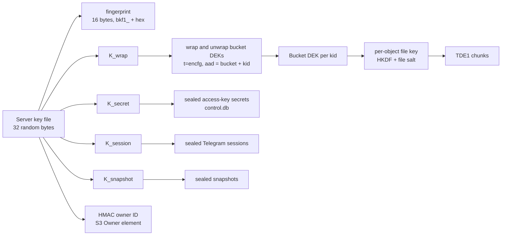

# Phase 03 — Storage engine
> Orchestrator: Opus, high effort. Workers: butterdb-lane-worker (Sonnet, high). Execute per docs/phases/00-execution-protocol.md.

## 1. Goal

Implement storage engine as the next strictly sequential butterDB phase. Deliver the owned packages below, wire them through the composition root, and prove the listed acceptance cases. The authoritative behavior lives in the linked specifications and decisions; this handoff fixes task ownership and verification.

## 2. Entry criteria

Phase 02 has passed its exit criteria and is merged locally. Read its status note before changing contracts.
Use the owner gates in section 8 before moving main.

## 3. Read before starting

- `docs/claude.md`, `docs/decisions.md`, `docs/plan.md`, `docs/phases/00-execution-protocol.md`.
- `docs/spec/wire-format.md`.
- `docs/spec/schema.md`.
- `docs/spec/storage-model.md`.
- `docs/spec/security.md`.
- Read the matching TDrive entries in `docs/reference/tdrive-port-map.md`; verify each source path exists in the TDrive checkout before citing or porting it.


## 4. Prelude (orchestrator)

Commit the projector port before fan-out: `Tx`, `Writer`, `Observed`, `Outcome`, `Applier`, and `Registry` with the signatures in `docs/spec/storage-model.md` §10 and schema access in `docs/spec/schema.md` §2. Add `golang.org/x/crypto/chacha20poly1305@v0.57.0` by exact imported path. Keep `internal/projection` free of the SQLite driver. Commit as `define projector and crypto contracts`.

## 5. Lanes

| Lane | Worktree branch | Exclusive owned paths and task |
|---|---|---|
| L1 | `phase/03-storage-engine-l1` | internal/projection/log |
| L2 | `phase/03-storage-engine-l2` | internal/projection/apply |
| L3 | `phase/03-storage-engine-l3` | internal/projection/rebuild |
| L4 | `phase/03-storage-engine-l4` | internal/crypto/{stream,randomaccess} (port TDrive backend/crypto) |
| L5 | `phase/03-storage-engine-l5` | internal/crypto/keyring |
| L6 | `phase/03-storage-engine-l6` | internal/storage/{objectrepo,bucketrepo} (keyset listing with prefix/delimiter support for ListObjectsV2) |

Each worker receives only its lane brief, `docs/claude.md`, the relevant specification, and the committed prelude. Workers may edit tests beside their owned source files; they must not edit another lane, `internal/core`, `cmd/`, `go.mod`, or `go.sum`. Build with `-mod=readonly` and report a missing module instead of adding it.

### 5.1 Lane L1 — internal/projection/log

**Objective.** Port the single projection door: `ProjectFromOp` and `ProjectFromOpTx` write the replay log first, detect header tampering, record skippable rejects and op outcomes, and apply through the L2 registry, all in one transaction.

**Owned paths.** `internal/projection/log/`.

**Read.** `docs/spec/storage-model.md` §9.6 (tamper), §10 (the projector), §14 (invariants); `docs/spec/schema.md` §2.3, §4.2–§4.4, §4.12; `docs/spec/wire-format.md` §7.3 (an unknown op is skippable, E5); legacy `docs/butterDBCore.md` lines 1702–1868.

**Rules.**
- Identity is `(channel_id, msg_id)`. A second observation with the same hash is a no-op that reports `alreadySeen`. A different hash records a `replay_log_tamper` row and keeps the first op canonical.
- Skippable apply errors (domain rejects, an unknown op) record `replay_log_rejects` and a `projection_operations` outcome without failing the transaction. SQL errors fail it.
- The projector never reads the clock for domain state. `seen_at` uses the injected clock and is never used to apply ops.
- `ProjectFromOpTx` participates in a caller's transaction so a sync page commits its ops, watermark and `pts` together. No network call ever happens inside it.

Verified source instructions for this lane:

| TDrive file | Lines | Verdict | Destination | Keep, change, and drop |
|---|---:|---|---|---|
| `backend/projection/log.go` | 197 | PORT | `internal/projection/log` (L1) | Keep: `HashHeader` (SHA-256 hex of the raw header), `ProjectFromOp` (owns its transaction) and `ProjectFromOpTx` (joins the caller's), `alreadySeen` on a repeated `(channel_id, msg_id)`, tamper row when the hash differs while the first op stays canonical, skippable apply errors recorded as rejects so replay continues, other errors fail the transaction, `ChannelIsEmpty`, `ErrChannelNotEmpty`. Change: `*sql.Tx` becomes the prelude's `Tx` port; context on every call; `seen_at` and `detected_at` from the incoming message; `unknown_op` recorded as a reject with the raw header kept (E5); injected logger |

TDrive exported declarations to compare while defining the butterDB adapter (the destination signatures must follow the butterDB spec):

- `backend/projection/log.go`: `func HashHeader(rawHeader string) string {`; `func ProjectFromOp(db *sql.DB, channelID int64, msgID int64, op Op, actorID int64, rawHeader string) (alreadySeen bool, err error) {`; `func ProjectFromOpTx(tx *sql.Tx, channelID int64, msgID int64, op Op, actorID int64, rawHeader string) (alreadySeen bool, err error) {`; `func ChannelIsEmpty(db *sql.DB, channelID int64) (bool, error) {`

**Tests (binding names).** the six carried `backend/projection/log_test.go` cases, the carried `managed_messages_test.go` and `reconcile_test.go` cases, plus `TestUnknownOpRecordedSkippable`, `TestProjectorNeverReadsClock`, and `TestNoTxAcrossNetwork` (schema §9, shared with `jobrepo`).

**Verify.**

```bash
go vet -mod=readonly ./internal/projection/log/...
go test -mod=readonly -race ./internal/projection/log/...
gofmt -l internal/projection/log
```

**Commits.** `port projection log with tamper and reject recording`.

### 5.2 Lane L2 — internal/projection/apply

**Objective.** Implement one `Applier` per op type, registered in the prelude's `Registry`: object put with last-writer-wins, delete tombstones, bucket lifecycle and config, encryption config, and the registry marker.

**Owned paths.** `internal/projection/apply/`.

**Read.** `docs/spec/storage-model.md` §4.2 (marker), §5.2–§5.4 (bucket ops), §6.2–§6.5 (commit protocol, overwrite and delete), §8.3 (`t=encfg`); `docs/spec/wire-format.md` §5; `docs/spec/schema.md` §4.5–§4.16 and §6 (which tables an applier writes).

**Rules.**
- Put: the highest message ID for a key in a bucket wins (E3). Superseded body and put message IDs are queued in `pending_message_cleanup` in the same transaction.
- Del: a tombstone records the delete's message ID. A put with a lower message ID for that key can never resurrect the object (E4).
- Ops are bucket-scoped. A `put` in one bucket channel never affects another.
- Appliers return domain sentinels for semantic rejects and plain errors for SQL failures, and never touch the replay log (that is L1's).
- No clock reads. Timestamps come from the op.

Verified source instructions for this lane:

| TDrive file | Lines | Verdict | Destination | Keep, change, and drop |
|---|---:|---|---|---|
| `backend/projection/apply.go` | 435 | PATTERN-ONLY | `internal/projection/apply` (L2) | TDrive's `ApplyOp` switch becomes a `Registry` of `Applier` values, one per op type (open/closed, `docs/claude.md` §7). Its skippable error classes (`ErrCycleRejected`, `ErrBadOp`, `ErrNameConflict`, `ErrRevisionConflict`) are replaced by object and bucket reject reasons |
| `backend/projection/writable_apply.go` | 754 | PATTERN-ONLY | `internal/projection/apply` (L2) | `fcommit` makes a hidden body visible and records an outcome per operation ID in `projection_operations`; repeated publication of the same operation under a different message ID resolves to one outcome. The `put` applier follows this |

TDrive exported declarations to compare while defining the butterDB adapter (the destination signatures must follow the butterDB spec):

- `backend/projection/apply.go`: `func ApplyOp(tx *sql.Tx, channelID int64, msgID int64, op Op, actorID int64) (err error) {`
- `backend/projection/writable_apply.go`: `func ProjectionOperationByID(db *sql.DB, channelID int64, opID string) (ProjectionOperation, bool, error) {`

**Tests (binding names).** the pattern cases from `backend/projection/apply_test.go` as put idempotency, unknown-op reject and cross-bucket isolation, plus `TestPutLastWriterWins`, `TestSupersededQueuedForCleanup`, `TestTombstoneBlocksOlderPut`, `TestNewerPutAfterDeleteLives`, `TestBucketCreateConfigureDelete`, `TestEncfgStoresWrappedKey`, `TestRegistryMarkerRecorded`.

**Verify.**

```bash
go vet -mod=readonly ./internal/projection/apply/...
go test -mod=readonly -race ./internal/projection/apply/...
gofmt -l internal/projection/apply
```

**Commits.** `add object and bucket op appliers`, `add encryption config and registry marker appliers`.

### 5.3 Lane L3 — internal/projection/rebuild

**Objective.** Rebuild derived tables from the replay log without network access, in keyset batches, and repair a single key when ops arrive out of order (E6).

**Owned paths.** `internal/projection/rebuild/`.

**Read.** `docs/spec/storage-model.md` §9.4 (per-key ordering repair), §12.1 (rebuild from the replay log); `docs/spec/schema.md` §7 (rebuild behaviour per table); `docs/spec/operations.md` §10.3; legacy `docs/butterDBCore.md` lines 1840–1868.

**Rules.**
- A full rebuild clears derived tables for a channel and replays `replay_log` in ascending message ID in batches of 256. It preserves `replay_log`, tamper and rejects. A replay failure rolls back.
- Per-key repair re-applies only that key's ops in message-ID order. It triggers only when a newly ingested op has a lower message ID than an already-recorded op for the same key (E6).
- A rebuild is byte-identical to incremental projection.

Verified source instructions for this lane:

| TDrive file | Lines | Verdict | Destination | Keep, change, and drop |
|---|---:|---|---|---|
| `backend/projection/rebuild.go` | 170 | PORT | `internal/projection/rebuild` (L3) | Keep: clear derived state for one channel, replay `replay_log` ascending by `msg_id` in keyset batches of 256 (`rebuildReplayBatchSize`), one transaction rolled back as a whole on failure, channels isolated. Add: per-key repair that replays only the rows for one key (E6) |
| `backend/projection/encryption_rebuild.go` | 113 | PORT-PARTIAL | `internal/projection/rebuild` (L3) | Rebuild of the `encfg` state from replay, rejecting tampered and malformed canonical headers. Drop password-config selection |

TDrive exported declarations to compare while defining the butterDB adapter (the destination signatures must follow the butterDB spec):

- `backend/projection/rebuild.go`: `func RebuildProjection(db *sql.DB, channelID int64) error {`; `func RebuildProjectionTx(tx *sql.Tx, channelID int64) (applied, rejected int, err error) {`
- `backend/projection/encryption_rebuild.go`: `func RebuildEncryptionConfigFromReplay(db *sql.DB, channelID int64) (bool, error) {`

**Tests (binding names).** the carried `backend/projection/rebuild_test.go` and `encryption_rebuild_test.go` cases, plus `TestRebuildEquivalence` (project N ops, snapshot, rebuild, compare every derived table), `TestPerKeyRepairOnlyTouchesKey`, `TestRepairNotTriggeredForOwnWritesAboveWatermark`, `TestRebuildPreservesReplayLog`.

**Verify.**

```bash
go vet -mod=readonly ./internal/projection/rebuild/...
go test -mod=readonly -race ./internal/projection/rebuild/...
gofmt -l internal/projection/rebuild
```

**Commits.** `port projection rebuild`, `add per key ordering repair`.

### 5.4 Lane L4 — internal/crypto/{stream,randomaccess} (port TDrive backend/crypto)

**Objective.** Port TDE1 encryption: the streaming encrypter and decrypter, an `EncryptingReaderAt` that reproduces identical ciphertext from persisted salt and nonce prefix (E8), and the authenticated random-access decryptor.

**Owned paths.** `internal/crypto/stream/`, `internal/crypto/randomaccess/`.

**Read.** `docs/spec/storage-model.md` §8.5 (determinism under retry); `docs/spec/security.md` §4; legacy `docs/butterDBCore.md` lines 2017–2222; phase 02 `internal/crypto/format` for all arithmetic.

**Rules.**
- Salt and nonce prefix are parameters, never drawn inside a retry path, so a resumed send reproduces the same bytes (E8). Randomness is injected for fresh encryptions.
- `hkdfInfo` is `butterDB/file/v1`. Use XChaCha20-Poly1305 with no additional data and the final-chunk bit from `format`.
- The random-access decryptor authenticates the final chunk at open and whole touched chunks per read. It may return authenticated bytes plus an error, retains only the file key, and `Close` zeroes it.
- Bounded memory: one chunk buffer per read.

Verified source instructions for this lane:

| TDrive file | Lines | Verdict | Destination | Keep, change, and drop |
|---|---:|---|---|---|
| `backend/crypto/stream.go` (`EncryptStream`, `DecryptStream`, `deriveSubkey`, `ensureNoExtraPlaintext`, `writeExact`) | 318 | PORT | `internal/crypto/stream` (L4) | Keep: HKDF-SHA256 32-byte per-file subkey from the 32-byte key and the file salt (`deriveSubkey`), XChaCha20-Poly1305 per 64 KiB chunk with the 24-byte nonce `prefix(20) ‖ counter_be32` and the final-chunk bit, `maxConsecutiveEmptyReads = 100`, rejection of trailing plaintext and length mismatch. Change: `hkdfInfo = "butterDB/file/v1"`; salt and nonce prefix are parameters (E8); randomness injected. Add: `EncryptingReaderAt`, new code with no TDrive source, which yields ciphertext at any offset from the DEK, salt, prefix and a plaintext `ReaderAt`, so a resumed send reproduces the same bytes |
| `backend/crypto/random_access.go` | 413 | PORT | `internal/crypto/randomaccess` (L4) | Keep: `ContextReaderAt`, `NewRandomAccessDecryptor` (authenticates the final chunk on open), `Clone` (independent, no storage read), `ReadAt` (authenticates every chunk read), `Size`, `Close` (cancels blocked reads, then clears the key), `ErrCiphertextSize`, `ErrDecryptorClosed`, `ErrNilContext`. Offset arithmetic moved to `format` in phase 02 |

TDrive exported declarations to compare while defining the butterDB adapter (the destination signatures must follow the butterDB spec):

- `backend/crypto/stream.go`: `func ValidatePlaintextSize(plaintextSize int64) error {`; `func EncryptStream(src io.Reader, dst io.Writer, masterKey []byte, plaintextSize int64) error {`; `func CiphertextSize(plaintextSize int64) int64 {`; `func DecryptStream(src io.Reader, dst io.Writer, masterKey []byte) (int64, error) {`
- `backend/crypto/random_access.go`: `type ContextReaderAt interface {`; `type RandomAccessDecryptor struct {`; `func NewRandomAccessDecryptor(`; `func (decryptor *RandomAccessDecryptor) Clone(source ContextReaderAt) (*RandomAccessDecryptor, error) {`; `func (decryptor *RandomAccessDecryptor) Size() int64 {`; `func (decryptor *RandomAccessDecryptor) ReadAt(`; `func (decryptor *RandomAccessDecryptor) Close() error {`; `func StoredOffset(plaintextOffset int64) (int64, bool) {`

**Tests (binding names).** every carried case (`stream_test.go` all nine with regenerated vectors, the `ciphertext_size_test.go` stream cases, `random_access_test.go` all including `FuzzRandomAccessDecryptorChunkBoundaries`), plus `TestTDE1TamperAndTruncation`, `TestPersistedSaltReproducesCiphertext` (security §16), `TestEncryptingReaderAtMatchesStream`, `TestEncryptingReaderAtAnyOffset`.

**Verify.**

```bash
go vet -mod=readonly ./internal/crypto/stream/... ./internal/crypto/randomaccess/...
go test -mod=readonly -race ./internal/crypto/stream/... ./internal/crypto/randomaccess/...
gofmt -l internal/crypto/stream internal/crypto/randomaccess
```

**Commits.** `port tde1 stream encryption`, `add encrypting reader at for resumable sends`, `port authenticated random access decryptor`.

### 5.5 Lane L5 — internal/crypto/keyring

**Objective.** Own the server key: load and verify the key file, derive every subkey, wrap and unwrap per-bucket DEKs bound to their bucket, seal access-key secrets, and hand out zeroable key values.

**Owned paths.** `internal/crypto/keyring/`.

**Read.** `docs/spec/security.md` §5.1–§5.7 (key file, the §5.2 subkey list, fingerprint, rotation); `docs/spec/storage-model.md` §8.2–§8.6; `docs/spec/operations.md` §5.

**Rules.**
- The key file is exactly 32 bytes; 31 or 33 are refused. Every subkey is `HKDF-SHA256(server key, salt = empty, info)` with the security §5.2 info strings.
- The fingerprint is 16 bytes, written as `bkf1_` followed by 32 lowercase hex characters (E15).
- A wrapped DEK is 72 bytes with `aad = "butterdb/dek/v1|" + decimal(bucket channel ID)`, so unwrapping with another channel or `kid` fails. A wrong key check returns `ErrDEKCheck`.
- `SealSecret` and `OpenSecret` bind the access key ID as additional data. Every `Key` value redacts in logs, and `Clear` zeroes it, on error paths too.
- Implement the method set the phase 03 contract lists (`Fingerprint`, `WrapDEK`, `UnwrapDEK`, `SealSecret`, `OpenSecret`, `SessionKey`, `SnapshotKey`, `OwnerID`, `Close`).

Verified source instructions for this lane:

| TDrive file | Lines | Verdict | Destination | Keep, change, and drop |
|---|---:|---|---|---|
| `backend/crypto/vault.go` | 308 | PORT-PARTIAL | `internal/crypto/keyring` (L5) | Keep: `WrapMasterKey` / `UnwrapMasterKey` (XChaCha20-Poly1305, output `nonce(24) ‖ ciphertext`, 72 bytes for a 32-byte key), `EncodeKeyCheck` / `VerifyKeyCheck`, `NewMasterKey` (32 random bytes) as the per-bucket DEK generator, exact envelope length checks. Change: the KEK is the 32-byte server key file (A6), key-check plaintext per 5.5, randomness injected. Drop: `KDFArgon2id`, `Params`, `DefaultParams`, `DeriveKEK`, `NewSalt`, `MarshalParams`, `UnmarshalParams`, the KDF half of `ValidateVaultMaterial` |
| `backend/services/encryption/key_lease.go` | 92 | PATTERN-ONLY | `internal/crypto/keyring` (L5) | A lease returns a private copy of key bytes and zeroes it on `Close`; the store zeroes a replaced key. butterDB leases unwrapped DEKs the same way |

TDrive exported declarations to compare while defining the butterDB adapter (the destination signatures must follow the butterDB spec):

- `backend/crypto/vault.go`: `type Params struct {`; `func DefaultParams() Params {`; `func DeriveKEK(password, salt []byte, p Params) ([]byte, error) {`; `func NewMasterKey() ([]byte, error) {`; `func NewSalt(p Params) ([]byte, error) {`; `func MarshalParams(p Params) (string, error) {`; `func UnmarshalParams(s string) (Params, error) {`; `func ValidateVaultMaterial(salt []byte, p Params, wrappedMasterKey, keyCheck []byte) error {`
- `backend/services/encryption/key_lease.go`: `type MasterKeyLease struct {`; `func (s *Service) AcquireMasterKeyLease() (*MasterKeyLease, error) {`; `func (l *MasterKeyLease) Key() ([]byte, error) {`; `func (l *MasterKeyLease) Close() {`

**Tests (binding names).** the carried `vault_test.go` and `key_lease_test.go` pattern cases, plus `TestKeyringDerivationsDistinct`, `TestWrappedDEKBoundToBucket`, `TestKeyCopiesCleared` (security §16), `TestKeyFileLengthExact`, `TestSealSecretBindsAccessKeyID`, `TestKeyRedactsInLogs`.

**Verify.**

```bash
go vet -mod=readonly ./internal/crypto/keyring/...
go test -mod=readonly -race ./internal/crypto/keyring/...
gofmt -l internal/crypto/keyring
```

**Commits.** `add server keyring with subkey derivation`, `add dek wrapping and secret sealing`.

### 5.6 Lane L6 — internal/storage/{objectrepo,bucketrepo} (keyset listing with prefix/delimiter support for ListObjectsV2)

**Objective.** Write the read and write repositories over the projected objects and buckets, including keyset listing with prefix, delimiter, start-after and continuation that ListObjectsV2 needs.

**Owned paths.** `internal/storage/objectrepo/`, `internal/storage/bucketrepo/`.

**Read.** `docs/spec/schema.md` §4.7–§4.11 (buckets, objects, encryption keys, tombstones, bodies), §6, §9 (`storage/objectrepo` rows); `docs/spec/s3-api.md` §7.3 (ListObjectsV2 semantics); `docs/spec/storage-model.md` §6.

**Rules.**
- Listing orders keys bytewise, so `z` sorts before `é`. A prefix's upper bound is computed in bytes. A delimiter skips each rolled-up common prefix with one index seek.
- Continuation tokens resume after a key or after a common prefix, and the planner uses the primary-key index.
- Writes happen only inside transactions handed in by the projector. Repositories never open their own write transactions on projected tables.

Verified source instructions for this lane:

| TDrive file | Lines | Verdict | Destination | Keep, change, and drop |
|---|---:|---|---|---|
| `backend/projection/encryption.go` | 118 | PATTERN-ONLY | `internal/storage/bucketrepo` (L6) | Exact-length validation of persisted key material before use; reject corrupt rows on read |
| `backend/projection/managed_messages.go` | 73 | PORT | `internal/storage/objectrepo` (L6) | `ManagedMsgIDsIn`: which candidate message IDs the projection owns, in batches of 200 (`managedMessageBatchSize`), cancellable. Used by the sweeper to find orphan bodies |
| `backend/projection/reconcile.go` | 61 | PORT-PARTIAL | `internal/storage/objectrepo` (L6) | `LiveFileMessageIDs` becomes "live body and put message IDs per bucket channel", excluding tombstoned objects |
| `backend/projection/read.go` | 908 | PATTERN-ONLY | `internal/storage/objectrepo` (L6) | Read helpers such as `FileEncryptionMeta`. Listing is new: keyset pagination with prefix and delimiter for ListObjectsV2 |

TDrive exported declarations to compare while defining the butterDB adapter (the destination signatures must follow the butterDB spec):

- `backend/projection/encryption.go`: `type EncryptionConfig struct {`; `func GetEncryptionConfig(db *sql.DB, channelID int64) (EncryptionConfig, error) {`; `func PutEncryptionConfig(db *sql.DB, c EncryptionConfig) error {`; `func PutEncryptionConfigTx(tx *sql.Tx, c EncryptionConfig) error {`
- `backend/projection/managed_messages.go`: `func ManagedMsgIDsIn(ctx context.Context, db *sql.DB, channelID int64, candidates []int64) (map[int64]struct{}, error) {`
- `backend/projection/reconcile.go`: `type FileMessageRefs struct {`; `func LiveFileMessageIDs(db *sql.DB, channelID int64) ([]FileMessageRefs, error) {`
- `backend/projection/read.go`: `type FolderSlim struct {`; `type FileSlim struct {`; `type SearchHit struct {`; `func ListFolderContents(db *sql.DB, channelID int64, parentID string) ([]FolderSlim, []FileSlim, error) {`; `func ListFolderContentsContext(ctx context.Context, db *sql.DB, channelID int64, parentID string) ([]FolderSlim, []FileSlim, error) {`; `func OrphanedFiles(db *sql.DB, channelID int64) ([]FileSlim, error) {`; `func MediaFiles(db *sql.DB, channelID int64) ([]FileSlim, error) {`; `func ListAllFolders(db *sql.DB, channelID int64) ([]FolderSlim, error) {`

**Tests (binding names).** every schema §9 `storage/objectrepo` row (`TestListByteOrder`, `TestPrefixEnd`, `TestListDelimiterSkipsByIndex`, `TestContinuationKinds`, `TestListQueryPlan`), plus `TestBucketLookupByName`, `TestBucketListOrdered`, `TestObjectMetaRoundTrip`.

**Verify.**

```bash
go vet -mod=readonly ./internal/storage/objectrepo/... ./internal/storage/bucketrepo/...
go test -mod=readonly -race ./internal/storage/objectrepo/... ./internal/storage/bucketrepo/...
gofmt -l internal/storage/objectrepo internal/storage/bucketrepo
```

**Commits.** `add object repository with keyset listing`, `add bucket repository`.

## 6. Integration lane

core wiring, test/acceptance/phase03 (idempotent projection, tamper, rebuild equivalence, crypto tamper/truncation)
Own `internal/core`, `cmd/`, and `test/acceptance/phase03` in the root module. Cherry-pick accepted lanes in numeric order, resolve wiring against the prelude contracts, then run `go mod tidy` once. The integration commit must include any cross-package adaptation and the acceptance suite.

## 7. Verification

- `go test -mod=readonly ./test/acceptance/phase03/...` after integration.
- `CGO_ENABLED=0 go build -mod=readonly ./cmd/butterdbd` for root-module phases; phase 10 and 13 also build their own app module with its platform dependencies.
- `go test -mod=readonly ./...` in each affected module.
- Run `scripts/verify.sh`, including layering and comment policy checks, when present.
- Acceptance cases:
  - `TestDuplicateProjectionIsIdempotent`: duplicate projection is idempotent.
  - `TestTamperedReplayIsFatal`: tampered replay is fatal.
  - `TestRebuildMatchesTheLiveProjection`: rebuild matches the live projection.
  - `TestCiphertextTamperAndTruncationFailAuthentication`: ciphertext tamper and truncation fail authentication.
### TDrive regression tests to adapt

| TDrive test file | Lines | Carry | Cases |
| --- | ---: | --- | --- |
| `backend/projection/log_test.go` | 199 | Full | `TestProjectFromOpInsertsLogAndProjectsAtomically`, `TestProjectFromOpIsIdempotentSameHash`, `TestProjectFromOpDetectsTamper`, `TestProjectFromOpRecordsAndSkipsRejectedApplyError`, `TestProjectFromOpTxAtomicWithCallerCheckpoint`, `TestChannelIsEmptyDetectsAnyRow` |
| `backend/projection/rebuild_test.go` | 221 | Partial | `TestRebuildEmptyChannelClears`, `TestRebuildReplaysAscending`, `TestRebuildReplaysAscendingAcrossBatches`, `TestRebuildRollsBackAllBatchesOnReplayFailure`, `TestRebuildDifferentChannelsAreIsolated`, `TestRebuildReplaysEncryptionConfig`. Drop `TestRebuildClearsAndReplaysFileParts`; rewrite `TestRebuildHandlesTombstones` for `t=del` |
| `backend/projection/encryption_rebuild_test.go` | 211 | Partial | The `RejectsTamper`, `RejectsInvalidCanonicalHeader`, `RejectsHashValidMalformedHeader` and `RejectsInvalidBoundariesAndStorage` cases |
| `backend/projection/apply_test.go` | 445 | Pattern | `TestApplyFileUploadIdempotentOnSameMsgID`, `TestApplyRejectsUnknownType` and `TestApplyMkdirSameObjIDIsolatedAcrossChannels` become put idempotency, unknown-op reject and cross-bucket isolation cases |
| `backend/projection/managed_messages_test.go` | 98 | Full | All three |
| `backend/projection/reconcile_test.go` | 109 | Partial | Empty, single and tombstoned cases; drop multipart |
| `backend/crypto/stream_test.go` | 230 | Full | All nine, vectors regenerated for the new `hkdfInfo` |
| `backend/crypto/ciphertext_size_test.go` | 169 | Partial | `TestCiphertextSizeMatchesEncryptStream`, `TestEncryptStreamRejectsSourceLengthMismatch`, `TestEncryptStreamRejectsTrailingDataAfterEmptyRead`, `TestEncryptStreamRejectsUnendingEmptyTrailingSource` |
| `backend/crypto/random_access_test.go` | 699 | Full | All, including `FuzzRandomAccessDecryptorChunkBoundaries` and its seeds |
| `backend/crypto/vault_test.go` | 215 | Partial | `TestKeyWrapRoundTrip`, `TestVaultBlobsRequireExactAuthenticatedEnvelopeSizes`. Drop the Argon2id and params cases |
| `backend/services/encryption/key_lease_test.go` | 235 | Pattern | `TestMasterKeyLeaseOwnsIndependentKeyAndReturnsCopies`, `TestMasterKeyLeaseCloseIsIdempotentAndZeroesKey`, `TestStoreMasterKeyZeroesReplacedOwnedBuffer` |

## 8. Owner gates

None beyond the entry criteria and any explicit gates recorded in the applicable specification.

## 9. Exit criteria and handoff

All L1–L6 commits have passed monitoring and review; the integration build and phase 03 acceptance tests pass. Write the phase status note using the template in `docs/phases/00-execution-protocol.md`. Fast-forward main locally only after owner gates close. Record any changed exported contract for phase 04.

## 10. Risks and pitfalls

- Telegram operations can have uncertain outcomes; preserve stable idempotency IDs and reconcile before retrying.
- Never hold a SQLite transaction across network I/O; project only committed control operations.
- Treat local cache and local-only control state separately from Telegram-backed authority.
- Keep phase ownership disjoint so cherry-picks remain reviewable; report any needed cross-lane contract change to the orchestrator.

## Binding behavior for this phase

The source specification is authoritative. Update this copy in the same commit if the source changes.

### Contract source: `docs/spec/storage-model.md`

## 10. The projector

`internal/projection/log` is the single door (claude.md invariant 1). Inputs
per observed message:

```go
type Observed struct {
	ChannelID   int64
	MsgID       int64
	MsgDate     int64
	IsDocument  bool
	ActorUserID int64
	RawText     string
}

func ProjectFromOp(ctx context.Context, w Writer, obs Observed) (Outcome, error)
func ProjectFromOpTx(ctx context.Context, tx Tx, obs Observed) (Outcome, error)
```

`RawText` is the message text, or the document caption when `IsDocument`. The
projector parses it with `wire.Parse`, so parse classification lives in one
place. Default (owner may change) for the exact Go shape; phase 03's prelude
commits it.

| `wire.HasPrefix` and parse result | Effect |
| --- | --- |
| `HasPrefix` false | Not a butterDB message, whatever `Parse` says. Nothing recorded; the watermark still advances |
| `HasPrefix` true and `ErrWireBadVersion`, `ErrWireMalformed` or `ErrWireTooLong` | `replay_log_rejects` row with code `malformed` and the raw header; no `replay_log` row |
| `ErrWireUnknownOp` | `replay_log` row with the raw header and `op_type` = the `t` value, plus a `replay_log_rejects` row `unknown_op` (E5) |
| A known op | `replay_log` row, then the op's `Applier` |

Applier rejects are skippable: they are recorded in `replay_log_rejects` and,
for ops with a `j`, in `projection_operations` with outcome `rejected`, and the
page continues. Database errors are fatal and roll the transaction back.

| Reject code | Op | Cause |
| --- | --- | --- |
| `malformed` | any | TDX1 header present but not parseable |
| `unknown_op` | any | `t` not known to this binary (E5) |
| `wrong_channel` | any | Registry op in a bucket channel or the reverse |
| `wrong_carrier` | any | `t=body` not on a document, or any other op on a document |
| `bucket_not_found` | `put`, `del`, `body`, `bcfg`, `bdel`, `encfg` | Bucket channel unknown or deleted, or `b` does not match the bucket's name |
| `bucket_name_invalid` | `bcreate` | Fails `internal/domain/bucket` rules |
| `bucket_exists` | `bcreate` | A live bucket already has the name, or the channel ID was used by any bucket before |
| `bad_body_ref` | `put` | `bm` ≥ the put's message ID |
| `size_mismatch` | `put` | `enc=1` and `sz ≠ CiphertextSize(psz)`, or `sz > MaxStoredObjectBytes` |
| `duplicate_op` | `put`, `del`, `bcreate`, `bcfg`, `bdel`, `encfg` | Same `j` and op type already recorded at another message ID; for `encfg`, `(bc, kid)` already present with an equal or higher `cv` (section 8.3) |
| `marker_conflict` | `reg` | Section 4.2 |

Outcomes recorded in `projection_operations`: `applied`, `superseded`
(section 6.4), `rejected`.

Rebuild (`internal/projection/rebuild`) follows legacy section 10 with these
changes: it re-parses `raw_header` instead of trusting `op_payload_json`, so a
newer binary applies ops that an older one recorded as `unknown_op`; it clears
`replay_log_rejects` rows for messages present in `replay_log` and re-records
the rejects it meets; it preserves `replay_log`, `replay_log_tamper`,
`deleted_messages`, parse-failure rejects and both cleanup queues; it runs per
channel in keyset batches of 256 in one transaction, registry channel first.

---

## Additional binding contracts and checks

### security.md: 5. Key management

## 5. Key management

### 5.1 Hierarchy

[storage-model.md](../spec/storage-model.md) §8 owns the object-encryption half of the
hierarchy (fingerprint, `K_wrap`, DEKs, key check, `t=encfg`). This section
restates it and adds the keys that protect local state.



### 5.2 Derivations

Every subkey is `HKDF-SHA256(ikm = server key, salt = empty, info = <info>)`,
32 bytes unless stated, derived once at start by `internal/crypto/keyring` and
held in `keyring.Key` values whose `LogValue` redacts and whose `Clear` zeroes
them.

| Name | `info` | Use | Owner |
| --- | --- | --- | --- |
| Fingerprint | `butterdb/keyring/fingerprint/v1`, first 16 bytes | Identifies the key in `state.json` (`kek_fingerprint`), `t=reg` and `t=encfg` (`kfp`), snapshot manifests, ops-channel captions and logs. Written as `bkf1_` followed by 32 lowercase hex characters (E15) | [storage-model.md](../spec/storage-model.md) §8.1 |
| `K_wrap` | `butterdb/keyring/dek-wrap/v1` | Wraps bucket DEKs | [storage-model.md](../spec/storage-model.md) §8.1 |
| `K_secret` | `butterdb/keyring/access-key-secret/v1` | Seals access-key secrets (§6) | [storage-model.md](../spec/storage-model.md) §8.1 |
| `K_session` | `butterdb/keyring/session-seal/v1` | Seals Telegram session files (§5.4). Default (owner may change) | this document |
| `K_snapshot` | `butterdb/keyring/snapshot/v1` | TDE1 master key for snapshots ([operations.md](../spec/operations.md) §9.2). Default (owner may change) | this document |
| Owner ID | not HKDF: `HMAC-SHA256(server key, "butterdb/s3/owner-id/v1")`, hex | Stable S3 `Owner` ID in listings; reveals nothing about the key | [s3-api.md](../spec/s3-api.md) §7.3 |

Secrets that are **not** derived from the server key:

| Secret | Why separate | Owner |
| --- | --- | --- |
| Admin setup tokens, device tokens, pairing codes | Stored as domain-separated SHA-256 (`"butterdb-admin-v1\x00" ‖ kind ‖ "\x00" ‖ value`); their entropy and lifetime make a keyed hash unnecessary, and `adminapi/session` stays independent of `keyring` | [admin-api.md](../spec/admin-api.md) §5.7 |
| Media signing key | Applications hold it to sign URLs; it must be distributable without exposing the server key | [media-api.md](../spec/media-api.md) §7.1 |
| Admin TLS key | Rotating the server key must not break GUI pins | [admin-api.md](../spec/admin-api.md) §2.3 |

Bucket DEK wrap ([storage-model.md](../spec/storage-model.md) §8.1; field encoding in
[wire-format.md](../spec/wire-format.md) §5.8):

```
kid          = 8 random bytes, 16 lowercase hex characters
dek          = 32 bytes from crypto/rand, one per (bucket, kid)
aad          = "butterdb/dek/v1|" + decimal(bucket channel ID) + "|" + kid
wrap         = nonce(24) ‖ XChaCha20-Poly1305(K_wrap).Seal(nonce, dek, aad)        72 bytes
check        = nonce(24) ‖ XChaCha20-Poly1305(dek).Seal(nonce, "butterDB-key-check-v1", nil)   61 bytes
```

The `aad` binds a wrapped DEK to its bucket and key ID, so a `wrap` copied into
another bucket's `t=encfg` fails to unwrap. Unwrap failure is `ErrDEKUnwrap`,
check failure `ErrDEKCheck`; both make reads of that key's objects return
`500 InternalError` and increment `butterdb_key_errors_total`, and neither
distinguishes a wrong key from damaged data.

```go
package keyring

type Key struct {
	b [32]byte
}

func (k *Key) Bytes() []byte
func (k *Key) Clear()
func (k Key) LogValue() slog.Value

type Ring struct {
	fingerprint [16]byte
	wrap        Key
	secret      Key
	session     Key
	snapshot    Key
	ownerID     string
}

func Generate(path string, rand io.Reader) ([16]byte, error)
func Load(path string) (*Ring, error)
func (r *Ring) Fingerprint() [16]byte
func (r *Ring) FingerprintString() string
func (r *Ring) WrapDEK(dek *Key, bucketChannelID int64, kid string) (wrap [72]byte, check [61]byte, err error)
func (r *Ring) UnwrapDEK(wrap []byte, check []byte, bucketChannelID int64, kid string) (*Key, error)
func (r *Ring) SealSecret(accessKeyID string, secret []byte) ([]byte, error)
func (r *Ring) OpenSecret(accessKeyID string, sealed []byte) ([]byte, error)
func (r *Ring) SessionKey() *Key
func (r *Ring) SnapshotKey() *Key
func (r *Ring) OwnerID() string
func (r *Ring) Close()
```

`Load` checks file permissions ([operations.md](../spec/operations.md) §2.5) and length
(exactly 32 bytes). Every DEK copy is cleared on every return path (invariant 6
of [claude.md](../claude.md)).

### 5.3 Generation and backup

| Step | Rule |
| --- | --- |
| Source | `crypto/rand`, 32 bytes |
| File format | Exactly the 32 raw bytes, no newline ([storage-model.md](../spec/storage-model.md) §8.1). `head -c 32 /dev/urandom > server.key` produces a valid file |
| Who creates it | `butterdbd setup --key-only`, or `serve` on a fresh deployment that was never linked ([operations.md](../spec/operations.md) §5.3) |
| Mode | `0600`, written through `secretfile`; on systemd hosts owned by root and delivered by `LoadCredential=` |

Backup instructions, printed by `setup --key-only` and at first generation, and
repeated in the operator guide. The key itself is never printed; the operator
copies the file.

1. Make two copies off the host before linking Telegram: one in a password
   manager as text (`base64 -w0 /etc/butterdb/server.key`; restore with
   `base64 -d > server.key` and `chmod 0600`), one as the raw file on offline
   media in a different place.
2. Record the fingerprint next to each copy.
3. Never store the key in the same place as copies of the data directory or of
   snapshots: a snapshot plus the key yields every access-key secret.
4. Never put the key in a Git repository, a container image, an environment
   variable, a CI secret store that logs, or a chat.
5. Test the backup: `BUTTERDB_SERVER_KEY_FILE=<copy> butterdbd check-config`
   prints the fingerprint; it must equal the recorded one. Monthly, run
   `butterdbd restore --snapshot <file> --verify-only` with the backup copy
   ([operations.md](../spec/operations.md) §9.6).

### 5.4 Fingerprint checks and sealed sessions

| Check | Where | Failure |
| --- | --- | --- |
| Key fingerprint equals `state.json` `kek_fingerprint` | Start, before any listener ([operations.md](../spec/operations.md) §7.1 step 7; [storage-model.md](../spec/storage-model.md) §4.4 step 4) | Exit 4 (`kek_mismatch`) |
| Projected registry marker carries the same channel and fingerprint | Start, step 7 | Exit 4 or 5 |
| The registry marker message in Telegram exists and its `dep`, `uid`, `kfp` equal `state.json` | Start, once connected (step 12) | Refuse: Telegram-dependent components do not start; admin reports the code |
| Every `t=encfg` `kfp` equals the marker's | Projection | Reject `kek_mismatch` |
| Snapshot manifest fingerprint equals the key's | `restore` | Exit 4 |
| Registry rediscovery offers only candidates whose `kfp` and `uid` match | `rebuild --from-telegram --registry-channel` ([storage-model.md](../spec/storage-model.md) §4.5) | Candidate cannot be confirmed |

These checks stop a server from writing objects under one key into a deployment
whose existing objects were wrapped under another, which would leave a bucket
with mixed, partly unreadable keys.

Sealed sessions, Default (owner may change): `internal/identity` stores each
gotd session file as

```json
{"v": 1, "nonce": "<base64 24 bytes>", "ct": "<base64 XChaCha20-Poly1305(K_session) of the gotd session JSON>"}
```

with additional data `butterdb/session/v1|primary` or `|replica`. A disk image
without the key file then holds no usable MTProto authorization key. TDrive
`backend/auth/session_storage.go` stores sessions in clear; the port changes
that. `secrets/telegram_app.json` stays plain JSON with mode `0600`: the
`api_hash` alone does not open the account.

### 5.5 Keeping the key off the data disk

| Deployment | Practice |
| --- | --- |
| systemd | Key at `/etc/butterdb/server.key` (root, `0600`), delivered with `LoadCredential=`; with a TPM2, `systemd-creds encrypt` and `LoadCredentialEncrypted=` so the key file at rest is bound to the machine |
| Container | Orchestrator secret mounted read-only at `/run/secrets/butterdb/server.key`; never baked into the image or passed as an environment value |
| Any | `data_dir` on a separate filesystem from `/etc/butterdb`; full-disk encryption on both |

### 5.6 Rotation by re-wrap

`butterdbd setup --rotate-key --new-key-file <path>`; server stopped (process
lock), Telegram reachable. Built in phase 11. Default (owner may change).

Rotation changes the fingerprint, and [storage-model.md](../spec/storage-model.md) §4.2
accepts a later `t=reg` only with the same `kfp`. Rotation therefore needs one
format addition, which must be in the phase 02 grammar so that phase 11 needs no
format change: an optional `t=reg` field `pkfp` (previous fingerprint). A later
`t=reg` with a different `kfp` is accepted when its `pkfp` equals the current
marker's `kfp`, with the same `dep` and `uid`. Every `t=encfg` is checked against
the marker in effect at its message ID, so wraps published before the new
marker stay valid during replay. [wire-format.md](../spec/wire-format.md) §5.4 and
[storage-model.md](../spec/storage-model.md) §4.2 must adopt this.

| Step | Action |
| --- | --- |
| 1 | Load both keys; refuse when fingerprints are equal or the old key fails §5.4 |
| 2 | Write `<data_dir>/rekey.json` (`0600`): old and new fingerprints and the last completed step. `serve` refuses to start while it exists (exit 4, `key rotation incomplete`) |
| 3 | Publish `t=reg` with the new `kfp` and `pkfp` = old fingerprint, project it |
| 4 | For each `(bucket, kid)`: unwrap with the old `K_wrap`, wrap and check with the new one, publish a new `t=encfg` with the same `kid`, the new `kfp` and `cv` + 1, project it. The active key per bucket is still the highest message ID |
| 5 | Rewrite `state.json` (`kek_fingerprint`, `marker_msg_id`) |
| 6 | In one `control.db` transaction, re-seal every access-key secret under the new `K_secret` |
| 7 | Re-seal the session files under the new `K_session` |
| 8 | Delete the superseded `t=encfg` and `t=reg` messages from the registry channel (and the replica registry, phase 12) with `channels.deleteMessages` |
| 9 | Remove `rekey.json`; print: replace `server_key_file` with the new key, keep the old key until every snapshot sealed under it has expired |

Each step is idempotent and resumes from `rekey.json`; during rotation `keyring`
tries the new key, then the old, when unwrapping. Admin devices, the admin TLS
pin and the media signing key are untouched (§5.2).

What rotation does not do: object DEKs are unchanged, so nothing is
re-uploaded. Anyone who already holds the old key file **and** a copy of an old
wrapped DEK (an earlier registry message, an old snapshot, a replica copy) can
still decrypt that bucket's objects. When the old key is believed stolen
together with channel access, re-encrypt: create a new encrypted bucket, copy
every object into it (`CopyObject` streams through the read path into a new put,
sealed under the new bucket's DEK), switch applications, delete the old bucket.

### 5.7 Lost key

Without the key file:

| Lost permanently | Survives |
| --- | --- |
| Every encrypted object | Every unencrypted object (bodies and put ops are in Telegram) |
| Access-key secrets (sealed) | Bucket configuration |
| Sealed sessions and every snapshot | Admin devices and pairing (their hashes use no server key) |
| | The Telegram account (log in again) |

The server refuses to start with a different key (§5.4). Recovery is
`butterdbd setup --replace-lost-key --new-key-file <path>`, which requires typing
`replace lost key` on the TTY, logs in to Telegram on the TTY, publishes a
`t=reg` with the new `kfp` and `pkfp=lost` (accepted by the same rule as §5.6,
with `lost` in place of the previous fingerprint; Default (owner may change)),
gives every encrypted bucket a new `kid` and DEK for future objects, deletes
every access-key row, writes `state.json`, and prints the count of
now-unreadable objects per bucket. Reads of those objects fail `ErrDEKUnwrap`
and return `500 InternalError` ([storage-model.md](../spec/storage-model.md) §8.3). The
owner deletes them. Built in phase 11.

---
