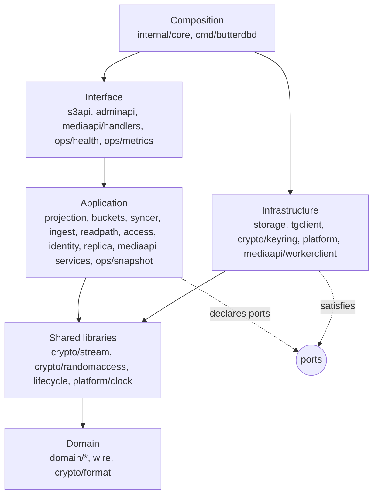

# butterDB — Implementation Plan

This plan turns [docs/decisions.md](decisions.md) into a build order. It owns the
architecture, the module and package map, the request flows that cross phases,
the phase sequence, the testing strategy and the risk register.

| Document | Owns |
| --- | --- |
| [docs/decisions.md](decisions.md) | Product decisions D1–D20, assumptions A1–A10, engineering decisions E1–E14, accepted risks. Wins every conflict |
| [docs/spec/storage-model.md](spec/storage-model.md) | Registry channel, bucket channels, object lifecycle, overwrite, delete, ordering repair, job states |
| [docs/spec/wire-format.md](spec/wire-format.md) | TDX1 grammar, op catalogue, field keys, escaping, text length limits, TDE1 byte layout |
| [docs/spec/schema.md](spec/schema.md) | `projection.db` and `control.db` DDL, migrations, pragmas |
| [docs/spec/s3-api.md](spec/s3-api.md) | Supported S3 operations, SigV4, XML shapes, error codes |
| [docs/spec/admin-api.md](spec/admin-api.md) | `/admin/v1` endpoints, setup token, device tokens, pairing, TLS pinning, `api/adminv1` |
| [docs/spec/admin-gui.md](spec/admin-gui.md) | Fyne screens, navigation, keychain and pinning on the client |
| [docs/spec/media-api.md](spec/media-api.md) | Transform URL grammar, presets, signing, derivative cache, `api/transformv1` |
| [docs/spec/operations.md](spec/operations.md) | Configuration keys, data directory, listeners, health, metrics, snapshot, deploy |
| [docs/spec/security.md](spec/security.md) | Threat model, server key file, TDE1 use, secrets handling, Telegram account safety |
| docs/plan.md (this file) | Layering, package map, cross-phase contracts, request flows, phase order, test strategy, risks |
| [docs/phases/00-execution-protocol.md](phases/00-execution-protocol.md) | How an orchestrator runs a phase: branches, worktrees, agents, review, merge |
| `docs/phases/01-…13-*.md` | One executable brief per phase (section 8) |
| [docs/reference/tdrive-port-map.md](reference/tdrive-port-map.md) | TDrive file to butterDB package mapping |
| [docs/claude.md](claude.md) | Code style, invariants, commit rules, definition of done |
| [docs/butterDBCore.md](butterDBCore.md) | Legacy engine specification (TDrive's explainer with names swapped). Used only for formats, constants and algorithms that a higher document retains |

Authority follows [docs/claude.md](claude.md) section 2: decisions, then specs,
then this plan, then phase documents, then the legacy specification. A spec wins
over this plan on a byte, a size or a field. This plan wins over a phase
document on structure, ownership and sequencing.

---

## 1. Product summary

butterDB is self-hosted object storage that speaks the S3 protocol and offers
Cloudinary-style media transforms, with its bytes stored in the deploying
developer's own Telegram account (D1, D2, D5). Telegram is the storage backend;
butterDB is the service that makes Telegram behave like object storage.

| Aspect | Shape |
| --- | --- |
| Who runs it | One developer per deployment on a server they control. One owner, many scoped access keys (D1, D3) |
| Telegram account | The developer's own, with their own `api_id` and `api_hash` (D2, D15) |
| Storage layout | One private broadcast channel per bucket, plus one registry channel (E1) |
| Object | Hidden body document plus a `t=put` control message; the put message is the commit (E2) |
| Client surface | Any AWS SDK or S3 tool, by changing the endpoint. Public-read or private buckets, SigV4 presigned URLs (D5, D7) |
| Admin surface | A Fyne desktop app on Windows, Linux and macOS, talking to an authenticated admin API. It holds no Telegram session (D13, D14) |
| Write acknowledgement | After Telegram accepts the `t=put` and the projection applies it (D8) |
| Object size | Up to `1900 * 1024 * 1024` stored bytes, one Telegram document per object; S3 multipart parts are assembled on the server (D9) |
| Overwrite and delete | Last writer wins by message ID; delete is immediate and hard, no versioning, no trash (D6, D10, E3, E4) |
| Encryption | Optional, per bucket default and per request; TDE1 with keys wrapped by the server key file (D11, A5, A6) |
| Durability | Optional mirror to a second Telegram account, after the first release (D12, A9, D17) |
| Media | URL transforms by `butterdb-transformd` (libvips, ffmpeg), after the first release (D16, D17) |
| Scale | Under 2,000 daily users, 500,000 objects and 1 TB per deployment; one server with a disk cache (D4) |

---

## 2. What is kept from TDrive and what is cut

TDrive (MIT, `/home/prieyan/weeb/TDrive`) is the reference implementation of the
storage engine (D18). Each phase ports the relevant files into butterDB's
layout, strips their comment blocks, turns package-level state into injected
fields, and records the attribution in `docs/legal/THIRD_PARTY_NOTICES.md`. The
file-level map is [docs/reference/tdrive-port-map.md](reference/tdrive-port-map.md).

| Kept and adapted | TDrive source | butterDB package | Phase |
| --- | --- | --- | --- |
| TDX1 grammar, `Parse`, `Format` | `backend/projection/wire.go` | `internal/wire` | 02 |
| `ProjectFromOp`, `ProjectFromOpTx`, tamper and reject records | `backend/projection/log.go`, `backend/projection/apply.go` | `internal/projection/log`, `internal/projection/apply` | 03 |
| Rebuild from the replay log | `backend/projection/rebuild.go` | `internal/projection/rebuild` | 03 |
| TDE1 stream and authenticated random access | `backend/crypto/stream.go`, `backend/crypto/random_access.go` | `internal/crypto/format`, `internal/crypto/stream`, `internal/crypto/randomaccess` | 02, 03 |
| Key wrap and key check (no Argon2id vault) | `backend/crypto/vault.go` (`WrapMasterKey`, `UnwrapMasterKey`, `EncodeKeyCheck`, `VerifyKeyCheck`) | `internal/crypto/keyring` | 03 |
| gotd connection, per-DC pools, ranged reads | `backend/tgclient/gotd.go`, `gotd_pool.go`, `gotd_range.go`, `range.go` | `internal/tgclient/conn`, `internal/tgclient/rangeio` | 04 |
| Flood-wait types, retry policies, write coordinator, getFile limiter | `backend/tgclient/client.go`, `floodwait_retry.go`, `transient.go`, `write_coordinator.go`, `getfile_limiter.go` | `internal/tgclient/flow` | 04 |
| `StableRandomID`, `SendFileIdempotent`, `SendControlIdempotent`, `ErrSendOutcomeUnknown` | `backend/tgclient/idempotency.go`, `backend/tgclient/client.go` | `internal/tgclient/send` | 04 |
| Fake Telegram client | `backend/tgclient/fake.go` | `internal/tgclient/faketg` | 04 |
| Login state machine, session storage, private files | `backend/auth/auth.go`, `backend/auth/session_storage.go`, `backend/auth/private_file.go`, `backend/services/auth/service.go` | `internal/identity`, `internal/platform/secretfile` | 01, 04 |
| History scan, channel difference, live sync | `backend/sync/sync.go`, `backend/sync/difference.go`, `backend/sync/initial_scan_spool.go`, `backend/livesync/coordinator.go` | `internal/syncer/{scan,difference,livesync}` | 05 |
| Chunked message deletion | `backend/projection/hard_delete.go` | `internal/ingest/remove` | 06 |
| Range reader, single-flight loads, LRU | `backend/media/range_reader.go`, `backend/media/cache.go`, `backend/mountcache/coalescer.go`, `backend/mountcache/lru.go` | `internal/readpath/rangereader`, `internal/readpath/blockcache` | 07 |
| Data directory and process lock | `backend/datadir/datadir.go`, `backend/processlock/lock.go` | `internal/platform/datadir`, `internal/platform/processlock` | 01 |

| Cut | Reason |
| --- | --- |
| Wails shell, Svelte frontend, mobile builds, updater, biometrics | The admin client is Fyne (D13); the server is headless (D14) |
| Folder namespace, dirents, trash, revisions | S3 keys are flat and overwritable (D6); delete is hard (D10) |
| TDX1 `t=part` / `t=manifest` multipart and the resumable upload journal | One document per object up to 1900 MiB (D9) |
| Passphrase vault (Argon2id) and key leases | Keys are wrapped by the server key file (A6) |
| Shared drives, invites, forum topics, channel sources | One owner per deployment (D3) |
| Mount, WebDAV, FUSE, HLS, remux, mpv, gallery, renditions, photo backup | Not object storage; image and video work moves to `apps/transformd` (D16) |
| Daemon socket protocol | Replaced by the S3, admin and media HTTP APIs |

---

## 3. Architecture

### 3.1 Layers

Dependencies point inward. The layer table is the same as
[docs/claude.md](claude.md) section 5.2.



| Layer | Packages | May import |
| --- | --- | --- |
| Domain | `internal/domain/...`, `internal/wire`, `internal/crypto/format` | Standard library only (E13) |
| Shared libraries | `internal/crypto/{stream,randomaccess}`, `internal/lifecycle`, `internal/platform/clock` | Domain, `golang.org/x/crypto` |
| Application | `internal/projection/...`, `internal/buckets`, `internal/syncer/...`, `internal/ingest/...`, `internal/readpath/...`, `internal/access/...`, `internal/identity`, `internal/replica/...`, `internal/mediaapi/{grammar,presets,signing,derivcache}`, `internal/ops/snapshot` | Domain, shared libraries, the shared value types of `internal/tgclient` |
| Infrastructure | `internal/storage/...`, `internal/tgclient/...`, `internal/crypto/keyring`, `internal/platform/...`, `internal/mediaapi/workerclient` | Domain, shared libraries, `api/...`, their own third-party drivers |
| Interface | `internal/s3api/...`, `internal/adminapi/...`, `internal/mediaapi/handlers`, `internal/ops/{health,metrics}` | Domain, shared libraries, application packages, `api/...` |
| Composition | `internal/core`, `cmd/butterdbd` | Everything in the root module |
| Public contracts | `api/adminv1`, `api/transformv1` | Standard library only |

The shared value types of `internal/tgclient` are defined by the phase 04
prelude: `DocumentRef`, the `InputPeer` wrappers, `FloodWaitError` and
`ErrSendOutcomeUnknown`. Application packages may name them in their ports and
never import a `tgclient` subpackage that holds behaviour.

### 3.2 The dependency rule

`scripts/layering.sh` (phase 01, lane L4) checks every rule with `go list -deps`
and fails `scripts/verify.sh` on a violation. The rule IDs are those of
[docs/claude.md](claude.md) section 5.3.

| Rule | Check | Reason |
| --- | --- | --- |
| L1 | `internal/domain/...`, `internal/wire`, `internal/crypto/format` import the standard library only | Formats are testable without a network or a database (E13) |
| L2 | Only `internal/tgclient/...` imports `github.com/gotd/td/...` | One package absorbs MTProto churn (E13) |
| L3 | Only `internal/storage/...` imports `modernc.org/sqlite` | One place owns connections and transactions (E7, E13) |
| L4 | Only `internal/core` and `cmd/butterdbd` call an adapter constructor from another package | One composition root |
| L5 | Only `cmd/butterdbd` imports `internal/core` | Nothing reaches around the root |
| L6 | `api/...` imports the standard library only, never `internal/...` | `apps/` modules depend on it |
| L7 | The root module never imports `github.com/PRIEYAN/ButterDB/apps/...` | Keeps the server static and cgo-free (E14) |
| L8 | `apps/admin` and `apps/transformd` import only `github.com/PRIEYAN/ButterDB/api/...` from the root module | Go's `internal` rule is path based and would allow `apps/admin` to import `internal/...` |
| L9 | Interface packages never import `internal/storage/...` or `internal/tgclient/...` | Data is reached through application services |
| L10 | No package imports a package of an outer layer | Section 3.1 |

### 3.3 Ports belong to consumers

A port is an interface declared in the package that calls it, named for the
role it plays there, and limited to the methods that caller uses. Adapters
satisfy ports implicitly and never import the consumer. A port with more than
five methods is two roles and is split.

```go
package put

type BodySender interface {
	SendBody(ctx context.Context, peer tgclient.InputPeer, body io.ReadSeeker, size int64, caption string, randomID int64) (int64, error)
}

type ControlSender interface {
	SendControl(ctx context.Context, peer tgclient.InputPeer, text string, randomID int64) (int64, error)
}

type Projector interface {
	Project(ctx context.Context, channelID int64, msgID int64, op wire.Op, raw string) (bool, error)
}

type Jobs interface {
	Create(ctx context.Context, j Job) error
	MarkBodySent(ctx context.Context, jobID string, bodyMsgID int64) error
	MarkPutAttempted(ctx context.Context, jobID string) error
	Finish(ctx context.Context, jobID string, state State, putMsgID int64) error
}
```

`internal/tgclient/send` does not know that `put.BodySender` exists;
`internal/core` passes the tgclient value where the port is expected. The
signatures above illustrate the pattern. The phase 06 document owns the exact
`put` ports, and `docs/spec/storage-model.md` owns the job states.

### 3.4 Constructor injection

Every dependency arrives through a constructor that validates it. A constructed
value is fully usable or it does not exist. There is no service locator, no
dependency carried in `context.Context`, and no setter injection.

```go
func NewService(d Deps) (*Service, error) {
	if d.Bodies == nil || d.Controls == nil || d.Projector == nil || d.Jobs == nil || d.Clock == nil {
		return nil, fmt.Errorf("put: %w", errs.ErrMissingDependency)
	}
	return &Service{d: d}, nil
}
```

### 3.5 Composition root

`internal/core` is the only package that constructs adapters and wires them.
`cmd/butterdbd` parses flags, loads configuration through
`internal/platform/config`, builds the environment, calls `core.New`, and runs
the result until a signal arrives.

```go
package core

type Env struct {
	Log   *slog.Logger
	Clock clock.Clock
	Rand  io.Reader
	FS    fsx.FS
}

type Server struct {
	group *lifecycle.Group
}

func New(cfg config.Config, env Env) (*Server, error)
func (s *Server) Run(ctx context.Context) error
```

Phase 01 lands this signature with an empty group; every later integration lane
adds its components to it. `core.New` constructs in this order and returns an
error, having started nothing, if any constructor or check fails:

1. `datadir.Open` on `cfg.DataDir`; `processlock.Acquire` on `<data_dir>/butterdbd.lock`.
2. `keyring.Load` on the server key file (A6). When the file is absent and the
   deployment has never been linked, `keyring.Generate` writes it through
   `secretfile` with mode `0600` and logs one `WARN` line telling the owner to
   back it up off the host.
3. `sqlitedb.Open` for `projection.db` and `control.db`, then the embedded
   migrations of `internal/storage/schema`.
4. Local startup checks ([docs/claude.md](claude.md) invariant 20): when
   `state.json` names a registry channel, the projected registry marker in
   `projection.db` must carry the same channel ID, and its key fingerprint must
   equal `keyring.Fingerprint()` of the loaded key. A mismatch refuses to start.
5. Repositories from `internal/storage/...`.
6. The primary `internal/tgclient/conn` client with its own `flow` limiters
   (and, from phase 12, a second client for the replica account).
7. Application services: `identity`, `buckets`, `projection`, `syncer`,
   `ingest`, `readpath`, `access`, then `replica` (12) and `mediaapi` (13).
8. HTTP handlers and listeners for ops, admin, S3 and media.

The remote half of the registry check, which compares the marker message in the
registry channel with `state.json`, needs Telegram and runs as the first step of
the syncer's start (section 3.7).

### 3.6 No global state

- No `init()` that does work and no package-level mutable variables. Immutable
  sentinel errors and constants are fine.
- Ported TDrive globals become fields of injected structs. Examples:
  `fallbackRandomCounter` in `backend/tgclient/idempotency.go` and the
  semaphores in `backend/tgclient/getfile_limiter.go` become fields of values
  built once per Telegram account in `core`.
- Time comes from `clock.Clock`, randomness from an injected `io.Reader`, files
  from `fsx.FS` and `datadir`, configuration from typed values produced by
  `internal/platform/config`, logs from an injected `*slog.Logger`.
- The projector is never given a clock. An object's `LastModified` is the
  Telegram date of its `t=put` message, so replay is deterministic.
- Two Telegram accounts are two `tgclient` values with separate limiters.
  Nothing assumes a single client.

### 3.7 Lifecycle

```go
package lifecycle

type Component interface {
	Start(ctx context.Context) error
	Close(ctx context.Context) error
}

type Group struct{}

func NewGroup(log *slog.Logger, closeBudget time.Duration) *Group
func (g *Group) Add(name string, c Component)
func (g *Group) Start(ctx context.Context) error
func (g *Group) Close(ctx context.Context) error

type Switch struct{}

func NewSwitch(name string, child *Group) *Switch
func (s *Switch) Start(ctx context.Context) error
func (s *Switch) Close(ctx context.Context) error
func (s *Switch) On(ctx context.Context) error
func (s *Switch) Off(ctx context.Context) error
```

`Group.Start` starts components in registration order and, if one fails, closes
those already started in reverse. `Group.Close` closes in strict reverse, each
with `closeBudget`. `Switch` is a `Component` that owns a child group which can
be turned on and off while the process runs: `Start` and `Close` do nothing but
record the parent's context and turn the child off; `On` starts the child,
`Off` closes it. `identity` calls `On` when the Telegram link completes and
`Off` on unlink, so linking from the GUI never needs a restart. All of this is
phase 01 lane L3.

`butterdbd serve` registers components in this order. The close order is the
exact reverse and matches [docs/claude.md](claude.md) section 6.5.

| Start order | Component | Ready when |
| --- | --- | --- |
| 1 | Process lock | Lock held (acquired in `core.New`; released by `Close`) |
| 2 | Logging sink | Writer open |
| 3 | `projection.db`, `control.db` | Migrations applied |
| 4 | Primary Telegram connection (`tgclient/conn`) | Run scope live; idle while no session exists |
| 5 | `linked` switch → syncer | Remote registry check passed and every bucket channel reached `Final` once |
| 6 | `linked` switch → ingest sweeper | Pending jobs loaded |
| 7 | `linked` switch → replica worker and backfill (12) | Journal cursor loaded |
| 8 | Transform worker supervisor (13) | Worker answered its health probe |
| 9 | HTTP listeners: ops, admin plus control socket, S3, media | Bound |

Readiness, served by `GET /readyz` on the ops listener: `200` when the server is
linked, the syncer has caught up and the spool has free space; otherwise `503`.
While not ready, the S3 listener answers requests that need Telegram with
`503 ServiceUnavailable`; GETs fully served from the block cache still succeed.
The admin listener serves from step 9 in every state, because setup and linking
happen through it.

Default (owner may change): listener drain 10 s, per-component close budget 5 s.

---

## 4. Binaries and modules

| Artifact | Path | Module | Build |
| --- | --- | --- | --- |
| Server `butterdbd` | `cmd/butterdbd` | `github.com/PRIEYAN/ButterDB` (root) | `CGO_ENABLED=0`, static (E14) |
| Admin GUI | `apps/admin` | `github.com/PRIEYAN/ButterDB/apps/admin` | cgo; Fyne needs OpenGL |
| Transform worker `butterdb-transformd` | `apps/transformd` | `github.com/PRIEYAN/ButterDB/apps/transformd` | cgo; libvips through govips, `ffmpeg` as a subprocess |

`go.work` at the repository root joins the modules for development. Phase 01
creates it with `use .`; the phase 10 prelude runs `go work use ./apps/admin`
and the phase 13 prelude runs `go work use ./apps/transformd`. Its final form:

```
go 1.26

use (
	.
	./apps/admin
	./apps/transformd
)
```

Root-module commands always run with `GOWORK=off`, so the root `go.sum` is
proven complete on its own. `apps/` commands run in workspace mode with
`go -C apps/<module>`, so they compile against the working tree's `api/...`.
Each `apps/*/go.mod` also carries
`require github.com/PRIEYAN/ButterDB v0.0.0-00010101000000-000000000000` and
`replace github.com/PRIEYAN/ButterDB => ../..`, so Docker and packaging builds
work with `GOWORK=off` (Default (owner may change), as in
[00-execution-protocol.md](phases/00-execution-protocol.md) section 17).

### 4.1 `butterdbd` subcommands

| Subcommand | Purpose | Phase |
| --- | --- | --- |
| `serve` | Run the server | 01 skeleton, wired by every later integration lane |
| `setup` | Interactive TTY fallback that saves `api_id`/`api_hash` and links the Telegram account without the GUI | 04 |
| `admin-token` | Print a setup token (unclaimed) or a one-time pairing code (claimed) through the control socket, or directly into `control.db` when the server is stopped (A1, A2) | 09 |
| `rebuild` | Rebuild `projection.db` from its replay log, or from Telegram history with `--from-telegram` | 11 |
| `snapshot` | Write a consistent copy of `projection.db`, `control.db` and `state.json` | 11 |
| `restore` | Restore a snapshot into an empty data directory | 11 |
| `check-config` | Validate configuration and secret-file permissions, then exit | 01 |
| `version` | Print version, commit and Go version | 01 |
| `tgprobe` | Owner-run Telegram throughput and flood-wait probe (section 9.7) | 04 |

### 4.2 Listeners and data directory

Default (owner may change). [docs/spec/operations.md](spec/operations.md) owns
the configuration keys; [docs/spec/admin-api.md](spec/admin-api.md) owns the
admin listener.

| Listener | Default address | Serves | Phase |
| --- | --- | --- | --- |
| S3 | `0.0.0.0:9000` | S3 API, path-style and virtual-hosted-style | 08 |
| Admin | `0.0.0.0:9443`, TLS 1.3, self-signed with SPKI pin (A3) | `/admin/v1/...` | 09 |
| Ops | `127.0.0.1:9090` | `/healthz`, `/readyz`, `/metrics` | 11 |
| Media | `0.0.0.0:9080` | Transform URLs | 13 |

| Path under `<data_dir>` (default `/var/lib/butterdb`, mode `0700`) | Holds |
| --- | --- |
| `butterdbd.lock` | Process lock; one process per data directory |
| `state.json` | Registry channel ID and access hash, registry marker message ID, bound primary user ID, server key fingerprint |
| `projection.db` | `replay_log`, its tamper and reject tables, and every derived table (E7) |
| `control.db` | Access keys, admin devices, setup token, pairing codes, audit log, jobs, idempotency records, multipart staging index, replica journal (E7) |
| `secrets/telegram_app.json` | `api_id`, `api_hash` (mode `0600`) |
| `secrets/session_primary.json`, `secrets/session_replica.json` | gotd sessions (mode `0600`) |
| `admin/tls_key.pem`, `admin/tls_cert.pem` | Admin listener key and certificate ([admin-api.md](spec/admin-api.md) §2.3) |
| `admin.sock` | Control socket used by `butterdbd admin-token` |
| `spool/` | PUT bodies and sealed ciphertext while a job runs |
| `multipart/<upload id>/` | Staged S3 multipart parts |
| `cache/blocks/` | Origin block cache of stored bytes; exists only when enabled (D21) |
| `cache/derived/` | Transform output cache (13) |
| `transformd.sock` | Unix socket to the transform worker, mode `0600` (13) |

The server key file defaults to `/etc/butterdb/server.key` and is configured
only by path (A6). The configuration file defaults to
`/etc/butterdb/butterdb.toml`, with `BUTTERDB_*` environment overrides.

---

## 5. Package layout

This tree is binding. Each path is owned by exactly one lane of one phase; the
phase column of section 5.1 names who creates it.

```
github.com/PRIEYAN/ButterDB
├── cmd/butterdbd/                     main and subcommands
├── api/
│   ├── adminv1/                       admin API DTOs and Go client (public, used by apps/admin)
│   └── transformv1/                   transform worker protocol DTOs (public, used by apps/transformd)
├── internal/
│   ├── platform/
│   │   ├── datadir/  processlock/  secretfile/  clock/  fsx/
│   │   ├── config/                    TOML file + BUTTERDB_* env overrides; secrets only via file paths
│   │   └── logging/                   log/slog JSON
│   ├── lifecycle/                     Component{Start,Close}, Group with reverse-order close, Switch
│   ├── domain/                        stdlib only
│   │   ├── errs/                      sentinel errors + stable codes
│   │   ├── limits/                    every size/count ceiling in one place
│   │   ├── object/                    Key, ObjectMeta, ETag, validation (S3 key rules)
│   │   ├── bucket/                    BucketName (S3 naming rules), Policy, EncryptionDefault
│   │   └── access/                    AccessKeyID, Scope, Action
│   ├── wire/                          TDX1 parse/format and op catalogue. stdlib only
│   ├── crypto/
│   │   ├── format/                    TDE1 header, nonce, size arithmetic. stdlib only
│   │   ├── stream/                    EncryptStream, DecryptStream, EncryptingReaderAt
│   │   ├── randomaccess/              authenticated random-access decryptor
│   │   └── keyring/                   server key file, per-bucket DEK wrap/unwrap, key check, fingerprint
│   ├── storage/                       the ONLY importer of modernc.org/sqlite
│   │   ├── sqlitedb/                  open, per-connection pragmas, one writer + read-only WAL pool
│   │   ├── schema/                    embedded migrations: projection/NNNN_*.sql, control/NNNN_*.sql (embed glob, no shared list file)
│   │   └── objectrepo/  bucketrepo/  channelrepo/  keyrepo/  adminrepo/  jobrepo/  replicarepo/  accountrepo/  opsrepo/
│   ├── projection/
│   │   ├── log/                       ProjectFromOp / ProjectFromOpTx, tamper, rejects, outcomes
│   │   ├── apply/                     one Applier per op type, registered in a Registry
│   │   └── rebuild/                   replay from replay_log, per-key repair
│   ├── tgclient/                      the ONLY importer of github.com/gotd/td
│   │   ├── conn/                      single long-lived run scope, per-DC pools, DocumentRef, file-reference refresh
│   │   ├── flow/                      FloodWaitError, write coordinator, getFile limiter, retry policies, send-rate limiter
│   │   ├── send/                      StableRandomID, SendFileIdempotent, SendControlIdempotent, ErrSendOutcomeUnknown
│   │   ├── rangeio/                   ReadDocumentRange preconditions, CDN redirect + hash verification
│   │   ├── rpc/                       createChannel, getHistory, getChannelDifference, getMessages, deleteMessages, getDialogs, sendMessage to Saved Messages
│   │   ├── authrpc/                   sendCode, signIn, checkPassword, getPassword, users.getUsers(self)
│   │   └── faketg/                    hand-written fake of the tgclient exported method set with fault scripting
│   ├── identity/                      api_id/api_hash credentials, login state machine, session storage, account binding
│   ├── syncer/
│   │   └── scan/  difference/  livesync/  reconcile/
│   ├── buckets/                       bucket service: channel per bucket, registry channel, bucket config ops
│   ├── ingest/
│   │   └── spool/  put/  remove/  admission/  multipartstage/  sweeper/
│   ├── readpath/
│   │   ├── rangereader/  blockcache/  objectreader/  httprange/
│   │   └── replicasource/             fallback read source on the replica account (phase 12)
│   ├── access/
│   │   └── keys/  sigv4/  policy/
│   ├── s3api/
│   │   └── router/  xmlcodec/  s3err/  bucketops/  objectops/  listing/  multipart/
│   ├── adminapi/
│   │   └── setup/  session/  tlscert/  handlers/
│   ├── replica/
│   │   └── account/  worker/  backfill/  deletes/
│   ├── mediaapi/
│   │   └── grammar/  presets/  signing/  derivcache/  workerclient/  handlers/
│   ├── ops/
│   │   └── health/  metrics/  snapshot/
│   └── core/                          the ONLY composition root
├── apps/admin/                        Fyne GUI module
├── apps/transformd/                   transform worker module
├── deploy/                            Dockerfiles, systemd units, compose and Caddy examples
├── scripts/                           layering check, comment check, verify.sh, commit-msg hook, worktree helpers
├── test/
│   ├── acceptance/phaseNN/            one package per phase, owned by that phase's integration lane
│   ├── s3compat/                      aws-sdk-go-v2 compatibility suite
│   └── load/                          load and soak harness
├── docs/                              every document
└── .claude/agents/                    worker, reviewer and git-monitor agent definitions
```

### 5.1 Who creates what

| Paths | Phase and lane |
| --- | --- |
| `go.mod`, `go.work`, `.gitignore`, `.claude/settings.json`, `scripts/hooks/commit-msg`, `scripts/install-hooks.sh`, `docs/legal/THIRD_PARTY_NOTICES.md`, root `CLAUDE.md` | 01 prelude |
| `internal/platform/{datadir,processlock,secretfile,clock,fsx}` | 01 L1 |
| `internal/platform/{config,logging}` | 01 L2 |
| `internal/lifecycle`, `internal/domain/{errs,limits}` | 01 L3 |
| `scripts/{layering.sh,nocomments.sh,verify.sh,worktree-*.sh}`, `Taskfile.yml` | 01 L4 |
| `internal/wire` | 02 prelude (contract), L1, L2 |
| `internal/crypto/format` | 02 L3 |
| `internal/storage/{sqlitedb,schema}` | 02 L4 |
| `internal/domain/{object,bucket,access}` | 02 prelude (contract), L5 |
| `internal/projection/{log,apply,rebuild}` | 03 L1–L3 |
| `internal/crypto/{stream,randomaccess}`, `internal/crypto/keyring` | 03 L4, L5 |
| `internal/storage/{objectrepo,bucketrepo}` | 03 L6 |
| `internal/tgclient/...`, `internal/identity`, `internal/storage/accountrepo` | 04 prelude (shared types), L1–L6 |
| `internal/buckets`, `internal/syncer/...`, `internal/storage/channelrepo` | 05 L1–L6 |
| `internal/ingest/...`, `internal/storage/jobrepo` | 06 L1–L6 |
| `internal/readpath/{rangereader,blockcache,objectreader,httprange}` | 07 L1–L4 |
| `internal/access/...`, `internal/storage/keyrepo`, `internal/s3api/...` | 08 L1–L6 |
| `api/adminv1`, `internal/adminapi/...`, `internal/storage/adminrepo` | 09 prelude (DTOs), L1–L5 |
| `apps/admin/...` | 10 prelude, L1–L6, integration |
| `internal/ops/...`, `internal/storage/opsrepo`, `deploy/` (server), `test/s3compat`, `test/load`, `docs/guide/` | 11 L1–L6 |
| `internal/replica/...`, `internal/storage/replicarepo`, `internal/readpath/replicasource`, replica admin handler, DTO file and GUI screen | 12 L1–L6 |
| `api/transformv1`, `apps/transformd/...`, `internal/mediaapi/...`, `deploy/transformd/` | 13 prelude, L1–L6 |
| `internal/core`, `cmd/butterdbd`, `test/acceptance/phaseNN` | Integration lane of every phase |

### 5.2 Placement rules the tree implies

| Concern | Lives in | Note |
| --- | --- | --- |
| Multipart staging index rows | `internal/storage/jobrepo` | `ingest/multipartstage` declares the port |
| Per-access-key idempotency records (E9) | `internal/storage/jobrepo` | Keyed by `(access_key_id, idempotency_key)` |
| Admin devices, setup token, pairing codes, audit log | `internal/storage/adminrepo` | [admin-api.md](spec/admin-api.md) §15 |
| Block cache index | `cache/blocks/` file names | A block file is published by rename after fsync, so a visible file never claims bytes that are not on disk ([claude.md](claude.md) invariant 5). An in-memory LRU of sizes is rebuilt by a directory scan at start. Default (owner may change) |
| SQLite online copy for snapshots | `internal/storage/sqlitedb` exposes `VacuumInto`; `internal/ops/snapshot` calls it through a port | Keeps the SQLite import inside `storage` |
| Error to HTTP mapping | Only `internal/s3api/s3err` (XML) and `internal/adminapi/handlers` (JSON) | No other package writes an HTTP status |
| Apps internals | `apps/admin/internal/...`, `apps/transformd/internal/...` | Separate modules; never imported by the root |

---

## 6. Storage model in brief

The full model is [docs/spec/storage-model.md](spec/storage-model.md); the byte
formats are [docs/spec/wire-format.md](spec/wire-format.md).

| Element | Telegram form |
| --- | --- |
| Registry channel | Private broadcast channel created at link time. Holds the registry marker and `t=bcreate`, `t=bcfg`, `t=bdel` and per-bucket `t=encfg` (wrapped DEK) ops (E1) |
| Bucket | Its own private broadcast channel holding bodies and object ops (E1) |
| Object body | Document sent `ForceFile` as `application/octet-stream`, caption `TDX1\|t=body\|j=<job id>\|...` |
| Object commit | `t=put` text message with key, body message ID, stored size, plaintext size, ETag, SHA-256, content type, encryption fields and user metadata. Its message ID is the object version (E2) |
| Overwrite | The later `t=put` for a key wins in message-ID order; superseded body and put messages are deleted after the new commit (E3) |
| Delete | `t=del` tombstone first, then `messages.deleteMessages` in batches of 100 (E4) |
| Unknown op | Skippable `unknown_op` reject; the raw header stays in `replay_log` (E5) |
| Ordering repair | Only when a newly ingested op has a lower message ID than a recorded op for the same key; that key alone is replayed (E6) |

Cross-phase contracts that follow from the model:

- `StableRandomID(jobID, step)` uses the steps `body`, `put` and `del`. Job IDs
  are server-minted UUIDv4 strings, never client values (E9). Replica sends use
  their own replica job ID with the same step names.
- The ETag field of `t=put` holds the S3 ETag text without quotes: the MD5 hex
  for a single PUT, `<md5 of the concatenated binary part MD5s>-<part count>`
  for a completed multipart upload. The SHA-256 field always covers the whole
  plaintext.
- Size checks use the stored size: `format.CiphertextSize(n)` for encrypted
  objects, `n` otherwise, against `limits.MaxStoredObjectBytes`
  (`1900 * 1024 * 1024`).

---

## 7. Request flows

Each walkthrough names the package that performs each step. **Commit** marks the
point after which the object state is durable in Telegram. Status codes follow
[docs/spec/s3-api.md](spec/s3-api.md); job states follow
[docs/spec/storage-model.md](spec/storage-model.md).

### 7.1 S3 PutObject with encryption

Request: `PUT /photos/2026/cat.jpg` on bucket `photos` with
`x-amz-server-side-encryption: AES256`,
`x-amz-content-sha256: STREAMING-AWS4-HMAC-SHA256-PAYLOAD` and
`x-amz-decoded-content-length: 734003`.

1. `s3api/router` resolves bucket and key from the path, or from the `Host`
   header for virtual-hosted style, and dispatches to `s3api/objectops`.
2. `access/sigv4` verifies the `Authorization` header with the access key's
   secret, which `access/keys` unwraps with a key derived from the server key
   file. It wraps the body in an aws-chunked decoder that verifies each chunk
   signature and any trailing checksum. Failure: `403 SignatureDoesNotMatch`.
3. `access/policy` checks that the key's scope allows `PutObject` on `photos`.
   Failure: `403 AccessDenied`.
4. `objectops` validates the key with `domain/object` (UTF-8, 1–1024 bytes) and
   the user metadata (2 KB total), then formats the prospective `t=put` with
   `wire` and checks it against Telegram's 4096-character message limit
   (`limits.MaxMessageTextChars`). Failure: `400 KeyTooLongError` or
   `400 MetadataTooLarge`, before any byte is read.
5. Encryption is resolved (A5): `AES256` means TDE1; an absent header means the
   bucket's `EncryptionDefault`; any other value is `400 InvalidArgument`.
6. The stored size is computed from the declared length:
   `format.CiphertextSize(734003)`. Above `limits.MaxStoredObjectBytes` the
   request fails with `400 EntityTooLarge` before the body is read.
7. `ingest/admission` takes a process-wide put slot and reserves spool space
   for the stored size. If either is unavailable within the S3 commit budget,
   the answer is `503 SlowDown` with `Retry-After` (A7).
8. `ingest/spool` streams the decoded body to `spool/<job id>.plain`, computing
   MD5 and SHA-256 in one pass, checks `Content-MD5` when present
   (`400 BadDigest`), and fsyncs.
9. `ingest/put` creates the job row through `jobrepo` in `control.db`: job ID,
   access key ID, bucket, key, sizes, MD5, SHA-256, content type, metadata,
   `encrypted = 1`, and a fresh 16-byte file salt and 20-byte nonce prefix. The
   row commits **before** any send (E8).
10. `crypto/keyring` unwraps the bucket DEK from the bucket's projected
    `t=encfg`. `crypto/stream` seals `spool/<job id>.plain` into
    `spool/<job id>.sealed` with the persisted salt and nonce prefix. Every DEK
    copy is cleared on every return path.
11. `ingest/put` passes the send-rate limiter (E10) and the write coordinator in
    `tgclient/flow`, then calls `tgclient/send.SendFileIdempotent` on the bucket
    channel with caption `TDX1|t=body|j=<job id>|...`, `ForceFile`,
    `application/octet-stream` and `StableRandomID(jobID, "body")`. The sealed
    file is an `io.ReadSeeker`; a retry rewinds it to zero.
12. The returned message ID is stored as `body_msg_id`; the job is `body_sent`.
13. `ingest/put` formats the `t=put`, commits `put_attempted` to the job row,
    and only then calls `SendControlIdempotent` with
    `StableRandomID(jobID, "put")`. **Commit.**
14. `projection/log.ProjectFromOp` records the op in `replay_log` and runs the
    `put` applier, which upserts the object row and, when an older version
    exists, queues its body and put message IDs for deletion in the same
    transaction (E3).
15. The job becomes `committed`. The handler returns `200 OK` with
    `ETag: "<md5 hex>"` and `x-amz-server-side-encryption: AES256` (D8).
16. After the response, `ingest/remove` deletes the superseded messages in
    batches of 100; failed batches stay queued for `ingest/sweeper`. The spool
    files are removed. Only when `cache.warm_on_put_max_bytes` is above 0 (off
    by default, D21) and the stored size is at most that value, the sealed
    bytes are first copied into `cache/blocks/`.
17. From phase 12, a `replica_journal` row is appended for the commit (A9).

| Failure point | State in Telegram | Response | Recovery |
| --- | --- | --- | --- |
| Before step 11 | Nothing | Mapped error | Job `aborted`, spool removed |
| Flood wait at step 11 or 13 longer than the remaining budget, before `put_attempted` | Body may exist; no commit | `503 SlowDown`, `Retry-After` | Job `aborted`; the sweeper finds any body by `j=<job id>` and deletes it |
| `ErrSendOutcomeUnknown` at step 11 after retries with the same random ID | Body may exist | `500 InternalError` | Job `uncertain_body`; the sweeper searches history from the job's channel head and deletes an orphan |
| `ErrSendOutcomeUnknown` at step 13 | Commit may exist | `500 InternalError` | Job `uncertain_put`; the syncer ingests the put if it landed and the sweeper finishes the job. A client retry becomes a newer put that wins |
| Projection failure after step 13 | Commit exists | `500 InternalError` | Never resend; the syncer ingests the message |
| Process crash | Job row holds the state | — | At start the sweeper resumes each job from its persisted state with the same salt, nonce prefix and random IDs |

### 7.2 GetObject range read through the origin cache

Request: presigned `GET /photos/2026/cat.jpg?X-Amz-Expires=900&...` with
`Range: bytes=100000-299999`.

1. `s3api/router` dispatches to `objectops`. `access/sigv4` verifies the query
   signature and expiry (`403 AccessDenied`, "Request has expired"). An
   anonymous request is allowed only for `GET` and `HEAD` when `access/policy`
   reports the bucket `public-read` (D7).
2. `access/policy` checks `GetObject`.
3. `objectops` loads `ObjectMeta` from `objectrepo` on the read-only WAL pool:
   put and body message IDs, stored and plaintext sizes, ETag, content type,
   encryption flag, user metadata, `LastModified`. Missing: `404 NoSuchKey`.
4. `readpath/httprange` evaluates `If-Match`, `If-None-Match`,
   `If-Modified-Since` and `If-Unmodified-Since` (`304 Not Modified`,
   `412 PreconditionFailed`), then parses the single byte range against the
   plaintext size. Unsatisfiable: `416 InvalidRange`. A multi-range header is
   answered with the full object, as S3 does.
5. `readpath/objectreader` maps the plaintext range to stored bytes. For TDE1,
   chunk `i = offset / 65536` starts at stored offset `50 + i * (65536 + 16)`.
   It opens a `crypto/randomaccess` decryptor over a `rangereader` source; the
   decryptor authenticates the final chunk once per open.
6. `readpath/rangereader` splits the stored range into 1 MiB blocks aligned to
   `RangeReadMaxBytes`, so no Telegram request crosses a block boundary.
7. `readpath/blockcache` looks up each block by
   `(channel_id, body_msg_id, block_index)`. A hit is read from disk with no
   Telegram call. The cache holds stored bytes, so encrypted objects stay
   encrypted at rest.
8. On a miss, one load per block (single flight) takes a foreground slot from
   the `flow` getFile limiter and calls `tgclient/rangeio.ReadDocumentRange`
   with the object's `DocumentRef`. `FILE_REFERENCE_EXPIRED` triggers one
   deduplicated `channels.getMessages` refresh. A CDN redirect is decrypted and
   verified against `upload.getCdnFileHashes`; a mismatch is an integrity error
   and is never served.
9. The block is written, fsynced and published by rename, then served.
   Sequential access schedules read-ahead of up to 8 blocks on background slots.
10. `randomaccess` authenticates each chunk before releasing its plaintext. A
    failure after headers were sent aborts the connection and increments
    `butterdb_read_auth_failures_total`.
11. The response is `206 Partial Content` with
    `Content-Range: bytes 100000-299999/734003`, `Content-Length: 200000`,
    `ETag`, `Last-Modified`, `Accept-Ranges: bytes`,
    `x-amz-server-side-encryption: AES256` and the stored `x-amz-meta-*`
    headers. A public-read bucket adds
    `Cache-Control: public, max-age=<bucket max-age>`, never `immutable` (A8).
12. From phase 12, a non-transient primary failure (message gone, channel
    unavailable, account deactivated) retries the read through
    `readpath/replicasource`.

### 7.3 DeleteObject hard delete

Request: `DELETE /photos/2026/cat.jpg`.

1. Router, SigV4 and `access/policy` check `DeleteObject`.
2. `objectops` loads `ObjectMeta`. A missing key returns `204 No Content` with
   no Telegram traffic, as S3 does.
3. `ingest/remove` creates a delete job in `control.db` holding the key, the
   target put message ID, and the body and put message IDs to delete.
4. It formats a `t=del` tombstone naming the key and the put message ID it
   removes, and sends it with `SendControlIdempotent` and
   `StableRandomID(jobID, "del")`. **Commit.**
5. `ProjectFromOp` applies the tombstone: the object row is removed and the
   covered message IDs are queued for deletion in the same transaction. A
   `t=put` for the key with a lower message ID can never resurrect it, during
   sync or rebuild (E4).
6. `ingest/remove` calls `messages.deleteMessages` on the bucket channel in
   batches of 100. Confirmed IDs leave the queue; a failed batch stays for
   `ingest/sweeper`.
7. `readpath/blockcache` evicts the body's blocks. From phase 12 a
   `replica_journal` delete row is appended; from phase 13
   `mediaapi/derivcache` purges the version's derivatives.
8. The handler returns `204 No Content`. A failed batch does not change the
   response.

`DeleteObjects` (`POST /<bucket>?delete`) runs the same steps per key, one
tombstone per key, and batches message deletions across keys. Tombstone
messages are kept; compaction is not built in v0.1.0 (risk R11).

### 7.4 S3 multipart upload complete

1. `CreateMultipartUpload` (`POST /<bucket>/<key>?uploads`): `s3api/multipart`
   resolves encryption and metadata as in 7.1 steps 4–5, mints an upload ID,
   and records it in the multipart index (`jobrepo`) with the access key ID.
2. `UploadPart` (`PUT ...?partNumber=N&uploadId=U`): `ingest/multipartstage`
   streams the part to `multipart/<U>/<N>.part` with its MD5, fsyncs, and
   records `(U, N, size, md5)`. Part numbers are 1–10000. The running total is
   checked against the stored-size ceiling (`400 EntityTooLarge`). The response
   carries `ETag: "<part md5>"`.
3. `CompleteMultipartUpload` (`POST ...?uploadId=U`) with the part list: parts
   must be ascending (`400 InvalidPartOrder`) and their ETags must match
   (`400 InvalidPart`); every part but the last must be at least 5 MiB
   (`400 EntityTooSmall`). The assembled stored size is checked again.
4. `multipartstage` concatenates the listed parts into `spool/<job id>.plain`,
   computing SHA-256 over the whole and the multipart ETag
   `"<md5 of concatenated binary part MD5s>-<part count>"`, then fsyncs.
5. The handler writes `200 OK` headers at once and one space byte every 15 s
   while the job runs, as S3 does for long completes.
6. `ingest/put` runs flow 7.1 from step 9, with the assembled spool file as the
   plaintext source.
7. On commit the body is a `CompleteMultipartUploadResult` document with the
   multipart ETag. On failure it is an S3 `Error` document after the `200`
   status line, which the AWS SDKs detect and retry.
8. The staging directory and index rows are removed after commit.
   `AbortMultipartUpload` removes them at once; `ingest/sweeper` removes uploads
   idle for 7 days. Default (owner may change): 7 days.

### 7.5 First-time setup and Telegram link from the Fyne app

[docs/spec/admin-api.md](spec/admin-api.md) owns every endpoint and code named
here; [docs/spec/admin-gui.md](spec/admin-gui.md) owns the screens.

1. The owner installs `butterdbd`, writes `/etc/butterdb/butterdb.toml`, and
   runs `butterdbd serve`. `core.New` generates the server key file if absent
   and warns to back it up off the host (A6).
2. `adminapi/tlscert` creates the self-signed ECDSA P-256 admin certificate and
   logs its SPKI fingerprint. Because the server is `unclaimed`,
   `adminapi/setup` mints a `bdst1_` setup token, stores its HMAC, and logs the
   token once (A2).
3. In the app, `apps/admin/internal/ui/connect` takes the server URL and calls
   `GET /admin/v1/server-info`, capturing the certificate. The owner compares
   the displayed fingerprint with the log line and confirms; the app pins it
   (A3).
4. The app sends `POST /admin/v1/setup/claim` with the setup token and a device
   name. The server deletes the token and returns a `bdt1_` device token in the
   same transaction that creates the device; the app stores it in the OS
   keychain (A1).
5. The Telegram wizard (`ui/telegramlink`) sends
   `PUT /admin/v1/telegram/credentials` with `api_id` and `api_hash`.
   `identity` writes them through `secretfile` to `secrets/telegram_app.json`.
6. `POST /admin/v1/telegram/login` with the phone starts `auth.sendCode`
   through `tgclient/authrpc`. `identity` keeps the `phone_code_hash` in memory;
   it never leaves the process.
7. `POST /admin/v1/telegram/login/code` calls `auth.signIn`. An invalid code is
   `422 telegram_code_invalid` with attempts left, retried against the same
   hash. `SESSION_PASSWORD_NEEDED` answers `200` with `state: "awaiting_password"`
   and the hint from `account.getPassword`.
8. `POST /admin/v1/telegram/login/password` runs the SRP check. The password is
   relayed once and never stored (D15).
9. On authorization, `identity` calls `users.getUsers(inputUserSelf)`, binds
   the deployment to that user ID, and persists the session to
   `secrets/session_primary.json`.
10. `buckets` creates the registry channel with `channels.createChannel`
    (broadcast), sends the registry marker op carrying the deployment ID and the
    server key fingerprint, and projects it. `state.json` is written by atomic
    rename with the registry channel ID, access hash, marker message ID, user ID
    and key fingerprint (E1).
11. `identity` turns the `linked` switch on (section 3.7). The syncer starts,
    `/readyz` turns `200`, and the S3 listener serves. The app moves to the
    dashboard, where the owner creates the first bucket and access key.

`butterdbd setup` performs steps 5–10 on a TTY when the GUI cannot reach the
admin port. A second device pairs with a code that the server posts to the
account's Saved Messages, or one printed by `butterdbd admin-token` (A1).

### 7.6 Media transform request (phase 13)

[docs/spec/media-api.md](spec/media-api.md) owns the URL grammar, presets and
signing. The illustrative request below uses its Cloudinary-style shape:
`GET /photos/image/upload/w_640,h_360,c_fill,q_80,f_webp/2026/cat.jpg` on the
media listener.

1. `mediaapi/handlers` splits bucket, resource type, transformation and key.
   `mediaapi/grammar` parses the transformation into a canonical form and
   rejects values outside `limits` (`400`).
2. `mediaapi/signing` verifies the request: a named preset from
   `mediaapi/presets` may be used unsigned on a public-read bucket; any other
   transformation, and every request on a private bucket, needs a valid URL
   signature. Failure: `403`. Default (owner may change): strict
   transformations on for every bucket.
3. The handler loads `ObjectMeta`. The derivative key is the SHA-256 of bucket,
   key, put message ID, canonical transformation and `transformv1` protocol
   version, so an overwrite invalidates every derivative.
4. `mediaapi/derivcache` serves a hit from `cache/derived/` with its stored
   ETag and content type.
5. On a miss, one load per derivative key opens the original through
   `readpath/objectreader` (block cache first, decrypting when needed) and
   streams it to `butterdb-transformd` through `mediaapi/workerclient` over
   `transformd.sock`, using `api/transformv1`.
6. `transformd` decodes with libvips (HEIC through libheif), auto-orients,
   resizes, crops, applies quality, strips metadata (A4), and encodes WebP,
   AVIF, JPEG or PNG. A video poster runs `ffmpeg` to extract one frame, then
   the same image pipeline. Per-request time and pixel limits apply.
7. The output is stored in `derivcache` and served with its `Content-Type`,
   `ETag` and `Cache-Control` from the bucket max-age; `f_auto` adds
   `Vary: Accept`.
8. If the worker crashes or times out, `workerclient` restarts it with backoff
   and the request answers `503`. The S3 API is unaffected, because the worker
   is a separate process (D16).

### 7.7 Replica mirroring (phase 12)

1. The owner links a second account from the GUI replica screen through
   `/admin/v1/replica/login`, `/admin/v1/replica/login/code` and
   `/admin/v1/replica/login/password`, the same state machine as 7.5.
   `replica/account` refuses an account whose user ID equals the primary's.
2. `replica/account` creates a replica registry channel and one replica channel
   per bucket in the second account, records the mapping through `replicarepo`
   in `control.db`, and mirrors the bucket ops and wrapped DEKs (`t=encfg`) so
   the replica is self-describing.
3. Every primary commit (put, delete, bucket op) appends a `replica_journal`
   row after the projection commit (A9). A crash between the two is closed by
   `replica/backfill`, which compares projected objects with mirrored ones at
   start and journals every gap.
4. `replica/worker` takes journal rows in order. For a put it reads the stored
   bytes through `readpath` (cache first, then the primary), so ciphertext is
   copied unchanged and the replica never holds plaintext of an encrypted
   object. It sends the body and a `t=put` to the replica bucket channel with
   `StableRandomID(replicaJobID, "body")` and `"put"`, through the replica
   account's own `flow` limiters.
5. The worker records `(bucket, key, primary put msg ID, replica body msg ID,
   replica put msg ID)` and marks the journal row done.
6. `replica/deletes` mirrors tombstones and superseded-message deletions in the
   replica channels with the same batch-of-100 rule.
7. Lag is exported as `butterdb_replica_lag_ops`. Replication never delays a
   primary acknowledgement; D8 covers the primary only.
8. On read, `readpath/replicasource` serves the replica document when the
   primary fails non-transiently, as in 7.2 step 12.

---

## 8. Phases

Execution is strictly sequential, 01 to 13 (E11). Every phase has a prelude run
by the orchestrator, up to six parallel lanes run by Sonnet workers in their own
worktrees, and an integration lane that owns `internal/core`, `cmd/`,
`test/acceptance/phaseNN` and `go mod tidy` (D19, E11, E12). The procedure is
[docs/phases/00-execution-protocol.md](phases/00-execution-protocol.md).

| Phase | Document | Goal | Builds on | Owner gate or input |
| --- | --- | --- | --- | --- |
| 01 | [01-foundation.md](phases/01-foundation.md) | Module, guardrail scripts and hooks, platform packages, config, logging, lifecycle, errors and limits; `butterdbd version` and `check-config` run | — | MIT confirmed (A10); verify the root license and TDrive notice |
| 02 | [02-formats-gate.md](phases/02-formats-gate.md) | TDX1 op catalogue, TDE1 format arithmetic, schema v1, SQLite access and domain types. **Hard gate**: after it, no format byte changes without a new decision | 01 lifecycle, errs, limits | Format freeze sign-off. Default (owner may change) |
| 03 | [03-storage-engine.md](phases/03-storage-engine.md) | Projector, appliers, rebuild with per-key repair, TDE1 stream and random access, keyring, object and bucket repositories with keyset listing | 02 formats and schema | none |
| 04 | [04-telegram-transport.md](phases/04-telegram-transport.md) | gotd transport, flow control and send-rate limiter, idempotent sends, ranged reads, RPCs, `faketg`, identity; `setup` and `tgprobe` | 03 projection ports | Test-DC `api_id`/`api_hash` for the gated smoke test (optional) |
| 05 | [05-buckets-and-sync.md](phases/05-buckets-and-sync.md) | Registry and bucket channels, history scan, difference sync, live sync, reconciliation; rebuild from Telegram | 03 projector, 04 transport | none |
| 06 | [06-write-path.md](phases/06-write-path.md) | Spool, put, overwrite cleanup, delete, admission and SlowDown, job sweeper, multipart staging | 05 buckets | none |
| 07 | [07-read-path.md](phases/07-read-path.md) | Range reader, disk block cache, object reader with decryption, HTTP range and conditional handling | 03 crypto, 04 rangeio, 06 objects to read | none |
| 08 | [08-s3-api.md](phases/08-s3-api.md) | Access keys, SigV4 (header, presign, aws-chunked, trailers), bucket policy, S3 router, object, listing and multipart operations | 06 write path, 07 read path | none |
| 09 | [09-admin-api.md](phases/09-admin-api.md) | Setup token, relayed login, device tokens, pairing, TLS certificate, admin handlers, `api/adminv1` client; `admin-token` | 04 identity, 05–08 services | none |
| 10 | [10-admin-gui.md](phases/10-admin-gui.md) | Fyne app: connect, Telegram link, buckets, keys, objects, dashboard, settings; packaging for Windows, Linux and macOS | 09 `api/adminv1` | GUI walkthrough on each OS. Default (owner may change) |
| 11 | [11-operations-and-release.md](phases/11-operations-and-release.md) | Health, metrics, snapshot and restore, deploy files, S3 compatibility suite, load harness, guides; local tag `v0.1.0` | 01–10 | Real-account probe; release tag |
| 12 | [12-replica-account.md](phases/12-replica-account.md) | Second account link, journal-driven mirroring, backfill, delete mirroring, read fallback, replica admin screen | 11 | A second Telegram account for the owner-run check |
| 13 | [13-media-transforms.md](phases/13-media-transforms.md) | Transform worker module, URL grammar, presets, signing, derivative cache, worker supervision, worker image | 11 (07 read path) | libvips with HEIF and ffmpeg on the build host (pre-flight P17) |

### 8.1 First-release cut line (D17)

```
01 → 02 → 03 → 04 → 05 → 06 → 07 → 08 → 09 → 10 → 11  ══ v0.1.0  S3 API, cached delivery, admin GUI, operations
                                                     → 12      v0.2.0  replica account
                                                     → 13      v0.3.0  media transforms
```

Tags are created locally and never pushed. Default (owner may change): `v0.2.0`
after phase 12 and `v0.3.0` after phase 13.

| In v0.1.0 | Not in v0.1.0 |
| --- | --- |
| Buckets, scoped access keys, public-read and private policy, presigned URLs | Replica account and read fallback (phase 12) |
| `PutObject`, `GetObject`, `HeadObject`, `DeleteObject`, `DeleteObjects`, `CopyObject`, `ListObjectsV2`, `ListObjects`, `ListBuckets`, `CreateBucket`, `DeleteBucket`, `HeadBucket`, `GetBucketLocation` | Media listener and `apps/transformd` (phase 13) |
| Multipart: `CreateMultipartUpload`, `UploadPart`, `CompleteMultipartUpload`, `AbortMultipartUpload`, `ListParts`, `ListMultipartUploads` | Versioning, lifecycle rules, ACL APIs, object lock, `UploadPartCopy`: all `501 NotImplemented` |
| Optional TDE1 encryption | |
| Disk block cache, Range and conditional GETs | |
| Fyne admin app on Windows, Linux and macOS | |
| Health, metrics, snapshot, restore, rebuild, Docker and systemd deploy | |

Default (owner may change): `CopyObject` streams the source through the read
path into a new put job, so it costs one upload.
[docs/spec/s3-api.md](spec/s3-api.md) is authoritative for the operation list.

### 8.2 Entry and exit

A phase starts only when the previous phase is on `main` and its owner gates are
closed. It exits when its lanes are accepted by the reviewer, verification V1–V13
of [00-execution-protocol.md](phases/00-execution-protocol.md) passes, every
acceptance test its section 7 names reports `--- PASS`, and its owner gates are
closed. Each phase document's section 9 lists what the next phase may rely on.

---

## 9. Testing strategy

### 9.1 Layers of tests

| Layer | Where | Technique |
| --- | --- | --- |
| Domain and formats | `internal/domain/...`, `internal/wire`, `internal/crypto/format` | Table tests with named cases; fuzz targets where a phase names them |
| Crypto | `internal/crypto/{stream,randomaccess,keyring}` | Round trip, tamper, truncation, chunk-boundary reads, known-answer vectors |
| Projection | `internal/projection/...` | Idempotency, tamper evidence, rejects, last writer wins, tombstones, per-key repair, rebuild equivalence |
| Storage | `internal/storage/...` | Real SQLite in `t.TempDir()` through `sqlitedb`; never mocked SQL |
| Services | `internal/ingest/...`, `internal/readpath/...`, `internal/syncer/...`, `internal/buckets`, `internal/access/...` | Hand-written fakes of consumer-declared ports |
| Transport | `internal/tgclient/...` | `faketg` for behaviour; retry and flood-wait tables with a fake clock |
| HTTP | `internal/s3api/...`, `internal/adminapi/...`, `internal/mediaapi/handlers` | `httptest` against services wired over `faketg` |
| Acceptance | `test/acceptance/phaseNN` | The composed server from `internal/core`, one package per phase |
| S3 compatibility | `test/s3compat` | `aws-sdk-go-v2` against a running server |
| GUI | `apps/admin/...` | Fyne `test` driver for widgets and navigation |
| Worker | `apps/transformd/...` | Golden images with tolerance, malformed inputs, limits |
| Load and soak | `test/load` | Listing at 500,000 objects, concurrent ranged reads, 24 h soak with `faketg` latency and flood-wait injection |

### 9.2 Domain table tests

Every format and rule package carries table tests with named cases. Required
coverage, refined by the phase documents:

| Package | Cases |
| --- | --- |
| `internal/wire` | `Parse(Format(op)) == op` for every op type; every malformed header maps to its sentinel; unknown `t=` value yields the skippable unknown-op error; escaping of `\|`, `=`, newlines, leading and trailing spaces; maximum-length key and metadata against `limits.MaxMessageTextChars` |
| `internal/crypto/format` | `CiphertextSize` for 0, 1, 65535, 65536, 65537 and the largest plaintext whose stored size fits `limits.MaxStoredObjectBytes`; stored offset of chunk `i`; header encode and decode; nonce with the final bit |
| `internal/domain/object` | Key rules: empty, 1024 and 1025 bytes, invalid UTF-8, `..` segments allowed as S3 allows them; ETag forms with and without `-N` |
| `internal/domain/bucket` | S3 bucket naming: 3–63 characters, lowercase, digits, hyphens and dots, no IP-address form, no `xn--` prefix, no `-s3alias` suffix |
| `internal/domain/access` | Scope and action matching per bucket and per action |
| `internal/domain/limits` | Every constant equals its spec value, so a changed constant fails a test |

### 9.3 Hand-written fakes and `faketg`

Fakes are hand-written, live beside the consumer's tests or in `faketg`, and
honour the whole error contract of the real adapter. There is no mocking
framework. A fake that cannot return `ErrSendOutcomeUnknown` or a
`FloodWaitError` hides the failure the write path exists to survive.

`internal/tgclient/faketg` implements the exported method set of `tgclient` with
in-memory channels, message histories, documents and a fault script:

| Fault | Exercises |
| --- | --- |
| `FLOOD_WAIT_n` on the Nth call of a named RPC | Budgets, `503 SlowDown`, write coordinator |
| Send delivers the message but returns `ErrSendOutcomeUnknown` | Uncertain body and uncertain put reconciliation |
| Send fails without delivering | Abort paths |
| Resend with a used `random_id` answers `RANDOM_ID_DUPLICATE` | Resolution by history search on `j=<job id>` instead of trusting the resend |
| `FILE_REFERENCE_EXPIRED` once per document | Deduplicated reference refresh |
| Message edited or deleted from outside | Tamper evidence, missing-body reads, deletion reconciliation |
| `CHANNEL_DIFFERENCE_TOO_LONG` | Fallback to a history scan |
| Partial `deleteMessages` failure | Sweeper retry of delete batches |
| Login errors: `PHONE_CODE_INVALID`, `PHONE_CODE_EXPIRED`, `SESSION_PASSWORD_NEEDED`, `PASSWORD_HASH_INVALID` | `identity` and the admin login relay |
| Account deactivated, channel unavailable | Replica read fallback (12) |

Every fault is deterministic under an injected clock.

### 9.4 Acceptance package per phase

Each integration lane writes `test/acceptance/phaseNN` against the composed
server. The phase document's section 7 maps every acceptance check to a test
name, and verification V10 requires each to report `--- PASS`. V5 runs every
earlier phase's package, so acceptance packages are the regression suite.
Representative names: `TestPutOverwriteDeletesSuperseded`,
`TestDeleteTombstoneBlocksResurrection`, `TestEncryptedPutReadRange`,
`TestUncertainPutReconciled`, `TestRebuildFromTelegramMatchesProjection`,
`TestCacheHitNeedsNoTelegram`.

### 9.5 S3 compatibility suite

`test/s3compat` (phase 11, lane L4) uses
`github.com/aws/aws-sdk-go-v2/service/s3` and
`github.com/aws/aws-sdk-go-v2/feature/s3/manager`. In CI it starts an in-process
server over `faketg`; with `BUTTERDB_S3COMPAT_ENDPOINT`,
`BUTTERDB_S3COMPAT_ACCESS_KEY_ID` and `BUTTERDB_S3COMPAT_SECRET_FILE` set it runs
against a real deployment.

It covers path-style and virtual-hosted-style addressing; header and presigned
SigV4; `UNSIGNED-PAYLOAD`; aws-chunked signed payloads; the SDK's default
checksum uploads (`x-amz-checksum-crc32` with
`STREAMING-UNSIGNED-PAYLOAD-TRAILER` and its signed form); transfer-manager
multipart uploads; Range and conditional GETs; listing with prefix, delimiter
and continuation tokens; and the error codes of
[docs/spec/s3-api.md](spec/s3-api.md). The AWS CLI and `rclone` are exercised by
hand from the guide; they are not CI dependencies.

### 9.6 Telegram test DCs (automated smoke)

The smoke test runs against Telegram's test data centres behind build tag
`tgtest` and the environment gate `BUTTERDB_TGTEST=1`, with
`BUTTERDB_TGTEST_API_ID` and `BUTTERDB_TGTEST_API_HASH`. It signs in with a test
number `99966XYYYY` (X is the DC number) and its fixed code, creates a registry
and a bucket channel, puts, overwrites, reads a range, deletes, and rebuilds
from history. Test-DC accounts are wiped by Telegram, so the test creates
everything it needs. Without the gate the test reports `--- SKIP`, which the
phase records as a gated skip. Default (owner may change): the tag and variable
names; the phase 04 document is authoritative.

### 9.7 Owner-run real-account probe

`butterdbd tgprobe` runs only on the owner's command, against a dedicated
account. It measures control-message send rate up to the first `FLOOD_WAIT` and
stops there; document upload throughput for 64 MiB and 1 GiB bodies;
`upload.getFile` throughput per pool size; and `deleteMessages` batch latency.
It writes a JSON report. The phase 11 owner gate uses the report to set the E10
send-rate limiter defaults. Default (owner may change) until measured: 20
control messages per minute per account with a burst of 5, and 6 document sends
per minute.

### 9.8 Honest evidence classes

| Evidence class | Proves | Does not prove |
| --- | --- | --- |
| Compilation | It builds | It runs |
| Unit and table tests | Logic, formats, failure branches | Real Telegram behaviour |
| `faketg` acceptance | Protocol shape, retries, reconciliation | Flood-wait reality, DC routing, CDN behaviour, `random_id` semantics |
| S3 compatibility suite over `faketg` | AWS SDK interoperability | Behaviour under Telegram latency |
| Telegram test-DC smoke | Real MTProto and RPC shapes | Production limits, ban thresholds |
| Real-account probe | Measured limits for one account at one time | Limits for other accounts or later dates |
| Fyne test driver | Widget logic and navigation | Rendering on each OS |
| Manual GUI walkthrough | Rendering and packaging on the OS tried | Other OS versions |

Every lane report, status note and release checklist names the classes that
actually ran. "Compiles" is never reported as "works", and a gated skip is never
reported as a pass.

---

## 10. Build and verification

| Command | Purpose |
| --- | --- |
| `CGO_ENABLED=0 GOWORK=off go build -trimpath -mod=readonly -o bin/butterdbd ./cmd/butterdbd` | Static server binary |
| `test -z "$(gofmt -l .)"` | Formatting |
| `CGO_ENABLED=0 GOWORK=off go vet -mod=readonly ./...` | Root module vet |
| `CGO_ENABLED=0 GOWORK=off go test -mod=readonly -count=1 ./...` | Root module tests, including every acceptance package |
| `CGO_ENABLED=1 GOWORK=off go test -mod=readonly -race -count=1 ./internal/...` | Race detector; cgo is for the test binary only |
| `CGO_ENABLED=0 GOWORK=off go test -mod=readonly -count=1 -v ./test/acceptance/phaseNN/...` | One phase's acceptance checklist |
| `GOWORK=off go mod verify` | Module integrity |
| `scripts/layering.sh` | Import rules L1–L10 |
| `scripts/nocomments.sh` | Rejects comment blocks, doc comments, `TODO`, `FIXME` and commented-out code |
| `CGO_ENABLED=1 go -C apps/admin vet -mod=readonly ./...` and `... test -mod=readonly -count=1 ./...` | GUI module |
| `CGO_ENABLED=1 go -C apps/transformd vet -mod=readonly ./...` and `... test -mod=readonly -count=1 ./...` | Worker module; needs libvips, libheif, ffmpeg |
| `go -C apps/admin run fyne.io/tools/cmd/fyne package` | GUI packaging per OS, driven by `apps/admin/packaging` |
| `docker build -f deploy/Dockerfile .` | Distroless server image |
| `docker build -f deploy/transformd/Dockerfile .` | Worker image with libvips, libheif, libde265, ffmpeg |
| `CGO_ENABLED=0 GOWORK=off go test -tags tgtest -count=1 ./test/acceptance/phase04/...` with `BUTTERDB_TGTEST=1` | Telegram test-DC smoke |
| `CGO_ENABLED=0 GOWORK=off go test -count=1 ./test/s3compat/...` | S3 compatibility suite |
| `scripts/verify.sh` | Runs V1–V11 of [00-execution-protocol.md](phases/00-execution-protocol.md) that the host can run, and names any it skipped |

`Taskfile.yml` wraps these as `task build`, `task test`, `task race`,
`task verify`, `task gui`, `task worker` and `task image`. Default (owner may
change): the task names. Workers always build and test with `-mod=readonly` and
never edit `go.mod`, `go.sum` or `go.work`.

---

## 11. Risk register

Owner-accepted risks are in [docs/decisions.md](decisions.md) section 5. This
register adds the engineering risks and where each is closed.

| # | Risk | Likelihood | Impact | Mitigation | Closed in |
| --- | --- | --- | --- | --- | --- |
| R1 | Telegram restricts or bans the storage account | Medium | Every unmirrored object is lost | Replica account (D12); dedicated aged account with 2FA; send-rate limiter on by default (E10); account-safety guide | 04, 11, 12 |
| R2 | Flood waits stretch PUTs past SDK timeouts | High | Client errors under load | `503 SlowDown` with `Retry-After` past the commit budget (A7); documented SDK timeout and retry settings | 06, 11 |
| R3 | Telegram trims or normalises message text and alters a key | Medium | A key read back differs from the key written | `wire` escapes whitespace and control characters; hostile-key round trip on the test DC | 02, 04 |
| R4 | A `t=put` with a 1024-byte key and 2 KB of metadata exceeds 4096 characters after escaping | Medium | Commit rejected after the body was sent | Length checked before spooling (7.1 step 4); `MetadataTooLarge` for the excess | 02, 08 |
| R5 | Current AWS SDKs send trailing checksums by default | High | Uploads fail with modern SDKs | `access/sigv4` decodes signed and unsigned trailer forms and verifies CRC32, CRC32C, CRC64NVME, SHA-1 and SHA-256; covered by `test/s3compat` | 08, 11 |
| R6 | Server key file lost | Low | Encrypted objects and access-key secrets unrecoverable | Setup warning; startup refuses a key whose fingerprint differs from the registry marker; backup guide | 03, 11 |
| R7 | Uncertain send leaves an orphan body or an unexpected commit | Medium | Wasted storage or a surprising newer version | Stable random IDs, persisted job state, `put_attempted` before the send, sweeper search by `j=<job id>` | 06 |
| R8 | Telegram answers a resend with `RANDOM_ID_DUPLICATE` instead of the original message | High | A retry is misread as a failure | Treat it as "sent"; resolve the message ID by history search; confirm on the test DC | 04, 06 |
| R9 | Spool disk fills under concurrent large PUTs | Medium | Write failures | Admission reserves spool bytes per job; `503 SlowDown` when the reservation fails | 06 |
| R10 | Encrypted resend uses new parameters after a crash | Low | Unreadable object | Salt and nonce prefix persisted before the first send (E8); test proves identical ciphertext | 03, 06 |
| R11 | Tombstones accumulate in bucket channels | Low at D4 scale | Slower rebuilds over years | Tombstones are short text messages; compaction deferred past v0.1.0 | Review after 11 |
| R12 | Read pool queues behind writes | Medium | Slow GETs during uploads | One writer plus read-only WAL pool (E7); no transaction across network I/O | 02, 03 |
| R13 | Telegram is unreachable at start | Medium | Readiness never turns green | Local startup checks need no network (3.5 step 4); the remote marker check gates only the syncer; cached reads and the admin API still serve | 05 |
| R14 | Fyne or libvips cgo leaks into the server build | Low | Static release blocked | Separate modules (E14); L7 and L8 in `layering.sh`; `GOWORK=off` root builds | 01 |
| R15 | Parallel lanes compile against contracts that do not exist yet | Medium | Lane failures and rework | Prelude commits contracts first (E11); exact-package `go get`, tidy only in integration (E12) | Every phase |
| R16 | A stranger claims an exposed, unclaimed server | Low | Takeover of the deployment | Setup token only in the log (A2); SPKI pinning (A3); claim rate limit | 09 |
| R17 | Crafted image exploits libvips or ffmpeg | Medium | Code execution in the worker | Separate unprivileged process (D16); pixel and time limits; signed transformations; worker socket `0600`; worker image without network | 13 |
| R18 | Ported TDrive code keeps its comment blocks or package globals | High | Policy violations, hidden shared state | `scripts/nocomments.sh` in verification; reviewer checks for package-level state | Every phase |
| R19 | The legacy specification's name swap changed constants, for example the TDE1 HKDF info `butterDB/file/v1` where TDrive uses `tdrive/file/v1`, and the `StableRandomID` domain string | Medium | Ported code and spec disagree; wrong vectors frozen | Phase 02 fixes every such string in [wire-format.md](spec/wire-format.md) and [security.md](spec/security.md) before the freeze; known-answer vectors are generated from the spec, not from TDrive | 02 |
| R20 | Primary account lost while a replica exists | Low | Writes stop; reads continue from the replica | Read fallback (7.7 step 8); replica is self-describing, so promotion is a documented runbook step. Default (owner may change): automated promotion is not built in phase 12 | 12 |
| R21 | Telegram changes limits or terms | Medium | Throughput falls or the service stops | Typed flood-wait handling; probe re-run before each release; each deployer carries their own account (D1) | 11 |

---

## 12. Defaults chosen in this plan (owner may change)

| Item | Default |
| --- | --- |
| Listener addresses | S3 `0.0.0.0:9000`, admin `0.0.0.0:9443`, ops `127.0.0.1:9090`, media `0.0.0.0:9080` |
| Data directory | `/var/lib/butterdb`, mode `0700` |
| Configuration and key file paths | `/etc/butterdb/butterdb.toml`, `/etc/butterdb/server.key` |
| Drain and close budgets | 10 s listener drain, 5 s per component |
| S3 commit budget (longest a PUT waits on admission and Telegram before `503 SlowDown`) | 2 minutes; [operations.md](spec/operations.md) names the key |
| Small-object cache warm on PUT | Off by default (D21); when enabled, stored size at most `cache.warm_on_put_max_bytes` |
| Multipart idle expiry | 7 days |
| `CopyObject` | Streamed through the read path into a new put |
| Block cache index | File names published by rename; no database rows |
| Send-rate limiter before the probe | 20 control messages per minute with burst 5; 6 document sends per minute |
| Release tags | `v0.1.0` after 11, `v0.2.0` after 12, `v0.3.0` after 13, local only |
| Test-DC gate | Build tag `tgtest`, `BUTTERDB_TGTEST=1` |
| Replica promotion | Runbook step, not automated |
