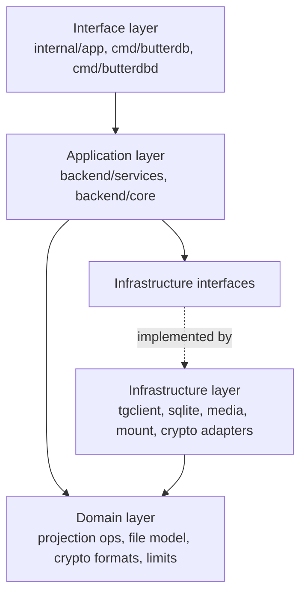

# butterDB — Implementation Plan

This plan turns `docs/butterDBCore.md` into an executable build order for a Go
implementation that follows clean architecture, the SOLID principles and
constructor dependency injection.

`butterDBCore.md` is the specification: it owns formats, constants and
algorithms. This file is the plan: it owns layering, interfaces, sequencing and
acceptance. Where the two disagree on a byte, a size or a constant, the
specification wins.

---

## 1. Scope

### 1.1 What is being built

A local-first desktop and mobile application that presents a user's own Telegram
account as a file system. A Go backend compiled into a Wails v3 shell, a CLI
driven through a local daemon, three loopback HTTP servers, and a SQLite
projection rebuilt from Telegram chat history.

### 1.2 Language policy

All application logic is Go. Every rule in this plan — layering, SOLID,
injection, comment policy, testing — applies to Go code.

One exception exists and is structural, not a preference: Wails renders its user
interface inside a native webview, so the view layer is TypeScript and Svelte.
That layer holds rendering and input only. No domain rule, no format, no
transport policy and no security decision lives there. If a behaviour could be
written in Go, it is written in Go.

### 1.3 Explicit non-goals

No server, no container deployment, no shared API credential, no transcoding, no
full-text search index, no content deduplication, no butterDB account system.
Identity is the Telegram account; authorization is channel membership.

---

## 2. Architecture

### 2.1 Four layers



| Layer | Holds | Imports |
| --- | --- | --- |
| **Domain** | TDX1 operations, TDE1 format arithmetic, file and folder models, limits, errors, port interfaces | Standard library only |
| **Application** | Use cases: upload, download, sync, projection, vault, media sessions, mount writes | Domain |
| **Infrastructure** | MTProto client, SQLite store, HTTP servers, WebDAV, remux, OS adapters | Domain, application ports |
| **Interface** | Wails services, CLI, daemon protocol | Application |

### 2.2 The dependency rule

Dependencies point inward. The domain layer imports nothing from this project.

Enforced edges, each verifiable by `go list` in CI:

- `backend/...` must never import `internal/app/...`.
- `internal/app/...` and `cmd/butterdbd/...` must never import each other.
- `backend/projection/wire`, `backend/crypto/format` and `backend/domain` must
  import no third-party package.
- No package outside `backend/tgclient` may import `github.com/gotd/td`.
- No package outside `backend/storage` may import `modernc.org/sqlite`.

Violating the last two is how a format package ends up unable to be tested
without a network or a database.

### 2.3 Interfaces belong to consumers

Every port is declared in the package that calls it, named for the role it
plays, and kept to the methods that caller actually uses. Adapters satisfy ports
implicitly; no adapter package imports a consumer package to declare conformance.

```go
package upload

type MessagePublisher interface {
    SendDocument(ctx context.Context, req DocumentRequest) (Receipt, error)
    SendControl(ctx context.Context, req ControlRequest) (Receipt, error)
}

type OperationProjector interface {
    Project(ctx context.Context, channelID int64, msgID int64, op wire.Op, raw string) error
}

type PartPlanner interface {
    Plan(storedSize int64) (PartPlan, error)
}
```

A port with more than roughly five methods is a sign that two roles were merged.
Split it.

### 2.4 Composition root

`backend/core` is the only place that constructs concrete types and wires them
together. Nothing else calls a constructor of another package's adapter, reads
configuration, or touches a package-level singleton.

```go
package core

type Engine struct {
    files     *file.Service
    folders   *folder.Service
    read      *read.Service
    vault     *encryption.Service
    media     *media.Service
    sync      *sync.Engine
    lifecycle *lifecycle.Group
}

func New(ctx context.Context, deps Dependencies) (*Engine, error)
```

`Dependencies` carries already-constructed infrastructure. `New` performs the
construction order from the specification and nothing else:

1. Clean cache temp directories — fatal on failure.
2. Build the Telegram adapter.
3. Connect to Telegram — a warning only; the engine stays usable offline.
4. Open the database and ensure the schema — fatal on failure.
5. Construct domain services — fatal on failure.
6. Load the saved personal channel — distinguishing unconfigured from invalid.

Two rules that follow from this order:

- A failed Telegram connection never blocks construction. Browsing a projection
  offline is a supported state, not a degraded one.
- Injecting a custom client or connect function skips live-update installation.
  Tests must not assume live sync started.

### 2.5 No global state

No `init()` that does work. No package-level mutable variables. No singletons.
No ambient clock, randomness or filesystem access.

Time, randomness, the filesystem and the network are ports:

```go
type Clock interface { Now() time.Time }
type IDSource interface { NewUUID() string }
type RandomSource interface { Read(p []byte) (int, error) }
type FileSystem interface {
    Open(name string) (io.ReadSeekCloser, error)
    CreateTemp(dir, pattern string) (TempFile, error)
    Rename(oldPath, newPath string) error
}
```

This is what makes the projector, the upload planner and the vault testable with
no I/O at all. It is also what enforces the specification's rule that the
projector never reads the local clock for domain state: the projector is not
given a clock.

---

## 3. Package map

```
butterDB/
├── main.go                      Embeds frontend/dist, calls app.Run
├── Taskfile.yml
│
├── backend/
│   ├── domain/                  Entities, value objects, domain errors. No deps
│   │   ├── fsmodel/             File, Folder, Dirent, Revision, ObjectID
│   │   ├── limits/              Every size and count ceiling, in one file
│   │   └── errs/                Sentinel errors and stable codes
│   │
│   ├── projection/
│   │   ├── wire/                TDX1 parse and format. Pure
│   │   ├── schema/              DDL and migrations
│   │   ├── apply/               Per-operation apply rules
│   │   ├── log/                 ProjectFromOp, ProjectFromOpTx
│   │   └── rebuild/             Replay from the log
│   │
│   ├── crypto/
│   │   ├── format/              TDE1 header, nonce, size arithmetic. Pure
│   │   ├── stream/              Encrypt and sequential decrypt
│   │   ├── randomaccess/        Authenticated random-access decryptor
│   │   └── vault/               Argon2id, wrap, unwrap, key check
│   │
│   ├── storage/                 SQLite open, pragmas, repositories
│   ├── tgclient/                MTProto transport, pools, limiter, retries
│   ├── sync/  livesync/  backfill/
│   ├── services/                file, folder, read, auth, encryption, channel
│   ├── media/                   Sessions, range reader, HTTP, thumbnails
│   │   └── remux/               Matroska demux to fMP4
│   ├── mount/                   dav, write, controller, policy, os adapters
│   ├── daemon/                  Socket server and JSON protocol
│   ├── core/                    Composition root
│   └── platform/                datadir, processlock, applog, biometric
│
├── internal/app/                Wails service layer
├── cmd/butterdb/                CLI
├── cmd/butterdbd/               Daemon
├── frontend/                    Svelte view layer
├── build/                       Packaging and platform tasks
└── docs/                        Every document in this project
```

One package, one reason to change. `backend/projection/wire` changes when the
wire format changes and for no other reason — which is why it can carry a
round-trip table test that is cheap to trust.

---

## 4. SOLID, applied

### 4.1 Single responsibility

| Package | Its one reason to change |
| --- | --- |
| `projection/wire` | The TDX1 grammar |
| `crypto/format` | The TDE1 container layout |
| `domain/limits` | A ceiling moves |
| `services/file/plan` | Split and part-planning rules |
| `services/file/upload` | Upload orchestration and commit boundaries |
| `tgclient/writecoord` | Flood-wait and write serialization policy |
| `media/rangereader` | Block caching, coalescing and read-ahead |

The upload service does not parse wire headers, compute ciphertext sizes or
decide retry policy. It asks collaborators.

### 4.2 Open/closed

Operation types extend through a registry, not a growing switch in every caller:

```go
type Applier interface {
    Type() wire.OpType
    Apply(ctx context.Context, tx Tx, env Envelope) error
}

type Registry struct{ appliers map[wire.OpType]Applier }

func (r *Registry) Register(a Applier)
func (r *Registry) Lookup(t wire.OpType) (Applier, bool)
```

Adding `t=untrash` means adding one applier and one registration. The projector
is untouched. The same shape covers upload shapes, download shapes, media
platform routing and daemon commands.

The wire parser keeps its own switch deliberately: parsing is a closed grammar
and an unknown type must fail loudly as `ErrWireBadOpType`. Unknown *keys* are
ignored so older clients degrade gracefully, which is the only extension point
the format offers.

### 4.3 Liskov substitution

Every implementation of a port honours the port's contract in full, including
its error contract. The in-memory test double for `MessagePublisher` returns
`ErrSendOutcomeUnknown` under the same conditions the real client does, because
a double that never produces an uncertain outcome hides the bug the whole upload
design exists to survive.

Read-only implementations are separate types, not implementations that return
"not supported" from write methods. A shared-drive mount is a read-only adapter
satisfying a read-only port.

### 4.4 Interface segregation

`ReadDocumentRange` consumers need one method, and that is the size of the port
they declare:

```go
package rangereader

type DocumentRangeReader interface {
    ReadDocumentRange(ctx context.Context, ref tgclient.DocumentRef, offset int64, dst []byte) (int, error)
}
```

The thumbnail extractor, the HLS source, the download runner and the random
access decryptor each depend on this one method. None of them can reach a send
path, so none of them can accidentally write.

### 4.5 Dependency inversion

Constructor injection everywhere, with validation at construction:

```go
func NewService(deps Dependencies) (*Service, error) {
    if deps.Publisher == nil {
        return nil, fmt.Errorf("upload: %w: publisher", errs.ErrMissingDependency)
    }
    ...
    return &Service{...}, nil
}
```

No service locator, no context-carried dependencies, no setter injection. A
constructed service is fully usable; a half-wired one does not exist.

---

## 5. Cross-cutting rules

### 5.1 Errors

Domain errors are sentinels wrapped with `%w`. Every error crossing a process
boundary carries a stable code separate from its display message.

```go
type Operation struct {
    OK      bool   `json:"ok"`
    Code    string `json:"code"`
    Message string `json:"message"`
}
```

Callers branch on codes and types, never on message text. Flood waits become a
typed `FloodWaitError` at the transport boundary. `ErrSendOutcomeUnknown` is its
own type and is never collapsed into a generic failure — a message that may
exist is a different fact from a message that does not.

### 5.2 Concurrency

Every goroutine has an owner that can stop it and wait for it. Lifecycles are
explicit:

```go
type Component interface {
    Start(ctx context.Context) error
    Close(ctx context.Context) error
}
```

`lifecycle.Group` starts components in dependency order and closes them in
strict reverse, with a bounded context per close. The mount closes before the
engine; the engine closes before logging; the process lock releases last.

Shared state is held behind the narrowest lock that works. The encryption
generation gate uses an `RWMutex` plus an atomic counter, and both checks run
under the gate before publication, because clearing a key cannot stop a request
that already copied it.

### 5.3 Persistence

- Exactly one pooled SQLite connection, process-wide.
- No transaction is held across a network call. Spool in short transactions
  between network calls, then apply.
- Every write that affects a transfer's durability lands on disk before the row
  that claims it. Download block rows are inserted after the staging file is
  synced, never before.

### 5.4 Secrets

One primitive writes every secret file: temp file in the same directory, chmod
`0600` before the first secret byte, write, sync, close, rename, fsync the
directory. Nothing else creates a file under the data directory.

Master key copies are cleared on every return path including error paths. Keys,
passwords and native signatures never cross into the frontend bindings or the
runtime event bus.

### 5.5 Comments

Code carries no comment blocks. A single-line comment is allowed where a
non-obvious constraint cannot be expressed in a name — an ordering requirement, a
protocol quirk, a deliberate deviation. Two consecutive comment lines are a
defect: extract the code into a named function instead.

This is not a documentation policy. Everything a comment block would have said
belongs in `docs/`, where it can be reviewed and versioned as prose.

---

## 6. Milestones

Twelve milestones. Each is independently demonstrable and ends with a commit.
Each acceptance criterion is a check that can actually be run.

### M1 — Shell and process ownership

Build `main.go`, `internal/app/run.go`, a Wails window, `platform/datadir`,
`platform/processlock`, `platform/applog`, and `lifecycle.Group`.

Ports introduced: `FileSystem`, `Clock`, `LockGuard`.

**Accept:** the app opens a window; a second instance refuses to start and says
why; killing the first frees the lock with no stale PID file left behind.

### M2 — Telegram identity

Build `services/auth`: the private-file primitive, credential storage, the
hand-rolled login state machine holding the phone code hash across attempts, 2FA,
session persistence, soft and full logout.

Ports: `CredentialStore`, `SessionStore`, `AuthClient`.

**Accept:** sign in with a real account; restart and stay signed in; a mistyped
code is retryable in place without restarting from the phone number;
`session.json` is `0600`.

### M3 — Database and the wire format

Build `storage` with the pragmas, and `projection`: `wire`, `schema`, `apply`,
`log`, `rebuild`, with the applier registry.

**This is the gate.** A wire-format or projector defect found at M9 is expensive;
found here it is a test case.

**Accept:** the TDX1 round-trip table test passes for every operation type and
every malformed input maps to its specific error; projecting the same message
twice is a no-op returning `alreadySeen`; an edited header produces a tamper row
with the original operation still canonical; rebuild reproduces the derived
tables exactly.

### M4 — Drives and read-only sync

Build personal drive creation and discovery, `sync` with the spool-based full
scan, `pts` differences, the watermark and authority distinction, ordering
repair, and `livesync`.

**Accept:** create a drive, add `mkdir` messages by hand in the Telegram app,
sync, and see the folders; delete the database, restart, and watch the namespace
rebuild from history.

### M5 — Single-file upload and download

Build `tgclient`: the single gotd run scope, `SendFileIdempotent`,
`StableRandomID`, `ReadDocumentRange` with its preconditions, the getFile
limiter, the write coordinator, flood-wait retries. Then single-document upload
and whole-file download with staging and rename publication.

**Accept:** upload a 10 MB file; see it in the Telegram app with a `TDX1|t=f`
caption; download it and compare SHA-256.

### M6 — Multipart

Build `domain/limits`, the part planner, the multipart uploader with its abort
boundary, chunked message deletion, `pending_part_cleanup`, and the manifest
completeness check in the projector.

**Accept:** upload a 4 GB file and see one file, not three; parts never appear in
listings; killing the process before the manifest attempt leaves no orphans;
killing it after the manifest send still yields a usable file after sync.

### M7 — Encryption

Build `crypto/format`, `crypto/stream`, `crypto/randomaccess`, `crypto/vault`,
`services/encryption` with leases and the generation gate, and the `encfg`
operation.

**Accept:** set a password; upload an encrypted file; verify the Telegram
document starts with `TDE1`; download and decrypt; a wrong password fails at
open; flipping one ciphertext byte fails the read that touches that chunk;
`CiphertextSize` matches the stored size exactly for 0, 1, 65535, 65536 and
65537 byte inputs.

### M8 — Media streaming

Build `media`: resolver, session, range reader with cache, read-ahead,
coalescing and priority promotion; the loopback HTTP server with capability
tokens and range handling; encrypted range mapping.

**Accept:** stream a 2 GB MP4 and seek to the middle without downloading the
whole file; stream an encrypted multipart video and seek across a part boundary;
revoking a session makes its URL return 404 immediately.

### M9 — Frontend

Build the Svelte shell, the API adapter layer and gateway, the typed event map,
`FlushEvents` and the event-ordering barrier, the virtualized file list, the
upload queue and transfer batch, the gallery with keyset paging and the rendition
broker, and the video controller with both adapters.

**Accept:** browse, upload with progress, play a video, scroll a 50,000-photo
gallery without memory growth, and have a batch's late events land on its own
rows rather than the batch queued behind it.

### M10 — Resumable transfers

Build the upload and download journals, their runners, recovery and
reconciliation, and the frontend retry logic with backoff and generation guards.

**Accept:** start a 5 GB upload, drop the network, restore it, and watch it
continue from confirmed parts without resending them; the same for a download,
across an app restart.

### M11 — Mount, remux, CLI

Build `mount/dav` and `mount/write` with the journal and its state machine,
`media/remux` with the HLS server, `daemon`, and `cmd/butterdb`.

**Accept:** mount the drive in Finder or Explorer and copy a file in and out;
play an MKV on a device whose webview cannot demux it; run
`butterdb ls --json` and get a schema-versioned object.

### M12 — Platforms and packaging

Build the Android and iOS hosts, biometric providers, photo backup, the updater,
packaging scripts and CI.

**Accept:** install the APK and sign into the same drive; the AppImage runs in a
container with no system GTK or WebKit; an update installs and rolls back cleanly
when the mount is unhealthy.

### Ordering

M3 gates everything. M5 and M6 precede M7, because debugging encryption on top of
a working upload is far easier than debugging both at once. M8 precedes M9, since
the frontend is much easier to build against a media server that already works.
M10 may slip: it is the most intricate subsystem and the least load-bearing for a
first usable release.

---

## 7. Testing

| Layer | Approach |
| --- | --- |
| Domain | Pure table tests, no I/O, no doubles |
| Application | Fakes for every port, written by hand |
| Infrastructure | Integration tests against temp directories and a fake Telegram client |
| Interface | Contract tests over the daemon JSON protocol and the binding surface |

Doubles are hand-written fakes placed beside the consumer that declares the port.
No mocking framework. A fake that cannot produce the port's documented failure
modes is not an acceptable double.

### 7.1 The minimum set before anything ships

1. TDX1 round trip for every operation type, plus every malformed input mapping
   to its specific error.
2. TDE1 size arithmetic for 0, 1, 65535, 65536, 65537 and a multi-gigabyte
   value, verifying the empty-final-chunk rule.
3. TDE1 round trip and tamper: flip a ciphertext byte, assert the touched chunk
   fails; truncate the tail, assert open fails.
4. Random-access boundary reads: spanning chunk boundaries, inside one chunk, and
   ending exactly at the final chunk.
5. Projector idempotency: the same message applied twice leaves the projection
   unchanged and reports `alreadySeen`.
6. Tamper evidence: same message ID with a different header keeps the original
   operation canonical and records a tamper row.
7. Rebuild equivalence: project N operations, snapshot the derived tables,
   rebuild, assert identical.
8. Cycle rejection: moving a folder into its own descendant.
9. Multipart abort boundary: failing before the manifest attempt deletes parts;
   failing after preserves them.
10. Download checkpoint durability: killing mid-batch leaves no block row
    claiming unsynced bytes.

### 7.2 Honesty about evidence

Each test class proves what it proves. Go unit tests prove logic, not Telegram
behaviour. A fake client proves protocol shape, not flood-wait reality.
Compilation proves it builds, not that it runs on a device. State which checks
actually ran; "compiles" is not "works".

---

## 8. Build and verification

```bash
npm --prefix frontend ci
npm --prefix frontend run build
wails3 task common:generate:bindings
wails3 task build
go build -o build/bin/butterdb ./cmd/butterdb
```

On Linux every direct Go command needs `-tags=gtk3`. Root-package Go commands
embed `frontend/dist`, so the frontend builds first on a fresh checkout.

Verification before every commit:

```bash
gofmt -l .
go vet -tags=gtk3 ./...
go test -tags=gtk3 ./...
```

CI adds: a race job over a curated package list, static analysis, binding drift
detection that fails on any regenerated difference, the AppImage smoke test in a
container deliberately missing GTK and WebKit, and the layering checks from
§2.2.

---

## 9. Workflow

### 9.1 Branching and commits

Work on a branch; `main` receives merges. One commit per coherent unit of work —
a milestone step, a package, a fix.

Commit messages are a single line of plain English with no body and no trailing
description. The author on every commit is `prieyan <mnprieyan@gmail.com>`.

```
add tdx1 wire parser and formatter
fix part plan overflow guard for large files
write implementation plan document
```

Nothing is pushed. Commits stay local until the repository owner pushes them.

### 9.2 Parallel commit execution

Independent file groups are committed by parallel Sonnet-low agents, one agent
per group, each agent responsible for staging only its own paths. Git serializes
on the index lock, so every agent retries on a held lock rather than failing.
A monitoring task tracks every agent and reports which commits landed.

Agents never push, never amend another agent's commit, and never stage a path
outside their assignment.

---

## 10. Risks

| Risk | Mitigation |
| --- | --- |
| Wire or container format defect discovered late | M3 is a hard gate with round-trip tests; both formats live in dependency-free packages |
| Two engines running against one database | Process lock at M1, before any storage code exists |
| Transaction held across network I/O | Repository methods take no context that could reach the network; spool-then-apply is the only sync path |
| Resend of an already-accepted message | Stable random IDs, `ErrSendOutcomeUnknown` as a distinct type, multipart refusing to start without an idempotent sender |
| Encryption key cleared mid-publication | Generation gate checked under the lock before publishing any session |
| Wails beta changing generated method IDs | Pin the beta exactly; CI fails on binding drift |
| Layering erosion over time | Import rules enforced in CI, not by convention |
