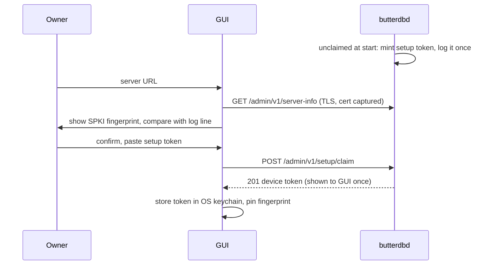
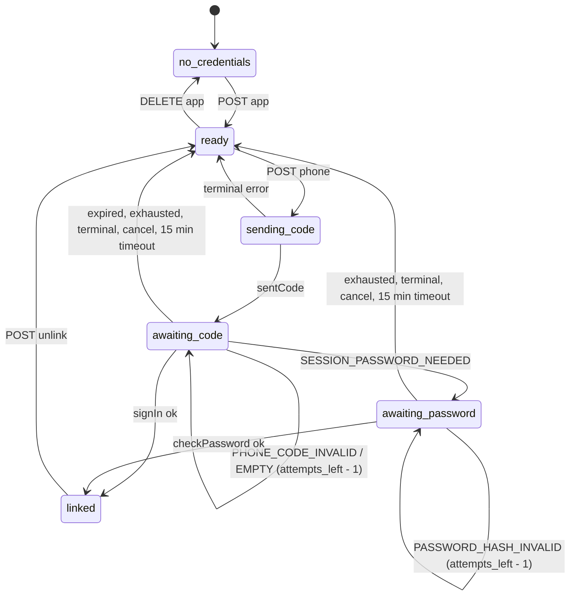

# Admin API specification (`/admin/v1`)

The admin API is the only way to administer a running `butterdbd`. The Fyne
desktop app (D13, D14, [admin-gui.md](admin-gui.md)) is its primary client; the
Go client in `api/adminv1` is the only supported client library. It is built in
phase 09, except the replica endpoints, which phase 12 adds.

| Item | Value |
| --- | --- |
| Base path | `/admin/v1` |
| Transport | HTTPS on its own listener, separate from the S3 and media listeners |
| Default listen address | `0.0.0.0:9443` — Default (owner may change) |
| TLS | Server-generated certificate, SPKI fingerprint pinned by the GUI (A3) |
| Authentication | Setup token (claim), device bearer tokens (A1, A2), pairing codes |
| Body format | `application/json; charset=utf-8`, except object upload and download |
| DTO and client package | `github.com/PRIEYAN/ButterDB/api/adminv1` |
| Server packages | `internal/adminapi/{setup,session,tlscert,handlers}`, `internal/storage/adminrepo` |

Bound by: D2, D3, D8, D9, D10, D11, D12, D14, D15, A1, A2, A3, A5, A6, A9, E9.

---

## 1. Principles

1. **The server owns the Telegram session.** The API relays login input to the
   server and reports state. No response ever contains the gotd session, the
   MTProto auth key, the `phone_code_hash`, the `api_hash`, the 2FA password or
   an SRP parameter.
2. **One owner, many devices.** A device is one installation of the GUI. Every
   device has the same, full authority. There are no admin roles (D3).
3. **Errors are branched on `code`, never on `message`** (the S20 JSON
   contract, kept).
4. **Mutations that touch Telegram return only after the Telegram commit** (D8),
   or fail with a retryable code and `retry_after_seconds`.
5. **The API surface is the Go client.** Every endpoint has exactly one method
   on `adminv1.Client` and one request and one response type.

---

## 2. Listener and transport

### 2.1 Configuration

Keys live in the `[admin]` table of the server TOML file and are overridable by
`BUTTERDB_ADMIN_*` environment variables (`internal/platform/config`).
`docs/spec/operations.md` is authoritative for the configuration file as a
whole; it must carry these admin keys with these names and defaults.

| Key | Env | Default | Meaning |
| --- | --- | --- | --- |
| `admin.listen` | `BUTTERDB_ADMIN_LISTEN` | `0.0.0.0:9443` | TCP address of the admin listener |
| `admin.tls_mode` | `BUTTERDB_ADMIN_TLS_MODE` | `self-signed` | `self-signed`, `files` or `proxy` |
| `admin.tls_cert_file` | `BUTTERDB_ADMIN_TLS_CERT_FILE` | empty | PEM chain, `files` mode only |
| `admin.tls_key_file` | `BUTTERDB_ADMIN_TLS_KEY_FILE` | empty | PEM key, `files` mode only, read through `internal/platform/secretfile` |
| `admin.hostnames` | `BUTTERDB_ADMIN_HOSTNAMES` | `[]` | Extra DNS names and IPs written into the self-signed certificate |
| `admin.trusted_proxies` | `BUTTERDB_ADMIN_TRUSTED_PROXIES` | `["127.0.0.1/32", "::1/128"]` | CIDRs whose `X-Forwarded-For` is honoured for rate limiting and audit |
| `admin.control_socket` | `BUTTERDB_ADMIN_CONTROL_SOCKET` | `<data_dir>/admin.sock` | Local socket used by `butterdbd admin-token` |
| `admin.setup_token_ttl` | `BUTTERDB_ADMIN_SETUP_TOKEN_TTL` | `24h` | Lifetime of a setup token |
| `admin.pairing_code_ttl` | `BUTTERDB_ADMIN_PAIRING_CODE_TTL` | `10m` | Lifetime of a pairing code |
| `admin.device_idle_revoke` | `BUTTERDB_ADMIN_DEVICE_IDLE_REVOKE` | `4320h` (180 days) | A device unused this long is revoked by the sweeper |
| `admin.upload_commit_budget` | `BUTTERDB_ADMIN_UPLOAD_COMMIT_BUDGET` | `10m` | Longest a single admin upload may wait on Telegram before `telegram_flood_wait` |

`butterdbd check-config` fails when:

- `tls_mode = "files"` and either file is missing or the key does not match the
  certificate;
- `tls_mode = "proxy"` and `admin.listen` is not a loopback address;
- the resolved control-socket path is longer than 103 bytes (the portable
  `sun_path` limit).

### 2.2 TLS modes

| Mode | Server behaviour | GUI trust mode |
| --- | --- | --- |
| `self-signed` | `internal/adminapi/tlscert` generates and serves its own certificate | `pinned` (SPKI fingerprint, TOFU at pairing) |
| `files` | Serves the operator's certificate and key; reloads them on `SIGHUP` | `system` when the chain verifies against OS roots, otherwise `pinned` |
| `proxy` | Plain HTTP on a loopback listener; a reverse proxy terminates TLS | `system` (the proxy's real certificate) |

TLS settings for `self-signed` and `files`: minimum version TLS 1.3, HTTP/2
enabled, no client certificates, session tickets on.

### 2.3 Self-signed certificate (`internal/adminapi/tlscert`)

| Property | Value |
| --- | --- |
| Key | ECDSA P-256, generated once on first start |
| Key file | `<data_dir>/tls/admin.key` (PEM, PKCS#8), mode `0600`, written through `secretfile` |
| Certificate file | `<data_dir>/tls/admin.crt` (PEM), mode `0644` |
| Subject CN | `butterdbd admin <server_id>` |
| SANs | `localhost`, `127.0.0.1`, `::1`, `os.Hostname()`, every `admin.hostnames` entry |
| Validity | 825 days from issue |
| Renewal | At start, if fewer than 30 days remain or the SAN set changed, a new certificate is issued **with the same key** |
| Fingerprint | SHA-256 of the DER `SubjectPublicKeyInfo` of the leaf (SPKI pin) |

Pinning the public key rather than the certificate means renewal and SAN
changes never break a paired GUI. Only deleting `tls/admin.key` changes the
fingerprint; the GUI then refuses to connect until the owner re-pairs
(see [admin-gui.md](admin-gui.md) §4.4).

Fingerprint text forms:

| Form | Example | Used in |
| --- | --- | --- |
| Canonical | `SHA256:` followed by 64 lowercase hex characters | JSON, config, `servers.json` |
| Display | 16 groups of 4 hex characters separated by spaces | Server log, GUI confirmation dialog |

At every start the server logs one line at `INFO`:

```json
{"level":"INFO","msg":"admin listener","addr":"0.0.0.0:9443","tls_mode":"self-signed","tls_fingerprint":"SHA256:4f1c…","tls_fingerprint_display":"4f1c 9a0e …"}
```

```go
package tlscert

type Material struct {
	Certificate tls.Certificate
	SPKISHA256  [32]byte
	NotAfter    time.Time
}

func LoadOrCreate(dir string, serverID string, hostnames []string, now time.Time) (Material, error)
func Fingerprint(spki [32]byte) string
func DisplayFingerprint(spki [32]byte) string
```

### 2.4 Reverse proxy

A proxy is optional. When used:

- The proxy must stream request and response bodies. nginx needs
  `proxy_request_buffering off`, `proxy_buffering off` and
  `client_max_body_size 1900m`. Caddy streams by default.
- Proxy read timeouts must be at least `admin.upload_commit_budget` plus one
  minute, because an upload response waits for the Telegram commit.
- The client address is taken from the right-most `X-Forwarded-For` entry not
  in `admin.trusted_proxies`. Requests from other peers have the header
  ignored.

### 2.5 HTTP server hardening

| Setting | Value |
| --- | --- |
| `ReadHeaderTimeout` | 10 s |
| `IdleTimeout` | 120 s |
| `MaxHeaderBytes` | 64 KiB |
| JSON request body limit | 1 MiB (`http.MaxBytesReader`), else `payload_too_large` |
| Read and write deadlines | 60 s for JSON routes, set per request with `http.ResponseController`; none for object upload and download |
| CORS | No CORS headers are ever sent; browsers cannot call the API cross-origin |
| JSON POST/PUT/PATCH | Requires `Content-Type: application/json`, else `unsupported_media_type` |
| Router | Standard library `http.ServeMux` with method patterns (Go 1.22+) |
| `Host` check | When `admin.listen` is a loopback address (always in `proxy` mode), a request whose `Host` (port stripped) is not `localhost`, `127.0.0.1`, `::1` or an `admin.hostnames` entry gets `421 misdirected_request`. Blocks DNS rebinding (docs/claude.md invariant 12) |

---

## 3. Conventions

| Topic | Rule |
| --- | --- |
| Field names | `snake_case` |
| Unknown request fields | Rejected with `bad_request` (`json.Decoder.DisallowUnknownFields`) |
| Unknown response fields | Clients ignore them; adding a response field is not a breaking change |
| Timestamps | RFC 3339 UTC with millisecond precision, e.g. `2026-11-12T09:41:07.312Z` |
| Durations | Integer seconds, field name ends in `_seconds` |
| Sizes | Integer bytes, field name ends in `_bytes` |
| Absent optional value | Field omitted (`omitempty`) or `null` for objects; never an empty-string sentinel |
| Pagination | `?cursor=<opaque>&limit=<n>`; response carries `next_cursor` (omitted on the last page). Cursors are base64url, opaque, and valid for 24 hours |
| Request ID | Every response carries `X-Request-Id` (16 random bytes, hex). Error bodies repeat it as `request_id` |
| Authentication header | `Authorization: Bearer <device token>` |
| Idempotency | `Idempotency-Key` header on object upload only (§12.4) |
| Versioning | A breaking change creates `/admin/v2`. `/admin/v1` stays served for at least one minor release after `v2` ships |
| User agent | The Go client sends `butterdb-adminv1/<module version> (<goos>/<goarch>)` |

---

## 4. Errors

### 4.1 Envelope

Every non-2xx response with a body uses this envelope. `HEAD` errors carry the
status code and an `X-Butterdb-Error-Code` header only.

```json
{
  "error": {
    "code": "telegram_code_invalid",
    "message": "Telegram rejected the login code.",
    "retryable": true,
    "hint": "Check the code in your Telegram app and enter it again. The same code request is still valid.",
    "retry_after_seconds": 0,
    "details": {"attempts_left": 4},
    "request_id": "6f0c2b9e4a1d73c05e88b1a2c3d4e5f6"
  }
}
```

| Field | Type | Meaning |
| --- | --- | --- |
| `code` | string | Stable machine code from §4.2. Never changes meaning within `v1` |
| `message` | string | English, one sentence, for logs. Not for branching |
| `retryable` | bool | `true` when the same request may succeed unchanged later |
| `hint` | string | What the owner should do; may be empty |
| `retry_after_seconds` | int | Set with `429` and flood-wait `503`; mirrored in the `Retry-After` header |
| `details` | object | Code-specific fields listed in §4.2; may be omitted |
| `request_id` | string | Same as `X-Request-Id` |

Codes come from `internal/domain/errs` sentinels where one exists; the
handler layer maps sentinels to codes in one table
(`internal/adminapi/handlers/errors.go`). An unmapped error becomes `internal`
and is logged with the request ID.

### 4.2 Stable code table

| Code | HTTP | Retryable | `details` | When |
| --- | --- | --- | --- | --- |
| `bad_request` | 400 | no | `field` | Malformed JSON, unknown field, bad query parameter |
| `validation_failed` | 422 | no | `field`, `reason` | Well-formed input that breaks a rule |
| `unauthenticated` | 401 | no | | Missing, malformed or unknown bearer token |
| `device_revoked` | 401 | no | `revoked_at` | Token belongs to a revoked device |
| `not_found` | 404 | no | | Unknown route or resource without a more specific code |
| `method_not_allowed` | 405 | no | | Route exists, method does not |
| `misdirected_request` | 421 | no | | `Host` check of §2.5 failed |
| `length_required` | 411 | no | | Upload without `Content-Length` |
| `payload_too_large` | 413 | no | `limit_bytes` | JSON body over 1 MiB |
| `unsupported_media_type` | 415 | no | | JSON route without JSON content type |
| `rate_limited` | 429 | yes | `scope` | A §5.6 limiter tripped |
| `internal` | 500 | no | | Unmapped server error |
| `server_not_ready` | 503 | yes | `state` | Startup, rebuild or restore in progress |
| `not_implemented` | 501 | no | `phase` | Endpoint belongs to a later phase (replica before phase 12) |
| `already_claimed` | 409 | no | | Claim on a claimed server |
| `not_claimed` | 409 | no | | Pairing on an unclaimed server |
| `setup_token_invalid` | 401 | no | | Wrong, used or expired setup token (indistinguishable on purpose) |
| `pairing_code_invalid` | 401 | no | | Wrong, used or expired pairing code (indistinguishable on purpose) |
| `pairing_unavailable` | 409 | no | `methods` | Saved Messages delivery requested while Telegram is not linked |
| `last_device` | 409 | no | | Revoking the only active device without `confirm_last` |
| `device_not_found` | 404 | no | | Unknown device ID |
| `telegram_not_linked` | 409 | no | | Operation needs a linked Telegram account |
| `telegram_unavailable` | 503 | yes | | Linked, but the connection to Telegram is down |
| `telegram_flood_wait` | 503 | yes | `until` | Telegram `FLOOD_WAIT` exceeds the request budget |
| `telegram_credentials_missing` | 409 | no | | Login started before `api_id`/`api_hash` were saved |
| `telegram_already_linked` | 409 | no | | Credentials change or login while linked |
| `telegram_login_in_progress` | 409 | no | `login_id`, `state` | Login started while another attempt is active |
| `telegram_login_not_active` | 409 | no | `state` | Code or password submitted with no matching attempt or stage |
| `telegram_api_id_invalid` | 422 | no | | `API_ID_INVALID` or `API_ID_PUBLISHED_FLOOD` |
| `telegram_phone_invalid` | 422 | no | | `PHONE_NUMBER_INVALID` |
| `telegram_phone_banned` | 403 | no | | `PHONE_NUMBER_BANNED` |
| `telegram_account_not_registered` | 422 | no | | `PHONE_NUMBER_UNOCCUPIED` or sign-up required |
| `telegram_code_invalid` | 422 | yes | `attempts_left` | `PHONE_CODE_INVALID` or `PHONE_CODE_EMPTY`; the attempt stays in `awaiting_code` |
| `telegram_code_expired` | 410 | no | | `PHONE_CODE_EXPIRED`; the attempt ends |
| `telegram_password_invalid` | 422 | yes | `attempts_left` | `PASSWORD_HASH_INVALID`; the attempt stays in `awaiting_password` |
| `telegram_attempts_exhausted` | 409 | no | | Fifth invalid code or password in one attempt; the attempt ends |
| `telegram_email_setup_required` | 422 | no | | Telegram demands login-email setup (`auth.sentCodeTypeSetUpEmailRequired`), which butterDB does not support |
| `telegram_account_mismatch` | 409 | no | `bound_user_id` | Login completed as a different Telegram user than the deployment is bound to |
| `telegram_login_failed` | 502 | no | `telegram_error` | Any other terminal Telegram error (`AUTH_RESTART`, unexpected sent-code type) |
| `bucket_not_found` | 404 | no | | |
| `bucket_exists` | 409 | no | | |
| `bucket_name_invalid` | 422 | no | `reason` | Breaks the S3 bucket naming rules in `internal/domain/bucket` |
| `bucket_not_empty` | 409 | no | `object_count` | Delete of a bucket that still holds objects |
| `bucket_limit_reached` | 409 | no | `limit` | More than `limits.MaxBuckets` (100) buckets |
| `access_key_not_found` | 404 | no | | |
| `scope_invalid` | 422 | no | `field` | Unknown action, unknown bucket, empty action list |
| `object_not_found` | 404 | no | | |
| `object_key_invalid` | 422 | no | `reason` | Empty, over 1024 bytes, or not valid UTF-8 |
| `object_too_large` | 413 | no | `max_bytes` | Stored size would exceed `limits.MaxStoredObjectBytes` (1900 MiB; ciphertext counts, D9) |
| `metadata_too_large` | 422 | no | `max_bytes` | User metadata over 2048 bytes |
| `checksum_mismatch` | 400 | no | `algorithm` | `Content-MD5` or `X-Butterdb-Content-Sha256` does not match the body |
| `precondition_failed` | 412 | no | | `If-Match` / `If-None-Match` failed on write |
| `range_not_satisfiable` | 416 | no | `size_bytes` | |
| `idempotency_conflict` | 409 | no | | `Idempotency-Key` reused with a different bucket, key or body hash |
| `commit_outcome_unknown` | 503 | yes | `job_id` | The Telegram send outcome is unknown (`ErrSendOutcomeUnknown`); retry with the same `Idempotency-Key` |
| `presign_key_invalid` | 422 | no | | Access key missing, revoked, or without `read` on the bucket |
| `s3_public_url_unset` | 409 | no | | Presign requested but the S3 public URL is not configured |
| `replica_not_linked` | 409 | no | | |
| `replica_already_linked` | 409 | no | | |
| `replica_same_account` | 409 | no | | Replica login resolved to the primary account's user ID |

---

## 5. Authentication

### 5.1 Server claim states

| State | Meaning | Reachable endpoints |
| --- | --- | --- |
| `unclaimed` | No device has ever been registered, or every device was revoked and none re-claimed | `GET /server-info`, `POST /setup/claim` |
| `claimed` | At least one device row exists (active or revoked) | `GET /server-info`, pairing endpoints, every device-authenticated endpoint |

Revoking the last device does not return the server to `unclaimed`; recovery
is through `butterdbd admin-token` (§5.5), which needs host access.

Exactly four routes run without a device token: `GET /server-info` (no secret,
needed to read the claim state before any credential exists),
`POST /setup/claim` (setup token), `POST /pairing/request` (sends a code only
to the owner's own Saved Messages) and `POST /pairing/complete` (pairing code).
Every other route requires `Authorization: Bearer`. This refines docs/claude.md
invariant 12, which names only the claim.

### 5.2 Setup token (A2)

| Property | Value |
| --- | --- |
| Format | `bdst1_` followed by 32 characters of lowercase RFC 4648 base32 without padding (20 random bytes, 160 bits) |
| Created | At `serve` start when the server is `unclaimed`; again on each later start while still unclaimed; on demand by `butterdbd admin-token` |
| Printed | Once per token, one `WARN` log line: `{"msg":"setup token","setup_token":"bdst1_…","expires_at":"…"}` |
| Stored | Only its hash (§5.7), one row in `admin_setup_token`. A new token replaces the old one |
| Lifetime | `admin.setup_token_ttl` (24 h) |
| Use | Single use. A successful claim deletes the row in the same transaction that inserts the first device |
| Comparison | Constant time (`subtle.ConstantTimeCompare`) on the hash |

Claim flow:



### 5.3 Device tokens (A1)

| Property | Value |
| --- | --- |
| Format | `bdt1_<device_id>_<secret>` |
| `device_id` | 16 characters lowercase base32 (10 random bytes) |
| `secret` | 52 characters lowercase base32 (32 random bytes) |
| Transport | `Authorization: Bearer` only; never a query parameter, never a cookie |
| At rest on the server | `token_hash` = keyed hash of the full token string (§5.7). The token itself is never stored or logged |
| Lookup | Parse `device_id`, load the row, compare hashes in constant time |
| Lifetime | No absolute expiry. Revoked by the sweeper after `admin.device_idle_revoke` (180 days) without use |
| `last_seen_at`, `last_seen_ip` | Updated on authenticated requests, coalesced to at most one write per device per 60 s |
| Rotation | `POST /admin/v1/devices/self/rotate` issues a new secret. The previous hash moves to `prev_token_hash` and stays valid for 10 minutes or until the new token is first used, whichever comes first |
| GUI rotation policy | The GUI rotates when the token is older than 30 days, at connect — Default (owner may change) |
| Revocation | `DELETE /admin/v1/devices/{device_id}` sets `revoked_at`. Takes effect for every request that starts afterwards; streaming requests already authenticated finish |
| Logging | The middleware logs `device_id` only |

Authentication middleware order: request ID → client address resolution →
rate limiter (§5.6) → bearer parse → hash compare → revoked check → handler.
A failed bearer check counts against the `auth_failure` limiter before the
response is written.

### 5.4 Pairing an additional device (A1)

A pairing code adds a device to a `claimed` server.

| Property | Value |
| --- | --- |
| Alphabet | Crockford base32, uppercase: `0123456789ABCDEFGHJKMNPQRSTVWXYZ` |
| Length | 10 characters (50 bits), displayed as `XXXXX-XXXXX` |
| Input normalisation | Uppercase; strip spaces and hyphens; map `O`→`0`, `I`→`1`, `L`→`1` |
| Lifetime | `admin.pairing_code_ttl` (10 minutes) |
| Use | Single use; consumed in the transaction that inserts the device |
| Active codes | At most one per delivery method. A new code for a method replaces the previous one |
| Attempt limit | 5 consecutive failed completions server-wide invalidate every active code; per-address limiter in §5.6 |
| Stored | Hash only (§5.7), table `admin_pairing_codes` |

Delivery methods:

| `delivery` | Source | Precondition |
| --- | --- | --- |
| `saved_messages` | `POST /admin/v1/pairing/request` from the new GUI; the server sends the code to the linked account's Saved Messages with `internal/tgclient/rpc` (`messages.sendMessage` to `inputPeerSelf`) | Telegram linked |
| `host` | `butterdbd admin-token` on the server host (§5.5) | Host shell access |

Saved Messages text, sent as plain text without link previews:

```
butterDB pairing code: ABCDE-FGHJK
Device: "Office laptop" (windows/amd64)
Expires: 2026-11-12 09:51 UTC
If you did not request this, ignore it. Your server is still safe.
```

The new device's name is shown so the owner can spot a request they did not
make. `POST /pairing/request` is unauthenticated; it is limited to 5 Telegram
sends per hour per server (§5.6) and is audited.

### 5.5 Local control socket and `butterdbd admin-token`

`butterdbd serve` listens on a Unix domain socket at `admin.control_socket`,
mode `0600`, inside the `0700` data directory. Go supports `AF_UNIX` on Linux,
macOS and Windows 10 1803+, so no named-pipe path exists. The protocol is one
newline-terminated JSON request and one JSON response per connection:

```json
{"version":1,"command":"admin_token"}
{"version":1,"ok":true,"kind":"pairing_code","code":"ABCDE-FGHJK","expires_at":"2026-11-12T09:51:00.000Z"}
```

`kind` is `setup_token` when the server is `unclaimed` (the response then
carries `token` instead of `code`) and `pairing_code` when it is `claimed`.

`butterdbd admin-token` behaviour:

| Situation | Action |
| --- | --- |
| Socket answers | Prints the code or token from the response to stdout and exits 0 |
| No socket, process lock free | Takes the data-directory lock (`internal/platform/processlock`), writes the new token or code into `control.db` directly, prints it, releases the lock |
| No socket, lock held | Exits 1 with `server is running but the control socket is unreachable` |

stdout format (one line, for scripts):

```
pairing code: ABCDE-FGHJK (expires 2026-11-12T09:51:00Z)
setup token: bdst1_… (expires 2026-11-13T09:41:00Z)
```

Every `admin-token` use is audited with actor type `host`.

### 5.6 Rate limiting

In-memory token buckets in `internal/adminapi/session`, keyed as listed. Limits
reset on restart; that is accepted because every secret they protect has at
least 50 bits of entropy and a short lifetime. All values are Default (owner
may change).

| Scope (`details.scope`) | Key | Limit | Applies to |
| --- | --- | --- | --- |
| `claim` | client address | 5 per 15 min | `POST /setup/claim` |
| `pairing_request` | server-wide | 5 per hour | `POST /pairing/request` |
| `pairing_request_addr` | client address | 3 per hour | `POST /pairing/request` |
| `pairing_complete` | client address | 10 per 15 min | `POST /pairing/complete` |
| `auth_failure` | client address | 20 failed bearer checks per 10 min, then blocked for 15 min | every device-authenticated route |
| `telegram_login` | server-wide | 5 login starts per hour | `POST /setup/telegram/phone`, `POST /replica/telegram/phone` |
| `telegram_app` | server-wide | 10 per hour | `POST /setup/telegram/app` |
| `telegram_submit` | login attempt | 5 invalid codes plus 5 invalid passwords | code and password endpoints (`telegram_attempts_exhausted`) |
| `device` | device ID | 50 requests/s, burst 100 | every device-authenticated route |
| `unauthenticated` | client address | 10 requests/s, burst 20 | `GET /server-info` and unknown routes |

A tripped limiter answers `429 rate_limited` with `Retry-After`. Telegram's own
`FLOOD_WAIT` on login RPCs surfaces as `telegram_flood_wait`, independent of
these limits.

### 5.7 Hashing secrets at rest

Setup tokens, device tokens and pairing codes are stored only as

```
SHA-256( "butterdb-admin-v1\x00" || kind || "\x00" || utf8(normalised value) )
kind ∈ { "setup", "device", "pairing" }
```

The kind prefix keeps a value of one kind from ever matching a hash of another.
A plain hash is enough: setup and device tokens carry 160 and 256 bits of
entropy, and a pairing code (50 bits) lives 10 minutes and is single use, so
an offline guess from a stolen `control.db` copy is not useful in time. No
server key is involved, which keeps `internal/adminapi/session` independent of
`internal/crypto/keyring`.

```go
package session

type SecretKind string

const (
	KindSetup   SecretKind = "setup"
	KindDevice  SecretKind = "device"
	KindPairing SecretKind = "pairing"
)

func HashSecret(kind SecretKind, normalised string) [32]byte
```

Comparison is always `subtle.ConstantTimeCompare` on the 32-byte hashes.

---

## 6. Endpoint index

Auth column: `none` = unauthenticated, `setup` = setup token in body, `pair` =
pairing code in body, `device` = bearer device token.

| Method and path | Auth | Request DTO | Success | Response DTO | Phase |
| --- | --- | --- | --- | --- | --- |
| `GET /admin/v1/server-info` | none | | 200 | `ServerInfo` | 09 |
| `POST /admin/v1/setup/claim` | setup | `ClaimRequest` | 201 | `DeviceCredentials` | 09 |
| `POST /admin/v1/pairing/request` | none | `PairingRequest` | 202 | `PairingRequested` | 09 |
| `POST /admin/v1/pairing/complete` | pair | `PairingCompleteRequest` | 201 | `DeviceCredentials` | 09 |
| `GET /admin/v1/devices` | device | | 200 | `DeviceList` | 09 |
| `PATCH /admin/v1/devices/{device_id}` | device | `UpdateDeviceRequest` | 200 | `Device` | 09 |
| `DELETE /admin/v1/devices/{device_id}` | device | query `confirm_last=true` | 204 | | 09 |
| `POST /admin/v1/devices/self/rotate` | device | | 200 | `DeviceCredentials` | 09 |
| `GET /admin/v1/setup/telegram` | device | | 200 | `TelegramStatus` | 09 |
| `POST /admin/v1/setup/telegram/app` | device | `TelegramCredentialsRequest` | 200 | `TelegramStatus` | 09 |
| `DELETE /admin/v1/setup/telegram/app` | device | | 200 | `TelegramStatus` | 09 |
| `POST /admin/v1/setup/telegram/phone` | device | `TelegramLoginStartRequest` | 200 | `TelegramStatus` | 09 |
| `POST /admin/v1/setup/telegram/code` | device | `TelegramCodeRequest` | 200 | `TelegramStatus` | 09 |
| `POST /admin/v1/setup/telegram/password` | device | `TelegramPasswordRequest` | 200 | `TelegramStatus` | 09 |
| `POST /admin/v1/setup/telegram/cancel` | device | | 200 | `TelegramStatus` | 09 |
| `POST /admin/v1/setup/telegram/unlink` | device | `UnlinkRequest` | 200 | `TelegramStatus` | 09 |
| `GET /admin/v1/status` | device | | 200 | `Status` | 09 |
| `GET /admin/v1/usage` | device | | 200 | `Usage` | 09 |
| `GET /admin/v1/buckets` | device | | 200 | `BucketList` | 09 |
| `POST /admin/v1/buckets` | device | `CreateBucketRequest` | 201 | `Bucket` | 09 |
| `GET /admin/v1/buckets/{bucket}` | device | | 200 | `Bucket` | 09 |
| `PATCH /admin/v1/buckets/{bucket}` | device | `UpdateBucketRequest` | 200 | `Bucket` | 09 |
| `DELETE /admin/v1/buckets/{bucket}` | device | | 204 | | 09 |
| `GET /admin/v1/access-keys` | device | query `include_revoked` | 200 | `AccessKeyList` | 09 |
| `POST /admin/v1/access-keys` | device | `CreateAccessKeyRequest` | 201 | `AccessKeyCreated` | 09 |
| `GET /admin/v1/access-keys/{access_key_id}` | device | | 200 | `AccessKey` | 09 |
| `PATCH /admin/v1/access-keys/{access_key_id}` | device | `UpdateAccessKeyRequest` | 200 | `AccessKey` | 09 |
| `DELETE /admin/v1/access-keys/{access_key_id}` | device | | 200 | `AccessKey` | 09 |
| `GET /admin/v1/buckets/{bucket}/objects` | device | query (§12.1) | 200 | `ObjectList` | 09 |
| `POST /admin/v1/buckets/{bucket}/objects/delete` | device | `DeleteObjectsRequest` | 200 | `DeleteObjectsResult` | 09 |
| `HEAD /admin/v1/buckets/{bucket}/object?key=` | device | | 200 | headers only | 09 |
| `GET /admin/v1/buckets/{bucket}/object?key=` | device | headers (§12.3) | 200 / 206 / 304 | raw bytes | 09 |
| `GET /admin/v1/buckets/{bucket}/object/meta?key=` | device | | 200 | `ObjectMeta` | 09 |
| `PUT /admin/v1/buckets/{bucket}/object?key=` | device | raw bytes + headers (§12.4) | 200 | `ObjectMeta` | 09 |
| `DELETE /admin/v1/buckets/{bucket}/object?key=` | device | | 204 | | 09 |
| `POST /admin/v1/buckets/{bucket}/presign` | device | `PresignRequest` | 200 | `PresignedURL` | 09 |
| `GET /admin/v1/replica` | device | | 200 | `ReplicaStatus` | 12 |
| `POST /admin/v1/replica/telegram/phone` | device | `ReplicaLoginStartRequest` | 200 | `ReplicaStatus` | 12 |
| `POST /admin/v1/replica/telegram/code` | device | `TelegramCodeRequest` | 200 | `ReplicaStatus` | 12 |
| `POST /admin/v1/replica/telegram/password` | device | `TelegramPasswordRequest` | 200 | `ReplicaStatus` | 12 |
| `POST /admin/v1/replica/telegram/cancel` | device | | 200 | `ReplicaStatus` | 12 |
| `POST /admin/v1/replica/unlink` | device | `UnlinkRequest` | 200 | `ReplicaStatus` | 12 |
| `GET /admin/v1/audit` | device | query (§14) | 200 | `AuditPage` | 09 |

Object keys are passed in the `key` query parameter, percent-encoded, never in
the path, so keys containing `/`, `?`, `%` or `..` need no escaping rules. Before
phase 12, the replica routes are registered and answer `501 not_implemented`
with `details.phase = 12`, so the GUI can tell an old server from a broken one.

---

## 7. Server, claim, pairing and devices

### 7.1 `GET /admin/v1/server-info`

Unauthenticated. The GUI calls it first to learn the claim state and to verify
the fingerprint it pinned.

```json
{
  "server_id": "k3v9m2q8t4w7x1z5a6b2c3d4e5",
  "api_version": "v1",
  "server_version": "0.1.0",
  "state": "claimed",
  "telegram_linked": true,
  "pairing_methods": ["host", "saved_messages"],
  "tls": {"mode": "self-signed", "spki_sha256": "SHA256:4f1c9a0e…"},
  "time": "2026-11-12T09:41:07.312Z"
}
```

| Field | Notes |
| --- | --- |
| `server_id` | 26 characters lowercase base32 (16 random bytes), created on first start, stored in `admin_meta`. Never changes. The GUI keys its keychain entry by it |
| `state` | `unclaimed` or `claimed` |
| `pairing_methods` | Empty when `unclaimed`; `["host"]` until Telegram is linked |
| `tls.spki_sha256` | Empty in `proxy` mode, where the server cannot see the proxy's certificate |

### 7.2 `POST /admin/v1/setup/claim`

```json
{"setup_token": "bdst1_…", "device_name": "Office laptop", "platform": "windows/amd64", "client_version": "0.1.0"}
```

| Field | Rule |
| --- | --- |
| `device_name` | 1–64 Unicode characters, no control characters |
| `platform` | `<goos>/<goarch>`, informational |
| `client_version` | Informational, max 32 characters |

`201`:

```json
{
  "device": {"device_id": "a1b2c3d4e5f6g7h2", "name": "Office laptop", "platform": "windows/amd64", "created_at": "…", "created_via": "setup", "last_seen_at": "…", "last_seen_ip": "203.0.113.7", "token_issued_at": "…", "current": true},
  "device_token": "bdt1_a1b2c3d4e5f6g7h2_…",
  "server_id": "k3v9m2q8t4w7x1z5a6b2c3d4e5"
}
```

Errors: `already_claimed`, `setup_token_invalid`, `validation_failed`,
`rate_limited`.

### 7.3 `POST /admin/v1/pairing/request`

```json
{"delivery": "saved_messages", "device_name": "Home desktop", "platform": "linux/amd64"}
```

`delivery` must be `saved_messages`; host codes come only from
`butterdbd admin-token`. The server mints the code, stores its hash, sends the
Saved Messages text, then answers `202`:

```json
{"delivery": "saved_messages", "expires_at": "2026-11-12T09:51:00.000Z"}
```

Errors: `not_claimed`, `pairing_unavailable`, `telegram_unavailable`,
`telegram_flood_wait`, `rate_limited`. If the Telegram send fails, the code row
is deleted before the error is returned.

### 7.4 `POST /admin/v1/pairing/complete`

```json
{"code": "ABCDE-FGHJK", "device_name": "Home desktop", "platform": "linux/amd64", "client_version": "0.1.0"}
```

`201` returns `DeviceCredentials` with `created_via` set to
`pairing_saved_messages` or `pairing_host`. Errors: `not_claimed`,
`pairing_code_invalid`, `validation_failed`, `rate_limited`.

### 7.5 Devices

`GET /admin/v1/devices`:

```json
{"devices": [{"device_id": "…", "name": "Office laptop", "platform": "windows/amd64", "created_at": "…", "created_via": "setup", "last_seen_at": "…", "last_seen_ip": "…", "token_issued_at": "…", "revoked_at": null, "current": true}]}
```

Revoked devices are listed for 30 days after revocation, then deleted by the
sweeper. `current` marks the calling device.

`PATCH /admin/v1/devices/{device_id}` body `{"name": "New name"}`.

`DELETE /admin/v1/devices/{device_id}` revokes. Revoking the last active device
requires `?confirm_last=true`, else `last_device`. Revoking oneself is allowed;
the response is `204` and the next request gets `device_revoked`.

`POST /admin/v1/devices/self/rotate` returns `DeviceCredentials` with the new
`device_token`. The client must persist it before discarding the old one.

---

## 8. Telegram link relay

### 8.1 State machine

The server runs the S7 login state machine inside `internal/identity`, ported
from TDrive `backend/auth/auth.go` (`StartLogin`, `signInWithPassword`) and the
stage guard in `backend/services/auth/service.go` (`loginStage`, `accepts`,
`sendLatest`, `drain`, `resetAttempt`, `finishAttempt`). The TDrive event sink
is replaced by a synchronous request/response bridge: each HTTP submit hands a
value to the waiting flow and blocks until the flow reaches its next stage.

| API `state` | identity stage | Entered when |
| --- | --- | --- |
| `no_credentials` | none | No `api_id`/`api_hash` saved |
| `ready` | `stageIdle` | Credentials saved, no session, no attempt |
| `sending_code` | `stageStarted` | `POST /setup/telegram/phone` accepted; `auth.sendCode` in flight |
| `awaiting_code` | `stageWaitingCode` | `auth.sendCode` returned `auth.sentCode` |
| `awaiting_password` | `stageWaitingPassword` | `auth.signIn` returned `SESSION_PASSWORD_NEEDED` (`auth.ErrPasswordAuthNeeded`) |
| `linked` | authorized | `auth.signIn` or `auth.checkPassword` succeeded and the account binding check passed |



Rules carried from TDrive and S7:

1. The `phone_code_hash` from `auth.sendCode` is held in memory for the whole
   attempt and never leaves the process. A mistyped code is retried in place
   against the same hash.
2. The 2FA hint comes from `account.getPassword` and is best effort; a failed
   lookup yields an empty `password_hint`, never an error.
3. A code or password submitted in the wrong stage is rejected with
   `telegram_login_not_active`; it is never buffered. TDrive's `SubmitCode`
   also accepts a code during `stageStarted`; butterDB does not need that,
   because `POST /setup/telegram/phone` returns only after `auth.sendCode`
   has answered.
4. Handoff channels hold one value, last writer wins, and are drained at the
   start and end of each attempt (`sendLatest`, `drain`).
5. A panic in the flow ends the attempt with `telegram_login_failed`.

butterDB changes from TDrive:

| Change | Reason |
| --- | --- |
| `PASSWORD_HASH_INVALID` is retryable in place (TDrive treats it as terminal) | A mistyped 2FA password should not cost a new SMS code. gotd's `Auth().Password` fetches fresh SRP parameters per call, so a retry is safe |
| Five invalid codes or five invalid passwords end the attempt with `telegram_attempts_exhausted` | TDrive loops forever; Telegram then answers with long flood waits on the account |
| Attempt timeout of 15 minutes from start | An abandoned attempt must not hold the login slot |
| Account binding check before `linked` | The registry channel belongs to one user; see rule below |
| The flow runs inside the single `internal/tgclient/conn` run scope, not its own `client.Run` | One connection per process (S7 connection architecture) |

On authorization the gotd session is persisted by `internal/identity` to
`<data_dir>/secrets/session_primary.json` (mode `0600`, `secretfile`; ported from
TDrive `backend/auth/session_storage.go`). It never crosses the admin API.

Account binding: the first successful link stores the Telegram `user_id`
(from `users.getUsers(inputUserSelf)`) as the deployment's bound account.
A later login that authorizes a different `user_id` is logged out locally,
its session discarded, and answered with `telegram_account_mismatch`.

Each submit endpoint waits at most 60 s for the flow to reach the next stage. If
Telegram does not answer in time the response is `telegram_unavailable` and the
attempt stays in its current stage.

### 8.2 `GET /admin/v1/setup/telegram`

Every Telegram relay endpoint answers with this `TelegramStatus`, so the GUI
renders the wizard from one shape.

```json
{
  "state": "awaiting_code",
  "next": "code",
  "credentials": {"api_id": 1234567, "api_hash_set": true},
  "login": {
    "login_id": "lg_5t2q9w3e8r1y",
    "phone_masked": "+44 77•• ••• •34",
    "code_delivery": {"type": "app", "length": 5, "next_type": "sms", "timeout_seconds": 60},
    "password_hint": "",
    "code_attempts_left": 5,
    "password_attempts_left": 5,
    "started_at": "…",
    "expires_at": "…"
  },
  "account": null,
  "last_error": null
}
```

| Field | Notes |
| --- | --- |
| `next` | The input the server needs next: `app` (`no_credentials`), `phone` (`ready`), `code` (`awaiting_code`), `password` (`awaiting_password`), `wait` (`sending_code`), `none` (`linked`) |
| `credentials.api_id` | `0` when unset. `api_hash` is never returned |
| `login` | `null` unless `state` is `sending_code`, `awaiting_code` or `awaiting_password` |
| `phone_masked` | Country calling code and last two digits kept, every other digit replaced by `•` |
| `code_delivery.type` | `app`, `sms`, `call`, `flash_call`, `missed_call`, `email`, `fragment_sms`, `firebase_sms`, `other` |
| `code_delivery.next_type` | Same set plus empty; informational. The API offers no resend; a new code needs a new attempt |
| `password_hint` | Set only in `awaiting_password` |
| `account` | Set when `linked`: `{"user_id": 777000123, "username": "…", "first_name": "…", "phone_masked": "…", "linked_at": "…", "connected": true}` |
| `last_error` | The error envelope body of the attempt's last terminal error, kept until the next attempt starts, so a second device can see why an attempt ended |

### 8.3 `POST /admin/v1/setup/telegram/app`

```json
{"api_id": 1234567, "api_hash": "0123456789abcdef0123456789abcdef"}
```

| Field | Rule |
| --- | --- |
| `api_id` | Integer, 1 to 2147483647 |
| `api_hash` | Exactly 32 lowercase hex characters (input is lowercased) |

`internal/identity` writes them to `<data_dir>/secrets/telegram_app.json`
through `internal/platform/secretfile` (mode `0600`, temp file, fsync, rename,
parent fsync; ported from TDrive `backend/auth/private_file.go` and
`SaveImpCredentials` in `backend/auth/auth.go`). Saving again replaces them.
Refused with `telegram_already_linked` when linked and
`telegram_login_in_progress` during an attempt.
`DELETE /admin/v1/setup/telegram/app` removes the file under the same
conditions. The credentials are validated by Telegram only at login
(`telegram_api_id_invalid`).

### 8.4 `POST /admin/v1/setup/telegram/phone`

```json
{"phone": "+447700900134"}
```

`phone` must match `^\+[1-9][0-9]{6,14}$` after removing spaces, hyphens and
parentheses. The handler returns after `auth.sendCode` answers, with
`state: "awaiting_code"` and `login.code_delivery` filled.

Errors: `telegram_credentials_missing`, `telegram_already_linked`,
`telegram_login_in_progress`, `telegram_phone_invalid`, `telegram_phone_banned`,
`telegram_api_id_invalid`, `telegram_email_setup_required`,
`telegram_flood_wait`, `telegram_unavailable`, `rate_limited`.

### 8.5 `POST /admin/v1/setup/telegram/code`

```json
{"login_id": "lg_5t2q9w3e8r1y", "code": "12345"}
```

`code` is trimmed and must be 1–16 characters. Outcomes:

| Telegram result | Response |
| --- | --- |
| `auth.authorization` | `200`, `state: "linked"` |
| `SESSION_PASSWORD_NEEDED` | `200`, `state: "awaiting_password"`, `login.password_hint` set |
| `PHONE_CODE_INVALID`, `PHONE_CODE_EMPTY` | `422 telegram_code_invalid`, `retryable: true`, `details.attempts_left`; state stays `awaiting_code` |
| Fifth invalid code | `409 telegram_attempts_exhausted`; state `ready` |
| `PHONE_CODE_EXPIRED` | `410 telegram_code_expired`; state `ready` |
| `PHONE_NUMBER_UNOCCUPIED`, sign-up required | `422 telegram_account_not_registered`; state `ready` |
| `FLOOD_WAIT_X` | `503 telegram_flood_wait`, `retry_after_seconds = X`; state stays `awaiting_code` |
| User differs from bound account | `409 telegram_account_mismatch`; state `ready` |
| Anything else | `502 telegram_login_failed`, `details.telegram_error` = the RPC error type; state `ready` |

A `login_id` that is not the active attempt gives `telegram_login_not_active`.

### 8.6 `POST /admin/v1/setup/telegram/password`

```json
{"login_id": "lg_5t2q9w3e8r1y", "password": "…"}
```

The password is passed to gotd's `Auth().Password` and the request buffer is
zeroed after the call; it is never logged. Outcomes mirror §8.5 with
`telegram_password_invalid` for `PASSWORD_HASH_INVALID` and `PHONE_PASSWORD_FLOOD`
mapped to `telegram_flood_wait`.

### 8.7 `POST /admin/v1/setup/telegram/cancel`

No body. Cancels the active attempt (context cancel; the flow's `WaitCode` or
`WaitPassword` returns) and answers with `state: "ready"`. Idempotent: with no
attempt it returns the current status.

### 8.8 `POST /admin/v1/setup/telegram/unlink`

```json
{"confirm": "unlink"}
```

`confirm` must equal `unlink`. Effects, in order:

1. Stop live sync, sweepers and replica workers that need the primary session
   (lifecycle reverse order).
2. Call `auth.logOut` so the authorization disappears from the account's active
   sessions. Best effort: a failure is logged and reported in
   `last_error`, and unlinking continues.
3. Delete `<data_dir>/secrets/session_primary.json`.
4. Keep `api_id`/`api_hash`, the bound `user_id`, `projection.db`, `control.db`,
   the block cache and the key file.

While unlinked, the S3 API answers operations that need Telegram with
`503 ServiceUnavailable`; cached reads keep working. Relinking requires the
same Telegram account.

---

## 9. Deployment status and storage usage

### 9.1 `GET /admin/v1/status`

```json
{
  "server_id": "…",
  "server_version": "0.1.0",
  "commit": "b73a0ec",
  "started_at": "…",
  "uptime_seconds": 86400,
  "state": "ready",
  "telegram": {
    "linked": true,
    "connected": true,
    "account": {"user_id": 777000123, "username": "…", "first_name": "…", "phone_masked": "…", "linked_at": "…", "connected": true},
    "flood_wait_until": null,
    "send_rate_per_minute": 20
  },
  "components": [
    {"name": "telegram", "status": "ok", "detail": "", "since": "…"},
    {"name": "projection", "status": "ok", "detail": "", "since": "…"},
    {"name": "sync", "status": "ok", "detail": "", "since": "…"},
    {"name": "block_cache", "status": "ok", "detail": "", "since": "…"},
    {"name": "spool", "status": "ok", "detail": "", "since": "…"},
    {"name": "s3_listener", "status": "ok", "detail": "", "since": "…"}
  ],
  "endpoints": {"s3_public_url": "https://s3.example.com", "s3_region": "us-east-1", "media_public_url": ""},
  "limits": {"max_object_bytes": 1992294400, "max_key_bytes": 1024, "max_user_metadata_bytes": 2048, "max_presign_seconds": 604800, "max_buckets": 100, "max_delete_batch": 1000},
  "replica": {"state": "not_linked", "pending_ops": 0}
}
```

| Field | Values |
| --- | --- |
| `state` | `starting`, `unlinked`, `syncing`, `ready`, `degraded` |
| `components[].name` | `telegram`, `projection`, `sync`, `block_cache`, `spool`, `s3_listener`, then `replica` (phase 12) and `transformd` (phase 13) |
| `components[].status` | `ok`, `degraded`, `down` |
| `send_rate_per_minute` | Current ceiling of the send-rate limiter (E10) |
| `replica` | Summary; `state` is `not_available` before phase 12 |

Before phase 11 builds `internal/ops/health`, components are reported by the
`StatusSource` port that `internal/core` assembles from the components already
wired.

### 9.2 `GET /admin/v1/usage`

```json
{
  "buckets": 3,
  "objects": 18234,
  "stored_bytes": 52934893211,
  "plaintext_bytes": 52901233000,
  "encrypted_objects": 1200,
  "block_cache": {"used_bytes": 10737418240, "limit_bytes": 21474836480, "hit_ratio_1h": 0.93},
  "spool": {"used_bytes": 0, "limit_bytes": 4294967296, "jobs_in_flight": 0},
  "computed_at": "…"
}
```

Counts come from the projection's derived tables; the server caches the result
for 30 s.

---

## 10. Buckets

`Bucket`:

```json
{
  "name": "photos",
  "created_at": "…",
  "policy": "private",
  "encryption_default": "none",
  "cache_max_age_seconds": 3600,
  "object_count": 1520,
  "stored_bytes": 4231000000,
  "telegram_channel_id": 2045123456
}
```

| Field | Rule |
| --- | --- |
| `name` | S3 bucket naming rules (`internal/domain/bucket.BucketName`) |
| `policy` | `private` or `public-read` (D7) |
| `encryption_default` | `none` or `tde1` (D11, A5) |
| `cache_max_age_seconds` | 0 to 31536000; used for public-read `Cache-Control` (A8). Default 3600 |
| `telegram_channel_id` | Informational |

| Endpoint | Body | Effect | Errors |
| --- | --- | --- | --- |
| `GET /buckets` | | `{"buckets": [Bucket]}` sorted by name | |
| `POST /buckets` | `{"name", "policy", "encryption_default", "cache_max_age_seconds"}`; only `name` required | Creates the channel, writes `t=bcreate` and, for `tde1`, `t=encfg`; returns after the registry commit | `bucket_exists`, `bucket_name_invalid`, `bucket_limit_reached`, `telegram_not_linked`, `telegram_flood_wait`, `telegram_unavailable` |
| `GET /buckets/{bucket}` | | `Bucket` | `bucket_not_found` |
| `PATCH /buckets/{bucket}` | any of `policy`, `encryption_default`, `cache_max_age_seconds` | Writes `t=bcfg` (and `t=encfg` on first switch to `tde1`) | `bucket_not_found`, `validation_failed`, Telegram codes |
| `DELETE /buckets/{bucket}` | | Writes `t=bdel`; S3 semantics, the bucket must be empty | `bucket_not_found`, `bucket_not_empty`, Telegram codes |

Changing `encryption_default` affects new objects only.

---

## 11. Access keys

`AccessKey`:

```json
{
  "access_key_id": "BDBK7Q2M9X4T1W8Z3R6Y",
  "name": "website prod",
  "created_at": "…",
  "last_used_at": "…",
  "status": "active",
  "revoked_at": null,
  "scope": {"buckets": ["photos", "avatars"], "actions": ["read", "list", "write"]}
}
```

| Scope field | Rule |
| --- | --- |
| `buckets` | Non-empty list of existing bucket names, or exactly `["*"]` for every current and future bucket |
| `actions` | Non-empty subset of `read`, `list`, `write`, `delete` |

Action meaning (enforced by `internal/access/policy`):

| Action | S3 operations |
| --- | --- |
| `read` | GetObject, HeadObject |
| `list` | ListObjectsV2, ListObjects, HeadBucket, GetBucketLocation, ListMultipartUploads, ListParts |
| `write` | PutObject, CopyObject (needs `read` on the source), CreateMultipartUpload, UploadPart, CompleteMultipartUpload, AbortMultipartUpload |
| `delete` | DeleteObject, DeleteObjects |

ListBuckets returns only the buckets in the key's scope. Bucket creation and
deletion are admin-API only.

| Endpoint | Body | Response | Errors |
| --- | --- | --- | --- |
| `GET /access-keys?include_revoked=false` | | `{"access_keys": [AccessKey]}` newest first | |
| `POST /access-keys` | `{"name", "scope"}` | `201 AccessKeyCreated` | `scope_invalid`, `validation_failed` |
| `GET /access-keys/{id}` | | `AccessKey` | `access_key_not_found` |
| `PATCH /access-keys/{id}` | any of `name`, `scope` (scope replaces whole) | `AccessKey` | `access_key_not_found`, `scope_invalid` |
| `DELETE /access-keys/{id}` | | `AccessKey` with `status: "revoked"` | `access_key_not_found` |

`AccessKeyCreated` is the only response that ever contains a secret:

```json
{
  "access_key": {"access_key_id": "BDBK7Q2M9X4T1W8Z3R6Y", "name": "website prod", "created_at": "…", "status": "active", "scope": {"buckets": ["photos"], "actions": ["read", "list"]}},
  "secret_access_key": "wJalrXUtnFEMI/K7MDENG/bPxRfiCYEXAMPLEKEY",
  "s3_endpoint": "https://s3.example.com",
  "s3_region": "us-east-1"
}
```

The ID is 20 characters `[A-Z0-9]` with prefix `BDBK`; the secret is 40
characters of base64 alphabet, as AWS SDKs expect. Generation and at-rest
protection belong to `internal/access/keys` (A6). Revocation is immediate for
new S3 requests; presigned URLs signed by a revoked key stop working.
`name` is 1–64 characters.

---

## 12. Objects

### 12.1 `GET /admin/v1/buckets/{bucket}/objects`

| Query | Default | Rule |
| --- | --- | --- |
| `prefix` | empty | Any UTF-8 |
| `delimiter` | empty | Empty or a single character; the GUI uses `/` |
| `cursor` | empty | From `next_cursor` |
| `limit` | 200 | 1–1000 |

```json
{
  "bucket": "photos",
  "prefix": "2026/11/",
  "delimiter": "/",
  "objects": [
    {"key": "2026/11/cat.jpg", "size_bytes": 482113, "etag": "\"9b2cf535f27731c974343645a3985328\"", "last_modified": "…", "content_type": "image/jpeg", "encrypted": false}
  ],
  "common_prefixes": ["2026/11/raw/"],
  "next_cursor": "eyJrIjoiMjAyNi8xMS9jYXQuanBnIn0"
}
```

Order is UTF-8 byte order of the key, common prefixes merged in, as
ListObjectsV2. Served from `internal/storage/objectrepo` keyset listing.

### 12.2 `HEAD` and `GET /admin/v1/buckets/{bucket}/object/meta?key=`

`HEAD .../object?key=` returns the download headers of §12.3 without a body.
`GET .../object/meta?key=` returns `ObjectMeta`:

```json
{
  "bucket": "photos",
  "key": "2026/11/cat.jpg",
  "version_id": "8812",
  "size_bytes": 482113,
  "stored_bytes": 482113,
  "etag": "\"9b2cf535f27731c974343645a3985328\"",
  "sha256": "e3b0c44298fc1c149afbf4c8996fb92427ae41e4649b934ca495991b7852b855",
  "content_type": "image/jpeg",
  "last_modified": "…",
  "encrypted": false,
  "user_metadata": {"camera": "x100v"},
  "replicated": false
}
```

`version_id` is the put message ID as a decimal string (storage model, E2).
`replicated` is always `false` before phase 12.

### 12.3 Download: `GET /admin/v1/buckets/{bucket}/object?key=`

Served by `internal/readpath/httprange`. Request headers honoured: `Range`
(single range), `If-Match`, `If-None-Match`, `If-Modified-Since`,
`If-Unmodified-Since`. Response headers:

| Header | Value |
| --- | --- |
| `Content-Type` | Stored content type |
| `Content-Length` | Plaintext length of the body sent |
| `Content-Range` | On `206` |
| `Accept-Ranges` | `bytes` |
| `ETag` | MD5 ETag, quoted |
| `Last-Modified` | HTTP date |
| `Content-Disposition` | `attachment; filename*=UTF-8''<percent-encoded last key segment>` |
| `X-Butterdb-Encrypted` | `true` or `false` |
| `X-Butterdb-Version-Id` | Put message ID |
| `X-Butterdb-Meta-<name>` | One per user metadata entry |

Encrypted objects are decrypted by the server; the GUI never sees ciphertext.

### 12.4 Upload: `PUT /admin/v1/buckets/{bucket}/object?key=`

The body is the raw object bytes, streamed. Request headers:

| Header | Required | Rule |
| --- | --- | --- |
| `Content-Length` | yes | Else `length_required`. Checked against the limit before reading, `object_too_large` |
| `Content-Type` | no | Default `application/octet-stream` |
| `X-Butterdb-Encryption` | no | `none` or `tde1`; absent means the bucket default (A5 semantics) |
| `X-Butterdb-Meta-<name>` | no | User metadata; names lowercased; total of names and values at most 2048 bytes |
| `Content-MD5` | no | Base64 MD5; verified after spooling, `checksum_mismatch` |
| `X-Butterdb-Content-Sha256` | no | Hex SHA-256; verified after spooling |
| `If-None-Match` | no | `*` only: create only if absent, else `precondition_failed` |
| `If-Match` | no | Overwrite only if the current ETag matches |
| `Idempotency-Key` | no | 1–128 printable ASCII characters |

Flow: spool to disk with MD5 and SHA-256 (E8) → admission (send-rate limiter,
E10) → body send → `t=put` commit → projection apply → `200 ObjectMeta`. Per
D8 the response is written only after the commit.

| Situation | Response |
| --- | --- |
| Flood wait exceeds `admin.upload_commit_budget` before the body send starts | Job abandoned, spool removed, `503 telegram_flood_wait` |
| Send outcome unknown | `503 commit_outcome_unknown` with `details.job_id`; the sweeper reconciles; the client retries with the same `Idempotency-Key` |
| Client disconnects before the body is complete | Job abandoned, nothing sent |
| Client disconnects after the body is complete | The server finishes the commit; the object appears |

Idempotency: the key is scoped to the calling device (scope string
`device:<device_id>`, E9) and remembered 24 hours in `control.db`'s
idempotency table with the bucket, key and body SHA-256. A repeat with the same
triple returns the original `ObjectMeta` without sending; a repeat with a
different triple gives `idempotency_conflict`. Job IDs stay server-minted.

### 12.5 Delete

`DELETE .../object?key=` hard-deletes (D10, E4) and answers `204`, also when the
key does not exist.

`POST .../objects/delete`:

```json
{"keys": ["2026/11/cat.jpg", "2026/11/dog.jpg"]}
```

1–1000 keys. Keys are deleted in order; the response lists each:

```json
{"deleted": ["2026/11/cat.jpg"], "errors": [{"key": "2026/11/dog.jpg", "code": "telegram_flood_wait", "message": "…", "retryable": true}]}
```

The request returns `200` even when some keys fail.

### 12.6 `POST /admin/v1/buckets/{bucket}/presign`

```json
{"key": "2026/11/cat.jpg", "access_key_id": "BDBK7Q2M9X4T1W8Z3R6Y", "expires_in_seconds": 3600}
```

| Field | Rule |
| --- | --- |
| `key` | Must exist, else `object_not_found` |
| `access_key_id` | Active key with `read` on the bucket, else `presign_key_invalid` |
| `expires_in_seconds` | 1–604800 (SigV4 limit); default 3600 |

The server signs a SigV4 query-string GET URL (`internal/access/sigv4`) for
`endpoints.s3_public_url`, path-style, region `endpoints.s3_region`:

```json
{"url": "https://s3.example.com/photos/2026/11/cat.jpg?X-Amz-Algorithm=AWS4-HMAC-SHA256&…", "method": "GET", "expires_at": "…"}
```

`s3_public_url_unset` when the S3 public URL is not configured. Only GET is
offered — Default (owner may change).

---

## 13. Replica account (phase 12)

The replica login reuses the §8 state machine, a second instance in
`internal/replica/account`, and the same request DTOs.

`ReplicaStatus`:

```json
{
  "state": "backfilling",
  "next": "none",
  "credentials_source": "primary",
  "login": null,
  "account": {"user_id": 777000999, "username": "…", "first_name": "…", "phone_masked": "…", "linked_at": "…", "connected": true},
  "lag": {"pending_ops": 412, "oldest_pending_at": "…"},
  "backfill": {"objects_total": 18234, "objects_done": 9120, "bytes_done": 26000000000, "started_at": "…"},
  "last_error": null
}
```

| `state` | Meaning |
| --- | --- |
| `not_linked` | No replica |
| `sending_code`, `awaiting_code`, `awaiting_password` | Login in progress, as §8 |
| `backfilling` | Linked; mirroring existing objects (A9) |
| `linked` | Linked and caught up |
| `degraded` | Linked; replica journal stalled or connection down; see `last_error` |

`next` follows §8.2: `phone` in `not_linked`, `code`, `password` or `wait`
during a login, `none` once linked. `credentials_source` is `primary`,
`replica` or empty when `not_linked`.

`POST /admin/v1/replica/telegram/phone`:

```json
{"phone": "+447700900999", "api_id": 0, "api_hash": ""}
```

`api_id` `0` and empty `api_hash` reuse the primary credentials
(`credentials_source: "primary"`); otherwise both are required and stored in
`<data_dir>/secrets/telegram_app_replica.json` (`credentials_source:
"replica"`). Default (owner may change): reusing the primary `api_id` is
allowed, because Telegram ties an `api_id` to the developer, not to one
account. Errors as §8.4 plus `replica_already_linked` and `telegram_not_linked`
(primary missing).

`POST /admin/v1/replica/telegram/code`, `/password` and `/cancel` behave as
§8.5, §8.6 and §8.7 against the replica attempt. An authorization whose
`user_id` equals the primary's is logged out and answered with
`replica_same_account`. On success the session is stored in
`<data_dir>/secrets/session_replica.json` and `state` becomes `backfilling`.

`POST /admin/v1/replica/unlink` with `{"confirm": "unlink"}` stops the replica
workers, logs the replica session out (best effort), deletes
`session_replica.json` and clears the replica journal. Replica channels are not
deleted from Telegram. Errors: `replica_not_linked`.

---

## 14. Audit log

`GET /admin/v1/audit?cursor=&limit=100&action=&since=&until=`

| Query | Rule |
| --- | --- |
| `limit` | 1–500, default 100 |
| `action` | Exact action name or a prefix ending in `.` (`bucket.`) |
| `since`, `until` | RFC 3339 |

```json
{
  "events": [
    {"id": 5521, "at": "…", "actor": {"type": "device", "device_id": "a1b2c3d4e5f6g7h2", "device_name": "Office laptop"}, "action": "bucket.create", "target": "photos", "outcome": "success", "error_code": "", "remote_addr": "203.0.113.7", "request_id": "…"}
  ],
  "next_cursor": "…"
}
```

Newest first. `actor.type` is `device`, `host`, `system` or `anonymous`.

Recorded actions:

| Group | Actions |
| --- | --- |
| Setup and devices | `setup.token_issued`, `setup.claim`, `pairing.request`, `pairing.code_issued`, `pairing.complete`, `pairing.failure`, `pairing.codes_invalidated`, `device.rename`, `device.rotate`, `device.revoke`, `device.idle_revoke`, `auth.failure` |
| Telegram | `telegram.credentials_save`, `telegram.credentials_delete`, `telegram.login_start`, `telegram.login_success`, `telegram.login_failure`, `telegram.login_cancel`, `telegram.unlink` |
| Buckets | `bucket.create`, `bucket.update`, `bucket.delete` |
| Access keys | `access_key.create`, `access_key.update`, `access_key.revoke` |
| Objects (admin API only) | `object.upload`, `object.delete`, `object.delete_batch`, `object.presign` |
| Replica | `replica.login_start`, `replica.link`, `replica.unlink` |

`auth.failure` is recorded at most once per client address per minute. Object
downloads and S3 API traffic are not audited. Retention: 90 days or 100,000
rows, whichever is smaller, pruned hourly — Default (owner may change). Audit
rows never contain secrets, codes, phone numbers in full or object contents.

---

## 15. Persistence (`internal/storage/adminrepo`, `control.db`)

Migrations live in `internal/storage/schema/control/NNNN_*.sql`. Times are Unix
milliseconds (`INTEGER`). Hashes are 32-byte `BLOB`s.

```sql
CREATE TABLE admin_meta (
  key   TEXT PRIMARY KEY,
  value TEXT NOT NULL
) STRICT;

CREATE TABLE admin_setup_token (
  id         INTEGER PRIMARY KEY CHECK (id = 1),
  token_hash BLOB    NOT NULL,
  created_at INTEGER NOT NULL,
  expires_at INTEGER NOT NULL
) STRICT;

CREATE TABLE admin_devices (
  device_id        TEXT    PRIMARY KEY,
  name             TEXT    NOT NULL,
  platform         TEXT    NOT NULL,
  client_version   TEXT    NOT NULL,
  created_via      TEXT    NOT NULL CHECK (created_via IN ('setup','pairing_saved_messages','pairing_host')),
  token_hash       BLOB    NOT NULL,
  token_issued_at  INTEGER NOT NULL,
  prev_token_hash  BLOB,
  prev_valid_until INTEGER,
  created_at       INTEGER NOT NULL,
  last_seen_at     INTEGER NOT NULL,
  last_seen_ip     TEXT    NOT NULL,
  revoked_at       INTEGER,
  revoked_by       TEXT
) STRICT;

CREATE TABLE admin_pairing_codes (
  delivery    TEXT    PRIMARY KEY CHECK (delivery IN ('saved_messages','host')),
  code_hash   BLOB    NOT NULL,
  device_name TEXT    NOT NULL,
  created_at  INTEGER NOT NULL,
  expires_at  INTEGER NOT NULL
) STRICT;

CREATE TABLE admin_audit (
  id              INTEGER PRIMARY KEY AUTOINCREMENT,
  at              INTEGER NOT NULL,
  actor_type      TEXT    NOT NULL,
  actor_device_id TEXT    NOT NULL DEFAULT '',
  action          TEXT    NOT NULL,
  target          TEXT    NOT NULL DEFAULT '',
  outcome         TEXT    NOT NULL CHECK (outcome IN ('success','failure')),
  error_code      TEXT    NOT NULL DEFAULT '',
  remote_addr     TEXT    NOT NULL DEFAULT '',
  request_id      TEXT    NOT NULL DEFAULT ''
) STRICT;

CREATE INDEX admin_audit_at ON admin_audit (at DESC);
CREATE INDEX admin_audit_action ON admin_audit (action, at DESC);
```

`admin_meta` keys: `server_id`, `bound_user_id`, `pairing_failures`
(consecutive failed completions). Server state is `claimed` when
`admin_devices` has any row. The idempotency table for uploads is shared with
the write path and owned by `internal/storage/jobrepo`; the admin scope string
is `device:<device_id>`.

Repository port consumed by `internal/adminapi/session`:

```go
package session

type DeviceStore interface {
	InsertDevice(ctx context.Context, d DeviceRecord, consume Consumption) error
	DeviceByID(ctx context.Context, id string) (DeviceRecord, error)
	ListDevices(ctx context.Context, includeRevokedSince time.Time) ([]DeviceRecord, error)
	UpdateDevice(ctx context.Context, d DeviceRecord) error
	TouchDevice(ctx context.Context, id string, at time.Time, ip string) error
}

type SecretStore interface {
	PutSetupToken(ctx context.Context, hash [32]byte, createdAt, expiresAt time.Time) error
	PutPairingCode(ctx context.Context, delivery string, hash [32]byte, deviceName string, createdAt, expiresAt time.Time) error
	FindPairingCode(ctx context.Context, hash [32]byte, now time.Time) (string, error)
	SetupTokenMatches(ctx context.Context, hash [32]byte, now time.Time) (bool, error)
	RecordPairingFailure(ctx context.Context) (consecutive int, err error)
	ClearPairingCodes(ctx context.Context) error
}

type Consumption struct {
	SetupToken      bool
	PairingDelivery string
}
```

`InsertDevice` deletes the consumed setup token or pairing code and resets
`pairing_failures` in the same transaction.

---

## 16. Go packages and DTOs

### 16.1 `api/adminv1` files

| File | Owner | Contents |
| --- | --- | --- |
| `paths.go` | phase 09 prelude | Route constants, header names |
| `errors.go` | phase 09 prelude | `ErrorEnvelope`, `ErrorBody`, `Code` constants, `APIError` |
| `auth.go` | phase 09 prelude | Server info, claim, pairing, devices |
| `telegram.go` | phase 09 prelude | Telegram link relay DTOs |
| `status.go` | phase 09 prelude | `Status`, `Usage` |
| `buckets.go` | phase 09 prelude | Bucket DTOs |
| `keys.go` | phase 09 prelude | Access key DTOs |
| `objects.go` | phase 09 prelude | Object DTOs, upload options |
| `audit.go` | phase 09 prelude | Audit DTOs |
| `replica.go` | phase 12 L6 | Replica DTOs |
| `client.go`, `trust.go`, `transport.go`, `client_*.go` | phase 09 L5 | Go client |

`api/adminv1` imports the standard library only.

### 16.2 Shared and error types

```go
package adminv1

const (
	BasePath             = "/admin/v1"
	HeaderRequestID      = "X-Request-Id"
	HeaderErrorCode      = "X-Butterdb-Error-Code"
	HeaderEncryption     = "X-Butterdb-Encryption"
	HeaderContentSHA256  = "X-Butterdb-Content-Sha256"
	HeaderMetaPrefix     = "X-Butterdb-Meta-"
	HeaderEncrypted      = "X-Butterdb-Encrypted"
	HeaderVersionID      = "X-Butterdb-Version-Id"
	HeaderIdempotencyKey = "Idempotency-Key"
)

type Code string

const (
	CodeBadRequest                   Code = "bad_request"
	CodeValidationFailed             Code = "validation_failed"
	CodeUnauthenticated              Code = "unauthenticated"
	CodeDeviceRevoked                Code = "device_revoked"
	CodeNotFound                     Code = "not_found"
	CodeMethodNotAllowed             Code = "method_not_allowed"
	CodeMisdirectedRequest           Code = "misdirected_request"
	CodeLengthRequired               Code = "length_required"
	CodePayloadTooLarge              Code = "payload_too_large"
	CodeUnsupportedMediaType         Code = "unsupported_media_type"
	CodeRateLimited                  Code = "rate_limited"
	CodeInternal                     Code = "internal"
	CodeServerNotReady               Code = "server_not_ready"
	CodeNotImplemented               Code = "not_implemented"
	CodeAlreadyClaimed               Code = "already_claimed"
	CodeNotClaimed                   Code = "not_claimed"
	CodeSetupTokenInvalid            Code = "setup_token_invalid"
	CodePairingCodeInvalid           Code = "pairing_code_invalid"
	CodePairingUnavailable           Code = "pairing_unavailable"
	CodeLastDevice                   Code = "last_device"
	CodeDeviceNotFound               Code = "device_not_found"
	CodeTelegramNotLinked            Code = "telegram_not_linked"
	CodeTelegramUnavailable          Code = "telegram_unavailable"
	CodeTelegramFloodWait            Code = "telegram_flood_wait"
	CodeTelegramCredentialsMissing   Code = "telegram_credentials_missing"
	CodeTelegramAlreadyLinked        Code = "telegram_already_linked"
	CodeTelegramLoginInProgress      Code = "telegram_login_in_progress"
	CodeTelegramLoginNotActive       Code = "telegram_login_not_active"
	CodeTelegramAPIIDInvalid         Code = "telegram_api_id_invalid"
	CodeTelegramPhoneInvalid         Code = "telegram_phone_invalid"
	CodeTelegramPhoneBanned          Code = "telegram_phone_banned"
	CodeTelegramAccountNotRegistered Code = "telegram_account_not_registered"
	CodeTelegramCodeInvalid          Code = "telegram_code_invalid"
	CodeTelegramCodeExpired          Code = "telegram_code_expired"
	CodeTelegramPasswordInvalid      Code = "telegram_password_invalid"
	CodeTelegramAttemptsExhausted    Code = "telegram_attempts_exhausted"
	CodeTelegramEmailSetupRequired   Code = "telegram_email_setup_required"
	CodeTelegramAccountMismatch      Code = "telegram_account_mismatch"
	CodeTelegramLoginFailed          Code = "telegram_login_failed"
	CodeBucketNotFound               Code = "bucket_not_found"
	CodeBucketExists                 Code = "bucket_exists"
	CodeBucketNameInvalid            Code = "bucket_name_invalid"
	CodeBucketNotEmpty               Code = "bucket_not_empty"
	CodeBucketLimitReached           Code = "bucket_limit_reached"
	CodeAccessKeyNotFound            Code = "access_key_not_found"
	CodeScopeInvalid                 Code = "scope_invalid"
	CodeObjectNotFound               Code = "object_not_found"
	CodeObjectKeyInvalid             Code = "object_key_invalid"
	CodeObjectTooLarge               Code = "object_too_large"
	CodeMetadataTooLarge             Code = "metadata_too_large"
	CodeChecksumMismatch             Code = "checksum_mismatch"
	CodePreconditionFailed           Code = "precondition_failed"
	CodeRangeNotSatisfiable          Code = "range_not_satisfiable"
	CodeIdempotencyConflict          Code = "idempotency_conflict"
	CodeCommitOutcomeUnknown         Code = "commit_outcome_unknown"
	CodePresignKeyInvalid            Code = "presign_key_invalid"
	CodeS3PublicURLUnset             Code = "s3_public_url_unset"
	CodeReplicaNotLinked             Code = "replica_not_linked"
	CodeReplicaAlreadyLinked         Code = "replica_already_linked"
	CodeReplicaSameAccount           Code = "replica_same_account"
)

type ErrorEnvelope struct {
	Error ErrorBody `json:"error"`
}

type ErrorBody struct {
	Code              Code           `json:"code"`
	Message           string         `json:"message"`
	Retryable         bool           `json:"retryable"`
	Hint              string         `json:"hint"`
	RetryAfterSeconds int            `json:"retry_after_seconds,omitempty"`
	Details           map[string]any `json:"details,omitempty"`
	RequestID         string         `json:"request_id"`
}

type APIError struct {
	Status int
	Body   ErrorBody
}

func (e *APIError) Error() string
func IsCode(err error, code Code) bool
func RetryAfter(err error) (time.Duration, bool)
```

### 16.3 Auth and device DTOs

```go
type ServerInfo struct {
	ServerID       string    `json:"server_id"`
	APIVersion     string    `json:"api_version"`
	ServerVersion  string    `json:"server_version"`
	State          string    `json:"state"`
	TelegramLinked bool      `json:"telegram_linked"`
	PairingMethods []string  `json:"pairing_methods"`
	TLS            TLSInfo   `json:"tls"`
	Time           time.Time `json:"time"`
}

type TLSInfo struct {
	Mode       string `json:"mode"`
	SPKISHA256 string `json:"spki_sha256,omitempty"`
}

type ClaimRequest struct {
	SetupToken    string `json:"setup_token"`
	DeviceName    string `json:"device_name"`
	Platform      string `json:"platform"`
	ClientVersion string `json:"client_version"`
}

type PairingRequest struct {
	Delivery   string `json:"delivery"`
	DeviceName string `json:"device_name"`
	Platform   string `json:"platform"`
}

type PairingRequested struct {
	Delivery  string    `json:"delivery"`
	ExpiresAt time.Time `json:"expires_at"`
}

type PairingCompleteRequest struct {
	Code          string `json:"code"`
	DeviceName    string `json:"device_name"`
	Platform      string `json:"platform"`
	ClientVersion string `json:"client_version"`
}

type Device struct {
	DeviceID      string     `json:"device_id"`
	Name          string     `json:"name"`
	Platform      string     `json:"platform"`
	CreatedAt     time.Time  `json:"created_at"`
	CreatedVia    string     `json:"created_via"`
	LastSeenAt    time.Time  `json:"last_seen_at"`
	LastSeenIP    string     `json:"last_seen_ip"`
	TokenIssuedAt time.Time  `json:"token_issued_at"`
	RevokedAt     *time.Time `json:"revoked_at"`
	Current       bool       `json:"current"`
}

type DeviceCredentials struct {
	Device      Device `json:"device"`
	DeviceToken string `json:"device_token"`
	ServerID    string `json:"server_id"`
}

type DeviceList struct {
	Devices []Device `json:"devices"`
}

type UpdateDeviceRequest struct {
	Name string `json:"name"`
}

type UnlinkRequest struct {
	Confirm string `json:"confirm"`
}
```

### 16.4 Telegram DTOs

```go
type TelegramState string

const (
	TelegramNoCredentials    TelegramState = "no_credentials"
	TelegramReady            TelegramState = "ready"
	TelegramSendingCode      TelegramState = "sending_code"
	TelegramAwaitingCode     TelegramState = "awaiting_code"
	TelegramAwaitingPassword TelegramState = "awaiting_password"
	TelegramLinked           TelegramState = "linked"
)

type TelegramNext string

const (
	NextApp      TelegramNext = "app"
	NextPhone    TelegramNext = "phone"
	NextCode     TelegramNext = "code"
	NextPassword TelegramNext = "password"
	NextWait     TelegramNext = "wait"
	NextNone     TelegramNext = "none"
)

type TelegramStatus struct {
	State       TelegramState       `json:"state"`
	Next        TelegramNext        `json:"next"`
	Credentials TelegramCredentials `json:"credentials"`
	Login       *TelegramLogin      `json:"login"`
	Account     *TelegramAccount    `json:"account"`
	LastError   *ErrorBody          `json:"last_error"`
}

type TelegramCredentials struct {
	APIID      int  `json:"api_id"`
	APIHashSet bool `json:"api_hash_set"`
}

type TelegramLogin struct {
	LoginID              string       `json:"login_id"`
	PhoneMasked          string       `json:"phone_masked"`
	CodeDelivery         CodeDelivery `json:"code_delivery"`
	PasswordHint         string       `json:"password_hint"`
	CodeAttemptsLeft     int          `json:"code_attempts_left"`
	PasswordAttemptsLeft int          `json:"password_attempts_left"`
	StartedAt            time.Time    `json:"started_at"`
	ExpiresAt            time.Time    `json:"expires_at"`
}

type CodeDelivery struct {
	Type           string `json:"type"`
	Length         int    `json:"length"`
	NextType       string `json:"next_type"`
	TimeoutSeconds int    `json:"timeout_seconds"`
}

type TelegramAccount struct {
	UserID      int64     `json:"user_id"`
	Username    string    `json:"username"`
	FirstName   string    `json:"first_name"`
	PhoneMasked string    `json:"phone_masked"`
	LinkedAt    time.Time `json:"linked_at"`
	Connected   bool      `json:"connected"`
}

type TelegramCredentialsRequest struct {
	APIID   int    `json:"api_id"`
	APIHash string `json:"api_hash"`
}

type TelegramLoginStartRequest struct {
	Phone string `json:"phone"`
}

type TelegramCodeRequest struct {
	LoginID string `json:"login_id"`
	Code    string `json:"code"`
}

type TelegramPasswordRequest struct {
	LoginID  string `json:"login_id"`
	Password string `json:"password"`
}
```

### 16.5 Status, usage, bucket and key DTOs

```go
type Status struct {
	ServerID      string         `json:"server_id"`
	ServerVersion string         `json:"server_version"`
	Commit        string         `json:"commit"`
	StartedAt     time.Time      `json:"started_at"`
	UptimeSeconds int64          `json:"uptime_seconds"`
	State         string         `json:"state"`
	Telegram      TelegramHealth `json:"telegram"`
	Components    []Component    `json:"components"`
	Endpoints     Endpoints      `json:"endpoints"`
	Limits        Limits         `json:"limits"`
	Replica       ReplicaSummary `json:"replica"`
}

type TelegramHealth struct {
	Linked            bool             `json:"linked"`
	Connected         bool             `json:"connected"`
	Account           *TelegramAccount `json:"account"`
	FloodWaitUntil    *time.Time       `json:"flood_wait_until"`
	SendRatePerMinute int              `json:"send_rate_per_minute"`
}

type Component struct {
	Name   string    `json:"name"`
	Status string    `json:"status"`
	Detail string    `json:"detail"`
	Since  time.Time `json:"since"`
}

type Endpoints struct {
	S3PublicURL    string `json:"s3_public_url"`
	S3Region       string `json:"s3_region"`
	MediaPublicURL string `json:"media_public_url"`
}

type Limits struct {
	MaxObjectBytes       int64 `json:"max_object_bytes"`
	MaxKeyBytes          int   `json:"max_key_bytes"`
	MaxUserMetadataBytes int   `json:"max_user_metadata_bytes"`
	MaxPresignSeconds    int   `json:"max_presign_seconds"`
	MaxBuckets           int   `json:"max_buckets"`
	MaxDeleteBatch       int   `json:"max_delete_batch"`
}

type ReplicaSummary struct {
	State      string `json:"state"`
	PendingOps int64  `json:"pending_ops"`
}

type Usage struct {
	Buckets          int        `json:"buckets"`
	Objects          int64      `json:"objects"`
	StoredBytes      int64      `json:"stored_bytes"`
	PlaintextBytes   int64      `json:"plaintext_bytes"`
	EncryptedObjects int64      `json:"encrypted_objects"`
	BlockCache       CacheUsage `json:"block_cache"`
	Spool            SpoolUsage `json:"spool"`
	ComputedAt       time.Time  `json:"computed_at"`
}

type CacheUsage struct {
	UsedBytes  int64   `json:"used_bytes"`
	LimitBytes int64   `json:"limit_bytes"`
	HitRatio1h float64 `json:"hit_ratio_1h"`
}

type SpoolUsage struct {
	UsedBytes    int64 `json:"used_bytes"`
	LimitBytes   int64 `json:"limit_bytes"`
	JobsInFlight int   `json:"jobs_in_flight"`
}

type Bucket struct {
	Name               string    `json:"name"`
	CreatedAt          time.Time `json:"created_at"`
	Policy             string    `json:"policy"`
	EncryptionDefault  string    `json:"encryption_default"`
	CacheMaxAgeSeconds int       `json:"cache_max_age_seconds"`
	ObjectCount        int64     `json:"object_count"`
	StoredBytes        int64     `json:"stored_bytes"`
	TelegramChannelID  int64     `json:"telegram_channel_id"`
}

type BucketList struct {
	Buckets []Bucket `json:"buckets"`
}

type CreateBucketRequest struct {
	Name               string `json:"name"`
	Policy             string `json:"policy,omitempty"`
	EncryptionDefault  string `json:"encryption_default,omitempty"`
	CacheMaxAgeSeconds *int   `json:"cache_max_age_seconds,omitempty"`
}

type UpdateBucketRequest struct {
	Policy             *string `json:"policy,omitempty"`
	EncryptionDefault  *string `json:"encryption_default,omitempty"`
	CacheMaxAgeSeconds *int    `json:"cache_max_age_seconds,omitempty"`
}

type Scope struct {
	Buckets []string `json:"buckets"`
	Actions []string `json:"actions"`
}

type AccessKey struct {
	AccessKeyID string     `json:"access_key_id"`
	Name        string     `json:"name"`
	CreatedAt   time.Time  `json:"created_at"`
	LastUsedAt  *time.Time `json:"last_used_at"`
	Status      string     `json:"status"`
	RevokedAt   *time.Time `json:"revoked_at"`
	Scope       Scope      `json:"scope"`
}

type AccessKeyList struct {
	AccessKeys []AccessKey `json:"access_keys"`
}

type CreateAccessKeyRequest struct {
	Name  string `json:"name"`
	Scope Scope  `json:"scope"`
}

type UpdateAccessKeyRequest struct {
	Name  *string `json:"name,omitempty"`
	Scope *Scope  `json:"scope,omitempty"`
}

type AccessKeyCreated struct {
	AccessKey       AccessKey `json:"access_key"`
	SecretAccessKey string    `json:"secret_access_key"`
	S3Endpoint      string    `json:"s3_endpoint"`
	S3Region        string    `json:"s3_region"`
}
```

### 16.6 Object, audit and replica DTOs

```go
type ObjectSummary struct {
	Key          string    `json:"key"`
	SizeBytes    int64     `json:"size_bytes"`
	ETag         string    `json:"etag"`
	LastModified time.Time `json:"last_modified"`
	ContentType  string    `json:"content_type"`
	Encrypted    bool      `json:"encrypted"`
}

type ObjectList struct {
	Bucket         string          `json:"bucket"`
	Prefix         string          `json:"prefix"`
	Delimiter      string          `json:"delimiter"`
	Objects        []ObjectSummary `json:"objects"`
	CommonPrefixes []string        `json:"common_prefixes"`
	NextCursor     string          `json:"next_cursor,omitempty"`
}

type ListObjectsOptions struct {
	Prefix    string
	Delimiter string
	Cursor    string
	Limit     int
}

type ObjectMeta struct {
	Bucket       string            `json:"bucket"`
	Key          string            `json:"key"`
	VersionID    string            `json:"version_id"`
	SizeBytes    int64             `json:"size_bytes"`
	StoredBytes  int64             `json:"stored_bytes"`
	ETag         string            `json:"etag"`
	SHA256       string            `json:"sha256"`
	ContentType  string            `json:"content_type"`
	LastModified time.Time         `json:"last_modified"`
	Encrypted    bool              `json:"encrypted"`
	UserMetadata map[string]string `json:"user_metadata"`
	Replicated   bool              `json:"replicated"`
}

type PutObjectOptions struct {
	ContentType    string
	Encryption     string
	UserMetadata   map[string]string
	ContentMD5     string
	ContentSHA256  string
	IfNoneMatchAny bool
	IfMatch        string
	IdempotencyKey string
}

type GetObjectOptions struct {
	RangeStart  int64
	RangeEnd    int64
	IfMatch     string
	IfNoneMatch string
}

type ObjectStream struct {
	Body          io.ReadCloser
	Status        int
	ContentLength int64
	ContentRange  string
	Meta          ObjectMeta
}

type DeleteObjectsRequest struct {
	Keys []string `json:"keys"`
}

type DeleteObjectsResult struct {
	Deleted []string            `json:"deleted"`
	Errors  []DeleteObjectError `json:"errors"`
}

type DeleteObjectError struct {
	Key       string `json:"key"`
	Code      Code   `json:"code"`
	Message   string `json:"message"`
	Retryable bool   `json:"retryable"`
}

type PresignRequest struct {
	Key              string `json:"key"`
	AccessKeyID      string `json:"access_key_id"`
	ExpiresInSeconds int    `json:"expires_in_seconds"`
}

type PresignedURL struct {
	URL       string    `json:"url"`
	Method    string    `json:"method"`
	ExpiresAt time.Time `json:"expires_at"`
}

type AuditActor struct {
	Type       string `json:"type"`
	DeviceID   string `json:"device_id,omitempty"`
	DeviceName string `json:"device_name,omitempty"`
}

type AuditEvent struct {
	ID         int64      `json:"id"`
	At         time.Time  `json:"at"`
	Actor      AuditActor `json:"actor"`
	Action     string     `json:"action"`
	Target     string     `json:"target"`
	Outcome    string     `json:"outcome"`
	ErrorCode  string     `json:"error_code"`
	RemoteAddr string     `json:"remote_addr"`
	RequestID  string     `json:"request_id"`
}

type AuditPage struct {
	Events     []AuditEvent `json:"events"`
	NextCursor string       `json:"next_cursor,omitempty"`
}

type AuditQuery struct {
	Cursor string
	Limit  int
	Action string
	Since  time.Time
	Until  time.Time
}
```

`replica.go` (phase 12):

```go
type ReplicaStatus struct {
	State             string           `json:"state"`
	Next              TelegramNext     `json:"next"`
	CredentialsSource string           `json:"credentials_source"`
	Login             *TelegramLogin   `json:"login"`
	Account           *TelegramAccount `json:"account"`
	Lag               ReplicaLag       `json:"lag"`
	Backfill          ReplicaBackfill  `json:"backfill"`
	LastError         *ErrorBody       `json:"last_error"`
}

type ReplicaLag struct {
	PendingOps      int64      `json:"pending_ops"`
	OldestPendingAt *time.Time `json:"oldest_pending_at"`
}

type ReplicaBackfill struct {
	ObjectsTotal int64      `json:"objects_total"`
	ObjectsDone  int64      `json:"objects_done"`
	BytesDone    int64      `json:"bytes_done"`
	StartedAt    *time.Time `json:"started_at"`
}

type ReplicaLoginStartRequest struct {
	Phone   string `json:"phone"`
	APIID   int    `json:"api_id"`
	APIHash string `json:"api_hash"`
}
```

### 16.7 Go client (`api/adminv1`, phase 09 L5)

```go
type TrustMode string

const (
	TrustPinned TrustMode = "pinned"
	TrustSystem TrustMode = "system"
)

type Trust struct {
	Mode       TrustMode `json:"mode"`
	SPKISHA256 string    `json:"spki_sha256,omitempty"`
}

type ClientConfig struct {
	BaseURL       string
	Trust         Trust
	Token         string
	UserAgent     string
	JSONTimeout   time.Duration
	HTTPTransport http.RoundTripper
}

type CertificateInfo struct {
	SPKISHA256              string
	DisplayFingerprint      string
	Subject                 string
	DNSNames                []string
	IPAddresses             []string
	NotAfter                time.Time
	VerifiesWithSystemRoots bool
}

type PinMismatchError struct {
	Expected string
	Got      string
}

func (e *PinMismatchError) Error() string

func ProbeCertificate(ctx context.Context, baseURL string) (CertificateInfo, error)
func NewClient(cfg ClientConfig) (*Client, error)

func (c *Client) SetToken(token string)
func (c *Client) ServerInfo(ctx context.Context) (ServerInfo, error)
func (c *Client) Claim(ctx context.Context, req ClaimRequest) (DeviceCredentials, error)
func (c *Client) RequestPairing(ctx context.Context, req PairingRequest) (PairingRequested, error)
func (c *Client) CompletePairing(ctx context.Context, req PairingCompleteRequest) (DeviceCredentials, error)
func (c *Client) ListDevices(ctx context.Context) (DeviceList, error)
func (c *Client) RenameDevice(ctx context.Context, deviceID string, req UpdateDeviceRequest) (Device, error)
func (c *Client) RevokeDevice(ctx context.Context, deviceID string, confirmLast bool) error
func (c *Client) RotateDeviceToken(ctx context.Context) (DeviceCredentials, error)
func (c *Client) TelegramStatus(ctx context.Context) (TelegramStatus, error)
func (c *Client) SaveTelegramCredentials(ctx context.Context, req TelegramCredentialsRequest) (TelegramStatus, error)
func (c *Client) DeleteTelegramCredentials(ctx context.Context) (TelegramStatus, error)
func (c *Client) StartTelegramLogin(ctx context.Context, req TelegramLoginStartRequest) (TelegramStatus, error)
func (c *Client) SubmitTelegramCode(ctx context.Context, req TelegramCodeRequest) (TelegramStatus, error)
func (c *Client) SubmitTelegramPassword(ctx context.Context, req TelegramPasswordRequest) (TelegramStatus, error)
func (c *Client) CancelTelegramLogin(ctx context.Context) (TelegramStatus, error)
func (c *Client) UnlinkTelegram(ctx context.Context) (TelegramStatus, error)
func (c *Client) Status(ctx context.Context) (Status, error)
func (c *Client) Usage(ctx context.Context) (Usage, error)
func (c *Client) ListBuckets(ctx context.Context) (BucketList, error)
func (c *Client) CreateBucket(ctx context.Context, req CreateBucketRequest) (Bucket, error)
func (c *Client) GetBucket(ctx context.Context, name string) (Bucket, error)
func (c *Client) UpdateBucket(ctx context.Context, name string, req UpdateBucketRequest) (Bucket, error)
func (c *Client) DeleteBucket(ctx context.Context, name string) error
func (c *Client) ListAccessKeys(ctx context.Context, includeRevoked bool) (AccessKeyList, error)
func (c *Client) CreateAccessKey(ctx context.Context, req CreateAccessKeyRequest) (AccessKeyCreated, error)
func (c *Client) GetAccessKey(ctx context.Context, id string) (AccessKey, error)
func (c *Client) UpdateAccessKey(ctx context.Context, id string, req UpdateAccessKeyRequest) (AccessKey, error)
func (c *Client) RevokeAccessKey(ctx context.Context, id string) (AccessKey, error)
func (c *Client) ListObjects(ctx context.Context, bucket string, opts ListObjectsOptions) (ObjectList, error)
func (c *Client) HeadObject(ctx context.Context, bucket, key string) (ObjectMeta, error)
func (c *Client) ObjectMeta(ctx context.Context, bucket, key string) (ObjectMeta, error)
func (c *Client) GetObject(ctx context.Context, bucket, key string, opts GetObjectOptions) (ObjectStream, error)
func (c *Client) PutObject(ctx context.Context, bucket, key string, body io.Reader, size int64, opts PutObjectOptions) (ObjectMeta, error)
func (c *Client) DeleteObject(ctx context.Context, bucket, key string) error
func (c *Client) DeleteObjects(ctx context.Context, bucket string, req DeleteObjectsRequest) (DeleteObjectsResult, error)
func (c *Client) Presign(ctx context.Context, bucket string, req PresignRequest) (PresignedURL, error)
func (c *Client) Audit(ctx context.Context, q AuditQuery) (AuditPage, error)
func (c *Client) ReplicaStatus(ctx context.Context) (ReplicaStatus, error)
func (c *Client) StartReplicaLogin(ctx context.Context, req ReplicaLoginStartRequest) (ReplicaStatus, error)
func (c *Client) SubmitReplicaCode(ctx context.Context, req TelegramCodeRequest) (ReplicaStatus, error)
func (c *Client) SubmitReplicaPassword(ctx context.Context, req TelegramPasswordRequest) (ReplicaStatus, error)
func (c *Client) CancelReplicaLogin(ctx context.Context) (ReplicaStatus, error)
func (c *Client) UnlinkReplica(ctx context.Context) (ReplicaStatus, error)
```

Client rules:

| Rule | Detail |
| --- | --- |
| Pinned trust | `tls.Config{MinVersion: tls.VersionTLS13, InsecureSkipVerify: true, VerifyConnection: pin check}`; the pin check hashes the leaf SPKI and compares with `Trust.SPKISHA256` in constant time; mismatch returns `*PinMismatchError` and the request is never sent |
| System trust | Default verification against OS roots; `Trust.SPKISHA256` ignored |
| Plain HTTP | `NewClient` accepts an `http://` `BaseURL` only when the host is `localhost`, `127.0.0.1` or `::1` (an SSH tunnel to a `proxy`-mode listener); `Trust` is then ignored. Any other `http://` URL is an error from `NewClient` |
| `ProbeCertificate` | Completes a TLS handshake without verification, sends no HTTP request, and returns the leaf details for TOFU |
| `UnlinkTelegram`, `UnlinkReplica` | Send `{"confirm":"unlink"}` |
| JSON timeout | `JSONTimeout` (default 75 s, above the 60 s submit wait) applies to JSON routes only; streaming methods rely on the caller's context |
| `PutObject` | Sets `Content-Length` from `size`; never buffers the body; the caller wraps `body` for progress |
| Retries | The client never retries on its own; callers decide using `Retryable` and `RetryAfter` |
| Errors | Non-2xx with an envelope → `*APIError`; transport failures returned wrapped; `HEAD` errors build `APIError` from `X-Butterdb-Error-Code` |
| Token | `SetToken` is safe for concurrent use; the token is never included in error strings |

### 16.8 Server packages

| Package | Lane (phase 09) | Owns |
| --- | --- | --- |
| `internal/adminapi/setup` | L1 | Claim, setup-token issuance at start, Telegram credentials save, relay of login steps to `internal/identity`, unlink |
| `internal/adminapi/session` | L2 | Device tokens, `HashSecret`, pairing codes, Saved Messages delivery port, control socket server, rate limiters, auth middleware, idle-revoke sweeper |
| `internal/storage/adminrepo` | L2 | §15 tables and the `DeviceStore`, `SecretStore`, audit store adapters |
| `internal/adminapi/tlscert` | L3 | §2.3 |
| `internal/adminapi/handlers` | L4 | Router, JSON codec, error mapping table, resource handlers, audit writes, listener construction helpers |
| `api/adminv1` client | L5 | §16.7 |
| `internal/adminapi/handlers/replica.go` | phase 12 L6 | §13 handlers |

Ports declared by `internal/adminapi/handlers` (each implemented by the
service named, wired in `internal/core`):

```go
package handlers

type BucketService interface {
	List(ctx context.Context) ([]bucket.Info, error)
	Create(ctx context.Context, spec bucket.Spec) (bucket.Info, error)
	Get(ctx context.Context, name bucket.BucketName) (bucket.Info, error)
	Update(ctx context.Context, name bucket.BucketName, patch bucket.Patch) (bucket.Info, error)
	Delete(ctx context.Context, name bucket.BucketName) error
}

type KeyService interface {
	List(ctx context.Context, includeRevoked bool) ([]access.KeyInfo, error)
	Create(ctx context.Context, name string, scope access.Scope) (access.KeyInfo, string, error)
	Get(ctx context.Context, id access.AccessKeyID) (access.KeyInfo, error)
	Update(ctx context.Context, id access.AccessKeyID, name *string, scope *access.Scope) (access.KeyInfo, error)
	Revoke(ctx context.Context, id access.AccessKeyID) (access.KeyInfo, error)
}

type ObjectLister interface {
	List(ctx context.Context, b bucket.BucketName, q object.ListQuery) (object.ListPage, error)
	Meta(ctx context.Context, b bucket.BucketName, k object.Key) (object.ObjectMeta, error)
}

type ObjectWriter interface {
	Put(ctx context.Context, req object.PutRequest, body io.Reader) (object.ObjectMeta, error)
	Delete(ctx context.Context, b bucket.BucketName, k object.Key) error
}

type ObjectServer interface {
	ServeObject(w http.ResponseWriter, r *http.Request, b bucket.BucketName, k object.Key) error
}

type Presigner interface {
	PresignGet(ctx context.Context, id access.AccessKeyID, b bucket.BucketName, k object.Key, ttl time.Duration) (string, time.Time, error)
}

type StatusSource interface {
	Status(ctx context.Context) (adminv1.Status, error)
	Usage(ctx context.Context) (adminv1.Usage, error)
}

type AuditLog interface {
	Record(ctx context.Context, e AuditRecord) error
	Page(ctx context.Context, q adminv1.AuditQuery) (adminv1.AuditPage, error)
}
```

The domain type names (`bucket.Info`, `bucket.Spec`, `bucket.Patch`,
`access.KeyInfo`, `object.ListQuery`, `object.ListPage`, `object.PutRequest`)
are the names the admin layer expects from `internal/domain`; the domain
specification is authoritative and the handlers adapt to it.

The identity port declared by `internal/adminapi/setup`:

```go
package setup

type LoginRelay interface {
	Status(ctx context.Context) (identity.Snapshot, error)
	SaveCredentials(ctx context.Context, apiID int, apiHash string) error
	DeleteCredentials(ctx context.Context) error
	Start(ctx context.Context, phone string) (identity.Snapshot, error)
	SubmitCode(ctx context.Context, loginID, code string) (identity.Snapshot, error)
	SubmitPassword(ctx context.Context, loginID, password string) (identity.Snapshot, error)
	Cancel(ctx context.Context) (identity.Snapshot, error)
	Unlink(ctx context.Context) (identity.Snapshot, error)
}
```

`identity.Snapshot` carries the state, login metadata and account summary, and
by construction has no field able to hold session bytes or the code hash.

---

## 17. Required tests

Server side (phase 09 lanes, test names are binding):

| Package | Tests |
| --- | --- |
| `tlscert` | `TestLoadOrCreateGeneratesP256Key`, `TestRenewalKeepsSPKI`, `TestSANChangeReissues`, `TestKeyFileMode0600`, `TestFingerprintFormats` |
| `session` | `TestDeviceTokenFormat`, `TestSecretHashDomainSeparated`, `TestRotateGraceWindowEndsOnFirstUse`, `TestRotateGraceWindowEndsAfterTenMinutes`, `TestRevokedDeviceRejected`, `TestLastSeenCoalesced`, `TestIdleRevokeSweeper`, `TestPairingCodeNormalisation`, `TestPairingCodeSingleUse`, `TestPairingCodeExpiry`, `TestFiveFailuresInvalidateCodes`, `TestSavedMessagesSendFailureDeletesCode`, `TestRateLimiterPerScope`, `TestAuthFailureBlock`, `TestControlSocketMode0600`, `TestAdminTokenWithoutRunningServer` |
| `setup` | `TestSetupTokenPrintedOnce`, `TestSetupTokenReplacedOnRestart`, `TestClaimConsumesToken`, `TestClaimAfterClaimed`, `TestCodeInvalidRetryInPlace`, `TestPasswordInvalidRetryInPlace`, `TestAttemptsExhausted`, `TestCodeExpiredEndsAttempt`, `TestSubmitInWrongStageRejected`, `TestAttemptTimeout`, `TestAccountMismatch`, `TestStatusNeverContainsSecrets`, `TestUnlinkCallsLogOutBestEffort` |
| `handlers` | `TestErrorEnvelopeShape`, `TestEveryCodeMapped`, `TestUnknownFieldRejected`, `TestJSONBodyLimit`, `TestObjectKeyFromQuery`, `TestUploadRequiresContentLength`, `TestUploadAcknowledgedAfterCommit`, `TestUploadIdempotentReplay`, `TestUploadIdempotencyConflict`, `TestUploadCommitOutcomeUnknown`, `TestDeleteMissingObject204`, `TestBatchDeletePartialFailure`, `TestPresignRequiresReadScope`, `TestReplicaRoutes501BeforePhase12`, `TestAuditRecordsMutations` |
| `api/adminv1` | `TestPinnedTrustAcceptsMatchingSPKI`, `TestPinnedTrustRejectsMismatchBeforeRequest`, `TestProbeCertificateSendsNoRequest`, `TestAPIErrorDecoding`, `TestHeadErrorFromHeader`, `TestPutObjectStreamsWithoutBuffering`, `TestTokenNotInErrorText` |

`TestStatusNeverContainsSecrets` drives a full login against `faketg` and
asserts that no response body across every endpoint contains the api_hash,
the phone code hash, the password, the session bytes or the full phone number.

`test/acceptance/phase09` (integration lane): claim with the logged setup
token; link Telegram through `faketg` including one invalid code and one
invalid password; pair a second device through both deliveries; rotate and
revoke; create a bucket and key; upload, list, download, presign, delete; read
the audit log.

---

## 18. Defaults chosen here (owner may change)

| Item | Default |
| --- | --- |
| Admin listen address | `0.0.0.0:9443` |
| Setup token lifetime | 24 h |
| Pairing code | 10 Crockford base32 characters, 10 minutes, 5 consecutive failures invalidate |
| Device token idle revocation | 180 days |
| GUI rotation age | 30 days |
| Rotation grace | 10 minutes or first use of the new token |
| Invalid code / password limit per attempt | 5 each |
| Login attempt timeout | 15 minutes |
| Admin upload commit budget | 10 minutes |
| Audit retention | 90 days or 100,000 rows |
| Rate limits | §5.6 table |
| Presign | GET only, path-style, max 7 days |
| Maximum buckets | 100 |
