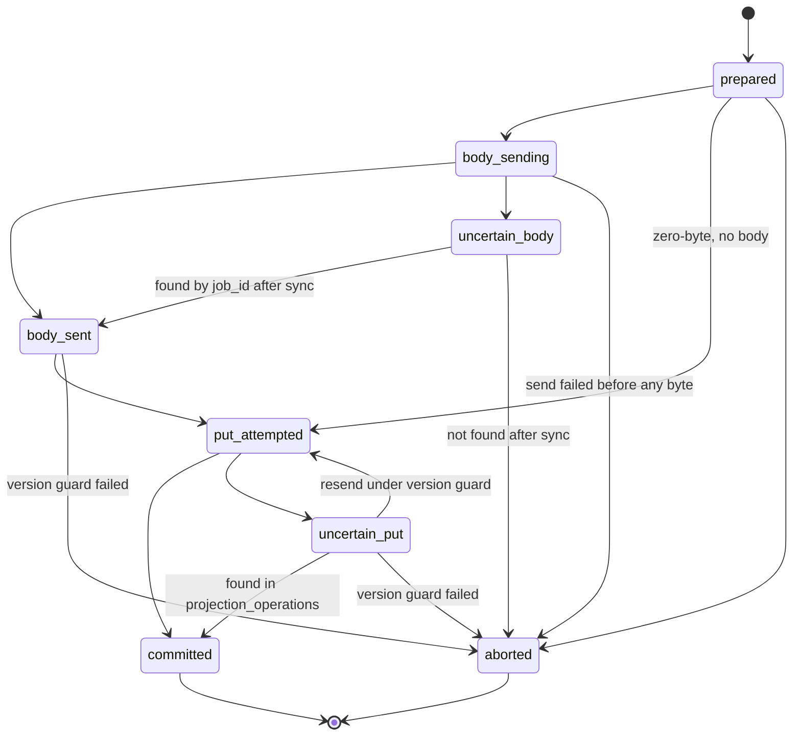
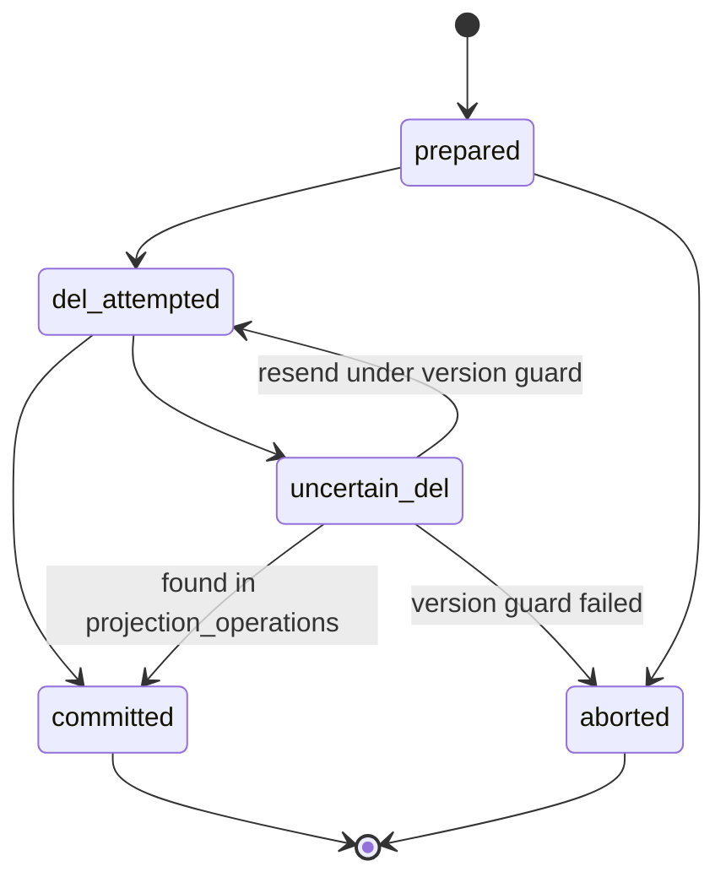

# butterDB SQLite schema, version 1

The two SQLite databases of a deployment, `projection.db` and `control.db`:
how connections are opened, how migrations are applied, the complete runnable
DDL of schema version 1, the rules each table obeys, and which phase and lane
owns each table. What the rows mean is in [storage-model.md](storage-model.md);
the op fields they are derived from are in [wire-format.md](wire-format.md).
Decisions are cited by ID from [../decisions.md](../decisions.md).

This document replaces section 9 of the legacy specification
([../butterDBCore.md](../butterDBCore.md)) for butterDB. The legacy namespace,
revision, trash, multipart, vault, gallery, rendition and mount tables do not
exist here.

Packages: `internal/storage/sqlitedb` (connections) and
`internal/storage/schema` (embedded migrations), both phase 02 lane L4. Only
`internal/storage` imports `modernc.org/sqlite` (E13).

---

## 1. Two databases

| File | Holds | Rebuildable | Durability |
| --- | --- | --- | --- |
| `<data_dir>/projection.db` | The replay log, its tamper and reject tables, every table derived from it, sync state, Telegram deletion evidence and the Telegram cleanup queues (E7) | Derived tables from the replay log; everything from Telegram except tamper evidence and first-seen captions (storage-model.md §3) | `synchronous=NORMAL` |
| `<data_dir>/control.db` | Local-only state: admin tables, Telegram account binding, access keys, jobs, idempotency records, the multipart staging index, the replica journal, the snapshot index (E7) | No. Only a snapshot restores it (operations.md §9) | `synchronous=FULL` |

The replay log and its derived tables share one file because they must commit
in one transaction; SQLite cannot make a transaction atomic across attached
files (E7). No query joins the two databases, and nothing `ATTACH`es one to the
other. A check that needs both (an orphan body is unreferenced in
`projection.db` and unowned by a job in `control.db`) reads each in its own
short read transaction and tolerates the gap between them.

### 1.1 Conventions

| Item | Rule |
| --- | --- |
| Table type | Every table is `STRICT`. No `WITHOUT ROWID` tables: replay and object rows reach several kilobytes, beyond the size at which a rowid table stops being the better layout |
| Booleans | `INTEGER` with `CHECK (x IN (0,1))` |
| Closed vocabularies | `CHECK (x IN (...))` for sets fixed by a decision or a state machine (`kind`, `state`, `policy`, `outcome`). Open vocabularies that a newer binary may extend (reject codes, op types, audit actions) carry no `CHECK`; Go validates them |
| `*_at` columns | Unix **milliseconds**, UTC, local clock (admin-api.md §15). Never written by the projector (claude.md invariant 10) |
| `msg_date`, `created_date` | Unix **seconds**, the Telegram message date |
| `op_ts` | Unix seconds, the op's `ts` field (wire-format.md §4) |
| Message and channel IDs | `INTEGER`. Message IDs are positive 32-bit values; channel IDs and access hashes are 64-bit |
| Hashes and IDs as text | Lowercase hex (`etag`, `sha256`, `md5`, `key_id`, `upload_id`), canonical lowercase UUIDv4 (`job_id`), `bkf1_` fingerprint (operations.md §5.2) |
| Object keys | `TEXT` holding the exact UTF-8 bytes of the key, compared with the default `BINARY` collation, which is `memcmp` and therefore UTF-8 byte order, as S3 requires (s3-api.md §7.3). Never `NOCASE`, never normalised |
| Metadata maps | `TEXT` holding `encoding/json` of a `map[string]string` (keys sorted by `encoding/json`), `{}` when empty |
| Secrets | Only sealed (`access_keys.secret_sealed`) or hashed (`admin_*`). No plaintext secret column exists |
| Foreign keys | Only inside `control.db`, where row lifetimes nest (`multipart_parts`, `idempotency_keys`). `projection.db` has none: rebuild clears derived tables in an order that foreign keys would fight |

---

## 2. Connections (`internal/storage/sqlitedb`)

Each database is opened as **one writer handle plus one read-only pool** (E7).
TDrive's single shared connection (`backend/storage_sqlite.go`, `TuneSQLite`)
serialised every query; butterDB keeps its pragma values but must not let API
reads queue behind writes.

| Handle | `database/sql` settings | Transactions |
| --- | --- | --- |
| Writer | `SetMaxOpenConns(1)`, `SetMaxIdleConns(1)`, `SetConnMaxLifetime(0)` | `BEGIN IMMEDIATE` (DSN `_txlock=immediate`), so a writer never fails with `SQLITE_BUSY` on lock upgrade |
| Read pool | `SetMaxOpenConns(n)`, `SetMaxIdleConns(n)`, `SetConnMaxIdleTime(5 * time.Minute)`; `n = max(4, runtime.GOMAXPROCS(0))`. Default (owner may change) | `BEGIN` (deferred). A read transaction sees one WAL snapshot |

### 2.1 Per-connection pragmas

Every pragma except `journal_mode` is per connection, so each one is passed in
the DSN as `_pragma=name(value)` and applied by the driver on every new
connection of both handles. Setting a pragma once through `db.Exec` is a bug:
it would reach one pooled connection only (tdrive-port-map.md §5.4 and §5.6).

| Pragma | `projection.db` | `control.db` | Handle | Source |
| --- | --- | --- | --- | --- |
| `journal_mode` | `WAL` | `WAL` | Writer, once at open; persistent in the file | TDrive |
| `synchronous` | `NORMAL` | `FULL` | Both | TDrive used `NORMAL`. `control.db` holds job states that are committed **before** a Telegram send (`put_attempted`, claude.md invariant 4; the salt and nonce prefix, invariant 17); losing such a commit to power failure after the send would resume a job blind. `projection.db` is reconstructible from Telegram. Default (owner may change) |
| `busy_timeout` | `5000` | `5000` | Both | TDrive |
| `foreign_keys` | `ON` | `ON` | Both | TDrive |
| `temp_store` | `MEMORY` | `MEMORY` | Both | TDrive |
| `cache_size` | `-32768` (32 MiB) | `-8192` (8 MiB) | Both | TDrive for `projection.db`; `control.db` is small (operations.md §9.5) |
| `mmap_size` | `134217728` | `0` | Read pool | TDrive, best effort; an `mmap` failure is ignored |
| `journal_size_limit` | `67108864` | `16777216` | Writer | New. Bounds the WAL file after checkpoints. Default (owner may change) |
| `query_only` | — | — | Read pool: `1` | New. A pool connection cannot write even by mistake (claude.md §9.2) |

DSN shape for the writer of `projection.db` (one line):

```text
file:/var/lib/butterdb/projection.db?_txlock=immediate&_pragma=busy_timeout(5000)&_pragma=synchronous(NORMAL)&_pragma=foreign_keys(1)&_pragma=temp_store(MEMORY)&_pragma=cache_size(-32768)&_pragma=journal_size_limit(67108864)
```

The pool DSN replaces `_txlock=immediate` and `journal_size_limit` with
`_pragma=query_only(1)&_pragma=mmap_size(134217728)`. Files are created with
mode `0600` inside the `0700` data directory (operations.md §3.1); `Open`
creates the file through `internal/platform/fsx` before the driver opens it, so
the mode never depends on the umask.

On open, `Open` verifies `PRAGMA application_id`: `1650745936` (`bdbP`) for
`projection.db`, `1650745923` (`bdbC`) for `control.db`, `0` for a new file
(which the migrator then stamps). A mismatch is `schema.ErrWrongDatabase`, exit
5 (operations.md §4.2): it catches a `control.db` restored over
`projection.db`.

### 2.2 Go contract

Committed by the phase 02 prelude. Default (owner may change) for the exact
shape; the names `Write`, `Read`, `VacuumInto` are binding because
operations.md §9.3 and storage-model.md §10 use them.

```go
package sqlitedb

type Name string

const (
	Projection Name = "projection"
	Control    Name = "control"
)

type Options struct {
	ReadConns       int
	BusyTimeout     time.Duration
	SlowTxThreshold time.Duration
}

type DB struct{}

func Open(ctx context.Context, name Name, path string, opts Options, log *slog.Logger) (*DB, error)
func (d *DB) Name() Name
func (d *DB) Write(ctx context.Context, fn func(tx *sql.Tx) error) error
func (d *DB) Read(ctx context.Context, fn func(tx *sql.Tx) error) error
func (d *DB) Reader() *sql.DB
func (d *DB) VacuumInto(ctx context.Context, dstPath string) error
func (d *DB) Close() error
```

| Method | Contract |
| --- | --- |
| `Write` | Runs `fn` in one `BEGIN IMMEDIATE` transaction on the writer; commits on `nil`, rolls back on error or panic. A transaction held longer than `SlowTxThreshold` (default 250 ms) logs one `WARN` with its duration and caller; it is a bug report, not a limit |
| `Read` | Runs `fn` in one deferred read transaction on the pool |
| `Reader` | The pool, for single statements that need no snapshot |
| `VacuumInto` | `VACUUM INTO ?` on a pool connection with `query_only` temporarily off for that statement only; the snapshot copy of operations.md §9.3 |
| `Close` | Closes the pool, then the writer, then runs `PRAGMA wal_checkpoint(TRUNCATE)` on a fresh connection |

### 2.3 No transaction across the network

claude.md invariant 2, restated for the database layer. No `Write` or `Read`
callback ever:

- calls `internal/tgclient` or anything that may wait on Telegram;
- reads an HTTP request body or writes a response;
- calls the transform worker;
- waits on a lock that another goroutine may hold across one of the above
  (the per-key and bucket gates of storage-model.md §6.6 are always taken
  **before** a transaction begins, never inside one).

The pattern is always: spool or fetch outside, then apply in one short
transaction. The full history scan spools Telegram pages into
`initial_scan_spool` in one short transaction per page, then applies the spool
in one transaction with no network wait (storage-model.md §9.2). Because
`projection.db` has one writer, a transaction held across a 30-second flood
wait would stall every PUT's projection commit in the process; the slow-
transaction warning exists to catch that.

`scripts/` gains no static check for this rule; it is enforced by review and
by the `TestNoTxAcrossNetwork` tests named in section 9, which run `faketg`
with a 2-second scripted delay and assert that concurrent `Write` calls on the
same database are never delayed by it.

---

## 3. Migrations (`internal/storage/schema`)

### 3.1 Layout

```text
internal/storage/schema/
  schema.go
  projection/0001_init.sql
  control/0001_init.sql
```

```go
//go:embed projection/*.sql control/*.sql
var files embed.FS
```

Files are discovered by the embed glob; there is no list file to keep in sync
(claude.md §9.2). A file name must match `^([0-9]{4})_([a-z0-9_]+)\.sql$`.
Versions in a set start at 1 and are contiguous; a gap, a duplicate number or a
non-matching name is `ErrSchemaGap`, raised by a unit test at build time and by
`Apply` at run time.

### 3.2 `schema_version`

Created by the migrator itself, before the first file runs, in each database:

```sql
CREATE TABLE IF NOT EXISTS schema_version (
  version    INTEGER PRIMARY KEY CHECK (version >= 1),
  name       TEXT    NOT NULL,
  sha256     TEXT    NOT NULL CHECK (length(sha256) = 64),
  applied_at INTEGER NOT NULL
) STRICT;
```

One row per applied file. `sha256` is the lowercase hex SHA-256 of the file's
bytes as embedded. `applied_at` is Unix milliseconds.

### 3.3 Apply

```go
package schema

type Set string

const (
	Projection Set = "projection"
	Control    Set = "control"
)

type Migration struct {
	Version int
	Name    string
	SHA256  string
	SQL     string
}

var (
	ErrSchemaTooNew   = errors.New("schema: database schema is newer than this binary")
	ErrSchemaChecksum = errors.New("schema: applied migration differs from the embedded file")
	ErrSchemaGap      = errors.New("schema: embedded migrations are not contiguous")
	ErrWrongDatabase  = errors.New("schema: database belongs to the other set")
)

func Migrations(set Set) ([]Migration, error)
func Latest(set Set) int
func Current(ctx context.Context, db *sqlitedb.DB) (int, error)
func Pending(ctx context.Context, db *sqlitedb.DB, set Set) ([]Migration, error)
func Apply(ctx context.Context, db *sqlitedb.DB, set Set) ([]int, error)
```

| Step | Rule |
| --- | --- |
| 1 | Check `application_id` (section 2.1); stamp it on a new file |
| 2 | `CREATE TABLE IF NOT EXISTS schema_version` |
| 3 | For every row in `schema_version`, the embedded file of that version must exist with the same `sha256`. A missing file means the database is newer: `ErrSchemaTooNew`. A different hash: `ErrSchemaChecksum` |
| 4 | Each pending file, in version order, runs in its own `Write` transaction together with the `INSERT INTO schema_version` of its row. A failure rolls that file back and stops; earlier files stay applied |
| 5 | After the last file, `PRAGMA foreign_key_check` on `control.db` and `PRAGMA quick_check` on both; any result row fails the start |

Errors map to exit codes in operations.md §4.2: `ErrSchemaTooNew`,
`ErrSchemaChecksum` and `ErrWrongDatabase` exit 5; any other failure exits 1.
`butterdbd serve` calls `Pending` first and, when it is non-empty and
`snapshot.before_migrate` is true, takes a snapshot before `Apply`
(operations.md §7.1 step 6). `butterdbd restore` refuses a snapshot whose
`schema` versions exceed `Latest` (operations.md §10.2 step 7).

### 3.4 Rules for writing a migration

1. An applied file is never edited. A change is a new file with the next number.
2. Migrations are forward only (operations.md §12).
3. A migration contains DDL and data fixes only. No `PRAGMA` that is per connection, no `ATTACH`, no `VACUUM` (it cannot run inside a transaction).
4. Changing a `CHECK` or a column type in SQLite means the twelve-step table rebuild (create new, copy, drop, rename) inside the migration's transaction.
5. A `projection.db` migration that changes how ops project ends with `UPDATE channels SET needs_projection_rebuild = 1;`, so the next start rebuilds from the replay log (storage-model.md §9.1) instead of shipping a migration that rewrites derived rows by hand.
6. Schema version 1 is frozen by the phase 02 format gate (plan.md §8). Tables used only by later phases (admin, replica, snapshot) are created in version 1 so that their shape is reviewed with the formats; a later phase that needs a new column adds a migration in its own prelude and records it in its status note.

---

## 4. `projection.db`

### 4.1 Full DDL: `projection/0001_init.sql`

Runnable as is on SQLite 3.37 or later (`STRICT`); verified with SQLite 3.54.

```sql
CREATE TABLE channels (
  channel_id               INTEGER PRIMARY KEY CHECK (channel_id > 0),
  kind                     TEXT    NOT NULL CHECK (kind IN ('registry','bucket')),
  access_hash              INTEGER NOT NULL DEFAULT 0,
  title                    TEXT    NOT NULL DEFAULT '',
  state                    TEXT    NOT NULL DEFAULT 'active' CHECK (state IN ('active','deleted')),
  last_synced_msg          INTEGER NOT NULL DEFAULT 0 CHECK (last_synced_msg >= 0),
  pts                      INTEGER NOT NULL DEFAULT 0 CHECK (pts >= 0),
  initial_sync_done        INTEGER NOT NULL DEFAULT 0 CHECK (initial_sync_done IN (0,1)),
  needs_projection_rebuild INTEGER NOT NULL DEFAULT 0 CHECK (needs_projection_rebuild IN (0,1)),
  last_reconciled_at       INTEGER NOT NULL DEFAULT 0
) STRICT;

CREATE UNIQUE INDEX channels_one_registry ON channels (kind) WHERE kind = 'registry';

CREATE TABLE replay_log (
  channel_id      INTEGER NOT NULL,
  msg_id          INTEGER NOT NULL CHECK (msg_id > 0),
  op_type         TEXT    NOT NULL CHECK (length(op_type) > 0),
  op_payload_json TEXT    NOT NULL,
  raw_header      TEXT    NOT NULL,
  first_seen_hash TEXT    NOT NULL CHECK (length(first_seen_hash) = 64),
  object_key      TEXT,
  job_id          TEXT    NOT NULL DEFAULT '',
  is_document     INTEGER NOT NULL CHECK (is_document IN (0,1)),
  actor_user_id   INTEGER NOT NULL DEFAULT 0,
  msg_date        INTEGER NOT NULL CHECK (msg_date >= 0),
  PRIMARY KEY (channel_id, msg_id)
) STRICT;

CREATE INDEX replay_log_key ON replay_log (channel_id, object_key, msg_id) WHERE object_key IS NOT NULL;

CREATE TABLE replay_log_tamper (
  channel_id     INTEGER NOT NULL,
  msg_id         INTEGER NOT NULL,
  old_hash       TEXT    NOT NULL CHECK (length(old_hash) = 64),
  new_hash       TEXT    NOT NULL CHECK (length(new_hash) = 64),
  new_raw_header TEXT    NOT NULL,
  observations   INTEGER NOT NULL DEFAULT 1 CHECK (observations >= 1),
  PRIMARY KEY (channel_id, msg_id, new_hash)
) STRICT;

CREATE TABLE replay_log_rejects (
  channel_id INTEGER NOT NULL,
  msg_id     INTEGER NOT NULL CHECK (msg_id > 0),
  code       TEXT    NOT NULL CHECK (length(code) > 0),
  op_type    TEXT    NOT NULL DEFAULT '',
  job_id     TEXT    NOT NULL DEFAULT '',
  raw_header TEXT    NOT NULL,
  detail     TEXT    NOT NULL DEFAULT '',
  msg_date   INTEGER NOT NULL CHECK (msg_date >= 0),
  PRIMARY KEY (channel_id, msg_id)
) STRICT;

CREATE INDEX replay_log_rejects_code ON replay_log_rejects (code, channel_id, msg_id);

CREATE TABLE registry_markers (
  channel_id      INTEGER NOT NULL,
  msg_id          INTEGER NOT NULL CHECK (msg_id > 0),
  deployment_id   TEXT    NOT NULL CHECK (length(deployment_id) = 26),
  format_version  INTEGER NOT NULL CHECK (format_version >= 1),
  min_reader      INTEGER NOT NULL CHECK (min_reader BETWEEN 1 AND format_version),
  kek_fingerprint TEXT    NOT NULL CHECK (length(kek_fingerprint) = 37 AND substr(kek_fingerprint, 1, 5) = 'bkf1_'),
  primary_user_id INTEGER NOT NULL CHECK (primary_user_id > 0),
  writer          TEXT    NOT NULL DEFAULT '',
  msg_date        INTEGER NOT NULL CHECK (msg_date >= 0),
  PRIMARY KEY (channel_id, msg_id)
) STRICT;

CREATE TABLE buckets (
  channel_id            INTEGER PRIMARY KEY CHECK (channel_id > 0),
  name                  TEXT    NOT NULL CHECK (length(name) BETWEEN 3 AND 63),
  policy                TEXT    NOT NULL CHECK (policy IN ('private','public-read')),
  encryption_default    TEXT    NOT NULL CHECK (encryption_default IN ('none','tde1')),
  cache_max_age_seconds INTEGER NOT NULL CHECK (cache_max_age_seconds BETWEEN 0 AND 31536000),
  created_msg_id        INTEGER NOT NULL CHECK (created_msg_id > 0),
  created_job_id        TEXT    NOT NULL CHECK (length(created_job_id) = 36),
  created_date          INTEGER NOT NULL CHECK (created_date >= 0),
  config_msg_id         INTEGER NOT NULL CHECK (config_msg_id >= created_msg_id),
  deleted_msg_id        INTEGER NOT NULL DEFAULT 0 CHECK (deleted_msg_id >= 0),
  object_count          INTEGER NOT NULL DEFAULT 0 CHECK (object_count >= 0),
  stored_bytes          INTEGER NOT NULL DEFAULT 0 CHECK (stored_bytes >= 0),
  plaintext_bytes       INTEGER NOT NULL DEFAULT 0 CHECK (plaintext_bytes >= 0)
) STRICT;

CREATE UNIQUE INDEX buckets_live_name ON buckets (name) WHERE deleted_msg_id = 0;

CREATE TABLE objects (
  channel_id         INTEGER NOT NULL,
  object_key         TEXT    NOT NULL CHECK (length(CAST(object_key AS BLOB)) BETWEEN 1 AND 1024),
  put_msg_id         INTEGER NOT NULL CHECK (put_msg_id > 0),
  body_msg_id        INTEGER NOT NULL CHECK (body_msg_id >= 0 AND body_msg_id < put_msg_id),
  job_id             TEXT    NOT NULL CHECK (length(job_id) = 36),
  stored_size        INTEGER NOT NULL CHECK (stored_size BETWEEN 0 AND 1992294400),
  plaintext_size     INTEGER NOT NULL CHECK (plaintext_size >= 0),
  etag               TEXT    NOT NULL CHECK (length(etag) BETWEEN 32 AND 38),
  sha256             TEXT    NOT NULL CHECK (length(sha256) = 64),
  content_type       TEXT    NOT NULL CHECK (length(content_type) BETWEEN 1 AND 1024),
  user_meta_json     TEXT    NOT NULL DEFAULT '{}',
  system_meta_json   TEXT    NOT NULL DEFAULT '{}',
  encrypted          INTEGER NOT NULL CHECK (encrypted IN (0,1)),
  encryption_version INTEGER NOT NULL DEFAULT 0 CHECK (encryption_version >= 0),
  key_id             TEXT    NOT NULL DEFAULT '',
  writer             TEXT    NOT NULL,
  op_ts              INTEGER NOT NULL CHECK (op_ts >= 0),
  msg_date           INTEGER NOT NULL CHECK (msg_date >= 0),
  PRIMARY KEY (channel_id, object_key),
  CHECK ((encrypted = 1 AND encryption_version >= 1 AND length(key_id) = 16) OR (encrypted = 0 AND encryption_version = 0 AND key_id = '' AND plaintext_size = stored_size)),
  CHECK (body_msg_id > 0 OR stored_size = 0)
) STRICT;

CREATE UNIQUE INDEX objects_put ON objects (channel_id, put_msg_id);
CREATE INDEX objects_body ON objects (channel_id, body_msg_id) WHERE body_msg_id > 0;

CREATE TABLE object_tombstones (
  channel_id        INTEGER NOT NULL,
  object_key        TEXT    NOT NULL CHECK (length(CAST(object_key AS BLOB)) BETWEEN 1 AND 1024),
  del_msg_id        INTEGER NOT NULL CHECK (del_msg_id > 0),
  job_id            TEXT    NOT NULL CHECK (length(job_id) = 36),
  target_put_msg_id INTEGER NOT NULL DEFAULT 0 CHECK (target_put_msg_id >= 0),
  writer            TEXT    NOT NULL,
  msg_date          INTEGER NOT NULL CHECK (msg_date >= 0),
  PRIMARY KEY (channel_id, object_key)
) STRICT;

CREATE TABLE object_bodies (
  channel_id         INTEGER NOT NULL,
  msg_id             INTEGER NOT NULL CHECK (msg_id > 0),
  job_id             TEXT    NOT NULL CHECK (length(job_id) = 36),
  stored_size        INTEGER NOT NULL CHECK (stored_size BETWEEN 1 AND 1992294400),
  encrypted          INTEGER NOT NULL CHECK (encrypted IN (0,1)),
  encryption_version INTEGER NOT NULL DEFAULT 0 CHECK (encryption_version >= 0),
  msg_date           INTEGER NOT NULL CHECK (msg_date >= 0),
  PRIMARY KEY (channel_id, msg_id)
) STRICT;

CREATE INDEX object_bodies_job ON object_bodies (channel_id, job_id);
CREATE INDEX object_bodies_age ON object_bodies (channel_id, msg_date, msg_id);

CREATE TABLE encryption_keys (
  bucket_channel_id INTEGER NOT NULL,
  key_id            TEXT    NOT NULL CHECK (length(key_id) = 16),
  wrapped_dek       BLOB    NOT NULL CHECK (length(wrapped_dek) = 72),
  key_check         BLOB    NOT NULL CHECK (length(key_check) = 61),
  kek_fingerprint   TEXT    NOT NULL CHECK (length(kek_fingerprint) = 37 AND substr(kek_fingerprint, 1, 5) = 'bkf1_'),
  config_version    INTEGER NOT NULL CHECK (config_version >= 1),
  first_msg_id      INTEGER NOT NULL CHECK (first_msg_id > 0),
  msg_id            INTEGER NOT NULL CHECK (msg_id >= first_msg_id),
  job_id            TEXT    NOT NULL CHECK (length(job_id) = 36),
  msg_date          INTEGER NOT NULL CHECK (msg_date >= 0),
  PRIMARY KEY (bucket_channel_id, key_id)
) STRICT;

CREATE INDEX encryption_keys_active ON encryption_keys (bucket_channel_id, kek_fingerprint, first_msg_id);

CREATE TABLE projection_operations (
  channel_id INTEGER NOT NULL,
  op_id      TEXT    NOT NULL CHECK (length(op_id) = 36),
  op_type    TEXT    NOT NULL,
  msg_id     INTEGER NOT NULL CHECK (msg_id > 0),
  outcome    TEXT    NOT NULL CHECK (outcome IN ('applied','superseded','rejected')),
  error      TEXT    NOT NULL DEFAULT '',
  PRIMARY KEY (channel_id, op_id, op_type)
) STRICT;

CREATE INDEX projection_operations_msg ON projection_operations (channel_id, msg_id);

CREATE TABLE initial_scan_spool (
  channel_id    INTEGER NOT NULL,
  msg_id        INTEGER NOT NULL,
  from_id       INTEGER NOT NULL,
  date          INTEGER NOT NULL,
  text          TEXT    NOT NULL,
  has_media     INTEGER NOT NULL CHECK (has_media IN (0,1)),
  media_size    INTEGER NOT NULL,
  document_name TEXT    NOT NULL,
  PRIMARY KEY (channel_id, msg_id)
) STRICT;

CREATE TABLE deleted_messages (
  channel_id  INTEGER NOT NULL,
  msg_id      INTEGER NOT NULL CHECK (msg_id > 0),
  source      TEXT    NOT NULL CHECK (source IN ('external','cleanup','reconcile')),
  recorded_at INTEGER NOT NULL,
  PRIMARY KEY (channel_id, msg_id)
) STRICT;

CREATE TABLE pending_message_cleanup (
  channel_id       INTEGER NOT NULL,
  msg_id           INTEGER NOT NULL CHECK (msg_id > 0),
  reason           TEXT    NOT NULL CHECK (reason IN ('superseded','blocked','duplicate','deleted','orphan_body')),
  object_key       TEXT,
  queued_by_msg_id INTEGER NOT NULL DEFAULT 0 CHECK (queued_by_msg_id >= 0),
  attempts         INTEGER NOT NULL DEFAULT 0 CHECK (attempts >= 0),
  next_attempt_at  INTEGER NOT NULL DEFAULT 0,
  last_error       TEXT    NOT NULL DEFAULT '',
  PRIMARY KEY (channel_id, msg_id)
) STRICT;

CREATE INDEX pending_message_cleanup_due ON pending_message_cleanup (next_attempt_at, channel_id, msg_id);

CREATE TABLE pending_channel_cleanup (
  channel_id      INTEGER PRIMARY KEY CHECK (channel_id > 0),
  bdel_msg_id     INTEGER NOT NULL CHECK (bdel_msg_id > 0),
  attempts        INTEGER NOT NULL DEFAULT 0 CHECK (attempts >= 0),
  next_attempt_at INTEGER NOT NULL DEFAULT 0,
  last_error      TEXT    NOT NULL DEFAULT ''
) STRICT;
```

### 4.2 `replay_log`

The first op observed per `(channel_id, msg_id)`: the rebuild source and the
first-seen evidence (storage-model.md §3, legacy section 10).

| Column | Rule |
| --- | --- |
| `op_type` | The op's `t`; for an unknown op, the unknown value (E5) |
| `op_payload_json` | `encoding/json` of the parsed `wire.Op`, informational only. Rebuild re-parses `raw_header` and never reads it (storage-model.md §10). For an unknown op: `{"t":"<t>"}` |
| `raw_header` | `strings.TrimSpace(wire.ExtractHeaderLine(text))`, the bytes that were hashed |
| `first_seen_hash` | Lowercase hex SHA-256 of `raw_header` |
| `object_key` | `wire.KeyOf(op)` for `put` and `del`; `NULL` otherwise. Feeds per-key repair (E6) |
| `job_id` | The op's `j`, `''` for `reg` and unknown ops |
| `is_document` | 1 when the message is a document (the header came from the caption) |
| `actor_user_id` | Telegram `from_id` of the message, 0 when absent (channel posts usually carry none) |
| `msg_date` | Telegram message date |

Per-key repair (storage-model.md §9.4) uses `replay_log_key`:

```sql
SELECT 1 FROM replay_log
WHERE channel_id = ?1 AND object_key = ?2 AND msg_id > ?3
LIMIT 1;

SELECT msg_id, raw_header, is_document, actor_user_id, msg_date
FROM replay_log
WHERE channel_id = ?1 AND object_key = ?2
ORDER BY msg_id;
```

The first query is the E6 trigger, run before recording an incoming `put` or
`del` at message `?3`; the second is the replay of that key alone.

### 4.3 `replay_log_tamper`

A later observation of a recorded message whose header hash differs (an edit
in the Telegram app). One row per distinct new hash; a repeat observation of
the same edit increments `observations`. Nothing else changes; the first op
stays canonical (storage-model.md §9.6). There is no detection timestamp, so
that the projector never reads the clock.

### 4.4 `replay_log_rejects`

At most one row per message. `code` is one of the reject codes of
storage-model.md §10 (`malformed`, `unknown_op`, `wrong_channel`,
`wrong_carrier`, `bucket_not_found`, `bucket_name_invalid`, `bucket_exists`,
`bad_body_ref`, `size_mismatch`, `duplicate_op`, `marker_conflict`); there is
no `CHECK`, because a newer binary may add codes. A `malformed` row has no
`replay_log` row; an `unknown_op` row and every applier reject do.

### 4.5 `channels`

One row per registry or bucket channel of the **primary** account; replica
channels live in `control.db` `replica_channels` (section 5.9).

| Column | Rule |
| --- | --- |
| `kind` | `registry` or `bucket`. `channels_one_registry` permits one registry row |
| `access_hash` | 0 until resolved from dialogs (storage-model.md §9.2); a send with hash 0 is never made |
| `state` | `deleted` after `t=bdel` projects (storage-model.md §5.4). The row is kept so its channel ID is never reused as a new bucket |
| `last_synced_msg`, `pts`, `initial_sync_done`, `needs_projection_rebuild` | The four sync fields of legacy section 11, meanings in storage-model.md §9.1 |
| `last_reconciled_at` | When `internal/syncer/reconcile` last ran the existence check of storage-model.md §9.5 |

`channels` is sync state, not a derived table: the syncer and
`internal/buckets` write it through `internal/storage/channelrepo`; the
projector writes only the bucket row that `t=bcreate` inserts and the
`state` that `t=bdel` sets.

### 4.6 `registry_markers`

Every accepted `t=reg` (storage-model.md §4.2). The current marker is
`ORDER BY msg_id DESC LIMIT 1`. `kek_fingerprint` is the marker's `kfp`; the
startup local check reads this table (storage-model.md §4.4).

### 4.7 `buckets`

One row per bucket ever created, keyed by its bucket channel ID.

| Column | Rule |
| --- | --- |
| `name` | S3 bucket name. `buckets_live_name` makes names unique among live buckets; a deleted name may be reused by a new channel |
| `created_msg_id`, `created_job_id`, `created_date` | From `t=bcreate`; `created_date` is S3 `CreationDate` (s3-api.md §7.1) |
| `config_msg_id` | Message ID of the configuration in force: `t=bcreate` or the newest applied `t=bcfg`. A `t=bcfg` with a lower message ID is outcome `superseded` |
| `deleted_msg_id` | `t=bdel` message ID; 0 while live |
| `object_count`, `stored_bytes`, `plaintext_bytes` | Maintained by the put and del appliers and by per-key repair, in the same transaction as the object row change. Served by admin-api.md §9.2 and §10 |

`ListBuckets` reads `WHERE deleted_msg_id = 0 ORDER BY name` through
`buckets_live_name`.

### 4.8 `objects`

One row per live key: the applied put with the highest message ID not blocked
by a higher tombstone (storage-model.md §6.4).

| Column | Source |
| --- | --- |
| `put_msg_id` | The put's message ID: the version (E2) |
| `body_msg_id` | `bm`; 0 only for an unencrypted zero-byte object. The `CHECK` repeats invariant 3 of storage-model.md §14 |
| `job_id` | `j` |
| `stored_size`, `plaintext_size` | `sz`, `psz` (or `sz` when unencrypted) |
| `etag`, `sha256` | `et` (unquoted, with any `-N` suffix), `h` |
| `content_type` | `ct`, or `application/octet-stream` |
| `user_meta_json`, `system_meta_json` | The `m.` and `s.` entries |
| `encrypted`, `encryption_version`, `key_id` | `enc`, `ev`, `kid` |
| `writer`, `op_ts` | `w`, `ts` |
| `msg_date` | The put message's date: `LastModified` (s3-api.md §8.9) |

`objects_put` serves version lookups and the cleanup guard ("never delete the
put or body of a live object", storage-model.md §6.4); `objects_body` serves the
orphan-body check.

**Keyset listing for ListObjectsV2** (s3-api.md §7.3), in
`internal/storage/objectrepo`. The primary key `(channel_id, object_key)` is the
listing index: the plan is `SEARCH objects USING COVERING INDEX
sqlite_autoindex_objects_1 (channel_id=? AND object_key>? AND object_key<?)`.

```sql
SELECT object_key, put_msg_id, stored_size, plaintext_size, etag, msg_date, encrypted
FROM objects
WHERE channel_id = ?1 AND object_key >= ?2 AND object_key < ?3
ORDER BY object_key
LIMIT ?4;
```

The same statement without `AND object_key < ?3` is used when there is no
upper bound. The bounds are computed in Go and bound as `TEXT`:

| Input | Bound |
| --- | --- |
| `prefix` | Lower bound `prefix` (inclusive). Upper bound `PrefixEnd(prefix)`: drop trailing `0xFF` bytes, then increment the last byte (`2026/` → `20260`). An empty prefix has no upper bound. The bound may be invalid UTF-8; SQLite compares it bytewise and never validates it |
| `start-after` K | Lower bound `K + "\x00"`, the smallest key greater than K (keys never contain U+0000, wire-format.md §9) |
| Continuation token, kind `0x00`, last key K | Lower bound `K + "\x00"` |
| Continuation token, kind `0x01`, last common prefix P | Lower bound `PrefixEnd(P)`, the first key not starting with P |
| Several apply | The lower bound is the greatest of them |

With a `delimiter`, `objectrepo` reads rows in order; for a key whose remainder
after `prefix` contains the delimiter, it emits the common prefix `P` (up to
and including the first delimiter) and re-issues the query with lower bound
`PrefixEnd(P)`, so the rolled-up keys are skipped by the index rather than read.
A page therefore costs at most `max-keys` index seeks. ListObjects (v1)
`marker` is the `start-after` rule. `ListMultipartUploads` uses the same
pattern on `multipart_uploads_listing` (section 5.8).

```go
package objectrepo

func PrefixEnd(prefix string) (string, bool)
```

### 4.9 `encryption_keys`

One row per `(bucket channel, kid)` from `t=encfg` on the registry
(storage-model.md §8.3). `bucket_channel_id` names the bucket; the message
itself lives in the registry channel, so `first_msg_id` and `msg_id` are
registry message IDs.

| Column | Rule |
| --- | --- |
| `wrapped_dek`, `key_check` | 72 and 61 bytes exactly (wire-format.md §5.8) |
| `kek_fingerprint` | The `kfp` of the newest applied wrap |
| `config_version` | `cv` of the newest applied wrap |
| `first_msg_id` | The `t=encfg` that minted the key; orders keys for the active-key choice |
| `msg_id` | The `t=encfg` of the newest applied wrap |

Active key for new objects (storage-model.md §8.3), through
`encryption_keys_active`:

```sql
SELECT key_id, wrapped_dek, key_check
FROM encryption_keys
WHERE bucket_channel_id = ?1 AND kek_fingerprint = ?2
ORDER BY first_msg_id DESC
LIMIT 1;
```

`?2` is the current marker's `kfp`. Reads look up `(bucket_channel_id,
key_id)` from the object row. Rows are removed only by `t=bdel`.

### 4.10 `object_tombstones`

One row per key that has ever been deleted, holding the highest `t=del`
message ID (`del_msg_id`). A put for the key with a lower message ID is
blocked (E4). `target_put_msg_id` is the tombstone's `pv` (0 when absent).
Tombstones are never pruned while the bucket lives: a pruned tombstone would let
a late or replayed lower put resurrect the key.

### 4.11 `object_bodies`

Every observed `t=body` document that still exists. A body never creates an
object (claude.md invariant 9); this table exists so the sweeper can resolve
`body_sending` jobs by `job_id` (`object_bodies_job`) and find orphan bodies by
age (`object_bodies_age`, storage-model.md §6.3). A row is removed when its
message enters `deleted_messages`.

### 4.12 `projection_operations`

The outcome of every op that carries a `j`, keyed by `(channel_id, op_id,
op_type)`. TDrive keyed by `(channel_id, op_id)`; butterDB adds `op_type`
because a body and its put share one job ID. The first message to record a key
wins; a second message with the same triple is a `duplicate_op` reject and
writes no row here. Outcomes: `applied`, `superseded` (a put that lost
last-writer-wins on arrival or was blocked by a tombstone), `rejected`. The
sweeper resolves uncertain jobs with

```sql
SELECT msg_id, outcome FROM projection_operations
WHERE channel_id = ?1 AND op_id = ?2 AND op_type = ?3;
```

### 4.13 `initial_scan_spool`

The full-history-scan spool, ported from TDrive `backend/sync/initial_scan_spool.go`
with its columns unchanged. Scratch, not a checkpoint: a full scan deletes the
channel's stale rows first, writes one short transaction per page (batches of
256), applies in one transaction, then deletes its rows best effort (legacy
section 11). `text` is the message text or the document caption; `media_size`
and `document_name` describe the document, 0 and `''` otherwise.

### 4.14 `deleted_messages`

Every message ID known to be gone from Telegram (storage-model.md §9.5).

| `source` | Written when |
| --- | --- |
| `cleanup` | Our own `channels.deleteMessages` batch confirmed the ID |
| `external` | `updates.getChannelDifference` reported the deletion and no cleanup row recorded it first |
| `reconcile` | `internal/syncer/reconcile`'s existence check found the message missing |

Preserved by every rebuild, so a rebuild never revives an object whose
messages are gone. Appliers consult it: a put or body whose message is listed
creates no row, and no cleanup row is queued for a listed ID.

### 4.15 `pending_message_cleanup`

Telegram messages queued for deletion, inserted in the projection transaction
that decides them (storage-model.md §6.4, §6.5) or by the sweeper for orphan
bodies.

| Column | Rule |
| --- | --- |
| `reason` | `superseded`, `blocked`, `duplicate`, `deleted` (tombstoned), `orphan_body` |
| `object_key` | For diagnostics; `NULL` for orphan bodies |
| `queued_by_msg_id` | The op that queued it; 0 for `orphan_body` |
| `attempts`, `next_attempt_at`, `last_error` | Written by `ingest/sweeper` only. Backoff 1 min doubling to 1 h. Default (owner may change) |

The sweeper claims due rows in batches of 100 per channel
(`limits.DeleteBatchSize`) through `pending_message_cleanup_due`. Before each
batch it drops any ID that is the `put_msg_id` or `body_msg_id` of a live
object (storage-model.md §6.4). A confirmed batch deletes its rows and inserts
`deleted_messages` rows with source `cleanup` in one transaction.

### 4.16 `pending_channel_cleanup`

Bucket channels whose `t=bdel` committed but whose `channels.deleteChannel`
has not yet succeeded (storage-model.md §5.4). Removed when the call succeeds
or Telegram answers that the channel no longer exists. On removal,
`channelrepo` deletes that channel's `replay_log`, `replay_log_rejects`,
`replay_log_tamper`, `projection_operations`, `deleted_messages` and
`initial_scan_spool` rows: once the channel is gone from Telegram its history
can never be rescanned or rebuilt, and the `channels` and `buckets` rows (state
`deleted`) are the only record kept.

---

## 5. `control.db`

### 5.1 Full DDL: `control/0001_init.sql`

```sql
CREATE TABLE admin_meta (
  key   TEXT PRIMARY KEY,
  value TEXT NOT NULL
) STRICT;

CREATE TABLE admin_setup_token (
  id         INTEGER PRIMARY KEY CHECK (id = 1),
  token_hash BLOB    NOT NULL,
  created_at INTEGER NOT NULL,
  expires_at INTEGER NOT NULL
) STRICT;

CREATE TABLE admin_devices (
  device_id        TEXT    PRIMARY KEY,
  name             TEXT    NOT NULL,
  platform         TEXT    NOT NULL,
  client_version   TEXT    NOT NULL,
  created_via      TEXT    NOT NULL CHECK (created_via IN ('setup','pairing_saved_messages','pairing_host')),
  token_hash       BLOB    NOT NULL,
  token_issued_at  INTEGER NOT NULL,
  prev_token_hash  BLOB,
  prev_valid_until INTEGER,
  created_at       INTEGER NOT NULL,
  last_seen_at     INTEGER NOT NULL,
  last_seen_ip     TEXT    NOT NULL,
  revoked_at       INTEGER,
  revoked_by       TEXT
) STRICT;

CREATE TABLE admin_pairing_codes (
  delivery    TEXT    PRIMARY KEY CHECK (delivery IN ('saved_messages','host')),
  code_hash   BLOB    NOT NULL,
  device_name TEXT    NOT NULL,
  created_at  INTEGER NOT NULL,
  expires_at  INTEGER NOT NULL
) STRICT;

CREATE TABLE admin_audit (
  id              INTEGER PRIMARY KEY AUTOINCREMENT,
  at              INTEGER NOT NULL,
  actor_type      TEXT    NOT NULL,
  actor_device_id TEXT    NOT NULL DEFAULT '',
  action          TEXT    NOT NULL,
  target          TEXT    NOT NULL DEFAULT '',
  outcome         TEXT    NOT NULL CHECK (outcome IN ('success','failure')),
  error_code      TEXT    NOT NULL DEFAULT '',
  remote_addr     TEXT    NOT NULL DEFAULT '',
  request_id      TEXT    NOT NULL DEFAULT ''
) STRICT;

CREATE INDEX admin_audit_at ON admin_audit (at DESC);
CREATE INDEX admin_audit_action ON admin_audit (action, at DESC);

CREATE TABLE telegram_accounts (
  role         TEXT    PRIMARY KEY CHECK (role IN ('primary','replica')),
  user_id      INTEGER NOT NULL CHECK (user_id > 0),
  username     TEXT    NOT NULL DEFAULT '',
  phone_masked TEXT    NOT NULL DEFAULT '',
  dc_id        INTEGER NOT NULL DEFAULT 0 CHECK (dc_id >= 0),
  linked       INTEGER NOT NULL CHECK (linked IN (0,1)),
  bound_at     INTEGER NOT NULL,
  linked_at    INTEGER NOT NULL DEFAULT 0,
  unlinked_at  INTEGER NOT NULL DEFAULT 0
) STRICT;

CREATE UNIQUE INDEX telegram_accounts_user ON telegram_accounts (user_id);

CREATE TABLE access_keys (
  access_key_id TEXT    PRIMARY KEY CHECK (length(access_key_id) = 20 AND substr(access_key_id, 1, 4) = 'BDBK'),
  name          TEXT    NOT NULL CHECK (length(name) BETWEEN 1 AND 64),
  secret_sealed BLOB    NOT NULL CHECK (length(secret_sealed) = 80),
  scope_buckets TEXT    NOT NULL CHECK (json_valid(scope_buckets) AND json_type(scope_buckets) = 'array'),
  scope_actions TEXT    NOT NULL CHECK (json_valid(scope_actions) AND json_type(scope_actions) = 'array'),
  created_at    INTEGER NOT NULL,
  created_by    TEXT    NOT NULL DEFAULT '',
  updated_at    INTEGER NOT NULL,
  last_used_at  INTEGER NOT NULL DEFAULT 0,
  revoked_at    INTEGER
) STRICT;

CREATE INDEX access_keys_created ON access_keys (created_at DESC, access_key_id);

CREATE TABLE upload_jobs (
  job_id              TEXT    PRIMARY KEY CHECK (length(job_id) = 36),
  kind                TEXT    NOT NULL CHECK (kind IN ('put','copy','multipart')),
  origin              TEXT    NOT NULL CHECK (origin IN ('s3','admin')),
  scope               TEXT    NOT NULL CHECK (scope LIKE 'key:%' OR scope LIKE 'device:%'),
  writer              TEXT    NOT NULL,
  bucket_channel_id   INTEGER NOT NULL CHECK (bucket_channel_id > 0),
  bucket_name         TEXT    NOT NULL,
  object_key          TEXT    NOT NULL CHECK (length(CAST(object_key AS BLOB)) BETWEEN 1 AND 1024),
  multipart_upload_id TEXT,
  state               TEXT    NOT NULL CHECK (state IN ('prepared','body_sending','uncertain_body','body_sent','put_attempted','uncertain_put','committed','aborted')),
  base_put_msg_id     INTEGER NOT NULL DEFAULT 0 CHECK (base_put_msg_id >= 0),
  if_match            TEXT    NOT NULL DEFAULT '',
  if_none_match       INTEGER NOT NULL DEFAULT 0 CHECK (if_none_match IN (0,1)),
  spool_path          TEXT    NOT NULL,
  sealed_path         TEXT    NOT NULL DEFAULT '',
  plaintext_size      INTEGER NOT NULL CHECK (plaintext_size >= 0),
  stored_size         INTEGER NOT NULL CHECK (stored_size BETWEEN 0 AND 1992294400),
  etag                TEXT    NOT NULL CHECK (length(etag) BETWEEN 32 AND 38),
  sha256              TEXT    NOT NULL CHECK (length(sha256) = 64),
  content_type        TEXT    NOT NULL CHECK (length(content_type) BETWEEN 1 AND 1024),
  user_meta_json      TEXT    NOT NULL DEFAULT '{}',
  system_meta_json    TEXT    NOT NULL DEFAULT '{}',
  encrypted           INTEGER NOT NULL CHECK (encrypted IN (0,1)),
  encryption_version  INTEGER NOT NULL DEFAULT 0 CHECK (encryption_version >= 0),
  key_id              TEXT    NOT NULL DEFAULT '',
  file_salt           BLOB,
  nonce_prefix        BLOB,
  body_msg_id         INTEGER NOT NULL DEFAULT 0 CHECK (body_msg_id >= 0),
  put_header          TEXT    NOT NULL DEFAULT '',
  put_msg_id          INTEGER NOT NULL DEFAULT 0 CHECK (put_msg_id >= 0),
  error_code          TEXT    NOT NULL DEFAULT '',
  attempts            INTEGER NOT NULL DEFAULT 0 CHECK (attempts >= 0),
  created_at          INTEGER NOT NULL,
  updated_at          INTEGER NOT NULL,
  CHECK ((encrypted = 1 AND encryption_version >= 1 AND length(key_id) = 16 AND length(file_salt) = 16 AND length(nonce_prefix) = 20)
      OR (encrypted = 0 AND encryption_version = 0 AND key_id = '' AND file_salt IS NULL AND nonce_prefix IS NULL AND plaintext_size = stored_size)),
  CHECK (state NOT IN ('put_attempted','uncertain_put','committed') OR put_header <> ''),
  CHECK (state <> 'committed' OR put_msg_id > 0),
  CHECK (state <> 'body_sent' OR body_msg_id > 0),
  CHECK ((kind = 'multipart') = (multipart_upload_id IS NOT NULL))
) STRICT;

CREATE INDEX upload_jobs_open ON upload_jobs (state, updated_at) WHERE state NOT IN ('committed','aborted');
CREATE INDEX upload_jobs_bucket_open ON upload_jobs (bucket_channel_id) WHERE state NOT IN ('committed','aborted');
CREATE INDEX upload_jobs_terminal ON upload_jobs (updated_at) WHERE state IN ('committed','aborted');

CREATE TABLE delete_jobs (
  job_id            TEXT    PRIMARY KEY CHECK (length(job_id) = 36),
  origin            TEXT    NOT NULL CHECK (origin IN ('s3','admin')),
  scope             TEXT    NOT NULL CHECK (scope LIKE 'key:%' OR scope LIKE 'device:%'),
  writer            TEXT    NOT NULL,
  request_id        TEXT    NOT NULL DEFAULT '',
  bucket_channel_id INTEGER NOT NULL CHECK (bucket_channel_id > 0),
  bucket_name       TEXT    NOT NULL,
  object_key        TEXT    NOT NULL CHECK (length(CAST(object_key AS BLOB)) BETWEEN 1 AND 1024),
  state             TEXT    NOT NULL CHECK (state IN ('prepared','del_attempted','uncertain_del','committed','aborted')),
  target_put_msg_id INTEGER NOT NULL CHECK (target_put_msg_id > 0),
  del_header        TEXT    NOT NULL DEFAULT '',
  del_msg_id        INTEGER NOT NULL DEFAULT 0 CHECK (del_msg_id >= 0),
  error_code        TEXT    NOT NULL DEFAULT '',
  attempts          INTEGER NOT NULL DEFAULT 0 CHECK (attempts >= 0),
  created_at        INTEGER NOT NULL,
  updated_at        INTEGER NOT NULL,
  CHECK (state NOT IN ('del_attempted','uncertain_del','committed') OR del_header <> ''),
  CHECK (state <> 'committed' OR del_msg_id > 0)
) STRICT;

CREATE INDEX delete_jobs_open ON delete_jobs (state, updated_at) WHERE state NOT IN ('committed','aborted');
CREATE INDEX delete_jobs_bucket_open ON delete_jobs (bucket_channel_id) WHERE state NOT IN ('committed','aborted');
CREATE INDEX delete_jobs_terminal ON delete_jobs (updated_at) WHERE state IN ('committed','aborted');

CREATE TABLE idempotency_keys (
  scope             TEXT    NOT NULL CHECK (scope LIKE 'key:%' OR scope LIKE 'device:%'),
  idempotency_key   TEXT    NOT NULL CHECK (length(idempotency_key) BETWEEN 1 AND 128),
  bucket_channel_id INTEGER NOT NULL CHECK (bucket_channel_id > 0),
  object_key        TEXT    NOT NULL,
  body_sha256       TEXT    NOT NULL CHECK (length(body_sha256) = 64),
  job_id            TEXT    NOT NULL REFERENCES upload_jobs (job_id) ON DELETE CASCADE,
  created_at        INTEGER NOT NULL,
  expires_at        INTEGER NOT NULL CHECK (expires_at > created_at),
  PRIMARY KEY (scope, idempotency_key)
) STRICT;

CREATE INDEX idempotency_keys_expiry ON idempotency_keys (expires_at);
CREATE INDEX idempotency_keys_job ON idempotency_keys (job_id);

CREATE TABLE multipart_uploads (
  upload_id               TEXT    PRIMARY KEY CHECK (length(upload_id) = 32),
  bucket_channel_id       INTEGER NOT NULL CHECK (bucket_channel_id > 0),
  bucket_name             TEXT    NOT NULL,
  object_key              TEXT    NOT NULL CHECK (length(CAST(object_key AS BLOB)) BETWEEN 1 AND 1024),
  initiator_access_key_id TEXT    NOT NULL,
  initiated_at            INTEGER NOT NULL,
  last_activity_at        INTEGER NOT NULL,
  content_type            TEXT    NOT NULL CHECK (length(content_type) BETWEEN 1 AND 1024),
  user_meta_json          TEXT    NOT NULL DEFAULT '{}',
  system_meta_json        TEXT    NOT NULL DEFAULT '{}',
  encrypted               INTEGER NOT NULL CHECK (encrypted IN (0,1)),
  checksum_algorithm      TEXT    NOT NULL DEFAULT '' CHECK (checksum_algorithm IN ('','CRC32','CRC32C','CRC64NVME','SHA1','SHA256')),
  checksum_type           TEXT    NOT NULL DEFAULT '' CHECK (checksum_type IN ('','COMPOSITE','FULL_OBJECT')),
  state                   TEXT    NOT NULL CHECK (state IN ('open','committing','completed','aborted')),
  job_id                  TEXT    NOT NULL DEFAULT '',
  etag                    TEXT    NOT NULL DEFAULT '',
  put_msg_id              INTEGER NOT NULL DEFAULT 0 CHECK (put_msg_id >= 0),
  part_list_sha256        TEXT    NOT NULL DEFAULT '',
  completed_at            INTEGER NOT NULL DEFAULT 0,
  CHECK (state <> 'committing' OR length(job_id) = 36),
  CHECK (state <> 'completed' OR (put_msg_id > 0 AND length(part_list_sha256) = 64 AND completed_at > 0))
) STRICT;

CREATE INDEX multipart_uploads_listing ON multipart_uploads (bucket_channel_id, object_key, initiated_at, upload_id) WHERE state IN ('open','committing');
CREATE INDEX multipart_uploads_idle ON multipart_uploads (last_activity_at) WHERE state = 'open';
CREATE INDEX multipart_uploads_completed ON multipart_uploads (completed_at) WHERE state = 'completed';

CREATE TABLE multipart_parts (
  upload_id      TEXT    NOT NULL REFERENCES multipart_uploads (upload_id) ON DELETE CASCADE,
  part_number    INTEGER NOT NULL CHECK (part_number BETWEEN 1 AND 10000),
  size           INTEGER NOT NULL CHECK (size BETWEEN 0 AND 1992294400),
  md5            TEXT    NOT NULL CHECK (length(md5) = 32),
  checksum_value TEXT    NOT NULL DEFAULT '',
  staged_at      INTEGER NOT NULL,
  PRIMARY KEY (upload_id, part_number)
) STRICT;

CREATE TABLE replica_channels (
  primary_channel_id  INTEGER PRIMARY KEY CHECK (primary_channel_id > 0),
  kind                TEXT    NOT NULL CHECK (kind IN ('registry','bucket')),
  replica_channel_id  INTEGER NOT NULL UNIQUE CHECK (replica_channel_id > 0),
  replica_access_hash INTEGER NOT NULL,
  state               TEXT    NOT NULL DEFAULT 'active' CHECK (state IN ('active','deleted')),
  created_at          INTEGER NOT NULL
) STRICT;

CREATE UNIQUE INDEX replica_channels_one_registry ON replica_channels (kind) WHERE kind = 'registry';

CREATE TABLE replica_jobs (
  seq                 INTEGER PRIMARY KEY AUTOINCREMENT,
  kind                TEXT    NOT NULL CHECK (kind IN ('put','del','purge','bcreate','bcfg','bdel','encfg')),
  primary_channel_id  INTEGER NOT NULL CHECK (primary_channel_id > 0),
  primary_msg_id      INTEGER NOT NULL CHECK (primary_msg_id > 0),
  object_key          TEXT,
  replica_job_id      TEXT    NOT NULL CHECK (length(replica_job_id) = 36),
  state               TEXT    NOT NULL DEFAULT 'pending' CHECK (state IN ('pending','body_sending','body_sent','op_attempted','done','skipped')),
  replica_body_msg_id INTEGER NOT NULL DEFAULT 0 CHECK (replica_body_msg_id >= 0),
  replica_op_msg_id   INTEGER NOT NULL DEFAULT 0 CHECK (replica_op_msg_id >= 0),
  attempts            INTEGER NOT NULL DEFAULT 0 CHECK (attempts >= 0),
  next_attempt_at     INTEGER NOT NULL DEFAULT 0,
  last_error          TEXT    NOT NULL DEFAULT '',
  created_at          INTEGER NOT NULL,
  updated_at          INTEGER NOT NULL,
  UNIQUE (primary_channel_id, primary_msg_id, kind)
) STRICT;

CREATE INDEX replica_jobs_pending ON replica_jobs (state, seq) WHERE state NOT IN ('done','skipped');

CREATE TABLE replica_objects (
  primary_channel_id  INTEGER NOT NULL,
  object_key          TEXT    NOT NULL,
  primary_put_msg_id  INTEGER NOT NULL CHECK (primary_put_msg_id > 0),
  replica_channel_id  INTEGER NOT NULL CHECK (replica_channel_id > 0),
  replica_body_msg_id INTEGER NOT NULL CHECK (replica_body_msg_id >= 0),
  replica_put_msg_id  INTEGER NOT NULL CHECK (replica_put_msg_id > 0),
  mirrored_at         INTEGER NOT NULL,
  PRIMARY KEY (primary_channel_id, object_key)
) STRICT;

CREATE TABLE snapshots (
  snapshot_id            TEXT    PRIMARY KEY CHECK (length(snapshot_id) = 32),
  file_name              TEXT    NOT NULL UNIQUE,
  trigger                TEXT    NOT NULL CHECK (trigger IN ('schedule','command','offline','pre_migrate')),
  created_at             INTEGER NOT NULL,
  bytes                  INTEGER NOT NULL CHECK (bytes > 0),
  sha256                 TEXT    NOT NULL CHECK (length(sha256) = 64),
  server_key_fingerprint TEXT    NOT NULL CHECK (length(server_key_fingerprint) = 37),
  schema_projection      INTEGER NOT NULL CHECK (schema_projection >= 1),
  schema_control         INTEGER NOT NULL CHECK (schema_control >= 1),
  local_state            TEXT    NOT NULL DEFAULT 'present' CHECK (local_state IN ('present','pruned')),
  upload_state           TEXT    NOT NULL DEFAULT 'none' CHECK (upload_state IN ('none','pending','uploaded','failed','too_large','deleted')),
  ops_channel_id         INTEGER NOT NULL DEFAULT 0,
  ops_msg_id             INTEGER NOT NULL DEFAULT 0,
  last_error             TEXT    NOT NULL DEFAULT '',
  CHECK (upload_state NOT IN ('uploaded','deleted') OR (ops_channel_id > 0 AND ops_msg_id > 0))
) STRICT;

CREATE INDEX snapshots_created ON snapshots (created_at DESC);
```

### 5.2 Admin tables

`admin_meta`, `admin_setup_token`, `admin_devices`, `admin_pairing_codes` and
`admin_audit` are reproduced verbatim from admin-api.md §15, which owns their
semantics, hashing (§5.7) and retention (§14). `admin_meta` keys:
`server_id` (the deployment ID, storage-model.md §4.3), `bound_user_id`,
`pairing_failures`. `bound_user_id` is written in the same transaction as the
`telegram_accounts` primary row and must equal its `user_id`; the account row
is the authority.

### 5.3 `telegram_accounts`

The account binding of storage-model.md §2.1. One row per role.

| Column | Rule |
| --- | --- |
| `role` | `primary` or `replica` (phase 12) |
| `user_id` | From `users.getUsers(inputUserSelf)`. `telegram_accounts_user` makes the two roles different users (`replica_same_account`, admin-api.md §4.2) |
| `username`, `phone_masked`, `dc_id` | Display only. `phone_masked` keeps the country code and last two digits (`+49 ••• •• 12`); the full number is never stored |
| `linked` | 1 while a session exists. Unlink sets 0 and `unlinked_at`; the row and its `user_id` stay, so a later login as another user is refused with `telegram_account_mismatch` |
| `bound_at`, `linked_at` | First binding; latest link |

A replica row is replaced, not kept, when the owner links a different replica
account after unlinking the previous one. Default (owner may change).

### 5.4 `access_keys`

| Column | Rule |
| --- | --- |
| `access_key_id` | 20 characters `[A-Z0-9]`, prefix `BDBK` (admin-api.md §11) |
| `secret_sealed` | `nonce(24) ‖ XChaCha20-Poly1305(K_ak).Seal(secret, aad)`, 80 bytes, `aad = "butterdb/access/v1|" + access_key_id` (security.md §6). Re-sealed in place by key rotation (security.md §5.6 step 5) |
| `scope_buckets` | JSON array of bucket names, or exactly `["*"]`. Names, not channel IDs: a bucket deleted and re-created under the same name stays in scope. Default (owner may change) |
| `scope_actions` | JSON array, non-empty subset of `read`, `list`, `write`, `delete` |
| `last_used_at` | Coalesced to one write per key per 60 s, as `admin_devices.last_seen_at` |
| `revoked_at` | `NULL` while active |

Revoked keys are kept for audit; `GET /access-keys?include_revoked=true` lists
them (admin-api.md §11).

### 5.5 `upload_jobs`

One row per PUT, CopyObject, CompleteMultipartUpload or admin upload: the
state machine of storage-model.md §6.2 and §6.3. The phase 06 document owns
the transitions in code; the table enforces their invariants.

| Column | Rule |
| --- | --- |
| `job_id` | Server-minted UUIDv4; the `j` of the body and the put, and the `StableRandomID` input (E9) |
| `kind`, `origin` | `put`, `copy`, `multipart`; `s3` or `admin` |
| `scope` | `key:<access_key_id>` or `device:<device_id>`: who asked (E9) |
| `writer` | The `w` value the put will carry (`key.<id>`, `dev.<id>`) |
| `base_put_msg_id` | The key's version when the job was prepared (0 if absent): the version guard of storage-model.md §6.3 |
| `if_match`, `if_none_match` | The write preconditions, re-checked under the key lock before the put send (s3-api.md §8.1) |
| `spool_path`, `sealed_path` | Relative to `data_dir`: `spool/<job id>.plain`, `spool/<job id>.sealed`. Persisted so a later layout change never strands a job |
| `etag`, `sha256` | The values the put will carry |
| `file_salt`, `nonce_prefix` | 16 and 20 bytes, generated and committed at `prepared`, before the first send, reused by every retry (E8, claude.md invariant 17). The table `CHECK` refuses an encrypted row without them |
| `body_msg_id`, `put_msg_id` | Recorded the moment a send returns a non-zero ID, even with an error (storage-model.md §6.2) |
| `put_header` | The exact `t=put` text, stored before the put send so a resend is byte-identical |
| `error_code` | Stable code of the last failure (`errs`) |

State machine:



`body_sending` and `put_attempted` are committed **before** their sends
(claude.md invariant 4). `internal/storage/jobrepo` exposes the transition as a
compare-and-swap (`UPDATE ... WHERE job_id = ? AND state = ?`, one row
affected), the pattern of TDrive `backend/mountwrite/journal.go`, and rejects a
transition not in the diagram before touching the database, as TDrive
`backend/mountwrite/types.go` `ValidateTransition` does. Terminal rows are
pruned 7 days after `updated_at` through `upload_jobs_terminal`; a spool file
with no non-terminal row is deleted at start.

### 5.6 `delete_jobs`

One row per key deleted by DeleteObject, DeleteObjects or the admin API
(storage-model.md §6.5). `request_id` groups the rows of one DeleteObjects
request for logs.



The Telegram message deletions that follow a committed tombstone are not job
state: they are `pending_message_cleanup` rows in `projection.db`, queued by
the tombstone's projection (section 4.15). Pruning as `upload_jobs`.

### 5.7 `idempotency_keys`

Per-caller idempotency records (E9, claude.md invariant 18). Today only the
admin upload uses them (`Idempotency-Key`, admin-api.md §12.4, scope
`device:<device_id>`); the scope `key:<access_key_id>` is reserved for an S3
extension and unused by v0.1.

| Rule | Detail |
| --- | --- |
| Key | `(scope, idempotency_key)`. Two callers using the same header value never share a row |
| Insert | In the same transaction that inserts the `upload_jobs` row at `prepared`, after spooling, when the body SHA-256 is known |
| Repeat, same bucket, key and `body_sha256` | Job `committed`: return the job's recorded result without sending. Job non-terminal: wait for it within the request budget, else `503 commit_outcome_unknown` with the job ID. Job `aborted`: the record is replaced by a new job |
| Repeat, different triple | `409 idempotency_conflict` |
| Lifetime | `expires_at = created_at + limits.IdempotencyTTL` (24 h); expired rows are deleted hourly. A job pruned after 7 days cascades its record away |

Job IDs stay server-minted; the client value never reaches `StableRandomID`.

### 5.8 `multipart_uploads` and `multipart_parts`

The multipart staging index of s3-api.md §9, written by
`internal/ingest/multipartstage` through `jobrepo`. Part files live at
`multipart/<upload id>/` (operations.md §3.1); the rows say which parts exist.

| Column | Rule |
| --- | --- |
| `upload_id` | 32 lowercase hex characters |
| `initiator_access_key_id` | `Initiator` in ListParts and ListMultipartUploads |
| `encrypted` | The decision resolved at CreateMultipartUpload (storage-model.md §8.4) |
| `state` | `open` → `committing` → `completed`; `committing` → `open` on a failure before `put_attempted` (s3-api.md §9.4); `open` → `aborted`, after which the rows and files are deleted at once |
| `job_id` | The `upload_jobs` row of the Complete; set at `committing` |
| `etag`, `put_msg_id`, `part_list_sha256`, `completed_at` | Recorded at `completed`, so a retried Complete with the same part list returns the stored result for `s3.completed_upload_retention` |
| `last_activity_at` | Bumped by every UploadPart; uploads idle for `s3.multipart_idle_expiry` (7 days) are aborted by the sweeper through `multipart_uploads_idle` |
| `multipart_parts.md5` | Lowercase hex MD5 of the part bytes: the part ETag and an input of the multipart ETag |
| `multipart_parts.checksum_value` | The `x-amz-checksum-*` value recorded for the part, base64 as received; `''` when none |

The running stored-size check at every UploadPart (storage-model.md §7.2):

```sql
SELECT coalesce(sum(size), 0) FROM multipart_parts
WHERE upload_id = ?1 AND part_number <> ?2;
```

plus the incoming part's declared length, converted with
`format.CiphertextSize` when `encrypted = 1`, against
`limits.MaxStoredObjectBytes`.

### 5.9 Replica tables (phase 12)

`replica_channels`, `replica_jobs` and `replica_objects` are the replica
journal and mapping of plan.md §7.7 and A9. `replica_jobs` is the table plan.md
calls the replica journal.

| Table | Rule |
| --- | --- |
| `replica_channels` | Maps each primary registry and bucket channel to its channel on the replica account |
| `replica_jobs` | Appended after the primary projection commit for every `put`, `del`, superseded-message deletion (`purge`) and registry op; `UNIQUE (primary_channel_id, primary_msg_id, kind)` makes backfill re-append harmless. Taken in `seq` order. `replica_job_id` is a fresh UUIDv4 for `StableRandomID` on the replica account |
| `replica_objects` | `(bucket, key, primary put msg ID, replica body msg ID, replica put msg ID)` of plan.md §7.7 step 5; read by `readpath/replicasource` |

The state set of `replica_jobs` is Default (owner may change); the phase 12
document owns the transitions and may extend the set with a migration in its
prelude.

### 5.10 `snapshots`

The snapshot index for operations.md §9. A snapshot is a file; this row records
what is needed to prune it and its ops-channel copy.

| Column | Rule |
| --- | --- |
| `snapshot_id` | 32 lowercase hex characters; the `StableRandomID(<snapshot id>, "snap")` input of operations.md §9.4 |
| `trigger` | `schedule`, `command` (control socket), `offline` (`butterdbd snapshot` with no server), `pre_migrate` |
| `local_state` | `pruned` once `snapshot.retain` removed the file |
| `upload_state`, `ops_channel_id`, `ops_msg_id` | The ops-channel copy; `deleted` once `snapshot.telegram_retain` deleted its message |

A snapshot is a `VACUUM INTO` copy taken before its own row exists, so no
snapshot contains its own row. A `pre_migrate` snapshot's row is written after
the migrations finish. Rows are deleted one year after `created_at` when the file
is pruned and the upload is absent or deleted. Default (owner may change).

---

## 6. Ownership

All DDL in schema version 1 is written by **phase 02 lane L4**, together with
`internal/storage/sqlitedb` and `internal/storage/schema`. The owner below is
the lane that writes the repository code which reads and writes the table.
"Writer" is the only package allowed to mutate it.

| Table | Database | Writer | Repository | Phase and lane |
| --- | --- | --- | --- | --- |
| `schema_version` | both | `internal/storage/schema` | `schema` | 02 L4 |
| `replay_log`, `replay_log_tamper`, `replay_log_rejects` | projection | `internal/projection/log` (the single door, claude.md invariant 1) | `projection/log` with `objectrepo` reads | 03 L1 |
| `registry_markers`, `buckets`, `encryption_keys` | projection | `internal/projection/apply` | `bucketrepo` | 03 L2 (appliers), 03 L6 (repository) |
| `objects`, `object_tombstones`, `object_bodies`, `projection_operations` | projection | `internal/projection/apply`, `internal/projection/rebuild` | `objectrepo` | 03 L2, L3, L6 |
| `pending_message_cleanup` | projection | Appliers insert; `ingest/sweeper` claims and deletes | `objectrepo` | 03 L6 (repository), 06 L5 (sweeper) |
| `channels`, `initial_scan_spool`, `deleted_messages`, `pending_channel_cleanup` | projection | `internal/syncer/...`, `internal/buckets` (and the `t=bcreate`/`t=bdel` appliers for `channels`) | `channelrepo` | 05 L6 |
| `admin_meta`, `admin_setup_token`, `admin_devices`, `admin_pairing_codes`, `admin_audit` | control | `internal/adminapi/session`, `internal/adminapi/handlers` | `adminrepo` | 09 |
| `telegram_accounts` | control | `internal/identity`, `internal/replica/account` | `accountrepo` (new, see below) | 04 L6 |
| `access_keys` | control | `internal/access/keys` | `keyrepo` | 08 |
| `upload_jobs`, `delete_jobs`, `idempotency_keys`, `multipart_uploads`, `multipart_parts` | control | `internal/ingest/...` | `jobrepo` | 06 L5 |
| `replica_channels`, `replica_jobs`, `replica_objects` | control | `internal/replica/...` | `replicarepo` | 12 |
| `snapshots` | control | `internal/ops/snapshot` | `opsrepo` (new, see below) | 11 |

Two repositories are missing from the binding tree of plan.md §5 and are
Default (owner may change): `internal/storage/accountrepo`, created by phase 04
lane L6, because `butterdbd setup` (phase 04) must persist the account binding
before `adminrepo` exists in phase 09; and `internal/storage/opsrepo`, created
by phase 11, for the snapshot index. The alternative is to place both in
`adminrepo` and move it to phase 04.

---

## 7. Rebuild and restore behaviour per table

| Table | `rebuild` (from the replay log) | `rebuild --from-telegram` | Restore from snapshot |
| --- | --- | --- | --- |
| `replay_log`, `replay_log_tamper` | Preserved | Rebuilt by the scans; tamper rows lost | Restored |
| `replay_log_rejects` | `malformed` rows kept; rows for messages in `replay_log` cleared and re-recorded | Rebuilt | Restored |
| `registry_markers`, `buckets`, `encryption_keys`, `objects`, `object_tombstones`, `object_bodies`, `projection_operations` | Cleared per channel and re-derived in keyset batches of 256 | Rebuilt | Restored |
| `deleted_messages` | Preserved | Copied from the old file when readable (storage-model.md §12.2) | Restored |
| `pending_message_cleanup`, `pending_channel_cleanup` | Preserved; re-derived rows are `INSERT OR IGNORE`, never for an ID in `deleted_messages` | Copied when readable | Restored |
| `channels` | Kept; `needs_projection_rebuild` reset per channel on success | Rebuilt | Restored; sync resumes from each `pts` |
| `initial_scan_spool` | Untouched | Scratch | Restored, then cleared by the next scan |
| Every `control.db` table | Untouched | Untouched | Restored |

A rebuild skips channels whose `state` is `deleted`.

---

## 8. Retention

| Table | Rule | Runs in |
| --- | --- | --- |
| `upload_jobs`, `delete_jobs` | Terminal rows deleted 7 days after `updated_at` | `ingest/sweeper` hourly |
| `idempotency_keys` | Deleted at `expires_at` | `ingest/sweeper` hourly |
| `multipart_uploads` | `completed` rows deleted after `s3.completed_upload_retention`; `open` rows idle 7 days aborted | `ingest/sweeper` hourly |
| `admin_audit` | 90 days or 100,000 rows, whichever is smaller (admin-api.md §14) | `adminapi/session` hourly |
| `admin_pairing_codes`, `admin_setup_token` | Deleted at `expires_at` | `adminapi/session` hourly |
| `snapshots` | Section 5.10 | `ops/snapshot` after each snapshot |
| `replay_log`, `replay_log_tamper`, `deleted_messages`, `object_tombstones` | Kept while the channel exists (section 4.16) | |
| `initial_scan_spool` | Cleared by the scan that wrote it | `syncer/scan` |

---

## 9. Required tests

| Package | Test | Asserts |
| --- | --- | --- |
| `storage/schema` | `TestMigrationsContiguous` | Both sets start at 1 with no gap and every name matches the pattern |
| `storage/schema` | `TestApplyFreshAndIdempotent` | `Apply` on an empty file creates every table of this document; a second `Apply` applies nothing |
| `storage/schema` | `TestSchemaTooNew` | A database with a `schema_version` row above `Latest` fails with `ErrSchemaTooNew` |
| `storage/schema` | `TestSchemaChecksum` | An altered `sha256` row fails with `ErrSchemaChecksum` |
| `storage/schema` | `TestWrongDatabase` | Opening `control.db` as `projection` fails with `ErrWrongDatabase` |
| `storage/schema` | `TestDDLMatchesSpec` | The embedded `0001_init.sql` files equal the blocks of sections 4.1 and 5.1 byte for byte (the test reads this document) |
| `storage/sqlitedb` | `TestPragmasOnEveryConnection` | Every pool connection reports the section 2.1 values, including the tenth opened |
| `storage/sqlitedb` | `TestPoolIsQueryOnly` | A write through `Reader()` fails |
| `storage/sqlitedb` | `TestReadsDoNotWaitForWriter` | A `Read` completes while a `Write` transaction is open |
| `storage/sqlitedb` | `TestVacuumIntoConsistent` | The copy opens, passes `quick_check` and holds the rows committed before the call |
| `storage/sqlitedb` | `TestFileMode0600` | Both files and their `-wal` and `-shm` are `0600` |
| `storage/objectrepo` | `TestListByteOrder` | `z` sorts before `é`; `a/` before `a0` |
| `storage/objectrepo` | `TestPrefixEnd` | `2026/` → `20260`; empty prefix has no bound; a prefix ending in a continuation byte |
| `storage/objectrepo` | `TestListDelimiterSkipsByIndex` | A prefix with 10,000 rolled-up keys costs one seek per common prefix |
| `storage/objectrepo` | `TestContinuationKinds` | Resuming after a key and after a common prefix |
| `storage/objectrepo` | `TestListQueryPlan` | `EXPLAIN QUERY PLAN` of the listing statement names `sqlite_autoindex_objects_1` |
| `storage/jobrepo` | `TestTransitionCAS` | A transition from a stale state affects no row and returns a typed error |
| `storage/jobrepo` | `TestEncryptedJobNeedsSaltAndNonce` | The `CHECK` refuses an encrypted row without a 16-byte salt and a 20-byte prefix |
| `storage/jobrepo` | `TestIdempotencyScoped` | Two scopes with the same key value get separate jobs |
| `storage/jobrepo`, `projection/log` | `TestNoTxAcrossNetwork` | With `faketg` delaying every call 2 s, concurrent `Write` calls finish in under 100 ms |

---

## 10. TDrive sources

All paths are relative to the TDrive repository and were confirmed to exist.

| Concern | TDrive file | Use |
| --- | --- | --- |
| Pragma values, one-connection rule | `backend/storage_sqlite.go` | Pattern only: values kept, connection model changed (E7) |
| Replay log, tamper, rejects, channels, operation outcomes | `backend/projection/schema.go` | Columns kept as listed in tdrive-port-map.md §6 (phase 02); imperative migrations replaced by embedded files |
| Scan spool DDL and batches | `backend/sync/initial_scan_spool.go` | DDL unchanged |
| Managed message lookups | `backend/projection/managed_messages.go` | Batches of 200 for orphan checks (`objectrepo`) |
| Job journal, compare-and-swap transitions | `backend/mountwrite/journal.go`, `backend/mountwrite/types.go` | Pattern for `jobrepo` |

---

## 11. Defaults chosen here (owner may change)

| Item | Default |
| --- | --- |
| `synchronous` | `FULL` for `control.db`, `NORMAL` for `projection.db` |
| Read pool size | `max(4, GOMAXPROCS)` |
| `cache_size` of `control.db`, `journal_size_limit` of both | 8 MiB; 64 MiB and 16 MiB |
| Slow-transaction warning | 250 ms |
| `application_id` values | `bdbP`, `bdbC` |
| Cleanup backoff | 1 min doubling to 1 h |
| Access-key scope by bucket name | Re-created buckets with the same name stay in scope |
| Replica account replacement | Row replaced on a new link after unlink |
| Snapshot index retention | One year after `created_at`, once the file and upload are gone |
| New repositories | `internal/storage/accountrepo` (phase 04 L6), `internal/storage/opsrepo` (phase 11) |
