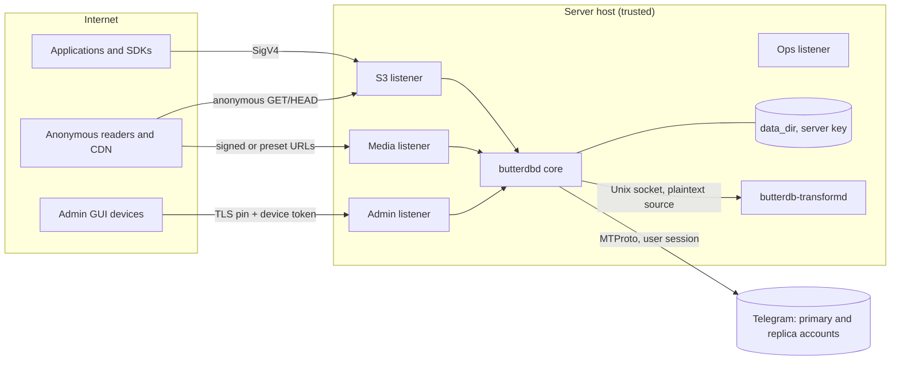
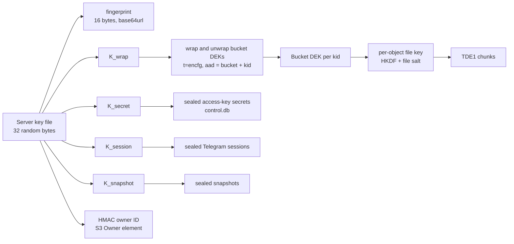

# Security specification

What butterDB protects, from whom, and how. This document owns the threat model,
the server key lifecycle (generation, backup, rotation, loss) and the derivations
that protect local state (sessions, snapshots), access-key secret storage,
the presigned-URL and public-bucket rules, the SSRF and path rules, the
transform worker sandbox, redaction policy, Telegram account safety, supply
chain rules and the security test checklist. Mechanics that other specs own are
linked, not restated: the object-encryption key hierarchy in
[storage-model.md](storage-model.md) §8, admin authentication in
[admin-api.md](admin-api.md) §5, the transform pipeline and worker sandbox in
[media-api.md](media-api.md) §16–§18, configuration and logging mechanics in
[operations.md](operations.md).

| Item | Value |
| --- | --- |
| Packages | `internal/crypto/{format,stream,randomaccess,keyring}`, `internal/access/{keys,sigv4,policy}`, `internal/storage/keyrepo`, `internal/adminapi/{setup,session,tlscert}`, `internal/identity`, `internal/platform/{secretfile,fsx,logging}`, `internal/mediaapi/{signing,workerclient}`, `apps/transformd` |
| Bound by | D1, D2, D7, D10, D11, D12, D14, D15, D16, A1, A2, A3, A4, A5, A6, E8, E9, E10, E13 |

Values marked **Default (owner may change)** are choices this document makes
where no decision settles them.

---

## 1. Security goals

1. A stranger on the internet cannot read, write or delete objects, claim an
   unclaimed server, or administer a claimed one.
2. An application key can do exactly what its scope allows and nothing more,
   and can be revoked at once.
3. With encryption on (D11), Telegram, anyone who obtains the Telegram account,
   and anyone who obtains a bucket channel's history cannot read object bytes.
4. A stolen data disk without the server key file yields no object plaintext of
   encrypted buckets, no access-key secret and no usable Telegram session.
5. The deploying developer's Telegram account is not put at risk of a ban by
   butterDB's own behaviour.
6. A crafted media file cannot compromise the server process.

Non-goals: protection against the operator of the host, against a compromised
running `butterdbd` process, against Telegram refusing service, or hiding which
objects exist from Telegram.

---

## 2. Assets

| Asset | Where it lives | Impact if lost | Impact if disclosed |
| --- | --- | --- | --- |
| Server key file (A6) | `server_key_file`, off-host backup | Encrypted objects, access-key secrets, sealed sessions, snapshots unrecoverable | Everything below protected by it |
| Bucket DEKs (one per bucket `kid`) | Wrapped in registry `t=encfg` ops; in memory during use | Encrypted objects in that bucket unrecoverable | That bucket's encrypted objects readable by whoever holds the bodies |
| Telegram primary session | `secrets/session_primary.json` (sealed, §5.4) | Re-login needed | Full control of the Telegram account: read, delete, ban risk |
| `api_id` / `api_hash` | `secrets/telegram_app.json` | Re-enter | Others can impersonate the developer's app; Telegram may act against the `api_id` |
| Access-key secrets | `control.db`, sealed (§6) | Applications must be re-keyed | Scoped object access, presigned URL minting |
| Admin device tokens | OS keychain on each GUI device; hashes in `control.db` | Re-pair | Full administrative control |
| Setup token, pairing codes | Server log, Saved Messages; hashes in `control.db` | Re-issue | Claim or add a device while valid |
| Media signing key (phase 13) | `secrets/media_signing.key`, applications that build media URLs | Re-create; old URLs stop verifying | Any transformation of any object in a media-enabled bucket, private ones included ([media-api.md](media-api.md) §7.1) |
| Object bodies | Telegram channels, replica account, `cache/blocks/`, `spool/`, `cache/derived/` | Data loss | Data disclosure |
| Object metadata (keys, sizes, content types, hashes, user metadata) | `t=put` ops in Telegram, `projection.db` | Rebuildable from Telegram | Disclosure of names and structure |
| `control.db` | Data directory, snapshots | Keys, devices, jobs lost | Sealed secrets and hashes, audit trail with IP addresses |
| Admin TLS private key | `<data_dir>/tls/admin.key` | Devices re-pin | Impersonation of the admin API to paired GUIs |

---

## 3. Adversaries

| # | Adversary | Capabilities assumed | Primary defences |
| --- | --- | --- | --- |
| T1 | Internet attacker | Reaches every listener the operator exposes; unlimited requests; can observe and alter traffic on untrusted networks | SigV4 on every non-public request (§8); setup token and pinned TLS on the admin API (§7); rate limits; no outbound fetches (§11); strict parsing limits (§12) |
| T2 | Compromised application access key | Holds an access-key ID and secret | Scope enforcement per request; revocation; per-key put slots; the E10 limiter caps Telegram writes whatever the request rate (§14) |
| T3 | Telegram or channel observer | Telegram itself, anyone who obtains the account session or a channel's history, legal compulsion of Telegram | TDE1 encryption of bodies (§4); no secrets in Telegram except wrapped keys; limits documented in §4.3 |
| T4 | Stolen server disk | Offline copy of the data filesystem, possibly without the key file | Key file kept apart (§5.5); sealed sessions and secrets (§5.4, §6); full-disk encryption recommended |
| T5 | Stolen GUI laptop | Device with the paired GUI and its keychain | Device revocation; no Telegram session and no access-key secrets on the device (D14); OS disk encryption and lock (§7.5) |
| T6 | Malicious media file | Any object an application uploads, later transformed or previewed | Transform worker isolation and limits (§12); GUI preview limits (§12.5); the server only sniffs the first 64 bytes and never decodes media |

### 3.1 Threat matrix

| Threat | Adversary | Mitigation | Residual risk |
| --- | --- | --- | --- |
| Claim an exposed unclaimed server | T1 | Setup token printed only to the server log (A2); claim rate limit 5 per 15 min per address | An attacker with log access already owns the host |
| Man-in-the-middle at first GUI connect | T1 | Owner compares the SPKI fingerprint with the log line before claiming (A3) | An owner who skips the comparison |
| Brute-force a device token or pairing code | T1 | 256-bit tokens; 50-bit codes, 10 min TTL, 5 failures invalidate all codes, per-address limits ([admin-api.md](admin-api.md) §5.4, §5.6) | None material |
| Forge SigV4 | T1 | HMAC-SHA256 with 40-character secrets; constant-time compare; 15 min skew window | None material |
| Replay a captured signed request | T1 | Skew window; TLS at the proxy; idempotent semantics of S3 operations | A replay inside 15 min over plaintext HTTP; serve S3 only over TLS |
| Exhaust spool, sockets or Telegram limits | T1, T2 | Admission slots and spool reservations, `503 SlowDown`, `ReadHeaderTimeout`, anonymous rate limit, E10 limiter | Degraded service under sustained abuse |
| Read or delete outside scope | T2 | `internal/access/policy` on every request; `ListBuckets` filtered by scope | Everything inside scope |
| Mint presigned URLs with a stolen key | T2 | Revocation invalidates every URL signed by the key (§8.3) | URLs work until revocation |
| Read object bytes in Telegram | T3 | TDE1 for encrypted buckets and requests | Unencrypted objects are readable; metadata visible (§4.3) |
| Forge or swap object ops in a channel | T3 with account access | Tamper evidence for edited messages; ops are not authenticated | A forged `t=put` pointing at another body in the same bucket is accepted (§4.3) |
| Take over the Telegram account from a disk image | T4 | Session sealed with a key derived from the server key file (§5.4) | Disk images that include the key file |
| Read encrypted objects from a disk image | T4 | Cache and replica hold ciphertext; DEKs only wrapped | `spool/*.plain` remnants after a crash; derivatives if not sealed (§4.2) |
| Administer from a stolen laptop | T5 | Revoke the device; tokens are not exportable from the server | Until revoked, full control including hard deletes (D10) |
| Code execution through an image or video | T6 | Separate worker process, separate user in production, no network, limits (§12) | A worker compromise sees the plaintext of originals it is given |

### 3.2 Trust boundaries



| Boundary | Crossing | What is trusted on the far side | Control at the crossing |
| --- | --- | --- | --- |
| B1 Internet → S3 listener | Every S3 request | Nothing until SigV4 verifies; anonymous only for `GET`/`HEAD` on public-read buckets | SigV4, scope policy, auth-failure and anonymous limits, parsing limits (§8, §9, §12.1) |
| B2 Internet → media listener | Transform URLs | Nothing; a valid signature proves only possession of the media signing key | Signature, presets, limits ([media-api.md](media-api.md) §7, §9) |
| B3 GUI device → admin listener | JSON and object streams | The device token holder is the owner | TLS 1.3 with SPKI pin, setup token, device tokens, pairing codes, rate limits (§7) |
| B4 Monitoring → ops listener | `/healthz`, `/readyz`, `/metrics` | Loopback by default | Loopback bind or bearer token; no secrets in any response (§10) |
| B5 `butterdbd` → Telegram | MTProto under the owner's user session | Telegram stores and returns bytes; channel content is **not** trusted to be authentic | TDE1 authentication of encrypted bodies, CDN hash checks, tamper evidence for edited ops, strict op parsing (§4, §12.1) |
| B6 `butterdbd` → transform worker | Plaintext source in, derivative out | The worker is assumed compromisable by its input | Separate process, sandbox, no secrets, output size and format checks on return (§12.4) |
| B7 Process → host filesystem | `data_dir`, key file, caches | The host and its root user are trusted (non-goal in §1) | Modes `0700`/`0600`, `os.Root`, sealed secrets so a copied disk without the key yields little (§5, §11.2) |
| B8 Host → off-host backups | Snapshots, key backup | Backups are as sensitive as the host | Snapshots sealed under `K_snapshot`; the key never stored beside them (§5.3) |

---

## 4. Encryption at rest (TDE1)

### 4.1 Scheme

| Element | Value |
| --- | --- |
| Container | TDE1, byte for byte as legacy S12: 50-byte header (`TDE1`, flags 0, `chunk_log2` 16, 16-byte file salt, 20-byte nonce prefix, little-endian plaintext size), then 64 KiB chunks each sealed with a 16-byte tag |
| AEAD | XChaCha20-Poly1305, no additional data |
| Per-object key | `HKDF-SHA256(ikm = bucket DEK, salt = file salt, info = "butterDB/file/v1")`, 32 bytes. The info string is the specification's (S12, S28), not TDrive's `tdrive/file/v1`, so TDrive ciphertext does not open under butterDB and must not |
| Nonce | `nonce_prefix ‖ uint32_be(counter \| final_bit)`; bit 31 marks the final chunk, so truncation is detected |
| Salt and nonce prefix | Generated per put job and persisted in the job row before the first send (E8) |
| Selection | `x-amz-server-side-encryption: AES256` or the bucket default (A5). The header value names the AWS mode only; the cipher is XChaCha20-Poly1305 |
| Where ciphertext lives | Telegram body documents, replica copies, `cache/blocks/`, `spool/<job id>.sealed` |

Code paths: `internal/crypto/format` (header and size arithmetic, stdlib only),
`internal/crypto/stream` (`EncryptStream`, `DecryptStream`), and
`internal/crypto/randomaccess` (authenticates the final chunk at open and every
touched chunk on read). Ported from TDrive `backend/crypto/stream.go` and
`backend/crypto/random_access.go`.

### 4.2 What it protects

| Property | Holds for encrypted objects |
| --- | --- |
| Confidentiality of object bytes against Telegram, channel observers and replica observers | Yes |
| Confidentiality in `cache/blocks/` and in a stolen disk image without the key file | Yes |
| Detection of modified, reordered within the stream, or truncated ciphertext | Yes, per 64 KiB chunk; a read never returns unauthenticated bytes |
| Confidentiality against readers the server authorises | No: the server decrypts for any request that passes SigV4 and policy, and for anyone when the bucket is public-read |

Two local plaintext stores need explicit handling:

| Store | Rule |
| --- | --- |
| `spool/<job id>.plain` | Plaintext exists from the spool write until sealing finishes and is removed after commit. After a crash it stays until the sweeper resumes or aborts the job. Mitigation: full-disk encryption of the data filesystem |
| Derivatives (phase 13) | Derivatives of encrypted objects live only in the memory tier; `cache/derived/` holds derivatives of unencrypted objects only ([media-api.md](media-api.md) §11.1) |
| Worker scratch (phase 13) | Video sources are written to an unlinked temp file in `media.worker_tmp_dir`, so plaintext has no name on disk and is freed when the job ends; an owner who wants none on disk at all points it at a tmpfs ([media-api.md](media-api.md) §17.1) |

### 4.3 What it does not protect

TDE1 limits from legacy S12, restated for object storage:

| Visible to Telegram and any channel observer | Why |
| --- | --- |
| Object keys (names) | Carried in the `t=put` text message (E2) |
| Bucket names and configuration | Registry ops |
| Content type and user metadata (`x-amz-meta-*`) | Carried in the put op. Applications must not put secrets or personal data in metadata of encrypted objects |
| Exact plaintext size | The TDE1 header stores it in clear; ciphertext size also determines it |
| MD5 ETag and SHA-256 of the plaintext | Carried in the put op so rebuild restores them. They let anyone holding the channel test whether a known file is stored (confirmation of file). Default (owner may change): kept in clear in v0.1; `docs/spec/wire-format.md` owns the fields |
| Timestamps, upload order, overwrite and delete history | Message dates and IDs |
| Access patterns | Telegram sees `upload.getFile` ranges on cache misses |
| Which bodies belong to which key | The put op references the body message ID. The op is not authenticated by TDE1, so a party able to post into the channel can point a key at another valid body of the same bucket. Substituting ciphertext within one bucket is outside the threat model, as legacy S12 says for one drive |
| The control plane | TDX1 headers are plain text and unauthenticated |

The admin GUI states these limits next to the encryption setting, and the
operator guide repeats them. Users otherwise assume more.

---

## 5. Key management

### 5.1 Hierarchy

[storage-model.md](storage-model.md) §8 owns the object-encryption half of the
hierarchy (fingerprint, `K_wrap`, DEKs, key check, `t=encfg`). This section
restates it and adds the keys that protect local state.



### 5.2 Derivations

Every subkey is `HKDF-SHA256(ikm = server key, salt = empty, info = <info>)`,
32 bytes unless stated, derived once at start by `internal/crypto/keyring` and
held in `keyring.Key` values whose `LogValue` redacts and whose `Clear` zeroes
them.

| Name | `info` | Use | Owner |
| --- | --- | --- | --- |
| Fingerprint | `butterdb/keyring/fingerprint/v1`, first 16 bytes | Identifies the key in `state.json` (`kek_fingerprint`), `t=reg` and `t=encfg` (`kfp`), snapshot manifests, ops-channel captions and logs. Written as base64url without padding, 22 characters | [storage-model.md](storage-model.md) §8.1 |
| `K_wrap` | `butterdb/keyring/dek-wrap/v1` | Wraps bucket DEKs | [storage-model.md](storage-model.md) §8.1 |
| `K_secret` | `butterdb/keyring/access-key-secret/v1` | Seals access-key secrets (§6) | [storage-model.md](storage-model.md) §8.1 |
| `K_session` | `butterdb/keyring/session-seal/v1` | Seals Telegram session files (§5.4). Default (owner may change) | this document |
| `K_snapshot` | `butterdb/keyring/snapshot/v1` | TDE1 master key for snapshots ([operations.md](operations.md) §9.2). Default (owner may change) | this document |
| Owner ID | not HKDF: `HMAC-SHA256(server key, "butterdb/s3/owner-id/v1")`, hex | Stable S3 `Owner` ID in listings; reveals nothing about the key | [s3-api.md](s3-api.md) §7.3 |

Secrets that are **not** derived from the server key:

| Secret | Why separate | Owner |
| --- | --- | --- |
| Admin setup tokens, device tokens, pairing codes | Stored as domain-separated SHA-256 (`"butterdb-admin-v1\x00" ‖ kind ‖ "\x00" ‖ value`); their entropy and lifetime make a keyed hash unnecessary, and `adminapi/session` stays independent of `keyring` | [admin-api.md](admin-api.md) §5.7 |
| Media signing key | Applications hold it to sign URLs; it must be distributable without exposing the server key | [media-api.md](media-api.md) §7.1 |
| Admin TLS key | Rotating the server key must not break GUI pins | [admin-api.md](admin-api.md) §2.3 |

Bucket DEK wrap ([storage-model.md](storage-model.md) §8.1; field encoding in
[wire-format.md](wire-format.md) §5.8):

```
kid          = 8 random bytes, 16 lowercase hex characters
dek          = 32 bytes from crypto/rand, one per (bucket, kid)
aad          = "butterdb/dek/v1|" + decimal(bucket channel ID) + "|" + kid
wrap         = nonce(24) ‖ XChaCha20-Poly1305(K_wrap).Seal(nonce, dek, aad)        72 bytes
check        = nonce(24) ‖ XChaCha20-Poly1305(dek).Seal(nonce, "butterDB-key-check-v1", nil)   61 bytes
```

The `aad` binds a wrapped DEK to its bucket and key ID, so a `wrap` copied into
another bucket's `t=encfg` fails to unwrap. Unwrap failure is `ErrDEKUnwrap`,
check failure `ErrDEKCheck`; both make reads of that key's objects return
`500 InternalError` and increment `butterdb_key_errors_total`, and neither
distinguishes a wrong key from damaged data.

```go
package keyring

type Key struct {
	b [32]byte
}

func (k *Key) Bytes() []byte
func (k *Key) Clear()
func (k Key) LogValue() slog.Value

type Ring struct {
	fingerprint [16]byte
	wrap        Key
	secret      Key
	session     Key
	snapshot    Key
	ownerID     string
}

func Generate(path string, rand io.Reader) ([16]byte, error)
func Load(path string) (*Ring, error)
func (r *Ring) Fingerprint() [16]byte
func (r *Ring) FingerprintString() string
func (r *Ring) WrapDEK(dek *Key, bucketChannelID int64, kid string) (wrap [72]byte, check [61]byte, err error)
func (r *Ring) UnwrapDEK(wrap []byte, check []byte, bucketChannelID int64, kid string) (*Key, error)
func (r *Ring) SealSecret(accessKeyID string, secret []byte) ([]byte, error)
func (r *Ring) OpenSecret(accessKeyID string, sealed []byte) ([]byte, error)
func (r *Ring) SessionKey() *Key
func (r *Ring) SnapshotKey() *Key
func (r *Ring) OwnerID() string
func (r *Ring) Close()
```

`Load` checks file permissions ([operations.md](operations.md) §2.5) and length
(exactly 32 bytes). Every DEK copy is cleared on every return path (invariant 6
of [claude.md](../claude.md)).

### 5.3 Generation and backup

| Step | Rule |
| --- | --- |
| Source | `crypto/rand`, 32 bytes |
| File format | Exactly the 32 raw bytes, no newline ([storage-model.md](storage-model.md) §8.1). `head -c 32 /dev/urandom > server.key` produces a valid file |
| Who creates it | `butterdbd setup --key-only`, or `serve` on a fresh deployment that was never linked ([operations.md](operations.md) §5.3) |
| Mode | `0600`, written through `secretfile`; on systemd hosts owned by root and delivered by `LoadCredential=` |

Backup instructions, printed by `setup --key-only` and at first generation, and
repeated in the operator guide. The key itself is never printed; the operator
copies the file.

1. Make two copies off the host before linking Telegram: one in a password
   manager as text (`base64 -w0 /etc/butterdb/server.key`; restore with
   `base64 -d > server.key` and `chmod 0600`), one as the raw file on offline
   media in a different place.
2. Record the fingerprint next to each copy.
3. Never store the key in the same place as copies of the data directory or of
   snapshots: a snapshot plus the key yields every access-key secret.
4. Never put the key in a Git repository, a container image, an environment
   variable, a CI secret store that logs, or a chat.
5. Test the backup: `BUTTERDB_SERVER_KEY_FILE=<copy> butterdbd check-config`
   prints the fingerprint; it must equal the recorded one. Monthly, run
   `butterdbd restore --snapshot <file> --verify-only` with the backup copy
   ([operations.md](operations.md) §9.6).

### 5.4 Fingerprint checks and sealed sessions

| Check | Where | Failure |
| --- | --- | --- |
| Key fingerprint equals `state.json` `kek_fingerprint` | Start, before any listener ([operations.md](operations.md) §7.1 step 7; [storage-model.md](storage-model.md) §4.4 step 4) | Exit 4 (`kek_mismatch`) |
| Projected registry marker carries the same channel and fingerprint | Start, step 7 | Exit 4 or 5 |
| The registry marker message in Telegram exists and its `dep`, `uid`, `kfp` equal `state.json` | Start, once connected (step 12) | Refuse: Telegram-dependent components do not start; admin reports the code |
| Every `t=encfg` `kfp` equals the marker's | Projection | Reject `kek_mismatch` |
| Snapshot manifest fingerprint equals the key's | `restore` | Exit 4 |
| Registry rediscovery offers only candidates whose `kfp` and `uid` match | `rebuild --from-telegram --registry-channel` ([storage-model.md](storage-model.md) §4.5) | Candidate cannot be confirmed |

These checks stop a server from writing objects under one key into a deployment
whose existing objects were wrapped under another, which would leave a bucket
with mixed, partly unreadable keys.

Sealed sessions, Default (owner may change): `internal/identity` stores each
gotd session file as

```json
{"v": 1, "nonce": "<base64 24 bytes>", "ct": "<base64 XChaCha20-Poly1305(K_session) of the gotd session JSON>"}
```

with additional data `butterdb/session/v1|primary` or `|replica`. A disk image
without the key file then holds no usable MTProto authorization key. TDrive
`backend/auth/session_storage.go` stores sessions in clear; the port changes
that. `secrets/telegram_app.json` stays plain JSON with mode `0600`: the
`api_hash` alone does not open the account.

### 5.5 Keeping the key off the data disk

| Deployment | Practice |
| --- | --- |
| systemd | Key at `/etc/butterdb/server.key` (root, `0600`), delivered with `LoadCredential=`; with a TPM2, `systemd-creds encrypt` and `LoadCredentialEncrypted=` so the key file at rest is bound to the machine |
| Container | Orchestrator secret mounted read-only at `/run/secrets/butterdb/server.key`; never baked into the image or passed as an environment value |
| Any | `data_dir` on a separate filesystem from `/etc/butterdb`; full-disk encryption on both |

### 5.6 Rotation by re-wrap

`butterdbd setup --rotate-key --new-key-file <path>`; server stopped (process
lock), Telegram reachable. Built in phase 11. Default (owner may change).

Rotation changes the fingerprint, and [storage-model.md](storage-model.md) §4.2
accepts a later `t=reg` only with the same `kfp`. Rotation therefore needs one
format addition, which must be in the phase 02 grammar so that phase 11 needs no
format change: an optional `t=reg` field `pkfp` (previous fingerprint). A later
`t=reg` with a different `kfp` is accepted when its `pkfp` equals the current
marker's `kfp`, with the same `dep` and `uid`. Every `t=encfg` is checked against
the marker in effect at its message ID, so wraps published before the new
marker stay valid during replay. [wire-format.md](wire-format.md) §5.4 and
[storage-model.md](storage-model.md) §4.2 must adopt this.

| Step | Action |
| --- | --- |
| 1 | Load both keys; refuse when fingerprints are equal or the old key fails §5.4 |
| 2 | Write `<data_dir>/rekey.json` (`0600`): old and new fingerprints and the last completed step. `serve` refuses to start while it exists (exit 4, `key rotation incomplete`) |
| 3 | Publish `t=reg` with the new `kfp` and `pkfp` = old fingerprint, project it |
| 4 | For each `(bucket, kid)`: unwrap with the old `K_wrap`, wrap and check with the new one, publish a new `t=encfg` with the same `kid`, the new `kfp` and `cv` + 1, project it. The active key per bucket is still the highest message ID |
| 5 | Rewrite `state.json` (`kek_fingerprint`, `marker_msg_id`) |
| 6 | In one `control.db` transaction, re-seal every access-key secret under the new `K_secret` |
| 7 | Re-seal the session files under the new `K_session` |
| 8 | Delete the superseded `t=encfg` and `t=reg` messages from the registry channel (and the replica registry, phase 12) with `channels.deleteMessages` |
| 9 | Remove `rekey.json`; print: replace `server_key_file` with the new key, keep the old key until every snapshot sealed under it has expired |

Each step is idempotent and resumes from `rekey.json`; during rotation `keyring`
tries the new key, then the old, when unwrapping. Admin devices, the admin TLS
pin and the media signing key are untouched (§5.2).

What rotation does not do: object DEKs are unchanged, so nothing is
re-uploaded. Anyone who already holds the old key file **and** a copy of an old
wrapped DEK (an earlier registry message, an old snapshot, a replica copy) can
still decrypt that bucket's objects. When the old key is believed stolen
together with channel access, re-encrypt: create a new encrypted bucket, copy
every object into it (`CopyObject` streams through the read path into a new put,
sealed under the new bucket's DEK), switch applications, delete the old bucket.

### 5.7 Lost key

Without the key file:

| Lost permanently | Survives |
| --- | --- |
| Every encrypted object | Every unencrypted object (bodies and put ops are in Telegram) |
| Access-key secrets (sealed) | Bucket configuration |
| Sealed sessions and every snapshot | Admin devices and pairing (their hashes use no server key) |
| | The Telegram account (log in again) |

The server refuses to start with a different key (§5.4). Recovery is
`butterdbd setup --replace-lost-key --new-key-file <path>`, which requires typing
`replace lost key` on the TTY, logs in to Telegram on the TTY, publishes a
`t=reg` with the new `kfp` and `pkfp=lost` (accepted by the same rule as §5.6,
with `lost` in place of the previous fingerprint; Default (owner may change)),
gives every encrypted bucket a new `kid` and DEK for future objects, deletes
every access-key row, writes `state.json`, and prints the count of
now-unreadable objects per bucket. Reads of those objects fail `ErrDEKUnwrap`
and return `500 InternalError` ([storage-model.md](storage-model.md) §8.3). The
owner deletes them. Built in phase 11.

---

## 6. Access-key secret storage

SigV4 verification computes `HMAC(HMAC(HMAC(HMAC("AWS4" + secret, date), region), "s3"), "aws4_request")`,
so the server needs the plaintext secret; a one-way hash cannot work. Secrets are
therefore sealed, not hashed.

| Property | Value |
| --- | --- |
| Generation | Access key ID `BDBK` + 16 characters `[A-Z0-9]`; secret 30 random bytes from `crypto/rand`, standard base64 = 40 characters ([s3-api.md](s3-api.md) §4.9) |
| At rest | `control.db` through `internal/storage/keyrepo` ([s3-api.md](s3-api.md) §4.9): `secret_sealed` = `nonce(24) ‖ XChaCha20-Poly1305(K_secret).Seal(nonce, secret, aad)`, 80 bytes, `aad = "butterdb/access/v1\|" + access_key_id`. The column name `secret_sealed BLOB NOT NULL` is the Default (owner may change); the schema owner names it |
| Disclosure | Returned once in `AccessKeyCreated`; never again, never logged, never in audit rows |
| In memory | Unsealed on demand by `internal/access/keys`. Derived SigV4 signing keys are cached per `(access_key_id, date, region)` for at most 24 h in a bounded LRU of 1,024 entries, cleared on revocation and on shutdown. Default (owner may change) |
| Revocation | `DELETE /admin/v1/access-keys/{id}` sets `revoked_at`; the cache entry is dropped in the same call; the next request with that key fails `403 InvalidAccessKeyId` |
| Rotation | Applications rotate by creating a second key, deploying it, then revoking the first. Keys have no built-in expiry |
| Server key rotation | Re-sealed in §5.6 step 6 |

The `aad` binds each sealed secret to its key ID, so swapping `secret_sealed`
values between rows in a stolen and modified `control.db` fails to unseal.

---

## 7. Admin authentication

The mechanics are [admin-api.md](admin-api.md) §5. Security properties:

| Mechanism | Property | Reference |
| --- | --- | --- |
| Setup token `bdst1_…` | 160 bits, printed once to the server log, single use, 24 h, stored as a domain-separated SHA-256; only someone who can read the log can claim (A2) | §5.2, §5.7 |
| Device token `bdt1_<id>_<secret>` | 256-bit secret, bearer only (never query or cookie), stored as a domain-separated SHA-256, 180-day idle revocation, rotation with a 10-minute overlap | §5.3, §5.7 |
| Pairing code | 50 bits, 10 min, single use, delivered to the account's Saved Messages (proves account control) or printed by `butterdbd admin-token` (proves host control); 5 consecutive failures invalidate every code | §5.4, §5.5 |
| Control socket | `0600` socket in the `0700` data directory; reaching it requires the server's user | §5.5 |
| Rate limits | Claim 5/15 min per address; pairing requests 5/h server-wide and 3/h per address; completions 10/15 min; 20 bearer failures/10 min block an address for 15 min; Telegram login 5 starts/h | §5.6 |
| No CORS, JSON-only mutations | Browsers cannot drive the admin API cross-origin | §2.5 |

### 7.1 TLS pinning (A3)

| Mode | Trust |
| --- | --- |
| `self-signed` | ECDSA P-256 key generated once; the GUI pins the SHA-256 of the leaf's `SubjectPublicKeyInfo` after the owner compares it with the server log line. Renewal keeps the key, so the pin survives |
| `files` | The operator's certificate; the GUI uses system roots when the chain verifies, otherwise pins |
| `proxy` | The proxy's certificate through system roots; `admin.listen` must be loopback |

The pin changes only when the admin TLS key changes: after `tls/admin.key`
is deleted, or after a restore onto a new host (snapshots exclude `tls/`).
Every paired GUI then refuses to connect until the owner re-pairs; that refusal
is the intended behaviour, not a fault. Rotating or replacing the server key
leaves the TLS key and every device untouched (§5.2).

### 7.2 Exposure guidance

| Listener | Recommended exposure |
| --- | --- |
| Admin `9443` | Owner's networks only: a firewall allowlist, WireGuard or Tailscale. Exposing it publicly is supported (the protections above hold) but needless |
| S3 `9000` | Public behind a TLS proxy when applications run elsewhere |
| Media `9080` | Public behind a TLS proxy or CDN (phase 13) |
| Ops `9090` | Loopback, or the cluster network with a metrics token |

### 7.3 Destructive operations

A device token can delete buckets and objects, and deletes are immediate and
hard in Telegram (D10); the replica mirrors deletes (phase 12). No backup inside
butterDB undoes them: snapshots hold metadata, not bodies. Bucket deletion
requires an empty bucket and Telegram unlink requires `{"confirm": "unlink"}`
([admin-api.md](admin-api.md) §8.8, §10); object deletes need no confirmation. The
audit log records every destructive action with device ID and address.

### 7.4 Stolen server-side secrets

`control.db` holds only domain-separated SHA-256 hashes of tokens and codes
([admin-api.md](admin-api.md) §5.7). A stolen copy cannot be reversed: setup and
device tokens carry 160 and 256 bits, and a 50-bit pairing code expires in 10
minutes and is single use, so an offline guess is not useful in time. A stolen
`control.db` does expose sealed access-key secrets to whoever also holds the key
file (§6), which is why the key is never stored beside data or snapshots.

### 7.5 Stolen GUI laptop (T5)

| Holds | Does not hold |
| --- | --- |
| Device token in the OS keychain (Keychain, Credential Manager, Secret Service) | Telegram session, `api_hash`, 2FA password (D14) |
| Pinned SPKI fingerprint and server URL | Access-key secrets (shown once at creation, never stored by the GUI) |
| Downloaded files the user saved | The server key |

Response: from another device, `DELETE /admin/v1/devices/{id}`; with no other
device, `butterdbd admin-token` on the host, pair a new device, revoke the stolen
one; then review `GET /admin/v1/audit` for the period and rotate any access key
created or viewed in it. Prevention: OS disk encryption and screen lock; the
idle-revocation sweeper limits forgotten devices.

---

## 8. S3 request authentication and presigned URLs

### 8.1 Rules for every request

| Rule | Value |
| --- | --- |
| Accepted auth | SigV4 `Authorization` header, SigV4 query (presigned), or none for `GET`/`HEAD` on a public-read bucket. SigV2, SigV4A, `X-Amz-Security-Token` session credentials and POST-policy uploads are rejected |
| Both header and query auth on one request | Rejected ([s3-api.md](s3-api.md) §4.1) |
| Signature compare | `hmac.Equal` on the hex signature |
| Credential scope | Date equals the date of `X-Amz-Date`; region equals `s3.region`; service `s3`; terminator `aws4_request` |
| Clock skew | Header auth: `X-Amz-Date` within 15 min of server time, else `403 RequestTimeTooSkewed` (a constant of `internal/access/sigv4`) |
| Signed headers | Must include `host`; `x-amz-content-sha256` and `x-amz-date` when present |
| Payload | `x-amz-content-sha256` is verified against the body (fixed hash), per chunk (aws-chunked signed) or by trailing checksum; with `UNSIGNED-PAYLOAD` integrity rests on TLS and any trailing checksum, so the S3 API is served over TLS |
| Scope check | After authentication, against the key's current scope ([admin-api.md](admin-api.md) §11) |
| Host | Virtual-hosted-style bucket names are taken from `Host` only for suffixes in `s3.base_domains`; any other `Host` is path-style ([s3-api.md](s3-api.md) §2.4) |

### 8.2 Presigned URL rules

[s3-api.md](s3-api.md) §4.3 owns the mechanics. Security-relevant rules:

| Rule | Value |
| --- | --- |
| `X-Amz-Expires` | 1–604800 s (7 days, the SigV4 maximum); outside that range is `400 AuthorizationQueryParametersError` |
| Validity window | Valid while `now ≤ X-Amz-Date + X-Amz-Expires`; expired is `403 AccessDenied` (`Request has expired`); `X-Amz-Date` more than 15 min in the future is `403 AccessDenied` (`Request is not valid yet`) |
| Methods | Any S3 operation the key's scope allows. The admin API mints `GET` only ([admin-api.md](admin-api.md) §12.6) |
| Payload | `UNSIGNED-PAYLOAD` unless `X-Amz-Content-Sha256` is in the query; a presigned `PUT` lets its holder upload any content to that one key until expiry |
| Evaluation time | Scope and revocation are checked when the URL is used, not when it was signed; a revoked key's URLs fail `403 InvalidAccessKeyId` |
| Response caching | A private object's response carries no `Cache-Control` unless the object stores one ([s3-api.md](s3-api.md) §13.6). A CDN in front of the S3 hostname must not cache responses to requests carrying `Authorization` or `X-Amz-Signature`, or must key its cache on the full query string |

### 8.3 Presigned URL risks and guidance

| Risk | Guidance |
| --- | --- |
| A URL is a bearer credential until it expires | Use the shortest workable expiry: minutes for downloads embedded in pages, never the 7-day maximum by habit |
| Individual URLs cannot be revoked | Mint presigned URLs with a dedicated read-only key per application; revoking that key kills every URL it signed without touching the application's write key |
| URLs leak through logs | butterDB never logs query strings ([operations.md](operations.md) §14.4). Configure the reverse proxy and CDN to do the same (Caddy `log` with a query filter, nginx `$uri` instead of `$request_uri`) |
| URLs leak through `Referer` | When objects are HTML pages, a link inside them sends the URL to the next site. Store untrusted uploads with `Content-Disposition: attachment` or serve them from a public bucket on a separate hostname |
| `Host` rewritten by a proxy | Breaks every signature; proxies must preserve `Host` |

### 8.4 Serving user content safely

| Risk | Rule |
| --- | --- |
| Stored HTML or SVG runs script in the S3 origin | Every S3 and media response carries `X-Content-Type-Options: nosniff` (media: [media-api.md](media-api.md) §12.1; S3: a requirement this document adds, which [s3-api.md](s3-api.md) must list among its common headers). Serve the S3 API on its own registrable domain, never on an application's cookie domain |
| Content type chosen by the uploader | Stored and returned as uploaded (A4). The media listener only returns its own raster outputs with a content type it sets |
| Admin API on the same origin | Impossible by design: separate port, no cookies, no CORS |

---

## 9. Public-read buckets

A public-read bucket allows anonymous `GET` and `HEAD` of objects only (D7).
Listing, writes and multipart are never anonymous.

| Risk | Consequence | Control |
| --- | --- | --- |
| Encryption gives no confidentiality to readers | The server decrypts for anyone | The GUI warns when a bucket is both encrypted and public; encryption still protects against T3 and T4 |
| Key guessing | Predictable keys (`invoice-0001.pdf`) are enumerable without listing | Applications use unguessable keys for semi-private content, or keep it private and presign |
| Cache-miss amplification | Every miss is an `upload.getFile` to Telegram; a flood of distinct cold keys drives flood waits that slow every reader and writer on the account | Anonymous limit `s3.anonymous_rate` per address; foreground and background `getFile` slots (12 / 8); a CDN in front; `503 SlowDown` past the budget |
| Hotlinking and egress | Bandwidth and Telegram load | CDN with `Cache-Control` from the bucket max-age (A8) |
| Accidental exposure | A private bucket set public | `bucket.update` is audited; the GUI requires confirmation and shows the public URL form |
| Overwrites served stale | Keys are overwritable; URLs are never `immutable` (A8) | ETag revalidation |

---

## 10. Network listeners

| Rule | Detail |
| --- | --- |
| Loopback listeners validate `Host` | A listener bound to `127.0.0.1` or `::1` accepts only `Host` values `localhost`, `127.0.0.1`, `::1` and its configured names, blocking DNS rebinding (invariant 12 of [claude.md](../claude.md)). S3: the host of `s3.public_url` and `s3.base_domains` with their subdomains, else `400 InvalidRequest` ([s3-api.md](s3-api.md) §2.5). Admin: `admin.hostnames`, else `421` ([admin-api.md](admin-api.md) §2.5). Media: `media.hostnames` and the host of `media.public_url`. Ops: `ops.hostnames`, else `421` |
| Trusted proxies | `X-Forwarded-For` and `X-Forwarded-Proto` are honoured only from configured CIDRs; the client address is the right-most untrusted entry |
| Timeouts | `ReadHeaderTimeout` 10 s and `MaxHeaderBytes` 64 KiB on every listener; body timeouts per listener spec |
| Unauthenticated surface | S3: anonymous `GET`/`HEAD` on public buckets. Admin: `GET /server-info`, `POST /setup/claim`, `POST /pairing/request`, `POST /pairing/complete`. Ops: `/healthz`, `/readyz`, and `/metrics` without a token file. Media: preset and signed transform URLs |
| Outbound | Telegram data centres only (§11.1) |

---

## 11. SSRF and path traversal

### 11.1 SSRF rules

| Rule | Detail |
| --- | --- |
| No client-supplied URL is ever dereferenced | No S3 operation, admin endpoint or media URL causes the server or the worker to fetch a URL. Cloudinary's `fetch` and remote-URL resource types are not supported; `docs/spec/media-api.md` rejects them with `400` |
| Outbound connections | `butterdbd` connects only to Telegram addresses from gotd's built-in DC list and Telegram's `help.getConfig`, including CDN DCs named by `upload.fileCdnRedirect` |
| Transform worker | No network in external mode (`PrivateNetwork=yes` or `network_mode: none`) and, in spawn mode, Landlock ABI v4+ denies TCP bind and connect (§12.4). `ffmpeg` reads only descriptor 3 with `-protocol_whitelist file`, `-format_whitelist` and `-codec_whitelist`, so playlists, `concat`, `subfile`, `http`, `tcp`, `rtmp` and `data` inputs cannot open ([media-api.md](media-api.md) §17.2) |
| libvips | Every `VipsForeignLoad` is blocked and only the JPEG, PNG, GIF, WebP and HEIF loaders are unblocked, so SVG (librsvg), PDF and other loaders that can reach external resources never run (§12.2) |
| XML | `encoding/xml` does not resolve external entities or DTDs; no XML parser with DTD support is used anywhere |

### 11.2 Path rules

| Rule | Detail |
| --- | --- |
| Object keys never become paths | S3 keys may contain `../`, `\`, leading `/` and anything else `internal/domain/object` allows; they are stored in SQLite and Telegram text only |
| On-disk names derive from server-minted values | `spool/<job id>.*` (UUIDv4), `multipart/<upload id>/part-<NNNNN>` (upload ID minted by the server), cache blocks from `(channel_id, body_msg_id, block_index)` integers, derivatives from SHA-256 hex |
| Validate before join | Every client-echoed identifier used in a path (multipart `uploadId`, `partNumber`) is matched against the generator's exact pattern before use; a mismatch is `404 NoSuchUpload` |
| One root | `internal/platform/fsx` opens `data_dir`, `cache.dir` and `snapshot.dir` as `os.Root` values (Go 1.24+); every access goes through them, so symlinks and `..` cannot escape |
| Restore archive | Member names are an exact allowlist; links, directories and devices are rejected (§12.3) |
| `Content-Disposition` | Admin downloads send `attachment; filename*=UTF-8''<percent-encoded last key segment>` ([admin-api.md](admin-api.md) §12.3); percent-encoding leaves no quote, separator or control character in the header |
| GUI saves | The Fyne app suggests the last key segment with `/`, `\`, `:`, control characters and leading dots replaced by `_`, capped at 255 bytes, and writes only to the path the user picks |

---

## 12. Parsing limits, decompression bombs and the transform worker

### 12.1 Server-side inputs

| Input | Limit |
| --- | --- |
| Object bodies | Never decoded: `Content-Encoding: gzip` is stored and returned verbatim. aws-chunked framing is decoded with a 4 KiB chunk-header limit and the decoded length must equal `x-amz-decoded-content-length` |
| Stored size | `limits.MaxStoredObjectBytes` (1900 MiB), checked from the declared length before reading (invariant 3) |
| XML request bodies | `DeleteObjects` 2 MiB, `CompleteMultipartUpload` 4 MiB, others 64 KiB, else `400 MaxMessageLengthExceeded` ([s3-api.md](s3-api.md) §14.2); Go's `encoding/xml` has no entity expansion beyond the five predefined entities |
| JSON admin bodies | 1 MiB ([admin-api.md](admin-api.md) §2.5) |
| `t=put` and other ops from Telegram | Parsed by `internal/wire` with explicit length limits; a malformed op is a reject, never a panic |
| Key-derivation parameters | None are read from Telegram: the legacy Argon2id `encfg` parameters (a one-message denial of service, S13) do not exist in butterDB |

### 12.2 Images and video (phase 13)

[media-api.md](media-api.md) §9, §16 and §17 own the limits and the pipeline.
The security floor they implement, checked before any full decode:

| Check | Rule |
| --- | --- |
| Source size | From the object's plaintext size before any read: `media.max_image_source_bytes` (64 MiB) for images, `media.max_video_source_bytes` (1 GiB) for posters, else `422 media.source_too_large` |
| Format allowlist by magic bytes | `sniff.Classify` on the first 64 bytes, run by the server and again by the worker: JPEG, PNG, GIF, WebP, AVIF, HEIC/HEIF, MP4/MOV, WebM/Matroska, AVI ([media-api.md](media-api.md) §16.2). Everything else, including SVG, PDF, TIFF, BMP, PSD, JPEG XL, RAW, MPEG-TS, playlists and `ffconcat` scripts, is refused. The stored `Content-Type` and the extension are never trusted |
| libvips loaders | `vips_operation_block_set("VipsForeignLoad", TRUE)`, then only the JPEG, PNG, GIF, WebP and HEIF loaders are unblocked; `VIPS_BLOCK_UNTRUSTED=1`; the libvips operation cache is disabled so no pixels survive between jobs |
| Dimensions | Header-only: width × height ≤ `media.max_source_pixels` (50 MP), each side ≤ `media.max_source_side` (32768); animated sources kept animated also obey `media.max_frames` (200) and `media.max_animated_pixels` (200 MP) |
| Output | ≤ `media.max_output_side` (4096), ≤ `media.max_output_pixels` (16 MP), ≤ `media.max_output_bytes` (32 MiB); metadata stripped and orientation applied on every derivative (A4) |
| Video posters | Fixed `ffmpeg` argument slice ([media-api.md](media-api.md) §17.2): input only `/dev/fd/3`, `-protocol_whitelist file`, `-format_whitelist`, `-codec_whitelist`, `-threads 1`, environment exactly `PATH=/usr/bin:/bin`. No part of a URL, key, bucket name or metadata reaches the argument list. The extracted frame then passes the image checks |
| Time | `media.image_timeout` (20 s) and `media.poster_timeout` (30 s) per job; the server-side watchdog kills the worker's process group when a job overruns by 5 s |
| Memory | `RLIMIT_AS` = `media.worker_memory_limit` (1 GiB) in spawn mode, cgroup `MemoryMax` in external mode; `RLIMIT_CORE` 0 |
| Repeat offenders | A source that crashes the worker twice is quarantined for `media.poison_ttl` and answered `422 media.source_rejected` without reaching the worker |

### 12.3 Snapshot restore

The restore reader ([operations.md](operations.md) §10.2) opens TDE1 first, so an
unauthenticated archive is never decompressed. Then: exact member allowlist,
regular files only, each member's size must equal the manifest's, the total
decompressed bytes may not exceed twice the manifest total, and extraction
writes only to fixed names through `os.Root`.

### 12.4 Worker sandbox

The worker sees the plaintext of every source it is given and nothing else. It
never receives a DEK, the server key path, a session, an access key or the media
signing key; it starts with an exact environment and no inherited descriptors
([media-api.md](media-api.md) §15.2). The server checks the worker's socket peer
with `SO_PEERCRED`.

Two topologies, selected by `media.worker_mode` ([media-api.md](media-api.md)
§15.1, §18.2, §21):

| Control | `external` (recommended for production) | `spawn` (default; single-host installs) |
| --- | --- | --- |
| Process | systemd unit `deploy/transformd/butterdb-transformd.service` or a container; the supervisor only probes | Child of `butterdbd`, `Setpgid`, `Pdeathsig: SIGKILL`, restarted with backoff |
| User | `butterdb-transformd`, group `butterdb`; `InaccessiblePaths=/var/lib/butterdb /etc/butterdb`, so it cannot read `data_dir` or the key | Same user as `butterdbd`; the Landlock ruleset is the only barrier between a compromised decoder and the data directory |
| Network | `PrivateNetwork=yes`, `RestrictAddressFamilies=AF_UNIX`; container `network_mode: none` | Landlock ABI v4+ denies TCP bind and connect; older kernels have no network restriction |
| Filesystem | `ProtectSystem=strict`, `ReadWritePaths=/var/tmp/butterdb-transformd`, read-only root in containers | `media.worker_sandbox = "auto"`: Landlock allows read and execute under `/usr`, `/lib`, `/lib64`, read of `/etc/ld.so.cache`, read-write in `media.worker_tmp_dir`, nothing else. `require` exits 78 without Landlock; `off` is for development |
| Socket | `/run/butterdb-transformd/transformd.sock`, mode `0660`, group `butterdb` | `<data_dir>/run/transformd.sock`, mode `0600`, in a `0700` directory (invariant 12 of [claude.md](../claude.md)) |
| Limits | cgroup `MemoryMax=1G`, `TasksMax=64`, `CPUQuota=200%`, `LimitCORE=0`, `MemoryDenyWriteExecute=yes`, `SystemCallFilter=@system-service` | `RLIMIT_AS`, `RLIMIT_CORE` 0, `RLIMIT_NOFILE` 256, `RLIMIT_FSIZE` = `max_video_source_bytes` + 64 MiB, `PR_SET_NO_NEW_PRIVS` |

A spawn-mode worker without Landlock reports `Health.Sandbox = none` and the
admin status component `transformd` is `degraded`; `check-config` warns when
`media.worker_sandbox = "off"`. Operators who accept untrusted uploads into
media-enabled buckets should run `external` mode: a decoder exploit in spawn
mode without Landlock is a server compromise.

### 12.5 Admin GUI previews

The Fyne app previews images with Go's standard decoders, which are memory-safe
but not bomb-proof: it calls `image.DecodeConfig` first and refuses previews
above 50 MP or 64 MiB of input, decodes only JPEG, PNG, GIF and WebP
(`golang.org/x/image/webp`), never runs a video decoder, and never renders HTML
or SVG. Default (owner may change).

---

## 13. Logging and redaction

Mechanics are [operations.md](operations.md) §14.4. Policy:

| Class | Rule |
| --- | --- |
| Keys and key material | Never logged, never in an error string, never returned by an API |
| Credentials (`api_hash`, sessions, login codes, 2FA passwords, access-key secrets, SigV4 signatures, device tokens, pairing codes) | Never logged. The only secret ever written to a log is the setup token, once, by design (A2) |
| Request URLs | Path only; query strings never logged; media signature segments masked |
| Personal data | Phone numbers masked; client IP addresses logged in access lines and audit rows (operators need them for abuse response); object keys per `log.object_keys` |
| Error responses | S3 and admin errors carry stable codes and generic messages; internal error text and stack traces go to the log only, after redaction |
| Panics | Recovered per request; the log records the panic value through the same redaction, without request bodies |
| Telegram | No log line contains message text of ops beyond the op type and IDs |

Secrets in memory are cleared on a best-effort basis, as legacy S13 warns: Go may
copy values, so clearing narrows exposure but is not a guarantee.

---

## 14. Telegram account safety

The storage account is the single point of failure for every object not
mirrored (accepted risk in [decisions.md](../decisions.md) §5). Telegram's own
guidance on `api_id` applies to every deployer: each phone number can hold one
`api_id`, accounts using unofficial clients are placed under observation, and
flooding or spamming through the API leads to a permanent ban.

| Practice | Why |
| --- | --- |
| Use a **dedicated** account for storage, not the developer's personal account | A ban or session theft then takes storage, not the developer's identity and chats |
| Use an **aged** account: created and used normally in an official app for several weeks before linking, with a username and profile photo | New accounts driven immediately by an unofficial client match the abuse pattern Telegram watches |
| Turn on **two-step verification** with a strong password and a recovery email | A stolen SIM or login code is not enough to take the account |
| Register the `api_id` at my.telegram.org from the developer's own number, and **never share** `api_id` / `api_hash` or publish them in code, images or issues | One `api_id` per number; a leaked pair used abusively by others is attributed to the developer |
| Never reuse another project's or a public `api_id` | butterDB never ships one (D2) |
| Keep the E10 send-rate limiter on; never wait out a flood wait by retrying faster or from another client | Flooding leads to permanent bans; the limiter keeps a continuous writer under the threshold |
| Write only to the account's own private channels and Saved Messages | butterDB never messages other users, joins public chats or posts invites; no code path may add such behaviour |
| One deployment per account | Two servers on one account share its limits ([operations.md](operations.md) §6) |
| Run `tgprobe` only on the dedicated account, at most once per release | The probe deliberately reaches the first flood wait and stops there |
| Avoid IP churn: run from a stable server address; do not route the server through rotating proxies or VPN exits | Session use from many addresses looks like theft |
| Watch Telegram's **Active sessions** list; the server appears as `telegram.device_model` | An unknown session means the account is compromised: terminate it and change the 2FA password |
| Link a replica account (D12) on a different number | A ban of one account does not lose mirrored objects |
| Do not edit or delete butterDB messages or channels in the Telegram app | Edits create tamper evidence; deletions break objects |

If the session file is stolen: terminate the `butterDB server` session from an
official app (Settings → Devices), change the 2FA password, and re-link with
`butterdbd setup` or the GUI.

---

## 15. Supply chain

| Rule | Detail |
| --- | --- |
| Pinned modules | Exact versions in `go.mod` and hashes in `go.sum`; never `@latest`, `@upgrade` or a branch; new versions at least 14 days old ([00-execution-protocol.md](../phases/00-execution-protocol.md) §4) |
| Read-only builds | `GOFLAGS=-mod=readonly` for every build and test; `GOWORK=off` for release builds; `go mod verify` in `scripts/verify.sh` |
| Checksum database | `GOSUMDB` stays at its default; `GONOSUMCHECK`, `GONOSUMDB`, `GOINSECURE` and `GOPRIVATE` are unset for public modules |
| Vulnerability scan | `go run golang.org/x/vuln/cmd/govulncheck@<pinned version> ./...` for the root module, and with `-C apps/admin` and `-C apps/transformd`. Run by `scripts/verify.sh` when the network is available and mandatory in the phase 11 release checklist. A reachable vulnerability (`govulncheck` reports it as called) blocks a release until fixed or documented with a reason in `docs/decisions.md` |
| Dependency surface | The server's direct dependencies are listed in `docs/legal/THIRD_PARTY_NOTICES.md`; adding one requires an entry with its license in the same commit, and the layering rules keep gotd and SQLite behind one package each (E13) |
| Ported code | Every TDrive file ported is reviewed by the lane reviewer and listed in the notices file (D18) |
| Build provenance | `-trimpath`; VCS stamping left on so `go version -m butterdbd` lists the exact module set; release artifacts ship with a `SHA256SUMS` file |
| Container images | Base images pinned by digest; the worker image installs libvips, libheif, libde265 and ffmpeg at pinned distribution package versions and is rebuilt when the distribution publishes security updates |
| C libraries | libvips, libheif, libde265 and ffmpeg are the largest attack surface; they run only in the worker (§12.4) and their versions are printed by `butterdb-transformd --version` |
| CI | Third-party actions pinned by commit SHA; no secrets available to pull-request builds |

---

## 16. Security test checklist

Automated tests, named as they appear in the acceptance and unit packages. A
phase's verification list maps them.

| Test | Package | Phase | Asserts |
| --- | --- | --- | --- |
| `TestSecretFileModeBeforeWrite` | `internal/platform/secretfile` | 01 | The temp file is `0600` before the first byte; rename and directory fsync happen |
| `TestConfigRejectsUnknownKeyAndEnv` | `internal/platform/config` | 01 | No key or variable can carry an inline secret |
| `TestCheckConfigSecretFilePermissions` | `cmd/butterdbd` | 01 | Other-readable, group-writable and foreign-owned secret files are errors; same-group read is a warning |
| `TestDataDirRefusesLooseMode` | `internal/platform/datadir` | 01 | A `0755` data directory refuses start |
| `TestProcessLockSecondInstance` | `internal/platform/processlock` | 01 | A second `serve` exits 3 |
| `TestTDE1TamperAndTruncation` | `internal/crypto/randomaccess` | 03 | Flipped byte fails the touched chunk; truncated tail fails open |
| `TestPersistedSaltReproducesCiphertext` | `internal/crypto/stream` | 03 | E8 |
| `TestKeyringDerivationsDistinct` | `internal/crypto/keyring` | 03 | Every `info` yields a different subkey; fingerprint is 16 bytes, 22 base64url characters; a key file of 31 or 33 bytes is refused |
| `TestWrappedDEKBoundToBucket` | `internal/crypto/keyring` | 03 | Unwrap with another channel ID or another `kid` fails; a wrong key check fails `ErrDEKCheck` |
| `TestKeyCopiesCleared` | `internal/crypto/keyring` | 03 | `Clear` zeroes; error paths clear |
| `TestSessionFileSealed` | `internal/identity` | 04 | The session file contains no gotd auth key bytes; opening with another server key fails |
| `TestFingerprintMismatchRefusesStart` | `test/acceptance/phase05` | 05 | Exit 4 before any listener binds |
| `TestRegistryRediscoveryRejectsForeignKey` | `internal/syncer/reconcile` | 05 | A candidate whose `kfp` or `uid` differs cannot be confirmed; nothing is adopted without confirmation |
| `TestIdempotencyScopedPerAccessKey` | `internal/storage/jobrepo` | 06 | E9 |
| `TestAccessKeySecretSealedAtRest` | `internal/access/keys` | 08 | `control.db` holds no plaintext secret; swapping sealed values between rows fails |
| `TestSigV4SkewAndScope` | `internal/access/sigv4` | 08 | Skew beyond 15 min, wrong region, wrong date scope and missing `host` are rejected |
| `TestPresignExpiryBounds` | `internal/access/sigv4` | 08 | `X-Amz-Expires` 0 and 604801 rejected; expired URL rejected |
| `TestPresignRevokedKey` | `test/acceptance/phase08` | 08 | A URL signed before revocation fails after |
| `TestAnonymousOnlyGetHeadOnPublic` | `internal/access/policy` | 08 | Anonymous list, put, delete and multipart are denied on public buckets |
| `TestTraversalKeysNeverTouchFilesystem` | `test/acceptance/phase08` | 08 | Keys `../../etc/passwd`, `..\\x`, `/abs` round-trip and create no file outside `data_dir` |
| `TestUploadIDValidatedBeforePath` | `internal/ingest/multipartstage` | 08 | A crafted `uploadId` is `NoSuchUpload` |
| `TestXMLBodyLimit` | `internal/s3api/xmlcodec` | 08 | A 3 MiB `DeleteObjects` body is rejected without full read |
| `TestNosniffOnEveryResponse` | `internal/s3api/router` | 08 | `X-Content-Type-Options: nosniff` present |
| `TestSetupTokenSingleUse` | `internal/adminapi/setup` | 09 | As [admin-api.md](admin-api.md) |
| `TestPairingFailuresInvalidateCodes` | `internal/adminapi/session` | 09 | Five failures void every code |
| `TestTokenHashDomainSeparation` | `internal/adminapi/session` | 09 | The same value hashed as `setup`, `device` and `pairing` gives three different hashes |
| `TestHostHeaderRebinding` | `internal/ops/health`, `internal/adminapi/handlers` | 09, 11 | Loopback listeners reject `Host: attacker.example` |
| `TestStatusNeverContainsSecrets` | `internal/adminapi/setup` | 09 | As [admin-api.md](admin-api.md) |
| `TestLogsContainNoSecrets` | `test/acceptance/phase11` | 11 | Full put, presign, login relay, pairing and snapshot with a buffer logger; the buffer contains none of the secret values used |
| `TestMetricsTokenRequired` | `internal/ops/metrics` | 11 | `/metrics` needs the bearer token when configured |
| `TestRestoreRejectsArchiveAbuse` | `internal/ops/snapshot` | 11 | Unknown member, symlink, size mismatch and oversize gzip are rejected; wrong key fails before decompression |
| `TestRotateKeyRewrapsEverything` | `test/acceptance/phase11` | 11 | After rotation, encrypted objects read, access keys verify, devices still authenticate, old `t=encfg` and `t=reg` messages are deleted, and a rebuild from Telegram accepts the `pkfp` marker |
| `TestReplaceLostKey` | `test/acceptance/phase11` | 11 | Plaintext objects survive; encrypted objects return the mapped error |
| `TestReplicaHoldsNoPlaintext` | `test/acceptance/phase12` | 12 | Replica bodies of encrypted objects are TDE1 |
| `TestTransformRejectsDisallowedFormats` | `apps/transformd` | 13 | SVG, PDF, TIFF are refused by `sniff.Classify` before libvips loads them |
| `TestTransformPixelBomb` | `apps/transformd` | 13 | A 1×1-byte PNG declaring 100,000 × 100,000 pixels is rejected from the header |
| `TestFfmpegNoNetworkProtocols` | `apps/transformd` | 13 | An HLS playlist and an `ffconcat` script stored as objects are refused, and the fixed argument slice opens no input but descriptor 3 |
| `TestWorkerTimeoutKills` | `internal/mediaapi/workerclient` | 13 | A hung worker is killed and restarted; the request returns `503 media.timeout` |
| `TestDerivativesOfEncryptedMemoryOnly` | `internal/mediaapi/derivcache` | 13 | A derivative of an encrypted object is never written under `cache/derived/` |
| `TestNoOutboundFetch` | `internal/mediaapi/grammar` | 13 | `fetch` and remote-URL resource types are `400` |

Manual checks before each release (phase 11 release checklist):

| Check | How |
| --- | --- |
| Exposed ports match the plan | `ss -ltnp` on the host; external port scan of the public address |
| TLS configuration | Admin listener negotiates TLS 1.3 only; the proxy's S3 hostname scores no weak protocol |
| `govulncheck` clean | §15 |
| Fresh-host disaster recovery | [operations.md](operations.md) §10.5 end to end on a scratch Telegram test account |
| Key backup restore | `check-config` with the backup copy prints the recorded fingerprint |
| Log review | One hour of `debug` logs from a staging run grepped for `bdt1_`, `bdst1_`, `X-Amz-Signature`, the test `api_hash` and the test access secret |
| Account hygiene | The dedicated account has 2FA, a recovery email and no unknown active sessions |
