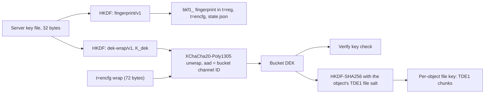

# butterDB storage model

How butterDB turns a Telegram account into S3 object storage: which channels
exist, which messages make an object, how writes commit, how overwrites and
deletes resolve, how encryption keys are held, and how the local projection
stays correct. Op grammar and field keys are in
[wire-format.md](wire-format.md). Table definitions are in
[schema.md](schema.md). Decisions are cited by ID from
[../decisions.md](../decisions.md).

This document replaces sections 3, 10, 11 and 14 of the legacy specification
([../butterDBCore.md](../butterDBCore.md)) for butterDB. Folders, dirents,
revisions, trash, shared drives, vault passwords, gallery and mount journals do
not exist in butterDB.

---

## 1. Vocabulary

| Term | Meaning |
| --- | --- |
| Deployment | One `butterdbd` data directory, one owner, one primary Telegram account, optionally one replica account (D1, D3, D12) |
| Deployment ID | 26 lowercase base32 characters (16 random bytes, RFC 4648 alphabet `a-z2-7`, no padding). Equal to `admin_meta.server_id` (admin-api.md §7.1) and carried as `dep` in the registry marker |
| Registry channel | Private broadcast channel holding the registry marker and bucket lifecycle and key ops (E1) |
| Bucket channel | Private broadcast channel holding the bodies and object ops of exactly one bucket (E1) |
| Body | A Telegram document message holding an object's stored bytes, caption `TDX1\|t=body\|...` |
| Put | A `t=put` text message that commits one version of one key (E2) |
| Version | The message ID of a put. Exposed as `version_id` and `X-Butterdb-Version-Id` |
| Tombstone | A `t=del` text message that removes a key (E4) |
| Job | A server-minted UUIDv4 (lowercase, 36 characters) naming one write. Every op a job sends carries it as `j` (E9) |
| Stored size | Bytes in the Telegram document. Ciphertext size when encrypted |
| Plaintext size | Bytes the client uploaded and reads back |
| Projection | `projection.db`: the replay log plus tables derived from it (E7) |
| Authority | A channel has authority when a full-history observation has committed and no repair is pending (section 9.3) |

---

## 2. Deployment and accounts

| Element | Count | Notes |
| --- | --- | --- |
| Owner | 1 | One admin, many access keys (D3) |
| Primary Telegram account | 1 | The owner's account, own `api_id` and `api_hash` (D2). Holds every registry and bucket channel |
| Replica Telegram account | 0 or 1 | Phase 12. Mirrors every bucket (A9). Must be a different Telegram user from the primary |
| Registry channel | 1 per account | Created at link time on the primary; created by `replica/account` on the replica |
| Bucket channel | 1 per live bucket per account | Created by `internal/buckets` |
| Server key file | 1 | 32 random bytes, mode `0600`, configured by path (A6). Never sent to Telegram |

### 2.1 Account binding

The first successful link stores the primary Telegram `user_id` (from
`users.getUsers(inputUserSelf)`) in `control.db` `telegram_accounts` (role
`primary`) and in `state.json` (`primary_user_id`). A later login as a
different user is refused with `telegram_account_mismatch` (admin-api.md §8.1).
The binding survives unlink. The replica row has role `replica` and its
`user_id` must differ from the primary's.

### 2.2 Telegram send rules for every message

| Rule | Value |
| --- | --- |
| Peer | The target channel as `inputPeerChannel{channel_id, access_hash}`. An access hash of 0 is never used; stale hashes are refreshed with `messages.getDialogs` (primary and archived folders) |
| Text ops | `messages.sendMessage`, `silent: true`, no parse mode, no entities, `no_webpage: true` |
| Bodies | `messages.sendMedia` with `inputMediaUploadedDocument{force_file: true, mime_type: "application/octet-stream"}`, attribute `documentAttributeFilename{file_name: "<job id>.bin"}`, no thumbnail, `silent: true`, caption = the `t=body` header |
| Random IDs | `StableRandomID(id, step)` from `internal/tgclient/send` (port of TDrive `backend/tgclient/idempotency.go`). Always non-zero |
| Rate | Every send passes the send-rate limiter and the write coordinator in `internal/tgclient/flow` (E10) |
| Deletion | `channels.deleteMessages` with at most 100 IDs per call (`limits.DeleteBatchSize`) |

`StableRandomID` steps:

| Op | id argument | step |
| --- | --- | --- |
| `t=body` | job ID | `body` |
| `t=put` | job ID | `put` |
| `t=del` | job ID | `del` |
| `t=bcreate`, `t=bcfg`, `t=bdel`, `t=encfg` | job ID | `bcreate`, `bcfg`, `bdel`, `encfg` |
| `t=reg` | deployment ID | `reg:<fv>` (for example `reg:1`) |

Replica sends use their own replica job ID with the same steps (phase 12).

---

## 3. Two planes and three trust layers

Ported from legacy section 3.

| Plane | Telegram form | Property |
| --- | --- | --- |
| Byte plane | Body documents in bucket channels | Immutable once sent |
| Operation plane | TDX1 text messages in registry and bucket channels | Append-only; ordered by message ID per channel |

A server with an empty data directory, the key file and the account can rebuild
every bucket, key and version by reading the registry channel and then every
bucket channel from message 1 (section 12).

| Layer | Authority | If destroyed |
| --- | --- | --- |
| Telegram messages | **Authoritative.** A locally failed write may already exist here | Data loss |
| `replay_log` (+ `replay_log_tamper`, `replay_log_rejects`, `deleted_messages`, `pending_message_cleanup`, `pending_channel_cleanup`) | First op observed per message with raw header, hash and message date; deletion evidence and queued Telegram deletions | Tamper evidence and first-seen captions are lost; queued deletions are re-derived only for superseded and tombstoned messages; rebuild from Telegram still works |
| Derived tables (`buckets`, `objects`, `object_tombstones`, `object_bodies`, `encryption_keys`, `registry_markers`, `projection_operations`) and sync state (`channels`, `initial_scan_spool`) | Rebuildable from the replay log with no network; sync state from Telegram | Rebuild |
| `control.db` jobs and queues | Local evidence of in-flight remote work | Orphaned bodies; uncertain commits unresolvable until sync |

`projection.db` is a projection but not disposable: deleting it loses
first-seen evidence. `control.db` is never rebuildable from Telegram.

---

## 4. The registry channel

### 4.1 Creation

Created once by `internal/buckets` right after the primary account is linked
and bound (plan.md flow 6.5 step 10).

1. `channels.createChannel{broadcast: true, title: "butterDB registry", about: "butterDB registry <deployment id>. Do not post, edit or delete messages here."}`.
2. Insert the `channels` row (kind `registry`, access hash from the result) and mark it authoritative without a scan, because the channel is empty (`InitialSyncEmptyChannel`, legacy section 11, which refuses when a replay log for the channel exists).
3. Send the marker `t=reg` (section 4.2) with `StableRandomID(deploymentID, "reg:1")`.
4. Project the marker through `ProjectFromOp`.
5. Write `state.json` (section 4.3) by atomic rename.

A crash between 1 and 5 leaves a registry channel with no `state.json`. The next
start finds no `state.json` and a linked account, and enters operator-confirmed
rediscovery (section 4.5), which offers the stray channel as a candidate.

### 4.2 The registry marker

```text
TDX1|t=reg|dep=6pzyoxbfwcf6ubwcq5gpvjg5c4|fv=1|mr=1|kfp=bkf1_3e9a0c51b7d24f6e8a01c9d2b3f4e5a6|uid=777000123|w=sys.setup|ts=1763000000
```

| Field | Meaning |
| --- | --- |
| `dep` | Deployment ID |
| `fv` | Format version the deployment writes (wire-format.md §7) |
| `mr` | Minimum reader format version needed to project this deployment correctly |
| `kfp` | Server key fingerprint, `bkf1_` + 32 hex (operations.md §5.2, section 8.1) |
| `uid` | Primary Telegram user ID |

The first `t=reg` in the registry channel is the deployment's identity. A later
`t=reg` is a **marker revision**, accepted only with the same `dep` and `uid`
and an `fv` and `mr` each greater than or equal to the current marker's. Its
`kfp` may differ only when written by `sys.rekey`: server key rotation
(security.md §5.6) and lost-key replacement (security.md §5.7) publish a
revision with the new fingerprint. A revision is how an upgraded binary raises
`fv` or `mr` (wire-format.md §7). Anything else is rejected with
`marker_conflict`. The newest accepted marker is the **current marker**; its
message ID is `registry_marker_msg_id` in `state.json`. Every accepted marker
is a `registry_markers` row (schema.md §4.6).

### 4.3 `state.json`

`<data_dir>/state.json`, mode `0600`, written by `internal/buckets` through
`internal/platform/secretfile` (temp file, fsync, rename, directory fsync).
operations.md §3.3 owns the file shape; this section owns what the registry
fields mean.

```json
{
  "version": 1,
  "registry_channel_id": 2208113456,
  "registry_access_hash": -6633117222220155911,
  "registry_marker_msg_id": 2,
  "primary_user_id": 777000123,
  "server_key_fingerprint": "bkf1_3e9a0c51b7d24f6e8a01c9d2b3f4e5a6"
}
```

| Field | Rule |
| --- | --- |
| `version` | File format version, `1` |
| `registry_channel_id`, `registry_access_hash` | The registry channel peer |
| `registry_marker_msg_id` | Message ID of the current marker |
| `primary_user_id` | Equals the current marker's `uid` and `telegram_accounts.user_id` for role `primary` |
| `server_key_fingerprint` | Equals the current marker's `kfp` and the loaded key file's fingerprint |

The deployment ID is not in `state.json`; it is the current marker's `dep`,
projected into `registry_markers`. The first marker takes its `dep` from
`admin_meta.server_id` (admin-api.md §7.1). When rediscovery (section 4.5)
adopts an existing registry on a host whose `control.db` was not restored,
`admin_meta.server_id` is overwritten with the adopted `dep` in the same step
that writes `state.json`; no device can be paired on such a host yet, so no
GUI keychain entry is orphaned. Unknown fields are tolerated on load and
preserved on rewrite (E17). The ops and probe channels are recorded in
`control.db` (operations.md §3.3), not here. A missing file is not an error
until an account is linked.

### 4.4 Startup verification

Two checkpoints of the startup order in operations.md §7.1 own these checks;
exit code 4 is operations.md §4.2's key and registry code, exit 5 its
incompatible-data-directory code. Stable reason codes go to the log and to
`GET /admin/v1/status`.

Local check, operations.md §7.1 step 7 (before any listener binds):

| Check | Reason code | Failure |
| --- | --- | --- |
| `state.json` loads; every field has its type | `state_invalid` | Exit 4 |
| No `state.json`, but `telegram_accounts` has a `primary` row | `registry_unknown` | Exit 4 with the hint to run `butterdbd setup` (rediscovery, section 4.5) |
| Loaded key fingerprint equals `server_key_fingerprint` (A6) | `kek_mismatch` | Exit 4 |
| The current `registry_markers` row, when present, has `msg_id = registry_marker_msg_id`, the same channel, `kfp = server_key_fingerprint` and `uid = primary_user_id` | `registry_marker_mismatch` | Exit 4 |
| That row's `mr` ≤ this binary's `wire.FormatVersion` | `format_too_new` | Exit 5; the operator upgrades the binary |
| The `channels` row of kind `registry`, when present, has `channel_id = registry_channel_id` | `projection_mismatch` | Exit 5; the operator runs `butterdbd rebuild --from-telegram` |

Remote check, operations.md §7.1 step 12 (once the primary run scope is
authorized, before the syncer starts):

| Check | Reason code | Failure |
| --- | --- | --- |
| Authorized user ID equals `primary_user_id` | `telegram_account_mismatch` | Graceful stop, exit 4 |
| `channels.getMessages(registry, [registry_marker_msg_id])` returns a text message whose header parses as `t=reg` | `registry_marker_missing` | Graceful stop, exit 4; rediscovery is the recovery |
| The SHA-256 of its trimmed header line equals `replay_log.first_seen_hash` for that message, when recorded; otherwise its `dep`, `uid` and `kfp` equal `state.json` | `registry_marker_mismatch` | Graceful stop, exit 4 |
| Its `mr` ≤ `wire.FormatVersion` | `format_too_new` | Graceful stop, exit 5 |

An unreachable Telegram leaves the remote check pending; the server stays
`syncing` and serves nothing Telegram-dependent (operations.md §7.2). Nothing
is repaired automatically.

### 4.5 Operator-confirmed rediscovery

Used when `state.json` is lost or its marker is missing. It runs inside
`butterdbd setup` on a TTY with the server stopped (process lock held), as
operations.md §10.5 step 2 describes, and is implemented by
`internal/syncer/reconcile` (phase 05). It is operator-confirmed: a wrong
choice would bind the deployment to another deployment's buckets.

1. `messages.getDialogs` over the primary and archived folders lists broadcast channels where the account is creator.
2. For each, `messages.getHistory` reads from the oldest message, at most 100 messages, to its first `t=reg`. A channel with one is a candidate; its marker revisions are then read through the whole channel to find the current marker (section 4.2).
3. Candidates whose current `kfp` differs from the loaded key's fingerprint, or whose `uid` differs from the authorized user, are listed as foreign and cannot be chosen. If every candidate is foreign, setup exits 4 (operations.md §10.5).
4. Each eligible candidate is printed with channel ID, title, creation date, `dep`, `fv`, `mr` and the count of live buckets from a registry scan.
5. The operator types the channel ID to adopt, even when there is one candidate. `--registry-channel <id>` supplies it non-interactively and still refuses a foreign channel. With no candidate at all, setup asks before creating a new registry (a fresh deployment, section 4.1).
6. Setup writes `admin_meta.server_id` (section 4.3), then `state.json` with the current marker's message ID. The next `serve` full-scans every channel from message 0 (section 9.2), or the operator runs `butterdbd rebuild --from-telegram` first (section 12.2).

---

## 5. Buckets

### 5.1 Bucket = channel

A bucket's durable identity is its **bucket channel ID**. The name is an
attribute. A deleted name can be reused; the new bucket gets a new channel.

| Attribute | Values | Source op |
| --- | --- | --- |
| `name` | S3 bucket naming rules (`internal/domain/bucket.BucketName`): 3–63 characters of `a-z 0-9 . -`, starts and ends with a letter or digit, no `..`, not an IPv4 address, no `xn--` prefix, no `-s3alias` or `--ol-s3` suffix | `t=bcreate` |
| `policy` | `private` \| `public-read` (D7) | `t=bcreate`, `t=bcfg` |
| `encryption_default` | `none` \| `tde1` (D11, A5) | `t=bcreate`, `t=bcfg` |
| `cache_max_age_seconds` | 0–31536000, default 3600 (A8) | `t=bcreate`, `t=bcfg` |
| Active encryption key | Newest `t=encfg` for the bucket channel | `t=encfg` |

At most `limits.MaxBuckets` (100) live buckets per deployment.

### 5.2 Create

Requires registry authority (section 9.3). Steps, in `internal/buckets` under
the registry write gate:

1. Validate the name and the limit; check no live bucket has the name.
2. Mint job ID `j`.
3. `channels.createChannel{broadcast: true, title: "butterDB bucket <name>", about: "butterDB bucket <name> in deployment <deployment id>. Do not post, edit or delete messages here."}`.
4. Insert the `channels` row (kind `bucket`) and mark it authoritative as an empty channel.
5. Send `t=bcreate` with `StableRandomID(j, "bcreate")` and project it through `ProjectFromOp`. **Commit.**
6. When `encryption_default` is `tde1`, send `t=encfg` (section 8.3) with a second job ID and `StableRandomID(j2, "encfg")`, and project it, before the call returns. A failure here leaves a valid bucket with no key; the first encrypted PUT creates it (section 8.3).

`channels.createChannel` has no random ID. If its outcome is unknown, or the
process stops between steps 3 and 6, an unreferenced channel titled
`butterDB bucket <name>` may exist. `internal/syncer/reconcile` lists such
channels (creator, title prefix `butterDB bucket `, about text naming this
deployment, not referenced by any `buckets` row) as orphan channels in the
status API. The owner deletes them; they are never deleted automatically.
Default (owner may change).

### 5.3 Configure

`t=bcfg` carries the **full** configuration (`pol`, `de`, `cma`), never a
delta, so last-writer-wins by message ID is exact. Switching
`encryption_default` to `tde1` on a bucket with no key first sends `t=encfg`.
Changing `encryption_default` affects new objects only.

### 5.4 Delete

S3 `DeleteBucket` semantics. Requires registry authority and the bucket's
authority.

1. Take the bucket's exclusive write gate (puts and deletes hold it shared).
2. Refuse with `409 bucket_not_empty` when `buckets.object_count > 0`, or when `control.db` has a non-terminal `upload_jobs` or `delete_jobs` row for the bucket channel. This is S3 `DeleteBucket` semantics; the S3 listener itself never deletes a bucket and answers `403 AccessDenied` (s3-api.md §6.4), so the check lives in `internal/buckets` and is reached through the admin API.
3. Abort every open `multipart_uploads` row for the bucket and remove its staging directory. Default (owner may change).
4. Send `t=bdel` to the registry with `StableRandomID(j, "bdel")`. **Commit.**
5. Project: the bucket row gets `deleted_msg_id`; the channel row becomes `deleted`; the bucket's `objects`, `object_tombstones`, `object_bodies`, `encryption_keys` and `pending_message_cleanup` rows are removed (the channel deletion removes every message at once); the keyring generation advances (claude.md invariant 7); a `pending_channel_cleanup` row is queued.
6. `channels.deleteChannel` on the bucket channel. On failure the row stays queued for `ingest/sweeper`, which retries with backoff (1 min doubling to 1 h).

Tombstones do not count: a bucket whose keys were all deleted is empty.

`channels.deleteChannel` is not in the `tgclient/rpc` list of plan.md §5;
phase 04 adds it to that package.

---

## 6. Objects

### 6.1 Identity

| Concept | Value |
| --- | --- |
| Object address | `(bucket channel ID, key)`. Keys are UTF-8, 1–1024 bytes (`limits.MaxKeyBytes`), compared and ordered as raw bytes |
| Version | The put message ID. One live version per key |
| Body reference | The put's `bm`. `bm = 0` only for an unencrypted zero-byte object, which has no body |
| `LastModified` | The put message's Telegram date (`replay_log.msg_date`), never a local clock (claude.md invariant 10) |
| `ETag` | The put's `et`, quoted on the wire |

A body never creates an object. An object exists only through an applied put
(claude.md invariant 9).

### 6.2 Commit protocol: body then put

The put message is the commit boundary (E2, D8). Steps and job states, owned by
`internal/ingest/put`; `control.db` `upload_jobs` holds the state:

| Step | Action | Job state after |
| --- | --- | --- |
| 1 | Validate key and metadata; `wire.FitsPut` with the classification of wire-format.md §6.3; resolve encryption (section 8.4); compute stored size from the declared length; refuse over `limits.MaxStoredObjectBytes` | none |
| 2 | Spool the body to `spool/<job id>.plain`, computing MD5 and SHA-256 in one pass; fsync | none |
| 3 | Insert the job row with sizes, hashes, metadata, `base_put_msg_id` (the key's current version, 0 if absent), and for encrypted jobs a fresh 16-byte file salt and 20-byte nonce prefix (E8). Commit | `prepared` |
| 4 | Encrypted: seal into `spool/<job id>.sealed` with the persisted salt and prefix | `prepared` |
| 5 | Set state, commit, then `SendFileIdempotent` with caption `TDX1\|t=body\|j=<j>\|sz=<stored>[\|enc=1]` and `StableRandomID(j, "body")` | `body_sending` |
| 6 | Record `body_msg_id`; project the body observation (`object_bodies` row) | `body_sent` |
| 7 | Format the `t=put` text, store it in `put_header`, set state, commit, **then** send with `SendControlIdempotent` and `StableRandomID(j, "put")` | `put_attempted` |
| 8 | Record `put_msg_id`; project through `ProjectFromOp`. **Commit is now durable in Telegram** | `committed` |
| 9 | Respond (D8). Delete superseded messages (section 6.4). Remove spool files | `committed` |

Zero-byte unencrypted objects skip steps 4–6: the put carries `bm=0`, `sz=0`.

Ported rules from legacy section 14:

| Rule | Detail |
| --- | --- |
| An error does not prove a send failed | A send can return a message ID and an error. A non-zero ID means the message exists; it is recorded and never resent |
| Plan by stored size | Every size check uses `format.CiphertextSize` for encrypted objects (claude.md invariant 3) |
| Rewind, never resume | Retries rewind the `io.ReadSeeker` body to offset 0 and reuse the same random ID |
| Two chunkings | One object is one Telegram message of up to 1900 MiB; gotd uploads it in 512 KiB parts (`uploader.MaximumPartSize`), 8 in flight (`UploadThreads`). A transport retry resends one 512 KiB part, not the object |
| Flood waits | Every server-directed `FLOOD_WAIT` is honoured while the request budget lasts; past it the request answers `503 SlowDown` (A7) |
| Process-wide upload slots | `UploadThreads` slots shared FIFO by all jobs |
| Put attempted before send | State `put_attempted` is committed before the put send, never after (claude.md invariant 4) |

### 6.3 Uncertain outcomes and resumption

| Job state | Meaning | Sweeper action |
| --- | --- | --- |
| `prepared` | Nothing sent | After a crash: `aborted`, spool removed |
| `body_sending` | Body may exist | Wait for one completed sync pass of the bucket channel that **started after** `updated_at`; then look up `object_bodies` by `job_id`. Found: `body_sent`. Not found: `aborted` |
| `uncertain_body` | Body send outcome unknown after the budget | Same as `body_sending` |
| `body_sent` | Body exists, no commit | Resume at step 7 only under the version guard below; otherwise `aborted` and the body is queued `orphan_body` |
| `put_attempted`, `uncertain_put` | Commit may exist | Wait for a completed sync pass started after `updated_at`, then check `projection_operations` for `(channel, j, 'put')`. Found: `committed` with that message ID. Not found: resend the stored `put_header` with the same random ID only under the version guard; otherwise `aborted` and the body is queued `orphan_body` |
| `committed`, `aborted` | Terminal | Pruned after 7 days |

**Version guard.** A job resumed after its request has returned (crash, budget
exhaustion, client gone) may send its put, or a delete job its tombstone, only
if the key's projected version still equals the job's `base_put_msg_id` (for
delete jobs, `target_put_msg_id`). Otherwise a newer write committed in between,
and resuming would let stale content win last-writer-wins. The guard is checked
in the same short `projection.db` read that precedes the send; the per-key
write lock (section 6.6) closes the remaining race inside the process.

Orphan bodies: an `object_bodies` row older than 24 hours
(`limits.OrphanBodyGrace`, Default (owner may change)) that no live object
references and no non-terminal job owns is queued for deletion with reason
`orphan_body`. Bodies sent by other writers are covered the same way.

### 6.4 Overwrite: last writer wins

For one key, the put with the highest message ID is the object (E3, claude.md
invariant 13). When a put applies:

| Situation at apply time | Result | Cleanup queued |
| --- | --- | --- |
| No current version, no tombstone above the put | Put becomes the object | none |
| Current version `V` < put `M` | Put replaces `V` | `V`'s put and body, reason `superseded` |
| Current version `V` > put `M` | Put is superseded on arrival; outcome `superseded` | `M`'s put and body, reason `superseded` |
| Tombstone with message ID > `M` | Put is blocked; outcome `superseded` | `M`'s put and body, reason `blocked` |
| A put with the same `j` already applied at another message ID | `duplicate_op` reject | `M`'s put message only, reason `duplicate` (the body is shared with the first put) |
| `M` or its `bm` is in `deleted_messages` | Put is gone: it supersedes older versions but creates no row | older version's messages, reason `superseded` |

Cleanup rows are inserted in the projection transaction that applies the
put. Superseded messages are deleted only after the new put is committed and
projected. No cleanup row is ever queued for a message ID that is the
`put_msg_id` or `body_msg_id` of a live object, and the cleanup worker checks
this again before each batch.

The rules are order-independent: applying the same set of puts and
tombstones in any order yields the same `objects`, `object_tombstones` and
cleanup set. Per-key repair (section 9.4) relies on this and the rebuild
equivalence test proves it.

### 6.5 Delete: tombstone, then batches of 100

`internal/ingest/remove`, with `control.db` `delete_jobs` holding state:

| Step | Action | Job state after |
| --- | --- | --- |
| 1 | Load the key's current version. Missing: `204 No Content`, nothing sent | none |
| 2 | Insert the job with `target_put_msg_id`. Commit | `prepared` |
| 3 | Format `t=del` (key, `pv` = target version, `w`, `ts`), store it in `del_header`, set state, commit, send with `StableRandomID(j, "del")` | `del_attempted` |
| 4 | Project: the tombstone row keeps the highest `del_msg_id`; a current version below it is removed and its put and body are queued with reason `deleted`. **Commit** | `committed` |
| 5 | `channels.deleteMessages` in batches of 100 (`limits.DeleteBatchSize`). Confirmed IDs leave `pending_message_cleanup` and enter `deleted_messages` with source `cleanup` | `committed` |

An unknown outcome at step 3 sets `uncertain_del` and answers `503 SlowDown`;
the sweeper resolves it like `uncertain_put` (section 6.3): found in
`projection_operations` means `committed`, otherwise the stored `del_header` is
resent with the same random ID only under the version guard, else `aborted`.

A failed batch stays queued for `ingest/sweeper`; the response is unchanged.
The tombstone blocks resurrection: any put with a lower message ID for the key,
arriving late or replayed in a rebuild, is blocked (E4, claude.md invariant
14). A put with a higher message ID is unaffected. The tombstone message itself
is kept (plan.md risk R11).

`DeleteObjects` runs the steps per key with one tombstone per key and merges
the message deletions across keys into shared batches of 100.

### 6.6 Concurrency inside the process

| Lock | Scope | Held by |
| --- | --- | --- |
| Bucket write gate | Per bucket channel, read-write | Puts and deletes shared; bucket delete exclusive |
| Key lock | Per `(bucket channel, key)`, exclusive | From the conditional-write check (`If-Match`, `If-None-Match`) through step 8 of 6.2 or step 4 of 6.5. Only covers that window, never the body upload |
| Registry write gate | Registry channel | Bucket create, configure, delete and `t=encfg` |

Two puts to one key from different requests still race in Telegram; the higher
message ID wins. The key lock only makes conditional writes and the version
guard exact within one process.

---

## 7. Size limits

All ceilings live in `internal/domain/limits`.

| Constant | Value | Meaning |
| --- | --- | --- |
| `MaxStoredObjectBytes` | `1900 * 1024 * 1024` = 1,992,294,400 | Largest stored body (D9). Ciphertext counts |
| `MaxEncryptedPlaintextBytes` | 1,991,808,062 | Largest plaintext that fits once sealed |
| `MaxKeyBytes` | 1024 | Key length in UTF-8 bytes |
| `MaxUserMetadataBytes` | 2048 | Sum of `x-amz-meta-*` names and values, S3's limit |
| `MaxSystemHeaderBytes` | 1024 | Each stored system header value (s3-api.md §8.1, wire-format.md §5.2.2) |
| `MaxContentTypeBytes` | 1024 | s3-api.md §8.1 |
| `MaxPutFixedChars` | 512 | Ceiling on the put op without key, content type and metadata; s3-api.md §8.7 relies on it (wire-format.md §6.2) |
| `MaxPutOpChars` | 4096 | Telegram text message limit (wire-format.md §6) |
| `MaxCaptionChars` | 1024 | Telegram caption limit |
| `DeleteBatchSize` | 100 | IDs per `channels.deleteMessages` |
| `MaxBuckets` | 100 | Live buckets per deployment |
| `MaxDeleteObjectsKeys` | 1000 | Keys per `DeleteObjects` |
| `MinMultipartPartBytes` | `5 * 1024 * 1024` | Every S3 part but the last |
| `MaxMultipartParts` | 10000 | S3 part numbers 1–10000 |
| `MaxCacheMaxAgeSeconds` | 31536000 | Bucket `cache_max_age_seconds` ceiling |
| `OrphanBodyGrace` | 24 h | Section 6.3 |
| `IdempotencyTTL` | 24 h | Idempotency record lifetime |

### 7.1 Arithmetic

TDE1 (legacy section 12) for plaintext length `L`, chunk `C = 65536`:

```
CiphertextSize(L) = 50 + L + 16 * (floor(L / 65536) + 1)
```

| Plaintext | Stored |
| ---: | ---: |
| 0 | 66 |
| 65,536 | 65,618 |
| 734,003 | 734,245 |
| 1,991,808,062 | 1,992,294,400 (exactly the ceiling: 30,393 chunks, overhead 486,338 bytes) |
| 1,991,808,063 | 1,992,294,401 (rejected) |

An encrypted upload just under 1900 MiB of plaintext is rejected with
`EntityTooLarge` (S3, 400) / `object_too_large` (admin API, 413) before any
byte is spooled, from the declared length. Unencrypted objects may use the full
1,992,294,400 bytes. Telegram's own non-premium document limit is 2000 MiB, so
the ceiling leaves 100 MiB of margin.

Legacy `MinResumableUploadBytes`, `LargeFileMaxBytes` and `MaxParts` are not
used: there is no TDX1 multipart (D9).

### 7.2 S3 multipart upload

S3 multipart parts are staged on local disk by `internal/ingest/multipartstage`
and assembled into one body (D9). The running sum of part sizes, converted to
stored size when the upload is encrypted, is checked against
`MaxStoredObjectBytes` at every `UploadPart`; the excess part fails with
`EntityTooLarge`. Nothing reaches Telegram before `CompleteMultipartUpload`.

---

## 8. Encryption

### 8.1 Model

| Element | Definition |
| --- | --- |
| KEK source | The server key file: 32 random bytes stored as 64 lowercase hex characters (operations.md §5.1, A6). Any other content, or permissions wider than `0600`, fails `check-config` and startup |
| Subkeys | Every subkey is `HKDF-SHA256(ikm = server key, salt = empty, info)`, 32 bytes, derived by `internal/crypto/keyring`. security.md §5.2 owns the list: `K_dek` (`butterdb/keyring/dek-wrap/v1`), `K_ak`, `K_admin`, `K_session`, `K_snapshot` |
| Key fingerprint | `bkf1_` + lowercase hex of the first 16 bytes of the subkey with info `butterdb/keyring/fingerprint/v1` (operations.md §5.2). Carried as `kfp` in `t=reg` and `t=encfg`, and stored in `state.json` |
| Bucket DEK | 32 random bytes per key ID per bucket |
| Key ID (`kid`) | 8 random bytes as 16 lowercase hex characters |
| Wrapped DEK | `nonce(24) ‖ XChaCha20-Poly1305.Seal(K_dek, nonce, DEK, aad)`, 72 bytes. `aad = "butterdb/dek/v1|" + decimal(bucket channel ID)` binds the wrapped key to its bucket (security.md §5.2, `keyring.WrapDEK`) |
| Key check | `nonce(24) ‖ XChaCha20-Poly1305.Seal(DEK, nonce, "butterDB-key-check-v1", nil)`, 24 + 21 + 16 = 61 bytes |
| Object encryption | TDE1 byte for byte (legacy section 12) with the DEK as TDE1's master key; per-object file salt and nonce prefix; HKDF info `butterDB/file/v1` |

The legacy key-check envelope is 59 bytes because TDrive's plaintext
`tdrive-key-check-v1` is 19 bytes (TDrive `backend/crypto/vault.go`). butterDB's
`butterDB-key-check-v1` is 21 bytes, so the envelope is 61 bytes. TDrive's HKDF
info is `tdrive/file/v1` (`backend/crypto/stream.go`); butterDB uses
`butterDB/file/v1`. TDrive test vectors that depend on either string are
regenerated, never copied.

### 8.2 Key hierarchy



### 8.3 `t=encfg`

Written to the registry channel by `internal/buckets` through
`internal/crypto/keyring`, under the registry write gate:

| When | Trigger |
| --- | --- |
| Bucket create with `encryption_default = tde1` | Section 5.2 |
| `t=bcfg` switching to `tde1` on a bucket with no key | Section 5.3 |
| First encrypted PUT on a bucket with no key | `ingest/put` asks `buckets.EnsureKey` before step 3 of 6.2 |

The `t=encfg` must be committed and projected before any body encrypted under
its DEK is sent. The projection keeps one `encryption_keys` row per
`(bucket channel, kid)` (schema.md §4.9):

| Situation when a `t=encfg` applies | Result |
| --- | --- |
| No row for `(bc, kid)` | Insert with `cv`, `wrap`, `check`, `kfp`; `first_msg_id` = `msg_id` = this message |
| Row exists with a lower `cv` | Re-wrap of the same DEK (security.md §5.6 step 3): replace `wrap`, `check`, `kfp`, `cv`, `msg_id`; keep `first_msg_id`. The superseded registry message is deleted by the rotation procedure, not by the projector |
| Row exists with an equal or higher `cv` | `duplicate_op` reject |

Several keys for one bucket are valid (for example two `EnsureKey` calls racing
across a crash, or a new key minted by lost-key replacement, security.md §5.7).
The **active** key, used for new encrypted objects, is the row with the highest
`first_msg_id` among the bucket's rows whose `kfp` equals the current marker's
`kfp`. A bucket with rows but none matching has no active key; the next
encrypted write mints one through `EnsureKey`. Every encrypted put names its
`kid`, so objects stay readable under any key the bucket holds whose `kfp`
matches the loaded server key. The projector does not reject a `kfp` that
differs from the current marker's: during rotation the re-wrapped `t=encfg`
messages are published before the marker revision (security.md §5.6 steps 3 and
4), and the keyring simply cannot unwrap rows sealed under another key.

Unwrap order: unwrap with `K_dek` and the AAD, then verify the key check. Either
failure returns `errs.ErrKeyUnavailable`, which never says which step failed
(security.md §5.2); the log line carries a reason field `unwrap` or `check` and
the bucket channel and `kid`, and `butterdb_key_errors_total` is incremented.
Reads of that key's objects fail as s3-api.md maps `ErrKeyUnavailable`. Every
DEK and file-key copy is cleared on every return path (claude.md invariant 6).

### 8.4 Per-request header versus bucket default

| Request | Encrypt? |
| --- | --- |
| S3 `x-amz-server-side-encryption: AES256` | Yes |
| S3 `x-amz-server-side-encryption: aws:kms` or `aws:kms:dsse`, or any SSE-C header | `400 InvalidArgument` (s3-api.md owns the response) |
| S3 header absent | The bucket's `encryption_default` |
| Admin API `X-Butterdb-Encryption: tde1` / `none` | Yes / No (admin-api.md §12.4) |
| Admin API header absent | The bucket's `encryption_default` |
| `CopyObject` | The destination request's header, else the destination bucket default |
| `CompleteMultipartUpload` | The value resolved at `CreateMultipartUpload` |

`AES256` is the label S3 SDKs send; the cipher is TDE1's XChaCha20-Poly1305.
Responses for encrypted objects carry `x-amz-server-side-encryption: AES256`.

### 8.5 Determinism under retry (E8)

The file salt and nonce prefix are generated at step 3 of 6.2 and stored in
`upload_jobs` before the first send. Sealing is a pure function of
(plaintext, DEK, salt, prefix), so a resumed job produces byte-identical
ciphertext and the same stored size. `internal/crypto/stream` therefore takes
the salt and prefix as inputs:

```go
func EncryptStream(dst io.Writer, src io.Reader, dek []byte, plaintextSize int64, fileSalt [16]byte, noncePrefix [20]byte) error
```

### 8.6 Startup key check

The local startup check (section 4.4) compares the key file fingerprint with
`state.json` and the current marker; the remote check compares it with the
marker in Telegram. After registry sync, `internal/crypto/keyring` tries to
unwrap the active key of every encrypted bucket and reports each failure in
`GET /admin/v1/status` without stopping the server. A deployment whose key
file is lost cannot decrypt any encrypted object and cannot read stored
access-key secrets (decisions.md section 5, security.md §5.7).

---

## 9. Sync and authority

Ported from legacy section 11 with butterDB's channel layout.

### 9.1 Per-channel gate and fields

Initial, incremental, authoritative and reconciliation work for one channel
serialize behind one gate per channel. A queued caller can cancel its own
admission without disturbing the active pass.

| Field (`channels`) | Means | Does not mean |
| --- | --- | --- |
| `last_synced_msg` | Contiguous scanned boundary, including messages that carry no op | The highest message projected |
| `pts` | `updates.getChannelDifference` cursor | Anything about coverage |
| `initial_sync_done` | A full-history observation committed | Up to date |
| `needs_projection_rebuild` | A full-channel rebuild is pending (only after a failed rebuild or a schema-driven rebuild; per-key repair never sets it) | A corrupt database |

### 9.2 Order

1. The registry channel syncs first and must reach authority.
2. Bucket channels named by live `buckets` rows sync next, each independently. A `t=bcreate` seen during registry sync inserts the bucket's `channels` row with `access_hash = 0`; the syncer fills the hash from `messages.getDialogs` before its first read.
3. The S3 listener answers `503 ServiceUnavailable` until every bucket channel's first difference reaches `Final` (plan.md section 2.7).

Incremental sync, full history scan (empty page proves exhaustion; spool in
short transactions; apply atomically), the retry budgets (flood-wait retries
plus four transport retries, independent) and live signals (debounce 750 ms,
backstop 5 min, per-pass timeout 2 min, sequential flushes) follow legacy
section 11 unchanged. The scan spool is `initial_scan_spool` in `projection.db` (schema.md §4.13).

### 9.3 Authority gates sends

| Write | Requires authority on |
| --- | --- |
| `t=bcreate`, `t=bcfg`, `t=bdel`, `t=encfg` | Registry channel |
| `t=body`, `t=put`, `t=del` for bucket B | Registry channel **and** B's channel |

A bucket without authority (scan in progress, rebuild pending) rejects writes
for **that bucket only** with `503 SlowDown` and `Retry-After: 5`; other
buckets keep working. Reads are served from the projection regardless.
`EnsureAuthoritative` runs an incremental refresh only when authority exists
and no rebuild is pending; otherwise it scans from message 0.

Registry authority matters for encryption the way the legacy vault did:
"no `t=encfg` seen yet" means "no key" only after the registry's complete
history has been observed. A put that would mint a second key because the
first was not yet synced is prevented by this gate.

### 9.4 Per-key ordering repair (E6)

Trigger: a put or tombstone for key K at message M is being recorded, and
`replay_log` already holds an op for K in the same channel with a message ID
greater than M. Action, inside the same transaction that records M:

1. Remove K's `objects` and `object_tombstones` rows and back their sizes out of the bucket counters.
2. Replay every `replay_log` row for `(channel, K)` in ascending message ID, re-parsing `raw_header`, through the put and del appliers.
3. Upsert `projection_operations` outcomes; cleanup rows are inserted with `INSERT OR IGNORE`.

Only key K is touched. Nothing else in the channel is rebuilt. With the
order-independent rules of section 6.4 the result equals an in-order apply;
the repair exists so that an applier bug surfaces as a rebuild-equivalence
test failure rather than divergent state. `TestRepairKeyEqualsInOrderApply`
asserts it.

The common source of out-of-order arrival is the server itself: two
concurrent PUTs to one key project their receipts in completion order, not in
message ID order.

### 9.5 Deletion reconciliation

| Source | Handling |
| --- | --- |
| `updates.getChannelDifference` other-updates with deleted message IDs | After the page transaction, record each ID in `deleted_messages` (source `external` unless a cleanup row already recorded it). If an ID is the put or body of a live object, remove that object row |
| History fallback | `internal/syncer/reconcile` checks the existence of every live object's put and body with `channels.getMessages` in batches of 100, at most once per channel per 24 h (`channels.last_reconciled_at`), and records missing IDs the same way with source `reconcile` |
| Own cleanup | Confirmed `deleteMessages` IDs are recorded with source `cleanup` |

`deleted_messages` is preserved across rebuilds, so a rebuild never revives an
object whose messages are gone.

### 9.6 Tamper

The first op observed for `(channel_id, msg_id)` stays canonical. A later
observation with a different header hash writes `replay_log_tamper` and changes
nothing else (legacy section 10).

---

## 10. The projector

`internal/projection/log` is the single door (claude.md invariant 1). Inputs
per observed message:

```go
type Observed struct {
	ChannelID   int64
	MsgID       int64
	MsgDate     int64
	IsDocument  bool
	ActorUserID int64
	RawText     string
}

func ProjectFromOp(ctx context.Context, w Writer, obs Observed) (Outcome, error)
func ProjectFromOpTx(ctx context.Context, tx Tx, obs Observed) (Outcome, error)
```

`RawText` is the message text, or the document caption when `IsDocument`. The
projector parses it with `wire.Parse`, so parse classification lives in one
place. Default (owner may change) for the exact Go shape; phase 03's prelude
commits it.

| `wire.HasPrefix` and parse result | Effect |
| --- | --- |
| `HasPrefix` false | Not a butterDB message, whatever `Parse` says. Nothing recorded; the watermark still advances |
| `HasPrefix` true and `ErrWireBadVersion`, `ErrWireMalformed` or `ErrWireTooLong` | `replay_log_rejects` row with code `malformed` and the raw header; no `replay_log` row |
| `ErrWireUnknownOp` | `replay_log` row with the raw header and `op_type` = the `t` value, plus a `replay_log_rejects` row `unknown_op` (E5) |
| A known op | `replay_log` row, then the op's `Applier` |

Applier rejects are skippable: they are recorded in `replay_log_rejects` and,
for ops with a `j`, in `projection_operations` with outcome `rejected`, and the
page continues. Database errors are fatal and roll the transaction back.

| Reject code | Op | Cause |
| --- | --- | --- |
| `malformed` | any | TDX1 header present but not parseable |
| `unknown_op` | any | `t` not known to this binary (E5) |
| `wrong_channel` | any | Registry op in a bucket channel or the reverse |
| `wrong_carrier` | any | `t=body` not on a document, or any other op on a document |
| `bucket_not_found` | `put`, `del`, `body`, `bcfg`, `bdel`, `encfg` | Bucket channel unknown or deleted, or `b` does not match the bucket's name |
| `bucket_name_invalid` | `bcreate` | Fails `internal/domain/bucket` rules |
| `bucket_exists` | `bcreate` | A live bucket already has the name, or the channel ID was used by any bucket before |
| `bad_body_ref` | `put` | `bm` ≥ the put's message ID |
| `size_mismatch` | `put` | `enc=1` and `sz ≠ CiphertextSize(psz)`, or `sz > MaxStoredObjectBytes` |
| `duplicate_op` | `put`, `del`, `bcreate`, `bcfg`, `bdel`, `encfg` | Same `j` and op type already recorded at another message ID; for `encfg`, `(bc, kid)` already present with an equal or higher `cv` (section 8.3) |
| `marker_conflict` | `reg` | Section 4.2 |

Outcomes recorded in `projection_operations`: `applied`, `superseded`
(section 6.4), `rejected`.

Rebuild (`internal/projection/rebuild`) follows legacy section 10 with these
changes: it re-parses `raw_header` instead of trusting `op_payload_json`, so a
newer binary applies ops that an older one recorded as `unknown_op`; it clears
`replay_log_rejects` rows for messages present in `replay_log` and re-records
the rejects it meets; it preserves `replay_log`, `replay_log_tamper`,
`deleted_messages`, parse-failure rejects and both cleanup queues; it runs per
channel in keyset batches of 256 in one transaction, registry channel first.

---

## 11. What Telegram can see

TDE1 protects object bytes only. The operation plane is plaintext TDX1.

| Visible to Telegram (and to anyone with the account) | Even for encrypted buckets? |
| --- | --- |
| Bucket names, policies, default encryption, cache max-age | Yes |
| Object keys | Yes (`k` in every put and tombstone) |
| Stored and plaintext sizes | Yes (`sz`, `psz`) |
| Content type, user metadata, stored system headers | Yes (`ct`, `m.<name>`, `s.<name>`) |
| MD5 ETag and SHA-256 of the plaintext | Yes (`et`, `h`). Enables confirmation of a guessed plaintext |
| Write times, writer (`w`: access key ID or device ID) | Yes |
| Overwrite and delete history (until cleanup deletes messages) | Yes |
| Wrapped DEKs and key checks | Yes, useless without the server key file |
| Server key fingerprint, deployment ID, primary user ID | Yes |
| Object bytes | Plaintext buckets: yes. Encrypted objects: no |

Not protected (legacy section 12, restated): TDX1 headers are not
authenticated by TDE1; substituting one valid ciphertext for another within
the same bucket and key ID is outside the threat model. security.md carries
the user-facing statement.

---

## 12. Rebuild paths

### 12.1 From the replay log

`butterdbd rebuild`: no network. Re-derives every table from `replay_log`
(section 10). Used after an applier fix or a schema change.

### 12.2 From Telegram

`butterdbd rebuild --from-telegram`: requires `state.json` (or rediscovery,
section 4.5) and the key file.

Server stopped (process lock). operations.md §10.3 owns the command; the
procedure is:

1. Create `tmp/projection.rebuild.db` and apply the projection migrations.
2. Insert the registry `channels` row from `state.json`; full-scan it to authority (section 9.2).
3. For each live bucket, resolve the access hash from dialogs and full-scan the bucket channel to authority.
4. Copy `deleted_messages` and both cleanup queues from the old file when it is readable, so no deleted object revives and no queued deletion is forgotten.
5. Verify every active `t=encfg` unwraps with the key file. Failures are listed, not fatal.
6. Rename the live file to `projection.db.pre-rebuild-<UTC timestamp>` and the new file into place.

`--bucket <name>` rescans one bucket channel into the live `projection.db`,
replacing that bucket's rows in one transaction.

`control.db` is untouched. Jobs that referenced message IDs now absent are
resolved by the sweeper's normal rules.

---

## 13. Failure modes

| Failure or observation | Persisted consequence | Recovery |
| --- | --- | --- |
| Body send fails before any byte reached Telegram | Job `aborted`, spool removed | Client retries |
| Body send outcome unknown | Job `uncertain_body`; client gets `503 SlowDown` | Sweeper resolves through sync by `j` |
| Put send outcome unknown | Job `uncertain_put`; `503 SlowDown` | Sync ingests the put if it landed; otherwise resend under the version guard, else abort |
| Put accepted, projection fails | Telegram holds the commit; job `put_attempted` | Never resend blind; sync ingests the message; sweeper marks `committed` |
| Crash after a body, before the put | Job `body_sent` | Resume under the version guard, else `orphan_body` cleanup |
| Superseded or tombstoned messages fail to delete | `pending_message_cleanup` rows remain | Sweeper retries; projection already correct |
| A message deleted in the Telegram app | `deleted_messages` row; the object disappears if it was live | None; the owner restores from the replica (phase 12) |
| A TDX1 caption or text edited in the Telegram app | `replay_log_tamper` row; first op stays canonical | Inspect; nothing changes |
| Unknown op from a newer binary | `unknown_op` reject; raw header kept (E5) | Upgrade, then `butterdbd rebuild` |
| Marker `mr` above this binary's format version | Startup refused | Upgrade |
| Out-of-order put or tombstone for one key | Per-key repair in the same transaction (E6) | None needed |
| Full scan interrupted | Spool rows remain; no authority | Next scan clears and rereads |
| Bucket channel creation outcome unknown | Possible orphan channel | Listed by reconcile; owner deletes |
| Bucket channel deletion fails after `t=bdel` | `pending_channel_cleanup` row | Sweeper retries |
| Server key file replaced | Startup refused, exit 4 (`kek_mismatch`) | Restore the original key file; a lost key follows security.md §5.7 |
| `state.json` lost | Startup enters rediscovery | Operator confirms the registry channel |
| `projection.db` lost | None in Telegram | `butterdbd rebuild --from-telegram` |
| `control.db` lost | Access keys, admin devices, jobs and idempotency lost | Restore from snapshot; re-pair the GUI with `butterdbd admin-token`; in-flight jobs become orphan bodies cleaned by the grace rule |

---

## 14. Invariants

Each is asserted by a named test in the owning phase.

1. A body never creates an object; only an applied put does.
2. The put message ID is the version. For one key, the highest put message ID not blocked by a higher tombstone is the object.
3. A put's `bm` is lower than the put's own message ID.
4. Cleanup never queues a message that is the put or body of a live object.
5. Superseded messages are deleted only after the superseding put is committed and projected.
6. A tombstone is sent and projected before any `deleteMessages` for the key.
7. A resumed job sends its put or tombstone only if the key's version equals the job's recorded base version.
8. The file salt and nonce prefix are persisted before the first body send and reused on every retry.
9. Size checks use stored size; encrypted objects above 1,991,808,062 plaintext bytes are refused before spooling.
10. `t=encfg` for a key is projected before any body sealed under that key is sent.
11. Writes to bucket B require registry authority and B's authority; a bucket without authority blocks only itself.
12. Per-key repair replays only that key and runs in the same transaction as the triggering op.
13. An unknown op is recorded with its raw header and skipped, never fatal and never dropped.
14. Startup serves nothing Telegram-dependent until the registry marker matches `state.json` and the key fingerprint.
15. Every DEK, file key and server-key copy is cleared on every return path.
16. No SQLite transaction is open across a Telegram call or an HTTP body read.

---

## 15. TDrive sources

All paths are relative to the TDrive repository and were confirmed to exist.

| Concern | TDrive file |
| --- | --- |
| TDX1 parse and format | `backend/projection/wire.go` |
| Single projection door, tamper | `backend/projection/log.go` |
| Rebuild | `backend/projection/rebuild.go` |
| Deletion reconciliation | `backend/projection/reconcile.go` |
| Managed message lookup | `backend/projection/managed_messages.go` |
| Sync, ordering repair marker | `backend/sync/sync.go`, `backend/sync/difference.go`, `backend/sync/initial_scan_spool.go` |
| Stable random IDs | `backend/tgclient/idempotency.go` |
| Channel creation | `backend/tgclient/personal_drive.go` |
| Delete batch of 100 | `backend/mountwrite/hard_delete.go` (`hardDeleteBatchSize`) |
| Stored-size limit | `backend/services/file/limits.go` (`MaxPartBytes`) |
| TDE1 | `backend/crypto/stream.go`, `backend/crypto/random_access.go` |
| Key wrap and key check pattern | `backend/crypto/vault.go` |
| SQLite tuning | `backend/storage_sqlite.go` |
